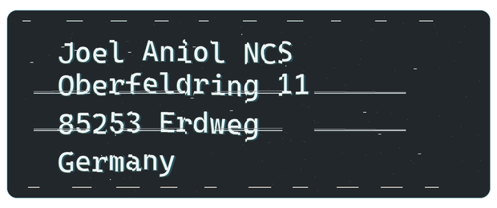

# End User License Agreement / Endnutzer-Lizenzvereinbarung

*Version 1.2-alpha · Revision: October 12, 2026 / Stand: 12. Oktober 2026*

> [!IMPORTANT]
> **Upcoming revised EULA — not yet shipped in a published setup.** This page reproduces the text prepared for a future installer. It does not show that existing users have accepted it or retrospectively change their contracts. The validly agreed version governs. This is a working revision without completed legal review.
>
> **Kommende überarbeitete EULA — noch nicht in einem veröffentlichten Setup ausgeliefert.** Diese Seite gibt die für einen künftigen Installer vorbereitete Fassung wieder. Sie belegt keine Zustimmung bestehender Nutzer und ändert deren Verträge nicht rückwirkend. Maßgeblich ist die wirksam vereinbarte Fassung. Es handelt sich um eine Arbeitsfassung ohne abgeschlossene anwaltliche Prüfung.

[English](#english) · [Deutsch](#deutsch) · [Contact / Kontakt](#contact)

## Contact / Kontakt

**Licensor / Lizenzgeber: Joel Aniol**

Postal address / Postanschrift:

Email / E-Mail: **joel@gnetwork.eu**. An accessible text version of the postal details is available on request / Eine zugängliche Textfassung der postalischen Angaben ist auf Anfrage erhältlich.

## English

NOVA AI WORKSPACE — END USER LICENSE AGREEMENT (EULA) Version 1.2-alpha · Revision date: October 12, 2026

### 1. PARTIES AND SCOPE

This End User License Agreement ("EULA") is concluded between Joel Aniol (contact: joel@gnetwork.eu · aniol-consulting.com · nova-cognitive.com; "Licensor") and the person or organization installing or using Nova AI Workspace ("User"). It supplements the terms agreed at purchase or order; individual agreements take precedence. Mandatory consumer rights remain unaffected. The postal address and contact details are published at https://github.com/joelaniol/nova/blob/main/EULA.md#contact where the postal address is displayed as an image.

### 2. PRODUCT AND ALPHA STATUS

Nova AI Workspace is an AI agent browser framework for Windows. The software is in its ALPHA PHASE: it is intended for evaluation and early adoption. It is not intended for environments where malfunctions can cause significant personal injury or property or financial damage — in particular medical, life-support or safety-critical systems, or financial transactions involving significant sums without human review. Features, surfaces and interfaces may change during the alpha phase. Nova AI Workspace includes tools that can read the network traffic of the open page and that can intercept, modify, fail or replay requests. These tools are inactive by default and become available only through an explicit authorization by the User; they are intended for the User's own websites and services and for authorized testing. This notice does not limit mandatory defect, update, security or liability rights.

### 3. LICENSE GRANT AND PURCHASE MODEL

The Licensor grants the User a non-exclusive, non-sublicensable right to install and use Nova AI Workspace as intended on supported Windows systems. User and device counts are specified when the license is issued; this revision does not retrospectively reduce rights already expressly granted. Section 6 also applies to free, trial, and evaluation licenses.

The intended future purchase model provides one year of use, including updates, from the start date disclosed before purchase. There is no automatic renewal or automatic charge. Continued use after expiry requires a new, voluntary purchase. Scope, price, device count, and start and end dates must be disclosed before purchase. This does not announce an already available purchase offer. Free alpha, trial, and social-access licenses follow the conditions expressly communicated when they are issued.

Contractual update periods do not limit mandatory statutory update, defect, or consumer rights. Technical activation and offline-validity periods are not automatic contractual renewals and do not replace the agreed license term.

### 4. ACTIVATION

Where the license plan requires activation, the data described in the activation privacy notice is required (account email address, license key, technical device and license identifiers). Deactivation and device changes are available in the app. In the event of a technically erroneous block or unavailability of the license service, the Licensor assists with recovery at joel@gnetwork.eu.

### 5. INTELLECTUAL PROPERTY AND STATUTORY EXCEPTIONS

Nova AI Workspace and its Nova-owned components remain protected by copyright. Beyond the rights granted in this EULA, the User may not reproduce, distribute, modify or decompile Nova AI Workspace. Mandatory statutory rights remain unaffected, in particular a necessary backup copy, observing, studying or testing during lawful loading and running, and decompilation under the conditions of the statutory interoperability provisions. Rights granted by third-party component licenses also remain unaffected.

### 6. USE RESTRICTIONS

The User may not use Nova AI Workspace to access systems or accounts without authorization, distribute malware, circumvent technical license limits, or infringe third-party rights. For automation and agent features, the User reviews target, scope and permissions before execution. Authorized testing requires express permission from a person or organization with authority to grant it; systems, scope, permitted methods, and, where necessary, time limits must be defined. Technical access or an existing session does not replace that permission.

An authorization applies only within its actual scope, such as specified actions, targets, and time periods. It is not blanket consent to arbitrary future agent actions. The User is responsible for configuring, authorizing, and reasonably supervising connected agents to the extent these actions are within the User's control and legally attributable to them. Third-party providers are responsible for their models and services under the applicable rules. This does not exclude the Licensor's responsibility for defects in Nova, including permission checks or execution. Sections 10 and 11 govern statutory warranty and liability.

The Acceptable Use Policy explains these restrictions. Its publication or subsequent amendment alone does not constitute acceptance of new contractual obligations; the validly agreed terms govern.

No business licenses for arms companies: Nova may not be acquired or used for professional or commercial purposes by or on behalf of a company that develops, manufactures, markets, or trades weapons, ammunition, military explosives, or components, systems, or services specifically designed for military combat. This also covers use through employees, contractors, or other intermediaries, and applies to paid, free, trial, and evaluation use.

Military technology is included: The company exclusion also covers providers of software, AI, data analysis, military intelligence, targeting, or combat command systems specifically designed or adapted for military combat. It applies even if the company also serves civilian customers.

No use for weapons or military combat: No user may use Nova to develop, manufacture, market, trade, or procure weapons, ammunition, or military explosives, or to plan, conduct, or directly support military combat operations. This includes technical, procurement, and logistical workflows serving those purposes.

Employment by such a company does not prevent genuinely private use unrelated to these prohibited purposes. Civilian explosives applications, such as mining or construction, are not prohibited solely because they involve explosives. Providing general-purpose civilian goods or services alone does not make a company an arms company under this definition. Journalism, historical research, humanitarian aid, and disarmament or explosive-ordnance disposal are not prohibited solely because they concern weapons or conflict; the business-customer exclusion above still applies.

The tools for reading, intercepting, modifying and replaying network traffic are additionally subject to the following: the User applies them to third-party services only to the extent their operator has authorized it. It is in particular prohibited to use them to bypass payment, licensing, quotas, client-side validation, consent dialogs or security mechanisms of a third-party service, or to replay recorded requests without authorization; the technical ability to reuse an existing session is not authorization from the service. Where the User thereby records personal data of third parties, the User is responsible for handling it lawfully; which data Nova AI Workspace itself processes is set out in the privacy notice.

The Licensor does not guarantee that third-party sites keep their surfaces or terms unchanged. This clause does not remove the Licensor's responsibility for secure product design and the agreed core features.

### 7. THIRD-PARTY COMPONENTS

Bundled third-party components are governed primarily by their own license terms. This EULA does not restrict any rights that a third-party or open-source license grants the User directly. A current overview is installed as "THIRD-PARTY-LICENSES.txt" in the installation folder.

### 8. UPDATES

During the license term, the Licensor provides the contractually and legally required updates, including security updates, and informs about their availability and the consequences of not installing them. Feature changes are made for valid reasons such as security, legal compliance or restoring interoperability. Mandatory information, consent, termination and price-reduction rights remain unaffected.

### 9. USER OBLIGATIONS, BACKUPS

The User protects account credentials and creates backups of important data at reasonable intervals using the backup feature provided by Nova AI Workspace. A missing backup is taken into account only under the statutory rules and only to the extent that a reasonable backup would demonstrably have prevented or reduced the specific damage.

### 10. STATUTORY WARRANTY

For consumers, the statutory rights for defects in digital products and the statutory update obligations apply without restriction. For businesses, the statutory warranty rules apply unless validly agreed otherwise in this EULA or the license plan.

### 11. LIABILITY

The Licensor is liable without limitation for intent and gross negligence, for culpable injury to life, body or health, in cases of mandatory statutory liability — in particular under applicable product liability and data protection law — and to the extent of any guarantee given. In cases of simple negligence, the Licensor is liable only for the breach of an essential contractual obligation (an obligation whose fulfilment makes the proper performance of the contract possible in the first place and on whose observance the User may regularly rely); in that case liability is limited to the foreseeable damage typical for this type of contract at the time of conclusion. Nothing in this EULA excludes or limits liability that cannot lawfully be excluded or limited under applicable law.

### 12. TERM, TERMINATION AND SUSPENSION

The license ends on the agreed end date or upon valid termination. There is no automatic renewal. Statutory termination, withdrawal, price- reduction, and refund rights remain unaffected.

For a material breach of agreed use restrictions or a concrete, significant security threat, the Licensor may temporarily suspend the license to the extent necessary and proportionate. The User is informed of the reason, scope, and available remedies unless doing so would itself create a concrete threat or breach a legal duty. Remediable breaches ordinarily require a reasonable opportunity to remedy them first. Immediate suspension may be appropriate to address an imminent threat or other circumstances justified under applicable law.

Final termination requires a statutory or validly agreed contractual ground; any required warnings and remedy periods remain applicable. Objections may be sent to joel@gnetwork.eu and will be reviewed. Temporary suspensions are lifted when their grounds no longer apply. Erroneous suspensions are corrected.

Suspension and expiry do not authorize deletion of local User data. Refunds and other claims follow applicable statutory and contractual rules; suspension does not automatically eliminate those claims.

### 13. GOVERNING LAW AND LANGUAGE

German law applies. For consumers, the protection of mandatory provisions of the state of their habitual residence remains unaffected; statutory consumer venues remain unaffected. This EULA is provided in German and English; both versions carry the same version number. Neither language version is intended to change the meaning of the other; statutory interpretation rules apply to ambiguities. Users outside Germany also retain any rights that cannot validly be limited under the applicable law.

### 14. CONTRACT VERSION AND CHANGES

The governing version is the one presented to the User at contract formation and validly agreed. Interactive setup displays the EULA for acceptance, and both language versions are installed. Merely using a website, downloading software, or installing an update does not by itself constitute acceptance of new or amended contractual terms. Material changes require any information and consent mandated by applicable law; a silent update does not replace these. Privacy notices explain processing and are not blanket consent to optional data processing.

---

A copy of this EULA is installed together with Nova AI Workspace. Questions: joel@gnetwork.eu

---

## Deutsch

NOVA AI WORKSPACE — ENDNUTZER-LIZENZVEREINBARUNG (EULA) Version 1.2-alpha · Stand: 12. Oktober 2026

### 1. VERTRAGSPARTNER UND GELTUNG

Diese Endnutzer-Lizenzvereinbarung („EULA") wird geschlossen zwischen Joel Aniol (Kontakt: joel@gnetwork.eu · aniol-consulting.com · nova-cognitive.com; „Lizenzgeber") und der Person oder Organisation, die Nova AI Workspace installiert oder nutzt („Nutzer"). Sie ergänzt die beim Erwerb oder bei der Bestellung vereinbarten Bedingungen; individuelle Vereinbarungen gehen vor. Zwingende Rechte von Verbrauchern bleiben unberührt. Die Postanschrift und Kontaktangaben sind unter https://github.com/joelaniol/nova/blob/main/EULA.md#kontakt veröffentlicht; die Postanschrift wird dort als Bild dargestellt.

### 2. PRODUKT UND ALPHA-STATUS

Nova AI Workspace ist ein KI-Agent-Browser-Framework für Windows. Die Software befindet sich in der ALPHA-PHASE: Sie ist für Evaluierung und frühe Nutzung bestimmt. Sie ist nicht vorgesehen für Umgebungen, in denen Fehlfunktionen zu erheblichen Personen-, Sach- oder Vermögensschäden führen können — insbesondere medizinische, lebenserhaltende oder sicherheitskritische Systeme sowie Finanztransaktionen mit erheblichen Summen ohne menschliche Prüfung. Funktionsumfang, Oberflächen und Schnittstellen können sich während der Alpha-Phase ändern. Nova AI Workspace enthält Werkzeuge, die Netzwerkverkehr der geöffneten Seite mitlesen, Anfragen abfangen, verändern, scheitern lassen oder erneut senden können. Diese Werkzeuge sind standardmäßig inaktiv und werden erst durch eine ausdrückliche Freigabe des Nutzers verfügbar; sie sind für eigene Websites und Dienste sowie für autorisierte Prüfungen bestimmt. Dieser Hinweis schränkt zwingende Mängel-, Update-, Sicherheits- oder Haftungsrechte nicht ein.

### 3. NUTZUNGSRECHT UND KAUFMODELL

Der Lizenzgeber räumt dem Nutzer ein einfaches, nicht ausschließliches und nicht unterlizenzierbares Recht ein, Nova AI Workspace auf unterstützten Windows-Systemen zu installieren und bestimmungsgemäß zu verwenden. Nutzer- und Gerätezahl werden bei Erteilung der Lizenz angegeben; bereits ausdrücklich zugesagte Rechte werden durch diese Überarbeitung nicht nachträglich eingeschränkt. Abschnitt 6 gilt auch für kostenlose, Test- und Evaluierungslizenzen.

Das vorgesehene künftige Kaufmodell umfasst ein Jahr Nutzungsrecht inklusive Updates ab dem vor dem Kauf ausgewiesenen Startdatum. Es gibt keine automatische Verlängerung und keine automatische Abbuchung. Nach Ablauf ist für weitere Nutzung ein neuer, freiwilliger Kauf notwendig. Umfang, Preis, Gerätezahl, Start- und Enddatum sind vor dem Kauf anzugeben. Dies kündigt kein heute bereits verfügbares Kaufangebot an. Kostenlose Alpha-, Test- und soziale Lizenzen richten sich nach den bei ihrer Erteilung ausdrücklich mitgeteilten Bedingungen.

Vertragliche Updatezeiträume beschränken keine zwingenden gesetzlichen Aktualisierungs-, Mängel- oder Verbraucherrechte. Die technischen Aktivierungs- und Offlinefristen sind keine automatische Vertrags- verlängerung und ersetzen nicht die vereinbarte Lizenzlaufzeit.

### 4. AKTIVIERUNG

Soweit der Lizenzplan eine Aktivierung vorsieht, sind die in den Datenschutzhinweisen zur Aktivierung beschriebenen Angaben erforderlich (Konto-E-Mail-Adresse, Lizenzschlüssel, technische Geräte- und Lizenzkennungen). Deaktivierung und Gerätewechsel sind über die App möglich. Bei einer technisch fehlerhaften Sperre oder bei Nichterreichbarkeit des Lizenzdienstes hilft der Lizenzgeber unter joel@gnetwork.eu bei der Wiederherstellung.

### 5. SCHUTZRECHTE UND GESETZLICHE AUSNAHMEN

Nova AI Workspace und die Nova-eigenen Bestandteile bleiben urheberrechtlich geschützt. Außerhalb der in dieser EULA eingeräumten Rechte darf der Nutzer Nova AI Workspace nicht vervielfältigen, verbreiten, bearbeiten oder dekompilieren. Unberührt bleiben zwingende gesetzliche Rechte, insbesondere eine erforderliche Sicherungskopie, das Beobachten, Untersuchen oder Testen beim rechtmäßigen Laden und Ablaufenlassen sowie die Dekompilierung unter den Voraussetzungen der gesetzlichen Interoperabilitätsregelungen. Rechte aus Lizenzen von Drittkomponenten bleiben ebenfalls unberührt.

### 6. NUTZUNGSGRENZEN

Der Nutzer darf Nova AI Workspace nicht einsetzen, um ohne Berechtigung auf Systeme oder Konten zuzugreifen, Schadsoftware zu verbreiten, technische Lizenzlimits zu umgehen oder Rechte Dritter zu verletzen. Bei Automations- und Agentenfunktionen prüft der Nutzer Ziel, Umfang und Freigaben vor der Ausführung. Autorisierte Prüfungen setzen die ausdrückliche Genehmigung einer hierzu befugten Stelle voraus; Systeme, Umfang, zulässige Verfahren und, soweit erforderlich, Zeitraum sind festzulegen. Eine technisch mögliche Aktion oder eine vorhandene Sitzung ersetzt diese Genehmigung nicht.

Eine Freigabe gilt nur innerhalb ihres tatsächlichen Umfangs, etwa für bestimmte Aktionen, Ziele und Zeiträume. Sie ist keine pauschale Zustimmung zu beliebigen zukünftigen Agentenaktionen. Der Nutzer ist für Konfiguration, Autorisierung und angemessene Beaufsichtigung verbundener Agenten verantwortlich, soweit diese Handlungen in seinem Einflussbereich liegen und ihm rechtlich zurechenbar sind. Drittanbieter verantworten ihre Modelle und Dienste nach den jeweils anwendbaren Regeln. Die Verantwortung des Lizenzgebers für Fehler in Nova, insbesondere bei Rechteprüfung oder Ausführung, wird dadurch nicht ausgeschlossen. Für Mängel und Haftung gelten Abschnitte 10 und 11.

Die Nutzungsrichtlinie erläutert diese Grenzen. Ihre Veröffentlichung oder spätere Änderung begründet allein keine Zustimmung zu neuen Vertrags- pflichten; maßgeblich sind die wirksam vereinbarten Bedingungen.

Keine geschäftlichen Lizenzen für Rüstungsunternehmen: Nova darf nicht für berufliche oder gewerbliche Zwecke durch oder im Auftrag eines Unternehmens erworben oder genutzt werden, das Waffen, Munition, militärische Sprengstoffe oder speziell für militärische Kampfhandlungen konzipierte Komponenten, Systeme oder Dienstleistungen entwickelt, herstellt, vermarktet oder damit handelt. Dies erfasst auch die Nutzung über Beschäftigte, Auftragnehmer oder andere Vermittler und gilt für bezahlte, kostenlose, Test- und Evaluierungsnutzung.

Militärtechnologie ist eingeschlossen: Der Unternehmensausschluss erfasst auch Anbieter von Software, KI, Datenanalyse, militärischen Aufklärungs-, Zielerfassungs- oder Gefechtsführungssystemen, die speziell für militärische Kampfhandlungen konzipiert oder angepasst sind. Er gilt auch dann, wenn das Unternehmen zusätzlich zivile Kunden bedient.

Keine Nutzung für Waffen oder militärische Kampfhandlungen: Niemand darf Nova zur Entwicklung, Herstellung, Vermarktung, zum Handel oder zur Beschaffung von Waffen, Munition oder militärischen Sprengstoffen oder zur Planung, Durchführung oder unmittelbaren Unterstützung militärischer Kampfhandlungen einsetzen. Dies umfasst technische, Beschaffungs- und Logistikabläufe, die diesen Zwecken dienen.

Die Beschäftigung bei einem solchen Unternehmen schließt eine tatsächlich private Nutzung ohne Bezug zu diesen verbotenen Zwecken nicht aus. Zivile Sprengstoffanwendungen, etwa im Bergbau oder Bauwesen, sind nicht allein wegen des Einsatzes von Sprengstoffen verboten. Das bloße Anbieten allgemeiner ziviler Waren oder Dienstleistungen macht ein Unternehmen nach dieser Definition nicht zum Rüstungsunternehmen. Journalismus, historische Forschung, humanitäre Hilfe sowie Abrüstung oder Kampfmittelbeseitigung sind nicht allein deshalb verboten, weil sie Waffen oder Konflikte betreffen; der oben geregelte Ausschluss als Geschäftskunde bleibt bestehen.

Für die Werkzeuge zum Mitlesen, Abfangen, Verändern und erneuten Senden von Netzwerkverkehr gilt zusätzlich: Der Nutzer setzt sie gegen fremde Dienste nur ein, soweit deren Betreiber dies genehmigt hat. Untersagt ist insbesondere, damit Bezahlung, Lizenzierung, Kontingente, clientseitige Prüfungen, Zustimmungsdialoge oder Sicherheitsmechanismen eines fremden Dienstes zu umgehen sowie aufgezeichnete Anfragen ohne Genehmigung erneut zu senden; die technische Möglichkeit, eine bestehende Sitzung wiederzuverwenden, ersetzt keine Genehmigung des Dienstes. Zeichnet der Nutzer dabei personenbezogene Daten Dritter auf, ist er für den zulässigen Umgang damit verantwortlich; welche Daten Nova Browser selbst verarbeitet, steht in der Datenschutzerklärung.

Der Lizenzgeber garantiert nicht, dass Drittseiten ihre Oberflächen oder Bedingungen unverändert lassen. Diese Regelung beseitigt nicht die Verantwortung des Lizenzgebers für sichere Produktgestaltung und vereinbarte Kernfunktionen.

### 7. DRITTKOMPONENTEN

Für mitgelieferte Drittkomponenten gelten vorrangig deren eigene Lizenzbedingungen. Diese EULA beschränkt keine Rechte, die eine Dritt- oder Open-Source-Lizenz dem Nutzer unmittelbar gewährt. Eine aktuelle Übersicht liegt als „THIRD-PARTY-LICENSES.txt" im Installationsordner.

### 8. UPDATES

Der Lizenzgeber stellt während der Lizenz-Laufzeit die vertraglich und gesetzlich erforderlichen Aktualisierungen einschließlich Sicherheitsaktualisierungen bereit und informiert über deren Verfügbarkeit und die Folgen einer Nichtinstallation. Funktionsänderungen erfolgen aus sachlichen Gründen, etwa zur Sicherheit, Rechtskonformität oder Wiederherstellung der Interoperabilität. Zwingende Informations-, Zustimmungs-, Kündigungs- und Minderungsrechte bleiben unberührt.

### 9. PFLICHTEN DES NUTZERS, SICHERUNGEN

Der Nutzer schützt seine Kontozugänge und erstellt in angemessenen Abständen Sicherungen wichtiger Daten über die von Nova AI Workspace bereitgestellte Backup-Funktion. Eine unterlassene Sicherung wird nur nach den gesetzlichen Regeln und nur insoweit berücksichtigt, wie eine zumutbare Sicherung den konkreten Schaden nachweislich verhindert oder vermindert hätte.

### 10. MÄNGELRECHTE

Für Verbraucher gelten die gesetzlichen Rechte bei Mängeln digitaler Produkte und die gesetzlichen Aktualisierungspflichten uneingeschränkt. Für Unternehmer gelten die gesetzlichen Gewährleistungsregeln, soweit in dieser EULA oder im Lizenzplan nichts Abweichendes wirksam vereinbart ist.

### 11. HAFTUNG

Der Lizenzgeber haftet unbeschränkt bei Vorsatz und grober Fahrlässigkeit, bei schuldhafter Verletzung von Leben, Körper oder Gesundheit sowie in den Fällen zwingender gesetzlicher Haftung, insbesondere nach dem anwendbaren Produkthaftungs- und Datenschutzrecht, und im Umfang einer übernommenen Garantie. Bei einfacher Fahrlässigkeit haftet der Lizenzgeber nur bei Verletzung einer wesentlichen Vertragspflicht (einer Pflicht, deren Erfüllung die ordnungsgemäße Durchführung des Vertrags überhaupt erst ermöglicht und auf deren Einhaltung der Nutzer regelmäßig vertrauen darf); die Haftung ist in diesem Fall auf den bei Vertragsschluss vorhersehbaren, vertragstypischen Schaden begrenzt. Diese Regelung schließt keine Haftung aus oder begrenzt sie, soweit das anwendbare Recht dies verbietet.

### 12. LAUFZEIT, KÜNDIGUNG UND SPERRE

Die Lizenz endet zum vereinbarten Enddatum oder durch wirksame Kündigung. Es erfolgt keine automatische Verlängerung. Gesetzliche Kündigungs-, Widerrufs-, Minderungs- und Erstattungsrechte bleiben unberührt.

Bei einem wesentlichen Verstoß gegen vereinbarte Nutzungsgrenzen oder einer konkreten erheblichen Sicherheitsgefahr kann der Lizenzgeber die Lizenz im erforderlichen und verhältnismäßigen Umfang vorübergehend sperren. Der Nutzer wird über Grund, Umfang und Abhilfemöglichkeiten informiert, soweit dadurch nicht selbst eine konkrete Gefahr entsteht oder eine gesetzliche Pflicht verletzt wird. Bei behebbaren Verstößen ist grundsätzlich zunächst eine angemessene Abhilfefrist zu gewähren. Eine sofortige Sperre kommt insbesondere zur Abwehr akuter Gefahren oder bei sonstigen gesetzlich gerechtfertigten Umständen in Betracht.

Eine endgültige Vertragsbeendigung setzt einen gesetzlichen oder wirksam vereinbarten Kündigungsgrund voraus; erforderliche Abmahnungen und Abhilfefristen bleiben gewahrt. Einwände können an joel@gnetwork.eu gerichtet werden und werden geprüft. Entfällt der Sperrgrund, wird eine vorübergehende Sperre aufgehoben. Fehlerhafte Sperren werden korrigiert.

Sperren und Vertragsende berechtigen nicht zur Löschung der lokalen Nutzerdaten. Erstattungen und sonstige Ansprüche richten sich nach den anwendbaren gesetzlichen und vertraglichen Regeln; eine Sperre lässt solche Ansprüche nicht pauschal entfallen.

### 13. RECHT UND SPRACHE

Es gilt deutsches Recht. Bei Verbrauchern bleibt der Schutz zwingender Bestimmungen des Staates ihres gewöhnlichen Aufenthalts unberührt; gesetzliche Verbrauchergerichtsstände bleiben unberührt. Diese EULA wird in deutscher und englischer Sprache bereitgestellt; beide Fassungen tragen dieselbe Versionsnummer. Keine Sprachfassung soll die andere inhaltlich verändern; bei Unklarheiten gelten die gesetzlichen Auslegungsregeln. Für Nutzer außerhalb Deutschlands bleiben auch solche Rechte erhalten, die nach dem anwendbaren Recht nicht wirksam beschränkt werden können.

### 14. VERTRAGSVERSION UND ÄNDERUNGEN

Maßgeblich ist die dem Nutzer bei Vertragsschluss vorgelegte und wirksam vereinbarte Fassung. Die EULA wird im interaktiven Setup zur Annahme angezeigt und in beiden Sprachen mitinstalliert. Die bloße Nutzung einer Webseite, ein Download oder ein Softwareupdate gilt nicht allein als Zustimmung zu neuen oder geänderten Vertragsbedingungen. Wesentliche Änderungen bedürfen der jeweils gesetzlich erforderlichen Information und Zustimmung; eine stille Aktualisierung ersetzt diese nicht. Datenschutzhinweise informieren über Verarbeitung und sind keine pauschale Einwilligung in optionale Datenverarbeitung.

---

Eine Kopie dieser EULA wird mit Nova AI Workspace installiert. Fragen: joel@gnetwork.eu
