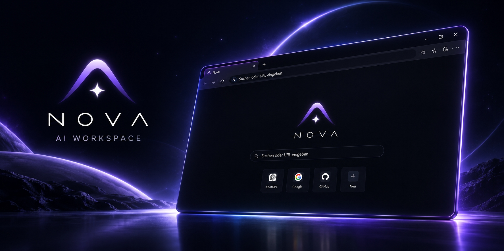
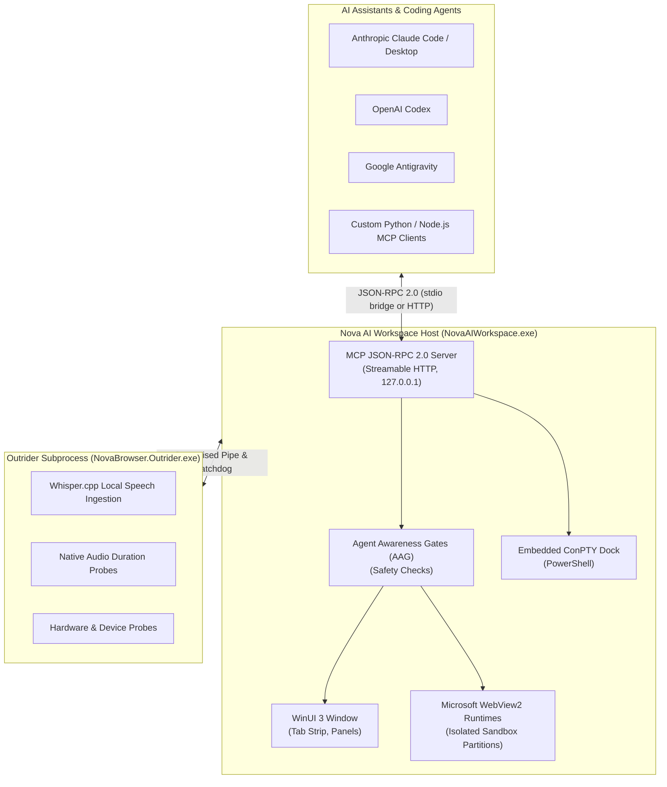

# Nova AI Workspace

### Your AI agent can use a browser. That doesn't mean you have to give up control.

Watch your agent work in real, signed-in browser tabs. Take over when needed.  
Keep accounts separate and let Nova remember useful website workflows.

Windows 10 / 11 · Works with Claude Code, Codex and other MCP clients · [480+ MCP tools](docs/mcp-reference/tool-catalog.md) · Free during alpha · No Nova account required · [Proprietary license](LICENSE)

**[Download](https://github.com/joelaniol/nova/releases) · [Try the demo](#-your-first-verified-task) · [How it works](#-what-is-nova-ai-workspace) · [Tool catalog](docs/mcp-reference/tool-catalog.md) · [Documentation](#-complete-documentation-index) · [Deutsch](#nova-ai-workspace-deutsch)**

[-0078D4?logo=windows&logoColor=white)](docs/getting-started/installation.md#1-system-requirements)

---

## 🌟 What is Nova AI Workspace?

Nova AI Workspace gives your AI agent a real browser workspace on Windows, with tabs you can see and use yourself. Connect Claude Code, Codex or another MCP client. Let it browse, inspect pages and complete tasks in Nova while you watch, take over individual tabs or stop it. Nova also keeps browser sessions separate, gives agents tools to check results and stores website procedures that are checked again when a page changes.

* **See the work:** an optional on-screen cursor labelled "AI" shows where the agent acts, with an optional card for the current and next step.
* **Take control:** a tab an agent is working in says so; click it and confirm **Take over**. **Emergency stop** in the main menu halts agent activity in Nova, releases agent-controlled tabs and pauses terminal sessions; it does not close your AI program. Typing or moving the mouse does not pause the agent by itself.
* **Reuse experience:** Nova can store useful website procedures, retrieve them on later visits and check whether they still apply. Automatic reuse depends on their verification and trust state.

---

## 🚀 Get Started — No Nova Account Needed

You need **Windows 10 / 11 (x64)** and an installed AI program such as Claude Code, Claude Desktop, Codex or Antigravity. Your conversation stays in that program; Nova provides the browser workspace. Your AI program may require its own account or subscription.

1. **[Download Nova](https://github.com/joelaniol/nova/releases):** under **Assets**, choose the Windows x64 installer `NovaAIWorkspace-x64-Setup-<version>.exe`. The matching `.sha256` file is for checksum verification, not installation.
2. **Activate.** On first launch the public alpha trial details are prefilled in the activation window; choose **Sign in**. No Nova registration is needed.
3. **[Connect your AI program](docs/getting-started/quickstart.md).** Nova detects supported AI programs. Follow **Easy setup**, click **Connect** if offered, and restart your AI program. The quickstart has a short test task; then try [your first verified task](#-your-first-verified-task).

> [!NOTE]
> **Windows SmartScreen:** early alpha builds may show **"Windows protected your PC"**. Before you continue, make sure you downloaded the installer from this repository's release page; you can compare its SHA-256 checksum with the matching `.sha256` file ([how](docs/getting-started/installation.md#2-download-and-install)). Then choose **"More info" → "Run anyway"**.

**Privacy at a glance:** Nova stores your browser profiles, cookies and workspace data locally. License activation and renewal contact Nova's server. Optional crash reports, which you review before sending, may include open-tab URLs (without query parameters) and sandbox names. Online search suggestions send typed text to your selected search provider unless you turn them off. Update checks and some optional features contact third-party services. Content your AI agent reads through Nova may reach its AI provider. [Full privacy details](PRIVACY.md#connections-to-other-services)

Installation details: [requirements and setup](docs/getting-started/installation.md). Looking for the trial key? → **[Alpha Trial License](docs/getting-started/trial-license.md)**

> [!WARNING]
> **ALPHA SOFTWARE — REVIEW THE TECHNICAL RISKS.** Nova is in active alpha development. Bugs, crashes, data loss and breaking changes may occur. Read the [technical risk notice](DISCLAIMER.md), [Acceptable Use Policy](ACCEPTABLE-USE.md), [Privacy Policy](PRIVACY.md), and [license documents](EULA.md). The applicable agreed contract and mandatory statutory rights govern; reading this page or installing an update does not by itself accept new contractual terms. · [Alpha status & known issues →](ALPHA.md)

---

## ✅ Your First Verified Task

An agent that clicks **Save** has not saved anything yet. This first exercise shows browser interaction, human handoff and result verification. [Download the demo files](https://github.com/joelaniol/nova/archive/refs/heads/main.zip), extract them and open `demos/lab.html` in Nova. In the **Experience loop** section, select **First visit** and ask your connected agent:

> Use Nova's connected MCP tools to work in the demo tab already open in Nova. Clear the release notice and save the sample draft. Verify the actual saved result instead of assuming the click succeeded. If confirmation is required, ask me to perform it myself. Then report the evidence.

Expected demo outcome: the first save deliberately leaves **Saved drafts** at **0**. Your agent should notice it and ask you; you click **I confirm this demo draft** yourself. The agent saves again and checks the page: **Saved drafts: 1**, with a receipt. All records are simulated, and the page makes no network requests of its own.

Persistent website learning needs the local HTTP setup in the demo guide; the full demo continues there with a return visit and a changed page. [Open the demo guide →](demos/README.md) · [Deutsche Anleitung](demos/README.de.md)

**Found a bug or have an idea?** Just tell your agent **"Nova feedback"**. It picks the right report type, collects the version and evidence, removes secrets and personal data, and shows you the draft. Only after your OK does it open the GitHub issue for you, or hand you the text for the form. You never have to fill in a bug template yourself.

---

## 🚀 Key Highlights & Capabilities

* **Staying in control:** take over a tab at a payment checkout or 2FA screen, solve it yourself and hand it back; **Emergency stop** halts agent activity in Nova. → [Guide](docs/user-guide/agents/watching-agent-work.md)
* **Separate sandboxes:** work, staging and personal accounts in one window, each with its own cookies, storage and cache, marked by tab colour. → [Guide](docs/user-guide/identity-and-security/sandboxes-and-profiles.md)
* **Stored passwords stay out of agent responses:** Nova fills vault passwords into login forms itself instead of returning them to the agent; they are protected with Windows DPAPI. API keys you authorize go to terminal programs as environment variables, which those programs can read. → [Guide](docs/core-features/privacy/vault-and-secrets/README.md)
* **Browser tools for agents:** inspect pages, measure layout, compare screenshots, download files, crawl, manage tabs, grouped into bundles an agent loads as needed. → [Tool Catalog](docs/mcp-reference/tool-catalog.md)
* **Terminal dock:** PowerShell next to the page you are working on. → [Guide](docs/user-guide/tools/terminal.md)
* **Local speech transcription:** Whisper models run offline on your PC. → [Guide](docs/core-features/media-intelligence/transcription/README.md)

---

## 🧠 How Nova Goes Beyond Browser Automation

Clicking a button is only part of an agent's job. Nova also gives agents tools to check whether the intended result happened, keeps useful website procedures between sessions and checks them again when a page changes. The components below explain how.

| Cognitive Function | What Nova Contributes | Architecture Guide | Video Demo |
| :--- | :--- | :--- | :---: |
| **Agent-Native Interface** | Built with agents: familiar action names and scoped aliases connect learned expectations to Nova's canonical tools | [Agent-Native Affordances](docs/core-features/agent-native-affordances/README.md) | — |
| **Evidence-Based Research** | Supplies claim tests, source requirements and tools to capture and compare visible evidence | [Evidence Verification Mode (EVM) & Visual Evidence](docs/research/evidence-verification-mode-evm/README.md) | — |
| **Procedural Memory** | Remembers website interaction recipes, state, health, and visual drift | [Phenomenological Knowledge Store (PKS)](docs/core-features/learning/phenomenological-knowledge-store-pks/README.md) | [Watch](https://www.youtube.com/watch?v=7NwRGC3l-r8) |
| **Operational Awareness** | Login state, plan and active model of a site, preserved as reported observations | [Operational Knowledge (OK) & Real-Time Environment State](docs/core-features/learning/operational-knowledge-ok/README.md) | [Watch](https://www.youtube.com/watch?v=LgShkPaSW7I) |
| **Episodic Task Memory** | Preserves recurring tasks, work units, progress, and learned guidance | [Episodic Task Memory (ETM)](docs/core-features/learning/episodic-task-memory-etm/README.md) | [Watch](https://www.youtube.com/watch?v=9qXrleOhPAw) |
| **User Context** | Opt-in domain notes and preferences preserved across sessions | [Browser Memory](docs/core-features/learning/browser-memory/README.md) | — |
| **Executive Control** | Goal Register and safety/reflection gates keep intent and steps visible | [Agent Awareness Gates (AAG)](docs/core-features/agent-awareness-gates-aag/README.md) | [Watch](https://www.youtube.com/watch?v=xhicSiFxPdY) |
| **Closed-Loop Verification** | Expected state → action → verified outcome; evidence-based claims | [Closed-Loop System (CLS)](docs/core-features/closed-loop-system-cls/README.md) | [Watch](https://www.youtube.com/watch?v=aKNp_74B8DE) |
| **Adaptive Learning** | Candidate promotion pipeline that validates and re-checks on site drift | [Agent Learning Pipeline (ALP)](docs/core-features/learning/agent-learning-pipeline-alp/README.md) | [Watch](https://www.youtube.com/watch?v=6iM3TbOL9o0) |

---

## 🏛️ System Architecture

---

## 📚 Complete Documentation Index

Explore the comprehensive documentation for operators, developers, and AI agents:

| Section | Focus Area | Key Documents |
| :--- | :--- | :--- |
| **[Getting Started](docs/getting-started/README.md)** | Installation & First Task | [Installation](docs/getting-started/installation.md) • [Your First Five Minutes](docs/getting-started/quickstart.md) • [What's Next?](docs/getting-started/whats-next.md) |
| **[User Guide](docs/user-guide/README.md)** | Everyday browsing & workspace controls | [Browser](docs/user-guide/browser/README.md) • [Identity & Security](docs/user-guide/identity-and-security/README.md) • [Agents](docs/user-guide/agents/README.md) • [Tools](docs/user-guide/tools/README.md) • [Settings](docs/user-guide/settings/README.md) |
| **[Core Features](docs/core-features/README.md)** | Deep Architecture & Systems | [Agent Awareness Gates (AAG)](docs/core-features/agent-awareness-gates-aag/README.md) • [Phenomenological Knowledge Store (PKS)](docs/core-features/learning/phenomenological-knowledge-store-pks/README.md) • [Password Vault & Secret Injection](docs/core-features/privacy/vault-and-secrets/README.md) • [Session Recording & Time-Travel Debugging](docs/core-features/session-recording/README.md) |
| **[Research](docs/research/README.md)** | Evidence, methods & empirical studies | [EVM & Visual Evidence](docs/research/evidence-verification-mode-evm/README.md) • [Gemini research](docs/research/gemini/README.md) • [BREACH](docs/research/breach/README.md) |
| **[Components & Processes](docs/components/README.md)** | Identify Nova-related processes | [Main app](docs/components/nova-ai-workspace.md) • [Outrider](docs/components/outrider/README.md) • [MCP Proxy](docs/components/mcp-proxy.md) • [TerminalRunner](docs/components/terminal-runner.md) • [ReplayValidator](docs/components/replay-validator.md) • [WebView2](docs/components/webview2-and-child-processes.md) |
| **[MCP Reference](docs/mcp-reference/README.md)** | Tools & Protocol | [Tool Catalog](docs/mcp-reference/tool-catalog.md) • [Protocol & Transport](docs/mcp-reference/protocol-and-transport.md) • [Dedicated Tool Guides](docs/mcp-reference/tools/README.md) |
| **[Integration](docs/integration/README.md)** | AI Assistants & Clients | [Claude Code](docs/integration/claude-code.md) • [Codex](docs/integration/openai-codex.md) • [Antigravity](docs/integration/google-antigravity.md) • [Claude Desktop](docs/integration/claude-desktop.md) • [Custom Agents](docs/integration/custom-agents.md) |
| **[Troubleshooting](docs/troubleshooting/README.md)** | Help by Symptom | [Connection Issues](docs/troubleshooting/agent-connection-issues.md) • [Agent Behavior](docs/troubleshooting/agent-behavior.md) • [Diagnostics Logs](docs/troubleshooting/diagnostics.md) • [Session Recovery](docs/troubleshooting/sandbox-and-session-recovery.md) |

---

## 🔒 Privacy, Security & Data Sovereignty

* **Local Execution:** Nova AI Workspace runs on your Windows machine and keeps its data in your profile folder. It collects no usage analytics. Which connections it makes (license server, optional crash reports, search suggestions, update checks, optional features) and what your AI provider receives is listed under [Privacy at a glance](#-get-started--no-nova-account-needed) and in the [Privacy Policy](PRIVACY.md#connections-to-other-services).
* **Encrypted Storage:** Vault passwords, stored secrets and the MCP access token are encrypted with the Windows Data Protection API (DPAPI) for your user account; session recordings are encrypted with AES-GCM under a DPAPI-protected key.
* **Supervised Outrider Process:** Native hardware access and audio parsing are quarantined in a dedicated child process with hard timeouts and watchdog supervision.

---

## 🇩🇪 Nova AI Workspace (Deutsch)

**Dein KI-Agent kann einen Browser bedienen. Deshalb musst du die Kontrolle nicht abgeben.**  
Sieh deinem Agenten in echten, angemeldeten Browser-Tabs bei der Arbeit zu. Übernimm, wenn nötig. Halte Konten getrennt und lass Nova sich nützliche Abläufe auf Websites merken.

Windows 10 / 11 · Für Claude Code, Codex und andere MCP-Programme · [480+ MCP-Werkzeuge](docs/mcp-reference/tool-catalog.md) · Kostenlos während der Alpha · Kein Nova-Konto nötig · [Proprietäre Lizenz](LICENSE)

### Schnellstart in 3 Schritten
Du brauchst **Windows 10 / 11 (x64)** und ein installiertes KI-Programm wie Claude Code, Claude Desktop, Codex oder Antigravity. Dein Gespräch bleibt dort; Nova stellt den Browser-Arbeitsplatz bereit. Das KI-Programm kann ein eigenes Konto oder Abo benötigen.

1. **[Nova herunterladen](https://github.com/joelaniol/nova/releases):** Unter **Assets** den Windows-x64-Installer `NovaAIWorkspace-x64-Setup-<version>.exe` wählen. Die passende `.sha256`-Datei dient der Prüfsummen-Kontrolle, nicht der Installation.
2. **Aktivieren:** Beim ersten Start ist das Aktivierungsfenster mit dem öffentlichen Alpha-Testzugang vorausgefüllt; **Anmelden** wählen. Eine Nova-Registrierung ist nicht nötig.
3. **[KI-Programm verbinden](docs/getting-started/quickstart.md):** Nova erkennt unterstützte KI-Programme. Folge der einfachen Einrichtung, klicke bei Bedarf **Verbinden** und starte dein KI-Programm neu.

**Windows SmartScreen:** Frühe Alpha-Versionen können **„Der Computer wurde durch Windows geschützt“** zeigen. Prüfe vorher, dass du den Installer von der Release-Seite dieses Repositorys geladen hast; seine SHA-256-Prüfsumme kannst du mit der passenden `.sha256`-Datei vergleichen ([so geht's](docs/getting-started/installation.md#installation)). Dann **„Weitere Informationen“ → „Trotzdem ausführen“**.

**Datenschutz auf einen Blick:** Nova speichert Browserprofile, Cookies und Arbeitsdaten lokal. Lizenzaktivierung und Verlängerung kontaktieren Novas Server. Optionale Absturzberichte, die du vor dem Senden ansiehst, können URLs offener Tabs (ohne Query-Parameter) und Sandbox-Namen enthalten. Online-Suchvorschläge schicken getippten Text an deine gewählte Suchmaschine, solange du sie nicht abschaltest. Update-Prüfung und einige optionale Funktionen kontaktieren Dienste Dritter. Was dein KI-Agent über Nova liest, kann bei dessen KI-Anbieter landen. [Alle Details](PRIVACY.md#verbindungen-zu-anderen-diensten)

### Deine erste geprüfte Aufgabe
Ein Agent, der auf **Speichern** klickt, hat noch nichts gespeichert. Diese erste Übung zeigt Browserbedienung, Übergabe an dich und Ergebnisprüfung: [Demo-Dateien herunterladen](https://github.com/joelaniol/nova/archive/refs/heads/main.zip), entpacken und `demos/lab.html` in Nova öffnen. Im Abschnitt **Experience loop** **First visit** wählen und deinem Agenten sagen:

> Nutze Novas verbundene MCP-Werkzeuge im Demo-Tab, der schon in Nova offen ist. Räume den Release-Hinweis weg und speichere den Beispielentwurf. Prüfe das tatsächlich gespeicherte Ergebnis, statt anzunehmen, dass der Klick gewirkt hat. Ist eine Bestätigung nötig, bitte mich, sie selbst auszuführen. Berichte dann die Belege.

Erwartetes Ergebnis der Demo: Der erste Speicherversuch lässt **Saved drafts** absichtlich auf **0**. Dein Agent sollte das bemerken und dich fragen; du klickst selbst **I confirm this demo draft**. Der Agent speichert erneut und prüft: **Saved drafts: 1** mit Beleg. Alle Daten sind simuliert. Dauerhaftes Lernen braucht die lokale HTTP-Einrichtung aus der [Demo-Anleitung](demos/README.de.md), dort geht es mit Wiederbesuch und geänderter Seite weiter.

**Fehler gefunden oder eine Idee?** Sag deinem Agenten einfach **„Nova Feedback“**. Er wählt die passende Meldung, sammelt Version und Belege, entfernt Geheimnisse und persönliche Daten und zeigt dir den Entwurf. Erst nach deinem OK legt er das GitHub-Issue an oder gibt dir den Text fürs Formular. Eine Bug-Vorlage musst du nie selbst ausfüllen.

Testschlüssel gesucht? → **[Alpha-Testlizenz](docs/getting-started/trial-license.md#alpha-testlizenz)**

Weiter: **[Installation auf Deutsch](docs/getting-started/installation.md#nova-ai-workspace-installieren)** · [Erste Schritte (Englisch)](docs/getting-started/quickstart.md) · [Hilfe (Englisch)](docs/troubleshooting/README.md).

---

## 📄 License & Community

* **Nova AI Workspace** is developed by Joel Aniol and contributors.
* **License:** [License notice](LICENSE) · [EULA and contract versions](EULA.md).
* **Security vulnerabilities:** Follow the [private reporting route](SECURITY.md).
* **Issues & Feedback:** Tell your agent **"Nova feedback"** (Deutsch: **„Nova Feedback“**); it drafts the report and opens it on [GitHub Issues](https://github.com/joelaniol/nova/issues) only after your OK. See [Nova's reporting guide](docs/mcp-reference/tools/app-shell-and-ui/nova-get-instructions.md#reporting-bugs-and-work-session-feedback) and the [alpha reporting policy](ALPHA.md#what-to-report).
* **Website:** [nova-cognitive.com](https://nova-cognitive.com)
* **YouTube:** [Nova Cognitive (@novacognitive)](https://www.youtube.com/@novacognitive)
* **Contact:** Joel Aniol — [LinkedIn](https://www.linkedin.com/in/joelaniol/)

---

## ❤️ Ethics · My promise

*Useful technology should open doors — whatever your income or circumstances.*

> **Never a software subscription.**  
> Nova AI Workspace will never require a software subscription. You buy the license once, and it stays valid permanently. If you want to support independent development voluntarily, you can additionally take out a Patreon membership that you can cancel at any time.
>
> **Always free for those who need it.**  
> Nova will always be free for people without income, people facing disadvantage, and students.

When Nova becomes available to buy, everyone will have the option to tick a box during checkout to say that one of these circumstances applies to them. I will not ask for proof, references, or explanations. Everyone has their own reasons, and I will respect yours.

> **Your privacy comes first.** 
> We will not spy on you. We will never sell your personal data. We avoid collecting personal data wherever possible and keep any necessary collection to a minimum.

Nova does not collect usage analytics or track your browsing behavior. License activation and renewal require limited data; crash reports are sent only if you choose to send them. Connected AI providers and websites have their own data practices. See our [Privacy Policy](PRIVACY.md) for the details.

> **Sponsorship must serve people.** 
> If Nova ever accepts sponsors, we will only partner with those who make a positive contribution to society. We will carefully examine their conduct and will not accept sponsorship from those whose practices harm people, society, or the environment.

We will be fully transparent about every sponsorship: who supports Nova, what financial or other support they provide, what they receive in return, and any conditions or conflicts of interest. Sponsorship will never override these promises.

> **Built to help people.** 
> We do not tolerate misuse that harms others. We use clear rules and safeguards and take action against misuse within our capabilities.

See our [Acceptable Use Policy](ACCEPTABLE-USE.md).

**No arms-industry business use.** Nova is not offered for business use by or on behalf of arms companies. Use for weapons, ammunition, military explosives, or military combat operations is prohibited. The [scope and exceptions](ACCEPTABLE-USE.md#arms-industry-and-military-use-restrictions) are defined in our policy.

This also excludes business use by providers of software, AI, or data-analysis systems specifically designed or adapted for military combat, even if they also have civilian customers.

**Joel Aniol**  
*Creator of Nova AI Workspace · Made with love*

<strong>🇩🇪 Mein Versprechen — auf Deutsch lesen</strong>

Hilfreiche Technologie sollte Türen öffnen — unabhängig vom Einkommen oder den Lebensumständen.

> **Niemals ein Software-Abo.**  
> Nova AI Workspace wird niemals ein Software-Abo benötigen. Die Lizenz wird einmalig gekauft und bleibt dauerhaft gültig. Wer die unabhängige Entwicklung freiwillig unterstützen möchte, kann zusätzlich eine jederzeit kündbare Patreon-Mitgliedschaft abschließen.
>
> **Immer kostenlos für diejenigen, die es brauchen.**  
> Nova wird für Menschen ohne Einkommen, benachteiligte Menschen sowie Studierende immer kostenlos sein.

Sobald Nova zum Kauf angeboten wird, kann jede Person beim Kauf ein Kästchen ankreuzen, wenn eine dieser Lebenssituationen auf sie zutrifft. Ich werde keine Belege, Verweise oder Erklärungen verlangen. Jeder Mensch hat seine eigenen Gründe, und ich respektiere deine.

> **Deine Privatsphäre steht an erster Stelle.** 
> Wir werden dich nicht ausspionieren. Wir werden deine personenbezogenen Daten niemals verkaufen. Wir vermeiden die Erhebung personenbezogener Daten, wo immer es möglich ist, und beschränken notwendige Erhebungen auf ein Minimum.

Nova erhebt keine Nutzungsanalysen und verfolgt dein Surfverhalten nicht. Lizenzaktivierung und -verlängerung benötigen einen begrenzten Datensatz; Crashberichte werden nur gesendet, wenn du dich dafür entscheidest. Verbundene KI-Anbieter und Websites haben eigene Regeln zum Umgang mit Daten. Details stehen in unserer [Datenschutzerklärung](PRIVACY.md#deutsch).

> **Sponsoring muss Menschen zugutekommen.** 
> Sollte Nova jemals Sponsoren annehmen, werden wir nur mit solchen zusammenarbeiten, die einen positiven Beitrag zur Gesellschaft leisten. Wir werden ihr Handeln sorgfältig prüfen und kein Sponsoring von Akteuren annehmen, deren Praktiken Menschen, der Gesellschaft oder der Umwelt schaden.

Wir werden jedes Sponsoring vollständig transparent machen: wer Nova unterstützt, welche finanziellen oder sonstigen Leistungen erbracht werden, welche Gegenleistungen vereinbart sind und welche Bedingungen oder Interessenkonflikte bestehen. Sponsoring wird diese Versprechen niemals außer Kraft setzen.

> **Nova soll Menschen helfen.** 
> Missbrauch, der anderen schadet, dulden wir nicht. Wir setzen klare Nutzungsregeln und Schutzmaßnahmen ein und gehen im Rahmen unserer Möglichkeiten gegen Missbrauch vor.

Details stehen in unserer [Nutzungsrichtlinie](ACCEPTABLE-USE.md#deutsch).

**Keine geschäftliche Nutzung durch die Rüstungswirtschaft.** Nova wird nicht für die geschäftliche Nutzung durch oder im Auftrag von Rüstungsunternehmen angeboten. Die Nutzung für Waffen, Munition, militärische Sprengstoffe oder militärische Kampfhandlungen ist untersagt. [Geltungsbereich und Ausnahmen](ACCEPTABLE-USE.md#ausschluss-der-rüstungswirtschaft-und-militärischer-nutzung) stehen in der Nutzungsrichtlinie.

Dies schließt auch die geschäftliche Nutzung durch Anbieter von Software, KI oder Datenanalysesystemen aus, die speziell für militärische Kampfhandlungen konzipiert oder angepasst sind, selbst wenn sie zusätzlich zivile Kunden haben.

— **Joel Aniol**, Entwickler von Nova AI Workspace

