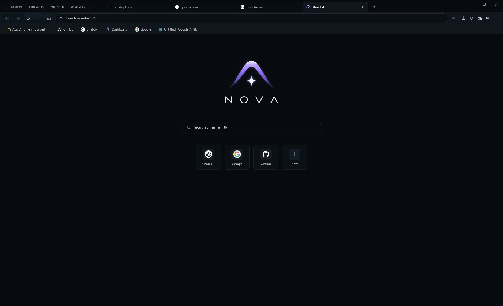

# Changelog — Nova AI Workspace 1.0.0-alpha.19

Nutzersichtbare Änderungen seit `1.0.0-alpha.18` (veröffentlicht am 14.10.2026; 07.10.2026–14.10.2026, 309 Commits im Release-Bereich `fd26a15b..6adbbd8d5`).
User-visible changes since `1.0.0-alpha.18` (released 2026-10-14; 2026-10-07–2026-10-14, 309 commits in release range `fd26a15b..6adbbd8d5`).

Im Zeitraum wurden über 280 Befunde geschlossen (286 Befunde); die nutzersichtbaren davon stehen unten, reine Test-, Build- und Prüfer-Arbeit bleibt bewusst draußen.

More than 280 findings were closed in this period (286 findings); the user-visible ones are listed below, while purely internal test, build and scanner work is deliberately left out.

## Version snapshot / Versionsansicht

Nova AI Workspace alpha.19: new tab page and browser toolbar.
Nova AI Workspace alpha.19: Neuer-Tab-Seite und Symbolleiste.

Window size, open tabs and shortcuts reflect the captured session.
Fenstergröße, offene Tabs und Schnellzugriffe entsprechen der aufgenommenen Sitzung.

---

# EN

## Highlights

- **Interactive SSH pseudo-terminal (PTY), live watch window, and streaming background execution.** Agents can drive full interactive terminal sessions (`/dev/pts/*` backed by XTerm.NET) via `nova.ssh_shell_*` with ANSI/VT escape sequences, inverse video highlighting for TUI selections, scrollback history, and dynamic resizing, paired with a real-time read-only live watch window (`nova.ssh_shell_watch`) with geometry locking and user-intervention indicators, and background streaming commands (`nova.ssh_run_*`) using bounded 64-bit offset byte rings and disk tombstones
- **Granular command execution and terminal capabilities.** Remote execution on SSH and SFTP connectors is separated into dedicated capability stages (`process.exec`, `process.stdin`, `process.pty`) with session leases ("allow for this session"), enabling users to authorize or restrict commands independently from file transfers
- **Automated chat reply detection (`waitForReplyMs`).** Agents can send messages and synchronously wait for conversational web AI responses to complete via `nova.guarded_send_message` and selector actions, powered by a multi-tier pipeline with DOM mutation monitoring, CDP streaming network detection, and declarative site profiles (`chat_surface`)
- **Comprehensive cross-origin iframe automation and inspection.** Out-of-process iframes are enabled by default for automation and inspection, featuring affine coordinate mapping (scaling, rotation, shear up to 4 nesting levels), scroll-aware hit testing, and frame-isolated execution across `perceive`, `eval`, and `read_text`
- **External MCP Hub with tool allowlisting, numeric IDs, and setup templates.** The external MCP server hub lets users inspect and granularly allowlist individual tools per server (`allowedTools`), supports clients requiring integer JSON-RPC request IDs (`numericRequestIds`), records live transport event logs, and includes a one-click setup template for Google Antigravity
- **Toolbar activity and service health indicators.** Dedicated status cluster indicators in the address bar display active connector operations (background SSH sessions and in-flight file transfers) with details and quick-stop controls, and monitor internal Nova services (MCP server and terminal runner) with direct access to diagnostics and logs
- **Smart favorites re-import and panel drag & drop.** Repeated Chrome and Edge bookmark imports intelligently detect and add only new entries using Chromium GUID diffing, preserving user folder renames and moves without creating duplicate bookmarks, while the favorites panel adds fluid drag-and-drop reordering
- **Resilient live settings, engine restart, and viewport self-healing.** Engine startup options (proxy, WebRTC protection, compositing) apply via an in-process drain and restart without closing windows or dropping tabs; language changes offer a clean restart prompt that restores open tabs; and stuck web viewports are automatically detected, measured, and self-healed

## New features and improvements

### Interactive SSH terminal and background execution

- Background command sessions stream live output into bounded memory ring buffers (`OffsetByteRing`) with absolute 64-bit byte offsets, rolling SHA-256 checksums, and honest reporting when older bytes were evicted or ingestion was capped
- Interactive standard input (`allowStdin=true`) supports sending text and closing the input stream (EOF), protected by monotonic sequence numbers so retried writes remain strictly idempotent
- Background sessions are guarded by an automated 30-second SSH keepalive to prevent NAT timeouts and a TCP zero-window watchdog that safely aborts wedged stdin writes
- Concurrency and resource ceilings are strictly enforced (maximum 4 global sessions, 2 per profile, 2 per owner) alongside an automated 30-second timer sweep that stops idle or expired processes
- Active session identifiers and metadata are persisted as disk tombstones across Nova restarts (`SshSessionTombstoneStore`), allowing subsequent queries to honestly report an abandoned state rather than a misleading not-found error
- Interactive pseudo-terminal sessions allocate real remote PTYs (`/dev/pts/*`) backed by an XTerm-compliant virtual terminal screen engine, enabling agents to operate full-screen terminal programs and interactive dialogs
- Terminal snapshots return formatted screen rows, cursor coordinates, and structured highlight ranges for inverted text, allowing agents to accurately inspect selected items in curses menus
- Terminal reading supports scrollback retrieval, bounded terminal geometry (2..500 columns and 2..300 rows), and a live reception budget gauge to protect agent contexts
- Real-time read-only live watch window (`nova.ssh_shell_watch`) lets users and agents observe active remote SSH PTY sessions as they happen, featuring geometry locking to prevent TUI reflow tearing, dynamic font-scaling, and a stretch toggle
- Opening the watch window via an agent displays passively without stealing human keyboard focus, while explicit user clicks or focus elevate the window with a temporary topmost pulse so it rises above browser overlays without permanently staying topmost
- When a user stops an SSH session from Nova, the watch window immediately displays a red status indicator with "Stopped by you - last frame shown." and the window icon tints red, or grey on natural session completion
- Pseudo-terminal session reading (`nova.ssh_shell_read`) surfaces an explicit `endReason` (`user_stopped`, `agent_stopped`, `connection_lost`, `remote_exited`, `idle_timeout`, `output_limit`) upon session end, while the live watch window visually differentiates connection drops and timeouts (amber) from clean exits (grey) and manual user stops (red)
- Fixed an issue where SSH channel write exceptions were swallowed silently and falsely reported successful keystrokes (`accepted: true`), permanently blocking retries
- Fixed an issue where pseudo-terminal resize requests ran synchronously under the write lock without a watchdog, freezing subsequent keystrokes on network latency
- Fixed an issue where standard keystroke notations such as `Ctrl+C`, `Ctrl+D`, `ArrowUp`, and `Spacebar` were rejected as invalid key names
- Fixed an issue where `nova.ssh_shell_read` only returned currently visible screen rows, causing output that scrolled off-screen to be lost
- Fixed an issue where plain text snapshots omitted inverse video styling, preventing agents from identifying focused items in curses menus
- Fixed an issue where session metadata failed to report the last write sequence number, preventing agents from recovering after a stale sequence error
- Fixed an issue where idempotent duplicate write requests erroneously reported bytes sent to the channel even though no new data was transmitted
- Fixed an issue where minimal terminal dimensions of 1x1 triggered division-by-zero crashes in curses programs and unbounded dimensions caused excessive memory allocations
- Fixed an issue where terminal snapshot rows were padded with trailing whitespace to the full column width, consuming unnecessary agent context tokens
- Fixed an issue where the watch window's local auto-fit resynchronized geometry against remote full-screen TUIs (such as htop or curses), tearing screen layouts; geometry is now locked to remote dimensions
- Fixed an issue where high-DPI display scaling caused watch window resize and read operations to miscalculate dimensions
- Fixed an issue where collapsing the terminal dock resized ConPTY to 0x0, compressing running shells to 2 columns and destroying scrollback history
- Fixed an issue where remote PTY resize events were delayed in the watch window until the next incoming byte
- Fixed an issue where initial terminal replay bytes were lost if the watch window ready-signal timed out, leaving the watch window blank
- Fixed an issue where rapidly opening the watch window multiple times created leaked duplicate windows; opening is now guarded by an atomic reservation set
- Fixed an issue where status updates after closing the watch window attempted to access closed XAML elements
- Fixed an issue where shortening long command titles containing emoji or surrogate pairs split unicode characters

### Granular connector capabilities and session leases

- Shell command execution and terminal interaction are governed by dedicated capability stages (`process.exec`, `process.stdin`, and `process.pty`) on SFTP and SSH connectors, completely distinct from file read and write permissions
- Running commands is its own permission (`process.exec`) and is no longer covered by full file access: a write grant never silently becomes a remote shell. After updating, the first command on an existing connection asks once; choose "Always" to keep it running unattended (scheduled tasks need this explicit grant)
- Command execution, interactive input, and terminal sessions can be permitted, prompted, or blocked independently while maintaining full file transfer capabilities
- Connector permissions support session leases ("allow for this session"), granting temporary execution authority that expires cleanly when Nova restarts or the session ends
- Runtime permission revocation immediately closes active command and pseudo-terminal sessions when their corresponding capability is removed in settings
- Every connection profile can specify its web interface URL (`webInterfaceUrl`), configured in Settings or via `connector_create`/`connector_update`, allowing `connector_list` to report what agents learned about the web service from domain notes
- Widening connector capabilities (`nova.connector_grant_set` from blocked to ask/always, or expanding mail read filters) or adding mail recipients (`nova.connector_recipient_set`) over MCP always displays an explicit user confirmation dialog in Settings terminology and cannot be granted unattended
- Refusing an attachment path (`local_path_not_allowed`) explicitly names all authorized folders for the current call (Downloads and active workspace) and clarifies that subfolders are included
- SFTP and FTP file transfers can read upload sources or write download targets outside Downloads and the active workspace folder with the user's explicit grant (`local.read` / `local.write`); confirmation prompts name the exact path and transfer direction, and a master kill switch in Settings (`ConnectorLocalFilesystemAccessEnabled`) can disable all out-of-sandbox connector access globally
- Rejecting unsafe remote symbolic links during SFTP/FTP directory traversal clearly names the affected untrusted parent directory component (`remote_symlink_rejected`)
- Deleting a connector is refused with an honest error message while SSH sessions or interactive terminals are actively running on it

### Approvals and permission dialogs

- Fixed an issue where clicking "Block" in permission dialogs (notifications, geolocation, clipboard access, hardware APIs) only deferred the prompt instead of permanently blocking the permission due to a WinUI dialog result discrepancy
- Fixed an issue where the "Remember for this session" option was ignored when denying clipboard or hardware access, causing websites to repeatedly re-trigger the permission dialog
- Fixed an issue where the `nova.permission_prompt` tool silently auto-denied every agent confirmation request because the callback to display the user confirmation dialog was not wired
- Fixed an issue where concurrent confirmation requests from agents overwrote the confirmation dialog state and caused the initial request to hang indefinitely
- Fixed an issue where the target display in MCP confirmation prompts rendered duplicate label prefixes
- Fixed an issue where the approval dialog ignored the configured timeout setting (`AgentApprovalTimeoutSeconds`), rigidly forcing 60 seconds and immediately timing out when set to 0 seconds
- Fixed an issue where the countdown timer in expiring approval prompts froze statically instead of ticking down second-by-second
- Fixed an issue where device permission management sent invalid identifiers to the browser engine, skipping permission resets for camera, microphone, and speakers
- Fixed an issue where untrusted SSL certificates from third-party background requests triggered disruptive certificate prompts instead of being rejected silently
- Deleting a domain note (`nova.domain_note_delete`) or an operator note (`nova.operator_notes_delete`) over MCP always displays a user confirmation prompt with the note content, and never stores an unattended "Always" answer
- Broadening connector permissions or adding mail recipients over MCP opens a dedicated confirmation dialog with clear descriptions matching Settings labels
- When an agent confirmation overlay or approval prompt is displayed, Nova continuously flashes the Windows taskbar until activated, ensuring pending decisions are never overlooked even if Windows foreground lock prevents raising Nova in front of full-screen applications

### Toolbar indicators and status cluster

- A connector activity indicator appears in the address bar status cluster whenever background SSH commands or SFTP and FTP file transfers are active, displaying the total count of running operations
- Clicking the connector activity indicator opens a flyout listing every active operation with its connection profile, remote host, current transfer phase or path, and a one-click stop action
- The connector activity indicator automatically hides itself once all transfers and background sessions complete
- A service health indicator watches critical Nova background services (the internal MCP server port bind and the terminal runner process) and appears only if a service remains unavailable past a 15-second grace period
- Clicking the service health indicator displays status diagnostics and offers a direct action to open the logs directory for immediate inspection

### Favorites and bookmarks management

- The favorites panel flyout supports drag-and-drop reordering, allowing users to rearrange bookmarks within folders, drag bookmarks into subfolders, and drag them onto the back button to move them up one level
- Repeated Chrome and Edge bookmark imports detect existing entries by Chromium GUID and offer to import only newly added bookmarks rather than duplicating folders
- Re-importing bookmarks respects user reorganizations and deletions in Nova, ensuring bookmarks moved to other folders or deliberately removed are not duplicated or reintroduced
- Bookmark move operations across the favorites bar, context menus, star bubble, manager, and agent tools use a unified planner with recursive target folder resolution
- Deleting a folder while choosing to keep its contents safely appends all contained bookmarks and subfolders to the end of the favorites bar without identifier collisions
- Fixed an issue where bookmark import reported success despite storage errors, causing the missing bookmarks to be flagged as deleted and permanently excluded on subsequent imports
- Fixed an issue where newly added browser bookmarks sharing a URL with existing favorites were falsely mapped to existing entries and omitted from import
- Fixed an issue where moving or renaming the original import root folder in Nova caused subsequent imports to duplicate all contained subfolders
- Fixed an issue where reordering bookmarks via drag-and-drop or MCP moves failed to refresh currently open flyouts and toolbars immediately
- Fixed an issue where deleting a folder while retaining its contents caused sort index collisions with existing root items on the favorites bar
- Fixed an issue where the bookmark bar overflow menu omitted website favicons for overflowed bookmarks
- The favorites flyout panel dynamically scales its list height to 60% of window height (between 240 and 720 px) when opened, rather than capping at a rigid 420 px that previously limited folder views to 12 items on large displays
- The sandbox badge tooltip in the tab bar appears only when the tab bar is in compact mode to minimize visual clutter

### Browser automation, screenshots, and cross-origin iframes

- Cross-origin iframe interaction is enabled by default (`McpCrossOriginFrameInteractionEnabled`), allowing agents to inspect and automate elements inside embedded frames from different domains
- Affine coordinate projection accurately maps interactions across scaled, rotated, or sheared iframes across up to four nesting levels
- Page reading and inspection tools (`perceive`, `eval`, `read_text`) operate in isolated frame sessions via dedicated DevTools targets, reporting accurate frame hierarchy and geometry
- Security filters automatically block password, one-time passcode, and credit card inputs inside cross-origin iframes, and strictly refuse automated sign-ins in embedded frames
- Browser actions automatically report visibility status (`window_minimized`, `tab_not_shown`, `settings_open`) when a user cannot observe the automated action on screen
- Fixed an issue where clicks inside embedded cross-origin iframes on scrolled pages missed their target due to uncompensated parent scroll offsets
- Fixed an issue where `nova.perceive` reported the parent window URL instead of the embedded frame's actual address for cross-origin iframes
- Fixed an issue where hovering over a background tab in the tab bar triggered a screenshot capture against an inactive web view, risking a direct composition display stall
- Fixed an issue where negative coordinate padding at screen borders caused selector and region screenshot crops to shift down and right, missing the target element
- Fixed an issue where a failing confirmation screenshot in click, measurement, and wait tools caused the entire tool call to error out, leading agents to retry clicks unintentionally
- Fixed an issue where responsive screenshots on websites with smooth scrolling failed to restore scroll positions promptly, leaving the viewport mid-scroll
- Fixed an issue where screenshot files in the local cache were not pruned according to the configured retention lifetime
- Fixed an issue where coordinate metadata for screenshots was collected after releasing the web view lock, causing concurrent scrolling to misalign reported click positions
- Fixed an issue where `nova.create_dump` captured screenshots on background tabs without setting a presentation repair flag, leaving the tab visually frozen upon subsequent activation
- Fixed an issue where non-integer viewport dimensions under Windows display scaling threw an exception and skipped automated presentation repair
- Fixed an issue where applying device presets dropped locale, timezone, and geolocation settings from emulation tracking
- Fixed an issue where application screenshots failed to capture open overlays, flyouts, and dialog panels rendered over the web page
- Fixed an issue where successful clicks inside embedded iframes falsely triggered a no-effect warning because effect observation only monitored the parent window
- Fixed an issue where emulation status chips failed to warn users when an active device preset rendered page dimensions smaller than the application window
- Tab claims prioritize the human user: taking over or closing a claimed tab cancels in-flight agent actions promptly without blocking on state serialization
- Triggering an emergency stop immediately releases all active tab claims across all agents
- Navigating a claimed tab directly from the address bar is automatically recognized as an intentional user takeover
- Executable protection: `nova.downloads_open_file` strictly refuses to launch executable programs and binaries (`executable_blocked`), permitting agents only to reveal containing folders
- Bulk tab closures return claimed tabs back to the user and report closed tabs to subsequent agent calls as `target.tab_closed` rather than an engine restart
- Pointer clicks on background tabs via selector actions restore the operator's previously active tab by default (`restoreActiveTarget: true`), preventing background automation from disrupting human browsing sessions
- Typing into rich-text and ProseMirror fields (`contentEditable`, such as ChatGPT) delivers up to 100,000 characters in a single atomic insertion rather than chunked batches, avoiding render-frame race conditions that previously dropped characters or misplaced text blocks
- If background tab activation is superseded because the user typed or clicked (`app_target_activation_superseded`), the recovery suggestion recommends retrying the same call instead of permanently stealing the user's tab via `set_active_tab`
- Selector and region screenshot captures synchronize through the pointer coordinator gate, preventing tab switching races from colliding with concurrent background pointer actions
- Smart scrolling (`nova.scroll_smart`) on inactive background tabs avoids falling back to mouse wheel emulation when script scrolling fails, preserving script results and suggesting `nova.input_wheel`
- A pointer action that is refused before it is dispatched (for example by an unmet precondition) switches back to the user's previously active tab instead of leaving the background tab in front
- Keyboard focus returns to the user's page after an agent click switched to a background tab and back
- `nova.run_sequence` refuses a step addressed to another tab instead of silently running it on the sequence's own tab

### Chat reply observation and structured conversations

- The `nova.guarded_send_message` tool and selector actions support synchronous reply waiting (`waitForReplyMs`) for conversational AI web interfaces
- Reply waiting combines a pure state reducer, DOM mutation observation, and CDP network streaming detection to identify when streaming AI responses settle
- Declarative site profiles (`chat_surface`) define custom indicators, stream endpoints, and generation markers for specific chat platforms
- If an agent sends a message to an inactive or obscured tab, reply waiting honestly reports that the page is hidden and suggests activating the tab
- The `nova.read_text_structured` tool supports a dedicated conversation mode that extracts chat turns with sender roles, timestamps, and message blocks
- Fixed an issue where sending messages on chat websites failed when submit buttons lacked text labels or when submission was not verified against the sent message text
- Fixed an issue where message submissions on chat websites with icon-only buttons failed or duplicated text; submissions now fall back to Enter key dispatch (`sendMethod='enter_key'`) under the same verification contract
- Fixed an issue where sending messages without text (`nova.guarded_send_message` without `text`) failed on chat platforms that replace the send button with a stop button during generation
- Fixed an issue where login warnings were displayed erroneously during standard conversational chat turns
- Fixed an issue where negated authentication phrasing in page titles (such as "No Login Required") was mistakenly classified as an active login gate
- Fixed an issue where invisible background `aria-busy` attributes stalled reply waiting indefinitely
- Fixed an issue where `nova.tab_claim` polled at slow one-second intervals instead of waiting synchronously on the tab lease
- Fixed an issue where input composer state probes evaluated in the top frame rather than the embedded frame hosting the composer
- Fixed an issue where the send check (`composer.textEmpty`) timed out after a delivered message when the conversation contained editable content blocks, such as ChatGPT "Writing" canvases

### External MCP Hub, setup, and agent onboarding

- External MCP server settings support granular per-server tool allowlisting (`allowedTools`), enabling users to expose only specific tools to connecting agents
- Tools not included in a server's allowlist are blocked before invocation and omitted from catalog discovery to reduce tool noise
- Broadening a server's tool allowlist or exposing new tools requires explicit user confirmation with the newly exposed tools clearly listed
- External servers support the `numericRequestIds` configuration option, ensuring seamless compatibility with clients and bridges requiring integer JSON-RPC identifiers
- Detailed transport lifecycle logs (`nova.external_server_logs`) record process launch events, HTTP status codes, durations, and diagnostic failure reasons
- Settings include a dedicated one-click configuration template for Google Antigravity under MCP setup
- Fixed an issue where failed external MCP server process launches remained stuck in a pending state without reporting diagnostic failure reasons
- Fixed an issue where an existing `CLAUDE.md` file caused `nova.install_onboarding` to skip creating `AGENTS.md` and `GEMINI.md`, leaving non-Claude agents without onboarding instructions
- Fixed an issue where incomplete marker blocks caused subsequent onboarding runs to delete custom user instructions located between markers
- Fixed an issue where project directories located on NTFS volume mount points or directory symlinks were rejected as invalid reparse points
- Fixed an issue where existing onboarding files in UTF-16 or ANSI encoding were overwritten with corrupted null bytes
- Fixed an issue where installation paths exceeding 150 characters prevented the background stdio proxy from launching properly
- Fixed an issue where transient file read errors caused valid runner capability and authentication tokens to be overwritten, locking out connections permanently
- Fixed an issue where large input bursts to a PTY session blocked all other concurrent terminals due to synchronous pipe processing; sessions now use dedicated asynchronous input queues

### Notifications and source navigation

- Agent notifications sent via `nova.notifications_send` support rich content including image attachments, custom icons, and interactive action buttons
- Notification cards in the notification center display website and agent source icons and allow users to jump directly to the originating tab or URL with one click
- Notification queries support filtering by tag and target identifier, alongside support for the `renotify` behavior
- Settings offer configurable notification retention periods (days, year, or forever) with automated database cleanup sweeps
- Sound playback options allow users to toggle notification chimes and prevent duplicate sounds between Nova and Windows system notifications
- Fixed an issue where cards in the notification center always displayed a default globe icon instead of the actual source website icons
- Fixed an issue where remote web images in Windows desktop toasts were silently dropped because unpackaged applications require local image files
- Fixed an issue where clicking a notification card opened a flyout containing a focusable text box instead of navigating directly to the source website or tab
- Fixed an issue where clicking a notification for a closed tab opened the page in the currently active sandbox instead of the originating profile, losing session state
- Fixed an issue where clicking a notification from a private browsing session could open a standard tab; Nova now refuses to open private session targets in regular tabs to preserve privacy
- Fixed an issue where clearing notifications in the center or via MCP failed to dispatch the `notification.onclose` event to open web pages
- Fixed an issue where the notification retention setting was never applied in background sweeps, allowing the database to grow unbounded
- Fixed an issue where notification tags longer than 64 characters lost their Windows toast tag, resulting in duplicate ghost toasts in the Windows Action Center
- Fixed an issue where the notification center and download panels could overlap simultaneously and pressing Escape did not close the notification center
- Fixed an issue where two dropdown selection controls in the notification interface could crash during rapid interaction
- Fixed an issue where incoming notifications played simultaneous duplicate chime sounds in both Nova and Windows

### Settings, engine lifecycle, and viewport resilience

- Updating browser engine startup options — including global proxy configuration, WebRTC IP leak protection, and the WebView compositing workaround — triggers a coordinated in-process engine drain and restart without closing windows or losing open tabs
- Changing the interface language applies on the next start and displays a persistent "Restart now" prompt that restores open tabs, eliminating blank settings pages and tab freezes
- An automated viewport watchdog detects and measures sizing discrepancies between the application window and browser viewports, self-healing stuck dimensions and indicating recovery in the toolbar
- Tooltips for scheduled tasks and session recording indicators on the toolbar are translated according to the active language
- Fixed an issue where changing the interface language during runtime triggered an engine option mismatch, causing newly opened tabs and favorites to hang with blank views until Nova was restarted
- Fixed an issue where the settings view failed to reconstruct its sections and displayed a blank page after a language change
- Fixed an issue where the web viewport became stuck at fixed dimensions (624x913) in a maximized window with no way to recover
- Fixed an issue where toolbar icon buttons lacked accessible automation names for screen readers

### Knowledge store and continuous learning

- Domain notes and operator notes are kept knowledge and are never deleted automatically any more: the age, use and count limits that silently removed notes (domain notes after 180 days or beyond 50 domains, operator notes after 90 days or beyond 100) are gone
- Deleting a domain note or an operator note through an agent always asks you first and shows the note; Nova never remembers that answer
- Deleting a sandbox keeps its notes by default; a follow-up dialog shows how many domain and operator notes it has and deletes them only if you choose so
- Domain notes, operator notes and connector extras (mail signature, connection web page) are stored in one local database (`notes.db`); the earlier files are imported once on first start and left unchanged, and agent calls read only the notes of the current site instead of all notes
- The `nova.learn_suggest(mode='scaffold')` tool scaffolds new knowledge entries directly from structure and forms on the currently open page
- The `nova.pks_deprecate` tool enables agents and administrators to retire outdated domain hints cleanly
- Domain pattern matching normalizes prefixes and local scopes for consistent domain policy evaluation
- The knowledge database limits task-scope growth through automated periodic maintenance sweeps, preventing unbounded disk accumulation
- Learning generators receive verified user inputs and explain skip or write decisions with concrete rationale
- Fixed an issue where the domain origin before MCP tool execution was consistently empty, causing domain rules to be ineffective and background revalidation to never trigger
- Fixed an issue where unclosed task scopes and orphaned tool observations caused the knowledge database (`pks.db`) to grow continuously on disk
- Fixed an issue where the revalidation budget counted individual candidates instead of runs, causing revalidation to halt after checking only a single candidate per tab visit
- Fixed an issue where a domain was locked out for the entire Nova session after two candidate checks, preventing further revalidation
- Fixed an issue where reactivating a deprecated domain hint did not reset consecutive failure counts, causing it to be demoted again immediately
- Fixed an issue where a single failure on a subdomain erroneously suppressed all inherited knowledge entries across related sibling domains
- Fixed an issue where per-domain capacity caps counted deprecated entries, preventing agents from adding new hints even after deprecating obsolete ones
- Fixed an issue where knowledge health tracking only learned from successful actions, never recording unverified or failed interactions as negative evidence
- Fixed an issue where semantic learning opportunities blocked or replaced selector learning across an entire domain rather than scoping strictly to their own selectors
- Fixed an issue where domain rules distinguished between addresses with and without the `www.` prefix, failing to apply rules to the alternate variant
- Fixed an issue where updating stored playbooks containing null fields caused serialization exceptions
- Fixed an issue where domain scopes containing `localhost:<port>` were rejected by strict hostname validation, breaking local development testing
- Database resilience ensures transient file locks, full disks, or permission errors never trigger destructive rebuilds; corrupted files are safely moved aside with their WAL sidecars without overwriting
- Note persistence tools (`nova.domain_note`, `domain_note_delete`, `operator_notes_store`, `operator_notes_delete`) report a failed disk save honestly as `notes_save_failed` (`retryable: true`) rather than falsely claiming success
- Fixed an issue where the sandbox notes dialog displayed plural phrasing for a single note; it now correctly says "1 site note"
- Automatic learning follow-ups and repair queues report concise summaries (`status: 'auto_completed'`) when Nova handles all repair steps internally, cutting noisy repetitive item payloads; click successes are no longer attributed to multiple candidate detections sharing a selector; and repetitive user-visibility hints are suppressed during background automation
- Fixed an issue where the sandbox ambiguity warning on `nova.tabs` was triggered for sandbox profiles that had no open tabs listed in the result
- Database schema upgrades for the notes store (`notes.db`) handle forward migrations cleanly without resetting existing databases, while files created by newer Nova versions are kept intact, and locked legacy files encountered during first-time import are safely retried on the next access instead of being discarded
- Operator notes loading tolerates malformed tag lines on disk rather than reporting an empty notes store

### Stability, emergency stop, and diagnostics

- The emergency stop mechanism halts all background tasks, active connector operations, file transfers, and SSH sessions immediately, establishing a non-retryable lock state
- Shared browser process options are frozen per instance lifecycle, preventing cache token mismatches that previously caused newly opened tabs, favorites, and navigations to hang with blank views
- Background SSH sessions interrupted by process termination or crash are tracked on startup and reported with indeterminate remote states rather than false not-found errors
- The required self-test suite includes a comprehensive runtime settings test verifying that dynamically toggling boolean, numeric, enum, language, and proxy settings leaves browser surfaces healthy
- Fixed an issue where closing an active tab could trigger an immediate fail-fast application crash (0xc0000409) when WinUI shifted focus to a WebView2 control that was not ready to receive input
- Fixed an issue where in-flight MCP tool executions continued running until timeout after a client disconnected; disconnected clients are now detected within 500 ms via socket polling to abort unused runs cleanly
- Fixed an issue where active file transfers (SFTP, FTP), background SSH commands, and mail backups continued running unhindered when emergency stop was triggered, instead of being immediately terminated
- Fixed an issue where in-flight tool calls cancelled by emergency stop returned generic cancellation errors that failed to inform connecting agents of the emergency stop condition
- Fixed an issue where rejected requests during an active emergency stop falsely reported `retryable: true`, driving autonomous agents into busy retry loops instead of halting
- Fixed an issue where `nova.create_dump` reported false success on incomplete steps or unreadable manifests; step failures are now reported honestly as `failedSteps` with status `degraded` or `unknown`
- Fixed an issue where executing build scripts in secondary git worktrees unexpectedly terminated the running primary Nova development process
- User intervention feedback delivers human actions from the Nova window (stopping SSH sessions, taking over tabs, closing tabs, clearing browser data) directly to connecting agents on their next tool call (`gateId user.intervention`), preventing agent drift
- Honest cancellation reporting clearly distinguishes human stops from crashes or timeouts across all background operations (mail backups, transcription, crawler runs, scheduled tasks, file transfers report `stopped_by_user` or `safety.emergency_stop`)
- Paused downloads return `download_paused` immediately from `nova.downloads_wait` rather than timing out
- Mid-command shell termination in `nova.terminal_run_command` reports `ok: false` with the concrete cause (`safety.emergency_stop` or `shell_exited`) instead of false success
- Native dialog inspection tools (`nova.ui_confirm_native_dialog`, `dismiss`, `set_file_name`) report `ok: false` honestly when no dialog is currently open

## For agents (MCP)

### New tools

*For full parameter schemas and usage, see the [MCP Tool Catalog](../mcp-reference/tool-catalog.md) and the [Connectors & File Transfer Index](../mcp-reference/tools/connectors-and-mail/README.md).*

- [`nova.ssh_run_start`](../mcp-reference/tools/connectors-and-mail/nova-ssh-run-start.md): Starts a background command session on an SSH or SFTP connector, returning an execution identifier with support for optional idempotency keys and interactive input
- [`nova.ssh_run_read`](../mcp-reference/tools/connectors-and-mail/nova-ssh-run-read.md): Reads live stdout and stderr streams by absolute byte offset without consuming buffer contents, reporting eviction flags, gap bytes, and termination facts
- [`nova.ssh_run_write`](../mcp-reference/tools/connectors-and-mail/nova-ssh-run-write.md): Writes UTF-8 text or sends an EOF half-close signal to an interactive session's standard input using monotonic sequence numbers for retry safety
- [`nova.ssh_run_stop`](../mcp-reference/tools/connectors-and-mail/nova-ssh-run-stop.md): Requests termination of a background session by sending KILL and tearing down the channel idempotently
- [`nova.ssh_run_list`](../mcp-reference/tools/connectors-and-mail/nova-ssh-run-list.md): Lists all active and recently completed background sessions owned by the calling agent or workspace
- [`nova.ssh_shell_open`](../mcp-reference/tools/connectors-and-mail/nova-ssh-shell-open.md): Opens an interactive pseudo-terminal session (PTY) on a remote host with configurable geometry, environment variables, and terminal type
- [`nova.ssh_shell_send`](../mcp-reference/tools/connectors-and-mail/nova-ssh-shell-send.md): Sends text or keystrokes to an active PTY session with support for sequence tracking and standard modifier combinations
- [`nova.ssh_shell_read`](../mcp-reference/tools/connectors-and-mail/nova-ssh-shell-read.md): Reads terminal screen snapshots including cursor position, formatted rows, and inverse highlight ranges, with long-polling update support
- [`nova.ssh_shell_resize`](../mcp-reference/tools/connectors-and-mail/nova-ssh-shell-resize.md): Dynamically resizes the terminal columns and rows of an active PTY session with automated fallback guards
- [`nova.ssh_shell_close`](../mcp-reference/tools/connectors-and-mail/nova-ssh-shell-close.md): Terminates an active pseudo-terminal session and frees remote and local resources
- [`nova.ssh_shell_list`](../mcp-reference/tools/connectors-and-mail/nova-ssh-shell-list.md): Lists active PTY sessions with geometry, ownership, and write sequence metadata
- [`nova.ssh_shell_watch`](../mcp-reference/tools/connectors-and-mail/nova-ssh-shell-watch.md): Controls the live read-only terminal watch window (`open`, `focus`, `close`, `status`) to monitor active SSH PTY sessions with geometry locking and passive display modes

### Protocol and capability contracts

- Central argument folding normalizes incoming parameters against tool schemas, tolerating parameter casing differences
- The `nova.connector_grant_set` and `nova.connector_list` tools support `process.exec`, `process.stdin`, and `process.pty` as separate capability stages alongside session lease grants
- Inspection and evaluation tools (`perceive`, `eval`, `read_text`) support cross-origin iframes with dedicated frame targets and user visibility reporting
- The `nova.guarded_send_message` tool accepts `waitForReplyMs` to wait synchronously for conversational AI responses
- Fixed an issue where switching the interface to German caused MCP floating-point coordinates and zoom numbers to format with decimal commas, breaking agent parsers
- Fixed an issue where `nova.eval` misled agents to search DOM trees when script variables existed only in the page context, rather than instructing them to use `worldMode='main'`
- Fixed an issue where `get_instructions(detail='compact')` returned oversized payloads containing connector rules not needed during agent bootstrap
- Fixed an issue where `nova.tools_bundle` keyword queries failed to find wait and condition tools because parameter descriptions were not indexed
- `nova.ssh_run` now reports `allCommandsSucceeded` alongside `ok`; `ok` stays transport-level ("Nova reached the server and ran the batch"), while `allCommandsSucceeded` is only true when every command ended with an expected exit code
- `nova.ssh_run` and `nova.ssh_run_read` mask crypt password hashes, PEM private keys, and mysql_native_password hashes in remote output as `[REDACTED:<kind>]`; disable with `redactSecrets=false`
- Terminals and SSH sessions are scoped strictly to the agent session that opened them (`X-Nova-Agent-Session`); foreign agents cannot access or close other agents' sessions (`terminal_not_owner`), while list tools report `otherAgentsSessionCount`
- The `nova.mail_send` tool supports `dryRun=true` to preview composed text, signatures, MIME headers, attachments, and confirmation prompts without sending
- Tool discovery in `nova.tools_bundle` supports paginated schema queries (`maxSchemas`, `schemaOffset`, `sharedPropertyDescriptions`) to drastically reduce token consumption across large tool catalogs
- The MCP proxy in Google Antigravity mode translates tool names to underscore notation (e.g. `nova_tabs`) across relayed text blocks, descriptions, and error messages

---

# DE

## Highlights

- **Interaktives SSH-Pseudo-Terminal (PTY), Live-Zuschaufenster und Streaming-Hintergrundausführung.** Agenten können interaktive Terminal-Sitzungen (`/dev/pts/*` basierend auf XTerm.NET) über `nova.ssh_shell_*` mit ANSI/VT-Escape-Sequenzen, inversen Hervorhebungen für TUI-Auswahlen, Scrollback-Historie und dynamischer Größenanpassung steuern, kombiniert mit einem synchronen Nur-Lese-Zuschaufenster (`nova.ssh_shell_watch`) mit Geometriesperre und Nutzertrennungsanzeige, sowie langlebigen Streaming-Befehlen (`nova.ssh_run_*`) mit 64-Bit-Offset-Ringspeichern und Disk-Tombstones
- **Feingranulare Befehlsausführungs- und Terminal-Berechtigungen.** Die Remote-Ausführung auf SSH- und SFTP-Konnektoren ist in eigene Berechtigungsstufen aufgeteilt (`process.exec`, `process.stdin`, `process.pty`) mit Sitzungsfreigaben („für diese Sitzung merken“), wodurch Befehle unabhängig von Dateiübertragungen autorisiert oder eingeschränkt werden können
- **Automatisches Warten auf Chat-Antworten (`waitForReplyMs`).** Agenten können Nachrichten senden und synchron auf den Abschluss von Web-KI-Antworten über `nova.guarded_send_message` und Selektor-Aktionen warten, gesteuert über eine mehrstufige Erkennung aus DOM-Mutationsbeobachtung, CDP-Streaming-Netzwerkerkennung und deklarativen Site-Profilen (`chat_surface`)
- **Vollständige Cross-Origin-iframe-Automatisierung und Inspektion.** Fremde iframes sind standardmäßig für Automatisierung und Inspektion freigegeben, mit affiner Koordinatenumrechnung (Skalierung, Drehung, Scherung bis zu 4 Verschachtelungsebenen), scroll-angepassten Klick-Tests und frame-isoliertem Lesen über `perceive`, `eval` und `read_text`
- **Externer MCP-Hub mit Werkzeug-Freigaben, numerischen IDs und Vorlagen.** Der externe MCP-Server-Hub erlaubt das feingranulare Freigeben einzelner Werkzeuge je Server (`allowedTools`), unterstützt ganzzahlige JSON-RPC-Anfrage-IDs (`numericRequestIds`), protokolliert Transport-Ereignisse im Live-Betrieb und bietet eine Klick-Vorlage für Google Antigravity
- **Symbolleisten-Aktivitäts- und Dienst-Integritätsanzeigen.** Eigene Indikatoren im URL-Leisten-Statuscluster zeigen aktive Konnektor-Aufgaben (Hintergrund-SSH-Sitzungen und laufende Dateiübertragungen) mit Details und Schnell-Stopp-Optionen an und überwachen interne Nova-Dienste (MCP-Server und Terminal-Runner) mit direktem Zugriff auf Diagnose und Protokolle
- **Intelligenter Favoriten-Wiederimport und Panel-Drag-and-Drop.** Erneute Chrome- und Edge-Lesezeichenimporte erkennen und ergänzen dank Chromium-GUID-Vergleich nur neue Einträge, ohne bestehende Ordnerstrukturen oder Verschiebungen zu duplizieren, während das Favoriten-Panel flexibles Drag-and-Drop-Umsortieren bietet
- **Widerstandsfähige Live-Einstellungen, Engine-Neustart und Viewport-Selbstheilung.** Engine-Startoptionen (Proxy, WebRTC-Schutz, Compositing) greifen über einen koordinierten In-Prozess-Neustart ohne Fenster- oder Tab-Verlust; Sprachwechsel bieten einen sauberen Neustart-Hinweis mit Tab-Wiederherstellung; und hängende Web-Viewports werden automatisch erkannt, gemessen und korrigiert

## Neue Funktionen und Verbesserungen

### Interaktives SSH-Terminal und Hintergrundausführung

- Hintergrund-Befehlssitzungen streamen Live-Ausgaben in begrenzte Ringspeicher (`OffsetByteRing`) mit absoluten 64-Bit-Byte-Offsets, laufenden SHA-256-Prüfsummen und ehrlicher Rückmeldung, falls ältere Bytes verdrängt oder Datenströme begrenzt wurden
- Interaktive Standardeingabe (`allowStdin=true`) unterstützt Textübergabe und Halbschließen (EOF), abgesichert durch monotone Sequenznummern für strikt idempotente Wiederholungen
- Hintergrundsitzungen werden durch automatische 30-Sekunden-SSH-Keepalives gegen NAT-Timeouts und einen TCP-Zero-Window-Wachhund geschützt, der blockierte stdin-Schreibvorgänge sicher abbricht
- Parallelitäts- und Ressourcenlimits werden strikt durchgesetzt (maximal 4 globale Sitzungen, 2 pro Profil, 2 pro Eigentümer), ergänzt durch einen automatischen 30-Sekunden-Timer-Sweep für inaktive oder abgelaufene Prozesse
- Aktive Sitzungskennungen und Metadaten werden bei Nova-Neustarts als Disk-Tombstones gesichert (`SshSessionTombstoneStore`), sodass spätere Abfragen ehrlich den Status „verlassen“ melden statt eines irreführenden Fehlers, dass die Sitzung nicht existiert
- Interaktive Pseudo-Terminal-Sitzungen öffnen echte Remote-PTYs (`/dev/pts/*`) mit einer XTerm-kompatiblen virtuellen Terminal-Bildschirm-Engine, wodurch Agenten interaktive Konsolenprogramme und Dialogmenüs bedienen können
- Terminal-Snapshots liefern formatierte Bildschirmzeilen, Cursor-Koordinaten und strukturierte Markierungsbereiche für invertierten Text, wodurch Agenten ausgewählte Menüeinträge in Curses-Oberflächen exakt erkennen
- Das Lesen des Terminals unterstützt Scrollback-Historie, begrenzte Terminalabmessungen (2..500 Spalten und 2..300 Zeilen) und eine Empfangsbudget-Anzeige zum Schutz des Agenten-Kontexts
- Ein synchrones Nur-Lese-Zuschaufenster (`nova.ssh_shell_watch`) ermöglicht es Nutzern und Agenten, aktive SSH-PTY-Sitzungen live mitzuverfolgen, mit fester Geometriesperre gegen das Zerreißen von Vollbild-TUIs, automatischer Schriftanpassung und Streckungsumschaltung
- Das Öffnen des Zuschaufensters durch einen Agenten erfolgt passiv ohne Fokusdiebstahl, während ein Klick des Nutzers oder Fokus das Fenster kurzzeitig in den Vordergrund holt, um Web-Overlays zu überlagern, ohne dauerhaft im Vordergrund zu verbleiben
- Stoppt der Nutzer eine SSH-Sitzung in Nova, zeigt das Zuschaufenster sofort einen roten Statuspunkt mit „Von Ihnen beendet – letztes Bild sichtbar.“ und das Fenstersymbol färbt sich rot (oder grau bei regulärem Sitzungsende)
- Das Lesen von Pseudo-Terminal-Sitzungen (`nova.ssh_shell_read`) weist beim Sitzungsende eine eindeutige Endursache aus (`endReason`: `user_stopped`, `agent_stopped`, `connection_lost`, `remote_exited`, `idle_timeout`, `output_limit`), während das Live-Zuschaufenster Verbindungsabbrüche und Timeouts (bernsteinfarben) optisch klar von regulärem Beenden (grau) und manuellen Nutzerstopps (rot) unterscheidet
- Ein Fehler wurde behoben, bei dem Schreibfehler auf dem SSH-Kanal stumm abgefangen wurden und dem Agenten fälschlicherweise erfolgreiche Tastenanschläge vortäuschten (`accepted: true`), was zudem Wiederholungen sperrte
- Ein Fehler wurde behoben, bei dem Anfragen zur Terminal-Größenänderung ohne Watchdog synchron unter der Schreibsperre liefen und bei Netzwerkverzögerungen alle weiteren Tasteneingaben blockierten
- Ein Fehler wurde behoben, bei dem gängige Tastenkombinationen wie `Ctrl+C`, `Ctrl+D` sowie Tastennamen wie `ArrowUp` und `Spacebar` als ungültig abgewiesen wurden
- Ein Fehler wurde behoben, bei dem `nova.ssh_shell_read` nur die aktuell sichtbaren Zeilen lieferte und aus dem Bild gescrollte Ausgaben verloren gingen
- Ein Fehler wurde behoben, bei dem reine Text-Snapshots inverse Farbhervorhebungen abschnitten, sodass Agenten in Konsolenmenüs das ausgewählte Element nicht erkennen konnten
- Ein Fehler wurde behoben, bei dem Sitzungsmetadaten nach Kontextverlust die letzte Schreibsequenznummer nicht nannten, wodurch Agenten bei Sequenzfehlern die Fortsetzungsnummer nicht ermitteln konnten
- Ein Fehler wurde behoben, bei dem idempotente Wiederholungen von Schreibaufrufen fälschlicherweise gesendete Bytes an den Kanal meldeten, obwohl keine neuen Daten übertragen wurden
- Ein Fehler wurde behoben, bei dem minimale Terminalmaße von 1×1 zu Division-durch-Null-Abstürzen in Konsolenprogrammen führten und übergroße Maße den Speicher überlasteten
- Ein Fehler wurde behoben, bei dem Terminalzeilen bis zur vollen Spaltenbreite mit Leerzeichen aufgefüllt wurden und unnötig den Kontext von KI-Modellen füllten
- Ein Fehler wurde behoben, bei dem die automatische Größenanpassung des Zuschaufensters die Geometrie von Remote-TUIs (wie htop oder curses) neu anordnete und das Bild zerriss; die Geometrie wird nun fest an die Remote-Maße gekoppelt
- Ein Fehler wurde behoben, bei dem Monitor-Skalierungen (High-DPI) dazu führten, dass Fenstergrößen und Abfragen des Zuschaufensters fehlerhafte Maße berechneten
- Ein Fehler wurde behoben, bei dem das Einklappen des Terminal-Docks ConPTY auf 0×0 verkleinerte, laufende Shells auf 2 Spalten stauchte und den Scrollback-Puffer zerstörte
- Ein Fehler wurde behoben, bei dem Größenänderungen von Remote-PTYs im Zuschaufenster erst beim Eintreffen des nächsten Bytes sichtbar wurden
- Ein Fehler wurde behoben, bei dem anfängliche Terminal-Bytes verworfen wurden, wenn das Bereitschaftssignal des Zuschaufensters in ein Timeout lief, wodurch das Fenster schwarz blieb
- Ein Fehler wurde behoben, bei dem mehrfaches schnelles Öffnen des Zuschaufensters doppelte Fenster erzeugte; das Öffnen ist nun über eine Reservierungsmenge geschützt
- Ein Fehler wurde behoben, bei dem Statusaktualisierungen nach dem Schließen des Zuschaufensters auf geschlossene XAML-Elemente zugriffen
- Ein Fehler wurde behoben, bei dem das Einkürzen langer Befehlszeilen mit Emojis oder Ersatzzeichenpaaren Unicode-Zeichen fehlerhaft trennte

### Feingranulare Konnektor-Berechtigungen und Sitzungsfreigaben

- Shell-Befehlsausführung und Terminal-Nutzung werden über dedizierte Berechtigungsstufen (`process.exec`, `process.stdin` und `process.pty`) auf SFTP- und SSH-Konnektoren geregelt, getrennt von Datei-Lese- und Schreibrechten
- Befehle ausführen ist eine eigene Berechtigung (`process.exec`) und gehört nicht mehr zum vollen Dateizugriff: Ein Schreibrecht wird nie still zur entfernten Shell. Nach dem Update fragt der erste Befehl auf einer bestehenden Verbindung einmal nach; mit „Immer“ läuft es danach auch unbeaufsichtigt (geplante Aufgaben brauchen diese ausdrückliche Freigabe)
- Befehlsausführung, interaktive Eingabe und Terminal-Sitzungen können unabhängig voneinander erlaubt, bestätigt oder gesperrt werden, während Dateiübertragungen voll erhalten bleiben
- Konnektor-Berechtigungen unterstützen Sitzungsfreigaben („für diese Sitzung merken“), die vorübergehende Ausführungsrechte gewähren und beim Schließen von Nova oder Sitzungsende automatisch erlöschen
- Ein nachträglicher Berechtigungsentzug beendet aktive Befehls- und Pseudo-Terminal-Sitzungen zur Laufzeit sofort, sobald die zugehörige Berechtigung in den Einstellungen entzogen wird
- Jedes Verbindungsprofil kann die URL seiner Weboberfläche (`webInterfaceUrl`) hinterlegen, konfigurierbar in den Einstellungen oder über `connector_create`/`connector_update`, sodass `connector_list` gelernte Handlungsanweisungen aus den Domain-Notizen mit ausgibt
- Das Ausweiten von Konnektor-Berechtigungen (`nova.connector_grant_set` auf permissivere Modi oder erweiterte Mail-Filter) sowie das Hinzufügen von Mail-Empfängern (`nova.connector_recipient_set`) über MCP erfordert immer eine ausdrückliche Nutzerbestätigung und kann nicht unbeaufsichtigt erteilt werden
- Das Ablehnen unerlaubter Dateipfade für Anhänge (`local_path_not_allowed`) nennt konkret alle für diesen Aufruf erlaubten Ordner (Downloads und gebundener Workspace) und stellt klar, dass Unterordner zulässig sind
- SFTP- und FTP-Dateiübertragungen können nach ausdrücklicher Nutzerbestätigung (`local.read` für Uploads, `local.write` für Downloads) lokale Dateien außerhalb von Downloads und dem aktiven Arbeitsbereich lesen oder schreiben; Bestätigungsdialoge nennen den genauen Pfad sowie die Richtung, und ein zentraler Hauptschalter in den Einstellungen (`ConnectorLocalFilesystemAccessEnabled`) kann Zugriffe außerhalb des Sandboxes global sperren
- Das Abweisen unsicherer entfernter symbolischer Verknüpfungen beim Durchlaufen von SFTP/FTP-Verzeichnissen nennt die betroffene übergeordnete Verzeichniskomponente im Klartext (`remote_symlink_rejected`)
- Das Löschen eines Konnektors wird mit verständlicher Fehlermeldung abgelehnt, solange noch aktive SSH-Sitzungen oder Terminals darauf ausgeführt werden

### Freigaben und Berechtigungs-Dialoge

- Ein Fehler wurde behoben, bei dem das Klicken auf „Blockieren“ in Berechtigungsdialogen (Website-Benachrichtigungen, Geolocation, Zwischenablage, Hardware-APIs) die Erlaubnis wegen eines WinUI-Dialog-Rückgabewerts nur aufschob, statt die Berechtigung wie gewünscht dauerhaft zu sperren
- Ein Fehler wurde behoben, bei dem die Option „Für diese Sitzung merken“ beim Ablehnen von Zwischenablage- oder Hardware-Zugriffen ignoriert wurde, sodass wiederholte Website-Abfragen den Dialog endlos erneut öffneten
- Ein Fehler wurde behoben, bei dem das MCP-Werkzeug `nova.permission_prompt` jede Bestätigungsanfrage eines Agenten sofort stumm ablehnte, da der Rückruf zum Anzeigen des Freigabedialogs nicht verdrahtet war
- Ein Fehler wurde behoben, bei dem parallele Bestätigungsanfragen von Agenten den Zustand des Freigabefensters überschrieben und den ersten Aufruf dauerhaft blockierten
- Ein Fehler wurde behoben, bei dem die Zielanzeige in MCP-Bestätigungsdialogen die Beschriftung doppelt ausgab
- Ein Fehler wurde behoben, bei dem der Freigabedialog die konfigurierte Wartezeit (`AgentApprovalTimeoutSeconds`) ignorierte, starr 60 Sekunden erzwang und bei einer Einstellung von 0 Sekunden sofort abbrach
- Ein Fehler wurde behoben, bei dem der Countdown-Text in ablaufenden Freigabedialogen statisch einfror und nicht sekündlich herunterzählte
- Ein Fehler wurde behoben, bei dem die Berechtigungsverwaltung ungültige Bezeichner an die Browser-Engine übergab und das Zurücksetzen von Berechtigungen für Kamera, Mikrofon und Lautsprecher übersprang
- Ein Fehler wurde behoben, bei dem fehlerhafte SSL-Zertifikate von Hintergrundanfragen fremder Hosts störende Zertifikatsdialoge öffneten, statt still abgewiesen zu werden
- Das Löschen einer Domain-Notiz (`nova.domain_note_delete`) oder Operator-Notiz (`nova.operator_notes_delete`) über MCP zeigt immer einen Bestätigungsdialog mit dem Notizinhalt an und merkt sich nie eine pauschale Freigabe
- Das Erweitern von Konnektor-Berechtigungen oder Hinzufügen von Mail-Empfängern über MCP öffnet einen übersichtlichen Bestätigungsdialog mit Texten, die den Bezeichnungen der Einstellungen entsprechen
- Bei ausstehenden Bestätigungsdialogen oder Freigabe-Overlays für Agenten lässt Nova die Windows-Taskleiste dauerhaft blinken, bis das Fenster aktiviert wird, sodass Genehmigungen auch dann nicht übersehen werden, wenn Windows das Vorholen des Fensters vor eine Vollbildanwendung sperrt

### Symbolleisten-Indikatoren und Statuscluster

- Eine Konnektor-Aktivitätsanzeige erscheint im Adressleisten-Statuscluster, sobald Hintergrund-SSH-Befehle oder SFTP- und FTP-Dateiübertragungen laufen, und zeigt die Gesamtanzahl aktiver Vorgänge an
- Ein Klick auf die Aktivitätsanzeige öffnet ein Detail-Flyout mit allen laufenden Vorgängen samt Verbindungsprofil, Zielhost, Übertragungsphase oder Pfad sowie einer Sofort-Stopp-Schaltfläche
- Die Konnektor-Aktivitätsanzeige blendet sich automatisch wieder aus, sobald alle Dateiübertragungen und Hintergrundsitzungen abgeschlossen sind
- Eine Dienst-Integritätsanzeige überwacht wichtige interne Nova-Dienste (die Port-Bindung des MCP-Servers und den Terminal-Runner) und schlägt erst Alarm, wenn ein Dienst nach einer 15-Sekunden-Kulanzzeit ausfällt
- Ein Klick auf die Dienst-Integritätsanzeige zeigt Statusdiagnosen an und bietet einen direkten Knopf zum Öffnen des Protokoll-Ordners

### Favoriten- und Lesezeichen-Verwaltung

- Das Favoriten-Panel unterstützt Drag-and-Drop, wodurch Lesezeichen innerhalb von Ordnern umsortiert, in Unterordner hineingezogen oder über die Zurück-Schaltfläche eine Ebene nach oben verschoben werden können
- Wiederholte Lesezeichen-Importe aus Chrome und Edge erkennen bestehende Einträge anhand der Chromium-GUID und bieten an, nur neu hinzugekommene Lesezeichen zu übernehmen statt Ordner zu duplizieren
- Der Wiederimport berücksichtigt manuelle Verschiebungen und Löschungen in Nova, sodass umorganisierte oder bewusst entfernte Lesezeichen nicht erneut eingespielt oder dupliziert werden
- Verschiebevorgänge über die Favoritenleiste, Kontextmenüs, die Stern-Bubble, den Lesezeichen-Manager und Agenten-Werkzeuge nutzen einen einheitlichen Planer mit rekursiver Zielordner-Ermittlung
- Das Löschen eines Ordners mit der Option „Inhalte behalten“ hängt alle enthaltenen Lesezeichen und Unterordner ohne ID-Kollisionen sauber an das Ende der Favoritenleiste an
- Ein Fehler wurde behoben, bei dem Lesezeichenimporte bei Speicherfehlern dennoch Erfolg meldeten und die nicht gespeicherten Favoriten beim nächsten Reimport fälschlich als gelöscht verbannten
- Ein Fehler wurde behoben, bei dem neu hinzugekommene Browser-Lesezeichen mit identischer Webadresse wie bestehende Favoriten fälschlich Alt-Einträgen zugeordnet und nicht importiert wurden
- Ein Fehler wurde behoben, bei dem das Verschieben oder Umbenennen des Import-Wurzelordners in Nova dazu führte, dass ein erneuter Import alle Unterordner als Duplikate neu anlegte
- Ein Fehler wurde behoben, bei dem das Umsortieren per Ziehen im Favoriten-Panel oder über MCP geöffnete Menüs und Leisten nicht sofort aktualisierte
- Ein Fehler wurde behoben, bei dem das Löschen eines Ordners mit Beibehalten der Inhalte Sortier-Indizes duplizierte und die Reihenfolge auf der Favoritenleiste durcheinanderbrachte
- Ein Fehler wurde behoben, bei dem das Überlaufmenü der Lesezeichenleiste keine Webseiten-Favicons für überlaufende Lesezeichen anzeigte
- Das Favoriten-Flyout passt seine Listenhöhe beim Öffnen dynamisch auf 60 % der Fensterhöhe an (zwischen 240 und 720 px), statt starr bei 420 px zu stoppen, was auf großen Monitoren bisher auf 12 Zeilen abschnitt
- Der Tooltip der Sandbox-Markierung in der Tableiste wird nur im Kompaktmodus angezeigt, um die Anzeige ruhig zu halten

### Browser-Automatisierung, Bildschirmaufnahmen und Cross-Origin-iframes

- Die Interaktion mit fremden iframes ist standardmäßig aktiviert (`McpCrossOriginFrameInteractionEnabled`), wodurch Agenten Elemente in eingebetteten Frames anderer Domänen inspizieren und bedienen können
- Eine affine Koordinatenprojektion rechnet Interaktionen über skalierte, gedrehte oder geschorene Frames über bis zu vier Verschachtelungsebenen hinweg präzise um
- Lese- und Inspektionswerkzeuge (`perceive`, `eval`, `read_text`) arbeiten über eigene DevTools-Ziele in isolierten Frame-Sitzungen und weisen Frame-Hierarchien und Abmessungen exakt aus
- Sicherheitsfilter sperren Passwort-, Einmalcode- und Kreditkartenfelder in fremden iframes automatisch und lehnen automatisierte Anmeldungen in eingebetteten Frames strikt ab
- Browser-Aktionen melden den Sichtbarkeitsstatus (`window_minimized`, `tab_not_shown`, `settings_open`) automatisch zurück, wenn der Nutzer die Ausführung auf dem Bildschirm nicht sehen konnte
- Ein Fehler wurde behoben, bei dem Klicks in fremden iframes auf gescrollten Webseiten durch unberücksichtigte Scroll-Verschiebungen das falsche Element trafen
- Ein Fehler wurde behoben, bei dem `nova.perceive` für fremde iframes die URL des Eltern-Fensters statt der tatsächlichen Frame-Adresse meldete
- Ein Fehler wurde behoben, bei dem das Überfahren eines Hintergrund-Tabs mit der Maus eine Bildschirmaufnahme der inaktiven Ansicht auslöste, was die DirectComposition-Darstellungsstufe blockieren konnte
- Ein Fehler wurde behoben, bei dem negatives Padding an Bildschirmrändern bei Selektor- und Bereichs-Screenshots die Schnittbox nach rechts und unten verschob und das Zielelement verfehlte
- Ein Fehler wurde behoben, bei dem ein fehlschlagender Bestätigungs-Screenshot bei Klick-, Mess- und Warte-Werkzeugen den gesamten Werkzeugaufruf abstürzen ließ und zu unbeabsichtigten Mehrfachklicks führte
- Ein Fehler wurde behoben, bei dem responsive Bildschirmaufnahmen auf Webseiten mit weichem Scrollen fehlschlugen und den Viewport in einem unvollständigen Bildlaufzustand zurückließen
- Ein Fehler wurde behoben, bei dem Bildschirmaufnahmen im lokalen Datei-Cache verblieben und die konfigurierte Lebensdauer nicht bereinigt wurde
- Ein Fehler wurde behoben, bei dem Koordinaten-Metadaten für Bildschirmaufnahmen erst nach Freigabe der Web-Sperre abgefragt wurden, sodass paralleles Scrollen zu verschobenen Klickkoordinaten führte
- Ein Fehler wurde behoben, bei dem `nova.create_dump` auf Hintergrund-Tabs Bildschirmaufnahmen ohne Reparatur-Kennzeichnung durchführte, wodurch der betroffene Tab bei späterer Aktivierung visuell einfror
- Ein Fehler wurde behoben, bei dem nicht-ganzzahlige Viewport-Maße unter Windows-Display-Skalierung eine Ausnahme warfen und die automatische Darstellungsreparatur übersprangen
- Ein Fehler wurde behoben, bei dem das Setzen von Geräte-Profilen Spracheinstellungen, Zeitzone und Standort aus der Emulationsüberwachung verlor
- Ein Fehler wurde behoben, bei dem App-Screenshots geöffnete Overlays, Flyouts und Dialoge über der Webseite nicht vollständig erfassten
- Ein Fehler wurde behoben, bei dem erfolgreiche Klicks in eingebetteten iframes fälschlicherweise als wirkungslos gewarnt wurden, weil die Beobachtungs-Probe nur das übergeordnete Fenster überwachte
- Ein Fehler wurde behoben, bei dem Statuschips in der Leiste nicht darauf hinwiesen, wenn ein aktives Geräte-Profil Seitenabmessungen kleiner als das Anwendungsfenster darstellte
- Tab-Sperren priorisieren immer den menschlichen Nutzer: Die Übernahme oder das Schließen eines gesperrten Tabs bricht laufende Agentenaktionen sofort ab, ohne durch Speicherungen blockiert zu werden
- Das Auslösen des Not-Aus gibt sofort alle aktiven Tab-Sperren aller Agenten frei
- Das Navigieren auf einem gesperrten Tab über die Adressleiste wird automatisch als gewollte Nutzerübernahme behandelt
- Programmschutz für Downloads: `nova.downloads_open_file` verweigert das Ausführen ausführbarer Programme und Binärdateien strikt (`executable_blocked`) und erlaubt Agenten nur das Öffnen des Ordners
- Das Schließen mehrerer Tabs übergibt gesperrte Tabs sauber an den Nutzer zurück und meldet geschlossene Tabs an nachfolgende Agentenaufrufe ehrlich als `target.tab_closed` statt als Neustart
- Mausklicks in Hintergrund-Tabs über Selektor-Aktionen stellen den zuvor aktiven Tab des Nutzers standardmäßig wieder her (`restoreActiveTarget: true`), sodass Hintergrundaktionen des Agenten das Browsen des Nutzers nicht stören
- Texteingaben in Rich-Text- und ProseMirror-Felder (`contentEditable`, wie etwa ChatGPT) werden bis 100.000 Zeichen in einer einzigen atomaren Eingabe ausgeführt statt gestückelt übertragen, was Darstellungs-Races vermeidet, die zuvor Zeichen verschlucken oder Textstücke ans Ende verschieben konnten
- Wird die Hintergrund-Aktivierung abgebrochen, weil der Nutzer getippt oder geklickt hat (`app_target_activation_superseded`), empfiehlt die Wiederherstellung denselben Aufruf erneut zu versuchen, statt dem Nutzer den Tab dauerhaft per `set_active_tab` wegzunehmen
- Selektor- und Bereichsaufnahmen synchronisieren sich über das Gate des Pointer-Koordinators, sodass Tab-Umschaltungen für Screenshots nicht mit gleichzeitigen Hintergrundklicks kollidieren
- Intelligentes Scrollen (`nova.scroll_smart`) auf inaktiven Hintergrund-Tabs verzichtet auf den Mausrad-Fallback, wenn das Skript keine Bewegung erzielt, behält Skript-Ergebnisse bei und schlägt `nova.input_wheel` vor
- Wird eine Zeiger-Aktion schon vor dem Ausführen abgelehnt (etwa wegen einer nicht erfüllten Vorbedingung), schaltet Nova auf den zuvor aktiven Tab des Nutzers zurück, statt den Hintergrund-Tab vorne zu lassen
- Nach einem Agenten-Klick, der kurz auf einen Hintergrund-Tab und zurück gewechselt hat, liegt der Tastaturfokus wieder auf der Seite des Nutzers
- `nova.run_sequence` lehnt einen Schritt für einen anderen Tab ab, statt ihn still auf dem Tab der Sequenz auszuführen

### Chat-Antwort-Warten und strukturierte Konversationen

- Das Werkzeug `nova.guarded_send_message` und Selektor-Aktionen unterstützen synchrones Warten auf Antworten (`waitForReplyMs`) auf dialogorientierten KI-Webseiten
- Das Antwort-Warten kombiniert eine reine Zustandsmaschine, DOM-Mutationsbeobachtung und CDP-Netzwerk-Stream-Erkennung, um den Abschluss gestreamter KI-Antworten präzise zu erfassen
- Deklarative Site-Profile (`chat_surface`) hinterlegen plattformspezifische Indikatoren, Streaming-Endpunkte und Generierungs-Marker für einzelne Chat-Dienste
- Wird eine Nachricht an einen inaktiven oder verdeckten Tab gesendet, meldet das Antwort-Warten ehrlich zurück, dass die Seite verborgen ist, und empfiehlt die Aktivierung des Tabs
- Das Werkzeug `nova.read_text_structured` unterstützt einen Konversationsmodus, der Chat-Verläufe nach Absenderrollen, Zeitstempeln und Nachrichtenblöcken strukturiert aufbereitet
- Ein Fehler wurde behoben, bei dem das Absenden von Nachrichten auf Chat-Webseiten fehlschlug, wenn Sende-Knöpfe keine Textbeschriftung trugen oder das Absenden nicht am gesendeten Text erkannt wurde
- Ein Fehler wurde behoben, bei dem das Absenden auf Chat-Seiten mit reinen Icon-Schaltflächen fehlschlug oder Text im Feld duplizierte; Eingaben weichen nun auf das Senden per Enter (`sendMethod='enter_key'`) unter demselben Absicherungsvertrag aus
- Ein Fehler wurde behoben, bei dem das Senden ohne Text (`nova.guarded_send_message` ohne `text`) auf Webseiten fehlschlug, die den Sende-Knopf während der Generierung durch einen Stopp-Knopf ersetzen
- Ein Fehler wurde behoben, bei dem Sicherheitswarnungen vor Anmeldeschritten fälschlich auf regulären Chat-Eingabeseiten angezeigt wurden
- Ein Fehler wurde behoben, bei dem verneinte Anmeldewörter im Seitentitel (wie „No Login Required“) fälschlicherweise als Anmeldeschranke eingestuft wurden
- Ein Fehler wurde behoben, bei dem unsichtbare `aria-busy`-Attribute im Hintergrund das Warten auf Antworten blockierten
- Ein Fehler wurde behoben, bei dem `nova.tab_claim` bei belegten Tabs unnötig lange im Sekundentakt pollte, statt kurzzeitig auf die Tab-Freigabe zu warten
- Ein Fehler wurde behoben, bei dem Eingabefeld-Zustände auf Chat-Webseiten im Haupt-Frame statt im tatsächlich eingebetteten Eingabe-Frame geprüft wurden
- Ein Fehler wurde behoben, bei dem die Senden-Prüfung (`composer.textEmpty`) nach einer zugestellten Nachricht in eine Zeitüberschreitung lief, wenn der Verlauf bearbeitbare Inhaltsblöcke wie ChatGPT-„Writing“-Ansichten enthielt

### Externer MCP-Hub, Einrichtung und Agenten-Onboarding

- Die Einstellungen für externe MCP-Server unterstützen eine feingranulare Werkzeug-Freigabe je Server (`allowedTools`), sodass Nutzer gezielt einzelne Werkzeuge für Agenten freischalten können
- Nicht freigegebene Werkzeuge werden vor dem Aufruf blockiert und in der Katalogsuche ausgeblendet, um den Kontext schlank zu halten
- Das Erweitern einer Werkzeug-Freigabe oder das Hinzufügen neuer Werkzeuge erfordert eine explizite Bestätigung, in der die neuen Werkzeuge übersichtlich aufgeführt werden
- Externe Server unterstützen die Option `numericRequestIds`, um vollständige Kompatibilität mit Clients und Bridges zu gewährleisten, die ganzzahlige JSON-RPC-IDs verlangen
- Detaillierte Transport-Protokolle (`nova.external_server_logs`) erfassen Prozess-Starts, HTTP-Statuscodes, Laufzeiten und Ursachen für Verbindungsabbrüche
- Die Einstellungen bieten unter der MCP-Einrichtung eine eigene Klick-Vorlage für Google Antigravity
- Ein Fehler wurde behoben, bei dem fehlgeschlagene Starts externer MCP-Server dauerhaft im Zustand „Ausstehend“ verharrten und keine Diagnose-Gründe anzeigten
- Ein Fehler wurde behoben, bei dem ein bestehendes `CLAUDE.md` dazu führte, dass `nova.install_onboarding` die Erstellung von `AGENTS.md` und `GEMINI.md` verweigerte und andere Agenten ohne Arbeitsanweisungen zurückließ
- Ein Fehler wurde behoben, bei dem unvollständige Marker-Blöcke in Agenten-Dateien dazu führten, dass nachfolgende Onboarding-Läufe benutzerdefinierte Regeln zwischen den Markern löschten
- Ein Fehler wurde behoben, bei dem Projektordner auf NTFS-Mountpoints oder Symlinks fälschlich als unzulässige Reparse-Points abgewiesen wurden
- Ein Fehler wurde behoben, bei dem bestehende Projektdateien in UTF-16- oder ANSI-Kodierung als fehlerhaftes UTF-8 mit Null-Bytes überschrieben wurden
- Ein Fehler wurde behoben, bei dem Installationspfade von mehr als 150 Zeichen den automatischen Start des Hintergrund-Proxies verhinderten
- Ein Fehler wurde behoben, bei dem vorübergehende Lesefehler in Konfigurationsdateien dazu führten, dass gültige Runner- und Authentifizierungs-Token überschrieben und Verbindungen dauerhaft blockiert wurden
- Ein Fehler wurde behoben, bei dem große Eingabemengen in eine PTY-Sitzung alle anderen Terminals blockierten, da Eingaben synchron auf der Pipe-Leseschleife verarbeitet wurden; jede Sitzung besitzt nun eine eigene asynchrone Eingabe-Warteschlange

### Benachrichtigungen und Quell-Navigation

- Agenten-Benachrichtigungen über `nova.notifications_send` unterstützen reichhaltige Inhalte wie angehängte Bilder, individuelle Icons und interaktive Aktionsknöpfe
- Benachrichtigungskarten im Benachrichtigungszentrum zeigen Website- und Agenten-Icons an und führen mit einem Klick direkt zum Quell-Tab oder zur Quell-URL
- Benachrichtigungsabfragen unterstützen das Filtern nach Tags und Zielkennungen sowie das `renotify`-Verhalten
- Die Einstellungen bieten konfigurierbare Aufbewahrungsfristen für Benachrichtigungen (Tage, Jahr oder unbegrenzt) mit automatischen Bereinigungsläufen
- Audio-Optionen ermöglichen das Ein- und Ausschalten von Benachrichtigungstönen und verhindern doppelte Töne zwischen Nova und Windows-Systemmeldungen
- Ein Fehler wurde behoben, bei dem Benachrichtigungskarten im Benachrichtigungszentrum starr ein Standard-Globus-Symbol zeigten, statt die echten Symbole der Quell-Websites darzustellen
- Ein Fehler wurde behoben, bei dem Web-Bilder in Windows-Systembenachrichtigungen lautlos verworfen wurden, da Windows bei nicht-paketierten Apps nur lokale Bilddateien akzeptiert
- Ein Fehler wurde behoben, bei dem das Anklicken einer Benachrichtigungskarte ein Detail-Flyout mit einer fokussierbaren Textbox öffnete, statt direkt zur Webseite oder zum Tab zu navigieren
- Ein Fehler wurde behoben, bei dem das Öffnen einer Benachrichtigung für einen geschlossenen Tab die Seite im aktiven Profil statt in der ursprünglichen Sandbox öffnete und angemeldete Sitzungen verlor
- Ein Fehler wurde behoben, bei dem das Anklicken einer Benachrichtigung aus einer privaten Sitzung versehentlich einen regulären Tab öffnete; Nova blockiert das Öffnen privater Seiten im normalen Browser nun zum Schutz der Privatsphäre
- Ein Fehler wurde behoben, bei dem das Leeren der Benachrichtigungen im Center oder über MCP das Schließen-Ereignis (`notification.onclose`) gegenüber geöffneten Webseiten nicht auslöste
- Ein Fehler wurde behoben, bei dem die Einstellung zur Aufbewahrungsdauer von Benachrichtigungen in Hintergrundläufen nie angewendet wurde und die Datenbank unbegrenzt anwuchs
- Ein Fehler wurde behoben, bei dem Benachrichtigungs-Tags mit mehr als 64 Zeichen den Windows-Toast-Tag verloren und zu Geister-Benachrichtigungen im Windows Action Center führten
- Ein Fehler wurde behoben, bei dem das Benachrichtigungszentrum und das Download-Panel gleichzeitig überlappen konnten und die Escape-Taste das Center nicht schloss
- Ein Fehler wurde behoben, bei dem zwei Auswahllisten im Benachrichtigungsbereich bei schnellen Benutzeraktionen abstürzen konnten
- Ein Fehler wurde behoben, bei dem das Eintreffen einer Web-Benachrichtigung gleichzeitig in Nova und in Windows einen doppelten Signalton abspielte

### Einstellungen, Engine-Lebenszyklus und Viewport-Widerstandsfähigkeit

- Änderungen an Engine-Startoptionen — einschließlich globaler Proxy-Konfiguration, WebRTC-IP-Leckschutz und Compositing-Workaround — lösen einen koordinierten In-Prozess-Neustart aus, der aktive Anfragen abklingen lässt und die Engine ohne Fenster- oder Tab-Verlust neu startet
- Ein Wechsel der Oberflächensprache greift beim nächsten Start und zeigt einen dauerhaften Hinweis „Jetzt neu starten“ mit Tab-Wiederherstellung, was unvollständige UI-Neuladungen und Tab-Hänger verhindert
- Ein automatischer Viewport-Wachhund erkennt und misst Abweichungen zwischen Anwendungsfenster und Web-Viewport, korrigiert steckenbleibende Maße selbstständig und zeigt die Behebung in der Symbolleiste an
- Tooltips für geplante Aufgaben und den Aufzeichnungs-Indikator in der Werkzeugleiste werden nun passend zur gewählten Sprache übersetzt
- Ein Fehler wurde behoben, bei dem das Umstellen der Oberflächensprache im laufenden Betrieb einen Konflikt in der Browser-Engine auslöste, wodurch neu geöffnete Tabs und Favoriten bis zum Neustart weiß und funktionslos blieben
- Ein Fehler wurde behoben, bei dem das Einstellungsfenster nach einem Sprachwechsel leer blieb oder Steuerelemente nicht wiederaufbaute
- Ein Fehler wurde behoben, bei dem die Web-Ansicht im maximierten Fenster auf festen Maßen (624×913) steckenblieb, ohne dass der Nutzer oder Agent einen Ausweg hatte
- Ein Fehler wurde behoben, bei dem Icon-Schaltflächen der Werkzeugleiste keine zugänglichen Namen für Bildschirmleser und Sprachausgabe bereitstellten

### Wissensspeicher und kontinuierliches Lernen

- Domain- und Operator-Notizen gelten als bewahrtes Wissen und werden nicht mehr automatisch gelöscht: die Grenzen nach Alter, Nutzung und Anzahl, die Notizen still entfernten (Domain-Notizen nach 180 Tagen oder ab 50 Domains, Operator-Notizen nach 90 Tagen oder ab 100), sind entfallen
- Löscht ein Agent eine Domain- oder Operator-Notiz, fragt Nova immer zuerst nach und zeigt die Notiz; diese Antwort merkt sich Nova nie
- Beim Löschen einer Sandbox bleiben ihre Notizen standardmäßig erhalten; ein Folgedialog nennt die Zahl der Domain- und Operator-Notizen und löscht sie nur auf Wunsch
- Domain-Notizen, Operator-Notizen und Verbindungs-Zusätze (Mail-Signatur, Webseite zur Verbindung) liegen in einer lokalen Datenbank (`notes.db`); die bisherigen Dateien werden beim ersten Start einmal übernommen und bleiben unverändert liegen, und Agenten-Aufrufe lesen nur die Notizen der aktuellen Seite statt aller Notizen
- Das Werkzeug `nova.learn_suggest(mode='scaffold')` entwirft neue Wissenseinträge direkt aus den Strukturen und Formularen der aktuell geöffneten Webseite
- Das Werkzeug `nova.pks_deprecate` ermöglicht es Agenten und Administratoren, veraltete Domänen-Hinweise gezielt stillzulegen
- Der Domänen-Musterabgleich normalisiert Präfixe und lokale Scopes für eine einheitliche Richtlinienauswertung
- Die Wissensdatenbank begrenzt das Wachstum durch automatische regelmäßige Bereinigungsläufe und verhindert ein unbegrenztes Anwachsen der Datenbankdatei
- Der Lern-Generator verarbeitet verifizierte Nutzereingaben und begründet Schreib- oder Überspringungsentscheidungen mit nachvollziehbaren Ursachen
- Ein Fehler wurde behoben, bei dem die Domänen-Herkunft vor der MCP-Ausführung immer leer war, wodurch Domänen-Regeln wirkungslos blieben und die Hintergrund-Revalidierung nie startete
- Ein Fehler wurde behoben, bei dem nicht geschlossene Aufgaben-Scopes und verwaiste Werkzeug-Beobachtungen die Wissensdatenbank (`pks.db`) kontinuierlich anwachsen ließen
- Ein Fehler wurde behoben, bei dem das Prüfbudget für die Revalidierung fälschlicherweise einzelne Kandidaten statt Prüfläufe zählte und dadurch nach genau einer Prüfung pro Tab-Besuch abbrach
- Ein Fehler wurde behoben, bei dem eine Domäne nach zwei Prüfungen für die gesamte Nova-Sitzung gesperrt wurde und keine weiteren Prüfungen stattfanden
- Ein Fehler wurde behoben, bei dem das Reaktivieren eines stillgelegten Domänen-Hinweises den Zähler für aufeinanderfolgende Fehlschläge nicht zurücksetzte, sodass der Hinweis sofort wieder deaktiviert wurde
- Ein Fehler wurde behoben, bei dem ein Fehlschlag auf einer Subdomäne fälschlich alle geerbten Wissenseinträge verwandter Domänen dauerhaft unterdrückte
- Ein Fehler wurde behoben, bei dem Obergrenzen je Domäne stillgelegte Einträge mitzählten, sodass das Stilllegen veralteter Einträge das Kontingent für neue Hinweise nicht freigab
- Ein Fehler wurde behoben, bei dem die Wissensintegritätsprüfung nur aus Erfolgen lernte und unverifizierte oder gescheiterte Aktionen nie als negative Belege verbuchte
- Ein Fehler wurde behoben, bei dem semantische Lern-Gelegenheiten das Selektor-Lernen der gesamten Domäne blockierten oder löschten, statt sich auf ihre eigenen Selektoren zu beschränken
- Ein Fehler wurde behoben, bei dem Domänen-Regeln zwischen Schreibweisen mit und ohne `www.` unterschieden und Regeln für die jeweilige Variante nicht anwendeten
- Ein Fehler wurde behoben, bei dem das Aktualisieren gespeicherter Handlungsanweisungen mit unvollständigen Feldern zu Ausnahmen führte
- Ein Fehler wurde behoben, bei dem Domänen-Gültigkeitsbereiche für `localhost:<port>` durch strikte Host-Prüfungen verworfen wurden und lokales Testen behinderten
- Die Datenbank-Widerstandsfähigkeit stellt sicher, dass vorübergehende Dateisperren, volle Festplatten oder Zugriffsfehler keinen zerstörerischen Neuaufbau auslösen; beschädigte Dateien werden samt WAL-Dateien beiseitegelegt, ohne Originale zu überschreiben
- Notiz-Werkzeuge (`nova.domain_note`, `domain_note_delete`, `operator_notes_store`, `operator_notes_delete`) melden fehlgeschlagene Speichervorgänge ehrlich als `notes_save_failed` (`retryable: true`), anstatt fälschlich Erfolg zu melden
- Ein Fehler wurde behoben, bei dem der Sandbox-Notiz-Dialog bei einer einzelnen Notiz die Mehrzahl anzeigte; er meldet nun korrekt „1 Seitennote“
- Automatische Lern-Nacharbeiten und Reparatur-Warteschlangen melden knappe Zusammenfassungen (`status: 'auto_completed'`), wenn Nova alle Schritte intern selbst erledigt, was überflüssige Item-Payloads vermeidet; Klick-Erfolge werden nicht mehr mehreren Erkennungen mit gleichem Selektor gutgeschrieben; und wiederholte Sichtbarkeits-Hinweise bei Hintergrundaktionen werden gedrosselt
- Ein Fehler wurde behoben, bei dem die Warnung vor mehrdeutigen Sandboxen in `nova.tabs` auch für Sandbox-Profile gemeldet wurde, von denen gar keine geöffneten Tabs in der Trefferliste standen
- Datenbankschema-Upgrades für den Notizspeicher (`notes.db`) führen Vorwärtsmigrationen sauber durch, ohne bestehende Datenbanken zurückzusetzen, während Datenbanken neuerer Nova-Versionen unangetastet bleiben, und beim Erstimport durch Scanner kurzzeitig gesperrte Altdateien werden beim nächsten Zugriff sicher erneut eingelesen statt verworfen
- Das Laden von Operator-Notizen verarbeitet fehlerhafte Schlagwort-Zeilen tolerant, anstatt bei einer unlesbaren Zeile alle Notizen als leer zu melden

### Stabilität, Not-Aus und Diagnose

- Der Not-Aus-Mechanismus stoppt sofort alle Hintergrundaufgaben, aktiven Konnektor-Vorgänge, Dateiübertragungen und SSH-Sitzungen und versetzt das System in einen nicht-wiederholbaren Sperrzustand
- Optionen des gemeinsamen Browserprozesses sind pro Instanz-Lebenszyklus eingefroren, was Cache-Token-Konflikte verhindert, durch die neu geöffnete Tabs, Favoriten und Seitennavigationen zuvor mit leeren Ansichten hängen blieben
- Durch Programmende oder Absturz unterbrochene Hintergrund-SSH-Sitzungen werden beim Start geladen und mit unbestimmtem Remote-Status ehrlich ausgewiesen statt irreführend als nicht gefunden zu gelten
- Die Pflicht-Testsuite enthält einen umfassenden Laufzeit-Einstellungstest, der nachweist, dass das dynamische Ändern aller booleschen, numerischen, Enum-, Sprach- und Proxy-Einstellungen intakte Browserflächen hinterlässt
- Ein Fehler wurde behoben, bei dem das Schließen eines aktiven Tabs durch eine interne WinUI-Fokusverschiebung in eine noch nicht bereite WebView zu einem sofortigen Programmabsturz (Fail-Fast 0xc0000409) führen konnte
- Ein Fehler wurde behoben, bei dem laufende MCP-Befehle nach einem Verbindungsabbruch des KI-Clients ohne Abnehmer bis zum Timeout weiterliefen; getrennte Clients werden nun innerhalb von 500 ms per Socket-Wächter erkannt und abgebrochen
- Ein Fehler wurde behoben, bei dem aktive Dateiübertragungen (SFTP, FTP), Hintergrund-SSH-Befehle und Mail-Sicherungen beim Auslösen des Notstops ungehindert weiterliefen, statt sofort abgebrochen zu werden
- Ein Fehler wurde behoben, bei dem laufende MCP-Befehle bei Notstop als gewöhnlicher Verbindungsabbruch zurückgemeldet wurden und Agenten nicht über den Notstop informierten
- Ein Fehler wurde behoben, bei dem Anfragen während eines aktiven Notstops fälschlicherweise als wiederholbar gemeldet wurden (`retryable: true`), was autonome Agenten in hektische Wiederholschleifen trieb
- Ein Fehler wurde behoben, bei dem `nova.create_dump` bei unvollständigen Schritten oder unlesbarem Manifest fälschlicherweise Erfolg meldete; Teilausfälle werden nun ehrlich als `failedSteps` mit Status `degraded` oder `unknown` ausgewiesen
- Ein Fehler wurde behoben, bei dem das Ausführen des Build-Skripts in einem sekundären Git-Worktree den laufenden Hauptprozess von Nova unerwartet beendete
- Rückmeldung von Nutzereingriffen liefert Aktionen des Nutzers im Nova-Fenster (Stoppen von SSH-Sitzungen, Tab-Übernahmen, Tab-Schließen, Löschen von Browserdaten) direkt beim nächsten Werkzeugaufruf an den Agenten aus (`gateId user.intervention`), um Steuerungsdrift zu verhindern
- Ehrliche Abbruchmeldungen unterscheiden Nutzerstopps klar von Abstürzen oder Timeouts über alle Hintergrundaufgaben hinweg (Mail-Backups, Transkriptionen, Crawler-Läufe, geplante Aufgaben und Dateiübertragungen melden `stopped_by_user` oder `safety.emergency_stop`)
- Pausierte Downloads liefern in `nova.downloads_wait` sofort `download_paused` zurück, anstatt bis zum Timeout zu warten
- Vorzeitiges Shell-Ende während eines Befehls in `nova.terminal_run_command` wird mit `ok: false` und der konkreten Ursache (`safety.emergency_stop` oder `shell_exited`) ausgewiesen statt fälschlich als Erfolg
- Werkzeuge für native Dialoge (`nova.ui_confirm_native_dialog`, `dismiss`, `set_file_name`) melden ehrlich `ok: false`, wenn aktuell kein nativer Dialog geöffnet ist

## Für Agenten (MCP)

### Neue Werkzeuge

*Vollständige Parameter-Schemas und Anwendungsbeispiele finden sich im [MCP-Werkzeugkatalog](../mcp-reference/tool-catalog.md) und im [Konnektoren- und Dateiübertragungs-Index](../mcp-reference/tools/connectors-and-mail/README.md).*

- [`nova.ssh_run_start`](../mcp-reference/tools/connectors-and-mail/nova-ssh-run-start.md): Startet eine Hintergrund-Befehlssitzung auf einem SSH- oder SFTP-Konnektor und liefert eine Sitzungskennung zurück, mit Unterstützung für Idempotenz-Schlüssel und interaktive Eingabe
- [`nova.ssh_run_read`](../mcp-reference/tools/connectors-and-mail/nova-ssh-run-read.md): Liest laufende stdout- und stderr-Datenströme nach absolutem Byte-Offset ohne Pufferverbrauch, mit Ausweis von Verdrängung, Lücken-Bytes und Beendigungsdaten
- [`nova.ssh_run_write`](../mcp-reference/tools/connectors-and-mail/nova-ssh-run-write.md): Übergibt UTF-8-Text oder ein EOF-Halbschließen an die Standardeingabe einer interaktiven Sitzung mit monotonen Sequenznummern für sichere Wiederholungen
- [`nova.ssh_run_stop`](../mcp-reference/tools/connectors-and-mail/nova-ssh-run-stop.md): Fordert das Beenden einer Hintergrundsitzung per KILL an und schließt den Kanal idempotent
- [`nova.ssh_run_list`](../mcp-reference/tools/connectors-and-mail/nova-ssh-run-list.md): Listet alle aktiven und kürzlich beendeten Hintergrundsitzungen des aufrufenden Agenten oder Workspaces auf
- [`nova.ssh_shell_open`](../mcp-reference/tools/connectors-and-mail/nova-ssh-shell-open.md): Öffnet eine interaktive Pseudo-Terminal-Sitzung (PTY) auf einem Remote-Host mit konfigurierbaren Abmessungen, Umgebungsvariablen und Terminal-Typ
- [`nova.ssh_shell_send`](../mcp-reference/tools/connectors-and-mail/nova-ssh-shell-send.md): Sendet Text oder Tastenkombinationen an eine aktive PTY-Sitzung mit Sequenzverfolgung und Standard-Tastenmodifikatoren
- [`nova.ssh_shell_read`](../mcp-reference/tools/connectors-and-mail/nova-ssh-shell-read.md): Liest Bildschirm-Snapshots samt Cursor-Position, formatierten Zeilen und inversen Markierungsbereichen
- [`nova.ssh_shell_resize`](../mcp-reference/tools/connectors-and-mail/nova-ssh-shell-resize.md): Passt die Spalten- und Zeilenzahl einer aktiven PTY-Sitzung zur Laufzeit mit automatischen Rücksetz-Sicherungen an
- [`nova.ssh_shell_close`](../mcp-reference/tools/connectors-and-mail/nova-ssh-shell-close.md): Beendet eine aktive Pseudo-Terminal-Sitzung und gibt Remote- sowie lokale Ressourcen frei
- [`nova.ssh_shell_list`](../mcp-reference/tools/connectors-and-mail/nova-ssh-shell-list.md): Listet aktive PTY-Sitzungen samt Maßen, Eigentümer- und Schreibsequenzdaten auf
- [`nova.ssh_shell_watch`](../mcp-reference/tools/connectors-and-mail/nova-ssh-shell-watch.md): Steuert das synchrone Nur-Lese-Terminalfenster (`open`, `focus`, `close`, `status`), um aktive SSH-PTY-Sitzungen mit Geometriesperre und passiver Anzeige live mitzuverfolgen

### Protokoll- und Berechtigungsverträge

- Die zentrale Argumentfaltung gleicht eingehende Parameter gegen das Werkzeug-Schema ab und toleriert abweichende Groß-/Kleinschreibung
- Die Werkzeuge `nova.connector_grant_set` und `nova.connector_list` unterstützen `process.exec`, `process.stdin` und `process.pty` als separate Berechtigungsstufen sowie temporäre Sitzungsfreigaben
- Inspektions- und Ausführungswerkzeuge (`perceive`, `eval`, `read_text`) unterstützen fremde iframes mit dedizierten Frame-Zielen und Sichtbarkeitsrückmeldungen
- Das Werkzeug `nova.guarded_send_message` akzeptiert den Parameter `waitForReplyMs`, um synchron auf Antworten dialogorientierter KI-Oberflächen zu warten
- Ein Fehler wurde behoben, bei dem das Umschalten auf die deutsche Sprache Dezimalzahlen in MCP-Ergebnissen mit Komma formatierte (z. B. `1,25`), was externe Agenten-Parser zum Absturz brachte
- Ein Fehler wurde behoben, bei dem `nova.eval` bei Skript-Variablen, die nur im Seiten-Kontext existieren, irreführend riet, das Element per DOM zu suchen, statt `worldMode='main'` vorzuschlagen
- Ein Fehler wurde behoben, bei dem `get_instructions(detail='compact')` stark überdimensionierte Antworten lieferte, die nicht benötigte Konnektor-Regeln beim Agenten-Start enthielten
- Ein Fehler wurde behoben, bei dem die Werkzeugsuche in `nova.tools_bundle` Warte- und Bedingungswerkzeuge nicht fand, weil Parameterbeschreibungen nicht durchsucht wurden
- `nova.ssh_run` meldet nun `allCommandsSucceeded` neben `ok`; `ok` bleibt Transport-Ebene („Nova hat den Server erreicht und den Stapel ausgeführt"), während `allCommandsSucceeded` nur wahr ist, wenn jeder Befehl mit einem erwarteten Exitcode endete
- `nova.ssh_run` und `nova.ssh_run_read` maskieren crypt-Passwort-Hashes, PEM-Privatschlüssel und mysql_native_password-Hashes in der Remote-Ausgabe als `[REDACTED:<art>]`; abschaltbar mit `redactSecrets=false`
- Terminals und SSH-Sitzungen gehören fest der Agenten-Sitzung, die sie gestartet hat (`X-Nova-Agent-Session`); fremde Agenten können fremde Sitzungen weder lesen noch beenden (`terminal_not_owner`), während Übersichts-Werkzeuge `otherAgentsSessionCount` melden
- Das Werkzeug `nova.mail_send` unterstützt `dryRun=true`, um Entwurfstext, Signaturen, MIME-Header, Anhänge und Bestätigungsdialoge ohne echten Versand vorab zu prüfen
- Die Werkzeugsuche in `nova.tools_bundle` unterstützt seitenweise Schema-Abfragen (`maxSchemas`, `schemaOffset`, `sharedPropertyDescriptions`), um den Kontext-Tokenverbrauch großer Werkzeugkataloge drastisch zu senken
- Der MCP-Proxy im Google-Antigravity-Modus übersetzt Werkzeugnamen auch in weitergeleiteten Textblöcken, Beschreibungen und Fehlermeldungen in Unterstrich-Schreibweise (z. B. `nova_tabs`)
