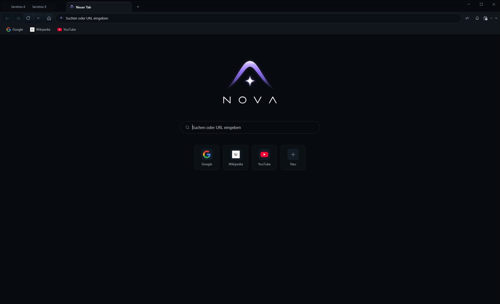

# Changelog — Nova AI Workspace 1.0.0-alpha.20

Nutzersichtbare Änderungen seit `1.0.0-alpha.19` (veröffentlicht am 15.10.2026; 14.10.2026, 42 Commits im Release-Bereich `066f07c5..f76e9af71`).
User-visible changes since `1.0.0-alpha.19` (released 2026-10-15; 2026-10-14, 42 commits in release range `066f07c5..f76e9af71`).

Im Zeitraum wurden 18 Befunde geschlossen; die nutzersichtbaren davon stehen unten, reine Test-, Build- und Prüfer-Arbeit bleibt bewusst draußen.

18 findings were closed in this period; the user-visible ones are listed below, while purely internal test, build and scanner work is deliberately left out.

## Version snapshot / Versionsansicht

Nova AI Workspace alpha.20 on a fresh profile with German interface: new tab page, toolbar, the two default sandboxes and the default shortcuts.
Nova AI Workspace alpha.20 mit frischem Profil und deutscher Oberfläche: Neuer-Tab-Seite, Symbolleiste, die zwei Standard-Sandboxes und die vorgegebenen Schnellzugriffe.

---

# EN

## Highlights

- **Automatic downloads get their own setting.** When a page starts several downloads by itself, Nova asks by default; you can allow or block it globally, per site, once or for this session, and agents can change it through the usual approval steps
- **Agent tabs keep working in the background.** Tabs an agent works in keep rendering while another tab is in front, so exports and animations there finish without the tab being pulled forward
- **Approval dialogs no longer react to typing elsewhere.** While you type in another program, Nova only flashes the taskbar; no button has the initial focus, and clicks or Escape count only after the dialog has been visible for one second
- **First contact with a new SSH server asks you directly.** Nova shows the host-key fingerprint and the agent's call continues once you trust the key; Settings > Connectors offers "Review host key…" for connections still waiting on that decision
- **Safer SSH runs for agents.** `nova.ssh_run` retries safely with an `operationId`, reads local scripts with `stdinFromFile`, checks a success marker, and a short background run finishes in one call; connection failures name their kind and `connectTimeoutSeconds` keeps a switched-off host from hanging
- **Frames of other sites in deep pages.** `nova.perceive` lists every cross-site frame the browser knows, also in very deep pages such as code editors with a live preview
- **Runs on .NET 10 (LTS).** Nova ships the .NET 10 runtime, which receives security updates until November 2028

## New features and improvements

### SSH and connectors

- The first connection to a new SSH server now asks you directly: Nova brings its window to the front and shows the server's host-key fingerprint, and the agent's call continues after you trust the key instead of failing with an error
- SSH connections whose host key still needs your decision show a "Review host key…" button in Settings > Connectors; the fingerprint check was previously only reachable through "Test"
- Approvals that also let an agent read or write local files outside Downloads now say that "Always" covers every local folder for that account, on the button and in the text
- Fixed an issue where an account allowed to read or write local files outside Downloads still refused files on the drive Nova itself runs from, which is usually C: for an installed Nova
- Fixed an issue where repeating `nova.ssh_run_start` or `nova.ssh_shell_open` with the same `operationId` reported a new connection and login that never happened; the repeat now says `replayed: true` with zero side effects
- SSH connection failures now name their kind (timeout, refused, dns, unreachable, dropped handshake) and are marked retryable when they can pass by themselves; a switched-off server no longer comes back as "see the Nova log"
- Fixed an issue where a login the server refused was reported with zero authentication attempts and without the server banner

### Approvals and permission dialogs

- Fixed an issue where an agent's approval dialog came to the front while you were typing in another program and your next key answered it; Nova now only flashes the taskbar while you are typing, no button holds the initial focus, and clicks or Escape count only after the dialog has been visible for one second; the same applies to the plugin access dialogs, where a stray Enter could otherwise have granted access

- Automatic downloads, where a page starts several downloads by itself, have their own setting: globally (default Ask), per site in the site information and the site list, once or for this session; agents can change it through the usual approval steps

### Tabs

- Tabs an agent works in keep rendering in the background instead of being slowed down, so an export or animation there finishes without the tab being brought to the front

### Stability and security

- Nova now runs on .NET 10 (LTS), which receives security updates until November 2028; the .NET 8 runtime of earlier versions stops receiving them in November 2026
- The mail connector uses a patched version of a cryptography component that had known security advisories

## For agents (MCP)

### Protocol and capability contracts

- `nova.ssh_run` accepts an `operationId`: the run keeps going in Nova when the client connection drops, and repeating the exact call returns its result instead of running the commands again; after a Nova restart the repeat reports the stored exit codes or `connector_remote_state_indeterminate`, never a second run. Results are kept 24 hours; the same `operationId` with a different request is refused with `operation_id_reused`
- `nova.ssh_run` reads a local script with `stdinFromFile` (Downloads and the workspace directly, other folders with the account's `local.read` stage) and checks a success marker with `expectStdoutRegex`; a matched marker leaves the output out while `exitCode` and `success` stay
- `nova.ssh_run_start` takes one-shot `stdin` or `stdinFromFile` (sent once, then EOF, needing only `process.exec`); `nova.ssh_run_start` and `nova.ssh_run_read` can wait for the end with `waitForEndSeconds` (up to 300 s) and answer with `outputDetail='compact'`, so a short background run is finished in one call
- `nova.ssh_run`, `nova.ssh_run_start` and `nova.ssh_shell_open` accept `connectTimeoutSeconds` (1-60, default 15), so a switched-off host on the local network answers within seconds
- `nova.ssh_run` accepts `outputDetail='compact'`: per command only outcome, success, exit code and output; truncation, redaction and an unconfirmed end appear only when they happened
- A first SSH contact in an interactive session waits for the user's host-key decision; a declined key ends the call with `-32036` and `connector_host_key_declined`, an unanswered question with `-32033` and `connector_host_key_unknown`; in both cases nothing is sent to the server
- When the connection to Nova drops during a call, the `proxy.outcome_unknown` message now matches the tool: for SSH tools it says the remote command may have finished, kept running or ended with its session, and points to `operationId` and `nova.ssh_run_start` for long runs
- The bootstrap hint names `connector_ops` for tasks that only use mail, SFTP/FTP or SSH accounts, and `nova.get_instructions` no longer suggests task profiles that match only weakly

- `nova.perceive` lists every frame of another site that the browser's frame tree or iframe targets know, also in very deep documents where the DOM walk stops early; `crossOriginCount` is never lower than the listed frames, and a freshly restored tab keeps the counter fields with a note to call again
- `exists` and `not_exists` on a `dom.<selector>` fact now mean "element present"; before, they always passed, and every transition-contract example in Nova's messages and documentation is now a valid contract
- `nova.downloads_wait` reports `status=blocked` and `nova.downloads_list` lists `recentlyBlocked` when a page's automatic downloads were refused; `nova.media_permission_set` (`automaticDownloads`), `nova.media_permission_get` and `nova.permission_center_set` (`automaticDownloadsPermissionMode`) read and change the new setting
- `nova.guarded_send_message` passes on what stopped typing into the composer (`reasonCode`, message, `typeFailure`), for example a welcome dialog covering it, and `sendEvidence.siteSignalHint` names the contract for the page's own sent sign; `verifyLastValue` keeps its JSON type
- `nova.eval` can deliver a large result as a file (`resultDelivery='file'`), and `runtime_unavailable` says whether the page is still loading, being restored or navigating
- A `cdp.timeout` says when the Nova window is minimized (`windowMinimized`), because no tab renders frames then, and names `nova.window_set_state(state='restore')`; that call now reports success when a minimized window comes back maximized
- The task-discovery hint appears once per agent session instead of once per Nova start

---

# DE

## Highlights

- **Automatische Downloads bekommen eine eigene Einstellung.** Startet eine Seite selbst mehrere Downloads, fragt Nova standardmäßig nach; du kannst sie global, je Website, einmalig oder für diese Sitzung erlauben oder sperren, und Agenten können sie über die üblichen Freigabestufen ändern
- **Agenten-Tabs arbeiten im Hintergrund weiter.** Tabs, in denen ein Agent arbeitet, rendern weiter, während ein anderer Tab vorn ist, sodass Exporte und Animationen dort fertig werden, ohne dass der Tab nach vorn geholt wird
- **Freigabedialoge reagieren nicht mehr auf Tippen in anderen Programmen.** Solange du woanders tippst, blinkt nur die Taskleiste; kein Knopf hat beim Erscheinen den Fokus, und Klicks oder Escape zählen erst, wenn der Dialog eine Sekunde sichtbar war
- **Der erste Kontakt mit einem neuen SSH-Server fragt dich direkt.** Nova zeigt den Fingerabdruck des Host-Keys, und der Aufruf des Agenten läuft weiter, sobald du dem Schlüssel vertraust; unter Einstellungen > Konnektoren gibt es „Host-Key prüfen…“ für Verbindungen, die noch auf diese Entscheidung warten
- **Sicherere SSH-Läufe für Agenten.** `nova.ssh_run` lässt sich mit einer `operationId` sicher wiederholen, liest lokale Skripte per `stdinFromFile`, prüft eine Erfolgsmarke, und ein kurzer Hintergrundlauf ist mit einem Aufruf erledigt; Verbindungsfehler nennen ihre Art, und `connectTimeoutSeconds` verhindert, dass ein ausgeschalteter Rechner hängen bleibt
- **Frames anderer Websites auch in tiefen Seiten.** `nova.perceive` listet jeden Frame einer anderen Website, den der Browser kennt, auch in sehr tiefen Seiten wie Code-Editoren mit Live-Vorschau
- **Läuft auf .NET 10 (LTS).** Nova bringt die .NET-10-Laufzeit mit, die bis November 2028 Sicherheitsupdates bekommt

## Neue Funktionen und Verbesserungen

### SSH und Konnektoren

- Die erste Verbindung zu einem neuen SSH-Server fragt jetzt direkt nach: Nova holt sein Fenster nach vorn und zeigt den Fingerabdruck des Host-Keys, und der Aufruf des Agenten läuft weiter, sobald du dem Schlüssel vertraust, statt mit einem Fehler abzubrechen
- SSH-Verbindungen, deren Host-Key noch deine Entscheidung braucht, zeigen unter Einstellungen > Konnektoren die Schaltfläche „Host-Key prüfen…“; die Prüfung des Fingerabdrucks war bisher nur über „Testen“ erreichbar
- Freigaben, mit denen ein Agent auch lokale Dateien außerhalb von Downloads liest oder schreibt, sagen jetzt auf dem Knopf und im Text, dass „Immer“ für jeden lokalen Ordner dieses Kontos gilt
- Ein Fehler wurde behoben, bei dem ein Konto, das lokale Dateien außerhalb von Downloads lesen oder schreiben darf, Dateien auf dem Laufwerk trotzdem ablehnte, von dem Nova selbst läuft, bei einer installierten Nova meist C:
- Ein Fehler wurde behoben, bei dem eine Wiederholung von `nova.ssh_run_start` oder `nova.ssh_shell_open` mit derselben `operationId` eine neue Verbindung und Anmeldung meldete, die nie stattfand; die Wiederholung sagt jetzt `replayed: true` ohne Nebenwirkungen
- SSH-Verbindungsfehler nennen jetzt ihre Art (Timeout, abgelehnt, DNS, nicht erreichbar, abgebrochener Handshake) und sind als wiederholbar markiert, wenn sie von selbst vergehen können; ein ausgeschalteter Server meldet nicht mehr nur „see the Nova log“
- Ein Fehler wurde behoben, bei dem eine vom Server abgelehnte Anmeldung mit null Anmeldeversuchen und ohne Server-Kennung gemeldet wurde

### Freigaben und Berechtigungs-Dialoge

- Ein Fehler wurde behoben, bei dem der Freigabedialog eines Agenten nach vorn kam, während du in einem anderen Programm getippt hast, und dein nächster Tastendruck ihn beantwortete; solange du tippst, blinkt jetzt nur die Taskleiste, kein Knopf hat beim Erscheinen den Fokus, und Klicks oder Escape zählen erst, wenn der Dialog eine Sekunde sichtbar war; dasselbe gilt für die Plugin-Zugriffsdialoge, in denen ein verirrtes Enter sonst Zugriff gewährt hätte

- Automatische Downloads, bei denen eine Seite selbst mehrere Downloads startet, haben eine eigene Einstellung: global (Vorgabe Fragen), je Website in den Website-Informationen und der Website-Liste, einmalig oder für diese Sitzung; Agenten können sie über die üblichen Freigabestufen ändern

### Tabs

- Tabs, in denen ein Agent arbeitet, rendern im Hintergrund weiter, statt gebremst zu werden, sodass ein Export oder eine Animation dort fertig wird, ohne dass der Tab nach vorn geholt wird

### Stabilität und Sicherheit

- Nova läuft jetzt auf .NET 10 (LTS), das bis November 2028 Sicherheitsupdates bekommt; die .NET-8-Laufzeit früherer Versionen bekommt ab November 2026 keine mehr
- Der Mail-Konnektor nutzt eine gepatchte Version einer Kryptografie-Komponente, für die Sicherheitswarnungen bekannt waren

## Für Agenten (MCP)

### Protokoll- und Berechtigungsverträge

- `nova.ssh_run` akzeptiert eine `operationId`: Der Lauf geht in Nova weiter, wenn die Verbindung des Clients abreißt, und der wiederholte, gleiche Aufruf liefert sein Ergebnis, statt die Befehle erneut auszuführen; nach einem Nova-Neustart meldet die Wiederholung die gespeicherten Exit-Codes oder `connector_remote_state_indeterminate`, nie einen zweiten Lauf. Ergebnisse bleiben 24 Stunden abrufbar; dieselbe `operationId` mit einer anderen Anfrage wird mit `operation_id_reused` abgelehnt
- `nova.ssh_run` liest mit `stdinFromFile` ein lokales Skript (Downloads und Workspace direkt, andere Ordner mit der Stufe `local.read` des Kontos) und prüft mit `expectStdoutRegex` eine Erfolgsmarke; bei Treffer entfällt die Ausgabe, `exitCode` und `success` bleiben
- `nova.ssh_run_start` nimmt einmalige Eingabe per `stdin` oder `stdinFromFile` (einmal gesendet, dann EOF, nur `process.exec` nötig); `nova.ssh_run_start` und `nova.ssh_run_read` können mit `waitForEndSeconds` (bis 300 s) auf das Ende warten und mit `outputDetail='compact'` antworten, sodass ein kurzer Hintergrundlauf mit einem Aufruf erledigt ist
- `nova.ssh_run`, `nova.ssh_run_start` und `nova.ssh_shell_open` akzeptieren `connectTimeoutSeconds` (1-60, Standard 15), damit ein ausgeschalteter Rechner im lokalen Netz nach Sekunden antwortet
- `nova.ssh_run` akzeptiert `outputDetail='compact'`: je Befehl nur Ergebnis, Erfolg, Exit-Code und Ausgabe; Kürzung, Schwärzung und ein unbestätigtes Ende erscheinen nur, wenn sie eingetreten sind
- Ein erster SSH-Kontakt in einer interaktiven Sitzung wartet auf die Host-Key-Entscheidung des Nutzers; ein abgelehnter Schlüssel beendet den Aufruf mit `-32036` und `connector_host_key_declined`, eine unbeantwortete Frage mit `-32033` und `connector_host_key_unknown`; in beiden Fällen geht nichts an den Server
- Bricht die Verbindung zu Nova während eines Aufrufs ab, passt die Meldung `proxy.outcome_unknown` jetzt zum Werkzeug: bei SSH-Werkzeugen sagt sie, dass der entfernte Befehl fertig sein, weiterlaufen oder mit seiner Sitzung beendet worden sein kann, und verweist für lange Läufe auf `operationId` und `nova.ssh_run_start`
- Der Bootstrap-Hinweis nennt `connector_ops` für Aufgaben, die nur Mail-, SFTP/FTP- oder SSH-Konten nutzen, und `nova.get_instructions` schlägt keine nur schwach passenden Aufgabenprofile mehr vor
- `nova.perceive` listet jeden Frame einer anderen Website, den der Frame-Baum oder die iframe-Ziele des Browsers kennen, auch in sehr tiefen Dokumenten, in denen der DOM-Durchlauf früh endet; `crossOriginCount` ist nie kleiner als die gelisteten Frames, und ein frisch wiederhergestellter Tab behält die Zählerfelder mit dem Hinweis, erneut aufzurufen
- `exists` und `not_exists` auf einem `dom.<selector>`-Fakt bedeuten jetzt „Element vorhanden“; bisher waren sie immer erfüllt, und jedes Beispiel für einen Übergangsvertrag in Novas Meldungen und Dokumentation ist jetzt ein gültiger Vertrag
- `nova.downloads_wait` meldet `status=blocked` und `nova.downloads_list` führt `recentlyBlocked`, wenn automatische Downloads einer Seite abgelehnt wurden; `nova.media_permission_set` (`automaticDownloads`), `nova.media_permission_get` und `nova.permission_center_set` (`automaticDownloadsPermissionMode`) lesen und ändern die neue Einstellung
- `nova.guarded_send_message` gibt weiter, was das Tippen ins Eingabefeld verhindert hat (`reasonCode`, Meldung, `typeFailure`), etwa einen Willkommensdialog darüber, und `sendEvidence.siteSignalHint` nennt den Vertrag für das eigene Gesendet-Zeichen der Seite; `verifyLastValue` behält seinen JSON-Typ
- `nova.eval` kann ein großes Ergebnis als Datei liefern (`resultDelivery='file'`), und `runtime_unavailable` sagt, ob die Seite noch lädt, wiederhergestellt wird oder navigiert
- Ein `cdp.timeout` sagt, wenn das Nova-Fenster minimiert ist (`windowMinimized`), weil dann kein Tab Bilder rendert, und nennt `nova.window_set_state(state='restore')`; dieser Aufruf meldet jetzt Erfolg, wenn ein minimiertes Fenster maximiert zurückkommt
- Der Hinweis zur Aufgabensuche erscheint einmal je Agentensitzung statt einmal je Nova-Start
