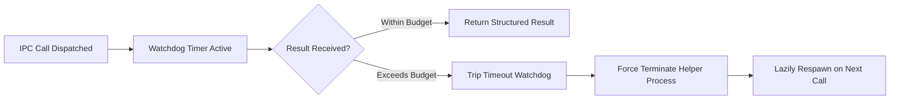

# Host-Bridge IPC, Process Tree & Lifecycle Management

> [!NOTE]
> This guide details how Nova AI Workspace coordinates its multi-process architecture: how `NovaAIWorkspace.exe` communicates with satellite helpers (`Outrider`, `TerminalRunner`, `McpProxy`, `ReplayValidator`), manages watchdog timers, isolates native hardware crashes, and ensures clean process termination.

---

## 1. Multi-Process Architecture Overview

Nova AI Workspace avoids monolithic single-process execution. In complex desktop environments where an application must simultaneously render modern web pages, interface with potentially unstable hardware drivers, host persistent command-line terminals, and serve local AI agents over the Model Context Protocol (MCP), running everything in one process is inherently fragile.

To guarantee that a hung webcam driver, a heavy video remux, or a long-running terminal command never freezes the main browser window or corrupts tab state, Nova delegates tasks across five specialized processes:

```mermaid
flowchart TD
    subgraph Host ["Main Application Shell"]
        Nova["NovaAIWorkspace.exe<br/>(WinUI 3 + Core Engine)"]
    end

    subgraph Satellites ["Supervised Satellite Helpers"]
        Outrider["NovaBrowser.Outrider.exe<br/>(Bounded Native OS Probes & OCR)"]
        Runner["NovaBrowser.TerminalRunner.exe<br/>(Inverted Long-Lived ConPTY Daemon)"]
        Proxy["NovaBrowser.McpProxy.exe<br/>(NativeAOT Stdio-to-HTTP Adapter)"]
        Validator["NovaBrowser.ReplayValidator.exe<br/>(Standalone Forensic Validator)"]
    end

    subgraph Engine ["Browser Engine"]
        WebView["msedgewebview2.exe<br/>(Chromium Multiprocess Runtimes)"]
    end

    Nova <-->|Authenticated Named Pipe (Protocol v2)| Outrider
    Nova <-->|Inverted Named Pipe (Pty Demux)| Runner
    Proxy <-->|Local Streamable HTTP (Bearer Auth)| Nova
    Nova <-->|Direct3D / WinUI XAML Composition| WebView
    Validator -.->|Offline Forensic Analysis| RecordingDir["Recording Storage"]
```

---

## 2. Satellite Helper Supervision Models

Nova implements three distinct supervision models tailored to the operational requirements of each helper process:

### 1. Bounded Lazy Utility (`NovaBrowser.Outrider.exe`)
* **Role:** Executes risky native OS interactions that could deadlock or crash the process: DirectShow COM camera enumeration, hardware audio loopback probes, Whisper speech-to-text models, PaddleOCR and Tesseract character recognition, and video remuxing.
* **Supervision Model:** Lazy and supervised. Nova spawns Outrider only when an agent or user invokes a native probe.
* **Failure Containment:** If a buggy third-party webcam driver hangs during DirectShow COM initialization, Nova's internal watchdog timer trips. Nova terminates Outrider forcefully, logs the incident, and returns a clean error payload. The main browser window, open tabs, and active logins remain completely unaffected.

### 2. Inverted Persistent Daemon (`NovaBrowser.TerminalRunner.exe`)
* **Role:** Hosts Windows Pseudo Consoles (ConPTY) and manages active shell processes (PowerShell, Command Prompt, bash).
* **Supervision Model:** Inverted persistence. While Outrider is a child that dies when Nova closes, TerminalRunner is designed to **outlive the main window**.
* **Independence:** If you close the Nova window while a background build or scheduled script is running, TerminalRunner stays alive in the background. When you reopen Nova, the app automatically reconnects to the running TerminalRunner pipe server, restores terminal output streams, and resumes session monitoring.

### 3. Headless Transport Adapter (`NovaBrowser.McpProxy.exe`)
* **Role:** Bridges AI coding agents communicating via standard input/output (`stdio`) to Nova's internal authenticated HTTP listener.
* **Supervision Model:** Compiled with NativeAOT for instant sub-millisecond startup and zero runtime overhead.
* **Auto-Launch Coordination:** When an agent client (such as Claude Code or Cursor) invokes the proxy while Nova is closed, the proxy automatically launches `NovaAIWorkspace.exe` in the background and polls the health endpoint for up to 90 seconds until the workspace is ready.

---

## 3. Inter-Process Communication (IPC) Protocol

Nova enforces strict cryptographic and protocol boundaries for all local IPC communication:

| IPC Channel | Transport | Authentication & Security | Framing Format |
| :--- | :--- | :--- | :--- |
| **Nova ↔ Outrider** | Windows Named Pipe | Pipe ACL restricted to current user SID + hello handshake token. | Binary frame headers (length-prefixed) + JSON request/response payloads (`MaxFrameBytes = 1 MB`). |
| **Nova ↔ TerminalRunner** | Windows Named Pipe | Per-user capability token verified during hello handshake. | Request-correlated control frames + raw binary PTY output stream demux. |
| **Agent ↔ McpProxy** | Standard Input/Output (`stdio`) | Standard JSON-RPC 2.0 protocol stream. | UTF-8 newline-delimited JSON-RPC messages. |
| **McpProxy ↔ Nova** | Local HTTP (`127.0.0.1`) | Bearer token authentication stored in `%LOCALAPPDATA%\nova-cognitive\Nova\mcp-identity.dat` (secured with Windows DPAPI). | Streamable HTTP with JSON-RPC bodies and health endpoint checks. |

---

## 4. Watchdog Timers & Timeout Budgets

To prevent deadlocks and unresponsive user interfaces, all IPC requests operate under strict timeout budgets:



* **DirectShow Camera Probe Budget:** DirectShow hardware enumeration must complete within 2,200 ms. If a driver stalls, Nova cuts off the call to prevent UI lag.
* **Outrider Worker Deadline:** Complex operations (such as multi-page OCR or video transcription) are governed by a configurable deadline (default 60 seconds), with progressive status reporting.
* **TerminalRunner Connect Timeout:** Nova attempts connecting to an existing runner pipe within 300 ms; if missing, it launches the runner and retries up to 40 times (approximately 10 seconds total).
* **McpProxy Readiness Window:** The proxy waits up to 90 seconds for Nova to complete cold boot and expose its health endpoint before returning an error to the agent client.

---

## 5. Process Lifecycle & Graceful Termination

Managing multiple processes requires deterministic startup, restart, and shutdown handling:

* **Graceful Handshake:** During normal shutdown, Nova dispatches shutdown control signals across its named pipes, giving child processes a grace period to flush file buffers, close open file handles, and release system resources.
* **Force Kill & Orphan Prevention:** If a child process fails to terminate within its grace window, Nova issues an explicit operating system process termination call (`TerminateProcess`).
* **Environment Variable Inheritance:** Child processes inherit parent environment variables unmodified, ensuring that test isolation flags (such as `NOVA_TEST_LOCALAPPDATA_DIR`) propagate cleanly throughout the entire process hierarchy.

---

## 6. Related Documentation

* **[Components & Processes Overview](README.md)** — High-level directory of all Nova executables.
* **[Nova AI Workspace Host](nova-ai-workspace.md)** — Main WinUI 3 application process.
* **[Nova Outrider](outrider/README.md)** — Native hardware probes and OCR helper.
* **[MCP Proxy](mcp-proxy.md)** — NativeAOT stdio transport bridge.
* **[Terminal Runner](terminal-runner.md)** — ConPTY console manager process.
