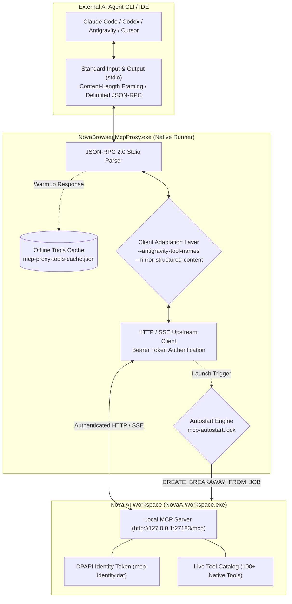
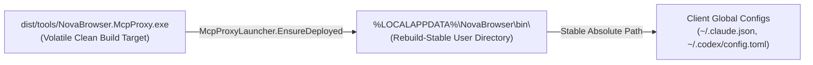
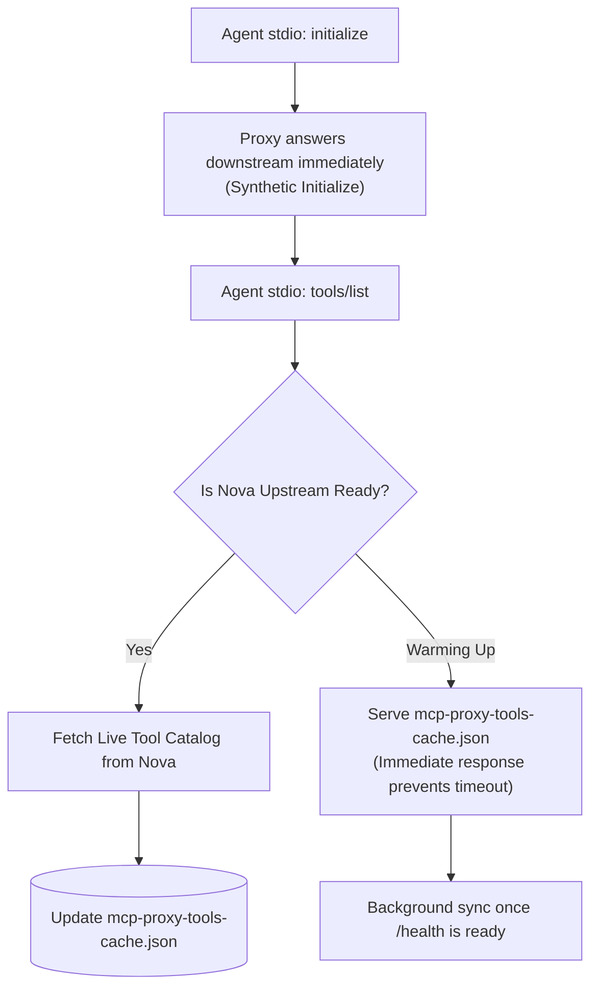

# MCP Stdio Proxy — Agent Connection Bridge & Process Runner

**Binary:** `NovaBrowser.McpProxy.exe`  
**Distribution Locations:** Shipped bundled in `dist/tools/NovaBrowser.McpProxy.exe`; automatically deployed and synchronized by Nova into the rebuild-stable user directory `%LOCALAPPDATA%\NovaBrowser\bin\NovaBrowser.McpProxy.exe`.

The **MCP Stdio Proxy** (often referred to as the **MCP Proxy Runner**) is a high-performance, single-file native executable built with .NET NativeAOT. It acts as the persistent, zero-dependency communication bridge between external AI agent command-line interfaces (such as Anthropic Claude Code, OpenAI Codex, Google Antigravity, Cursor, and Claude Desktop) and Nova's internal Model Context Protocol (MCP) HTTP/SSE server.



---

## 1. High-Level Architecture & Transport Guarantees

Unlike traditional automation bridges that depend on external JavaScript runtimes (e.g. Node.js), Nova's proxy runner is a self-contained native executable with zero external runtime requirements:

* **Bidirectional Stdio Framing:** Accepts JSON-RPC 2.0 messages over standard input and output (`stdin`/`stdout`), dynamically supporting both HTTP-style `Content-Length: ...\r\n\r\n` header framing and raw newline-delimited JSON streams.
* **Separation of Concerns:** External AI programs run as child processes inside user terminals or IDEs, communicating via stdio pipes. Nova AI Workspace is a WinUI desktop application. The proxy decouples their lifecycles so that restarting an IDE or closing a CLI session does not terminate the browser.
* **Network Independence:** This component is an **MCP transport adapter**, completely distinct from the HTTP, HTTPS, and SOCKS5 proxies used for browser traffic egress. Terminating the proxy runner closes only that agent's connection; it never affects the browser's web navigation or active tabs.

---

## 2. Rebuild-Stable Deployment Mechanics (`McpProxyLauncher`)

When integrating with external AI tools, clients save absolute file paths to the proxy binary inside their global configuration files (e.g. `~/.claude.json`, `~/.codex/config.toml`, or `%APPDATA%\Claude\claude_desktop_config.json`):



### Why the Launcher Lives in `%LOCALAPPDATA%`
During software compilation, updates, or git workspace cleans, the build output directory (`dist/`) is completely wiped and regenerated. If agent configurations pointed directly to `dist/tools/NovaBrowser.McpProxy.exe`, every clean rebuild would delete the binary and permanently break agent connectivity. 

To solve this, Nova's deployment engine (`McpProxyLauncher`):
1. **Synchronizes the Binary:** Automatically copies the bundled native proxy into `%LOCALAPPDATA%\NovaBrowser\bin\NovaBrowser.McpProxy.exe` on application boot.
2. **Mutex-Protected Upgrades:** Uses a per-user Windows named mutex (`Local\NovaBrowser_McpProxy_DeployMutex`) to serialize upgrades across parallel processes.
3. **Atomic Rename Dance:** Staged file copies and atomic file moves ensure that binary updates never leave a half-written executable on disk.
4. **Lock Deferral (`DeferredLocked`):** If an active AI agent currently holds the proxy executable open, Nova defers file replacement until the next launch rather than crashing active agent sessions.
5. **UI Reinstallation:** If an external antivirus or permission failure damages the launcher, operators can trigger an instant repair via **Settings → AI & agents → Setup → Reinstall runner**.

---

## 3. Lazy Autostart & Process Breakaway Engine

Autonomous agents frequently run scheduled tasks or CLI commands when Nova is closed. The proxy runner includes an intelligent **Lazy Autostart Engine**:

```mermaid
sequenceDiagram
    autonumber
    actor Agent as AI Agent CLI (e.g. Claude Code)
    participant Proxy as NovaBrowser.McpProxy.exe
    participant Lock as mcp-autostart.lock
    participant OS as Windows Kernel (CreateProcessW)
    participant Nova as NovaAIWorkspace.exe

    Agent->>Proxy: stdio: initialize request
    Proxy->>Proxy: Check http://127.0.0.1:27183/health (Unreachable)
    Proxy->>Lock: Acquire Autostart Lease (mcp-autostart.lock)
    
    alt Lease Owned (First Caller)
        Proxy->>OS: CreateProcessW(NovaAIWorkspace.exe, CREATE_BREAKAWAY_FROM_JOB)
        OS-->>Nova: Spawns independent desktop process
        Note over Proxy,Nova: Polls /health & mcp-boot-status.json (up to 90s)
    else Lease Held by Peer
        Note over Proxy: Joins peer wait loop; monitors existing boot
    end

    Nova-->>Proxy: http://127.0.0.1:27183/health returns status: "ready"
    Proxy->>Nova: Authenticated upstream session established
    Proxy-->>Agent: stdio: initialize response returned
```

### Key Autostart Invariants:
* **Job Object Breakaway (`CREATE_BREAKAWAY_FROM_JOB`):** CLI agents (e.g. Claude Code or terminal processes) are often executed inside Windows Job Objects that automatically terminate all child processes when the terminal exits. The proxy explicitly spawns Nova with `CREATE_BREAKAWAY_FROM_JOB` (with fallback if nested), guaranteeing that the browser stays alive even if the agent CLI closes.
* **Thundering-Herd Protection (`mcp-autostart.lock`):** If multiple agent CLIs (e.g. two parallel terminal windows plus an IDE extension) connect simultaneously while Nova is closed, the proxy uses an exclusive file lease. Exactly one proxy instance launches the browser (`Owned`); all other instances wait as observers (`JoinedPeer`), preventing duplicate browser windows.
* **Environment Variable Scrubbing:** Before launching the browser, the proxy scrubs sensitive or volatile environment variables (such as `NOVA_MCP_*` or `NOVA_TEST_*`) from the child environment block to prevent test profile contamination.
* **Rebuild Grace Window (`ExeMissingGraceMs`):** During local compilation or installer updates, `NovaAIWorkspace.exe` may temporarily disappear from disk for several seconds. Instead of failing immediately, the proxy maintains a 15-second grace window, retrying discovery until compilation completes.
* **Boot Status Diagnostics:** If the browser encounters a startup failure, it writes error markers to `%LOCALAPPDATA%\NovaBrowser\mcp-boot-status.json`. The proxy inspects this file to return clear diagnostic messages instead of hanging indefinitely.

---

## 4. Session Continuity & Offline Tool Caching

To ensure smooth agent interactions, the proxy implements resilient session recovery:



* **Synthetic Downstream Handshake:** When an agent connects, the proxy immediately completes the MCP initialization handshake downstream. The agent never suffers from RPC initialization timeouts while the desktop app is warming up.
* **Offline Tool Cache Persistence (`mcp-proxy-tools-cache.json`):** While Nova is booting, the proxy serves the cached tool catalog from disk. This allows agents to inspect available capabilities immediately without waiting for full browser UI hydration.
* **Transparent Upstream Reconnection:** If Nova is restarted or updated, the proxy maintains its stdio connection with the agent and automatically reconnects to Nova's newly spawned upstream port once `/health` responds.
* **In-Flight Cancellation:** If an agent cancels a tool call (via `notifications/cancelled`), the proxy propagates the cancellation downstream to terminate long-running browser operations promptly.

---

## 5. Commandline Switches & Client Compatibility Matrix

Different AI clients implement variations of the Model Context Protocol. Nova's proxy runner provides built-in compatibility adaptations:

```
Usage: NovaBrowser.McpProxy.exe [--version | --self-test] | [--antigravity-tool-names] [--mirror-structured-content]
```

| Switch / Flag | Target Clients | Technical Behavior & Compatibility Rationale |
| :--- | :--- | :--- |
| *(Default / No Args)* | **Claude Code**, **OpenAI Codex**, **Claude Desktop** | Canonical Nova tool naming (`nova.tabs`, `nova.navigate`) and native dual-payload delivery (`structuredContent` JSON object alongside text summaries). |
| `--antigravity-tool-names` | **Google Antigravity**, **Gemini CLI** | Replaces dots with underscores (`nova_tabs`, `nova_navigate`) for clients that reject dotted identifiers. Transparently maps incoming tool executions back to canonical dotted names, and implicitly enables structured-content mirroring. |
| `--mirror-structured-content` | **Legacy / Text-Only LLM Clients** | Copies the full structured JSON-RPC payload from `structuredContent` directly into the `content[type="text"]` block, ensuring models that discard structured objects still receive complete tool data. |
| `--version` | **Diagnostic Scripts & Installers** | Prints the proxy's exact assembly file version (e.g. `13.0.5.0`) and exits with code `0`. Used by Nova to detect version drift. |
| `--self-test` | **Operators & Health Audits** | Validates JSON-RPC framing, UTF-8 parsing, and profile directory resolution. Outputs `NovaBrowser.McpProxy self-test OK` on success. |

---

## 6. Settings UI Integration & Maintenance

Operators can monitor and manage the proxy runner directly from Nova's graphical user interface under **Menu → Settings → AI & agents → Setup**:

* **Runner Status Indicator:** Displays the active runner state:
  * `Runner ready: C:\Users\<user>\AppData\Local\NovaBrowser\bin\NovaBrowser.McpProxy.exe`
  * `Runner unavailable: <path>` (accompanied by repair instructions).
* **Reinstall Runner Button:** Re-extracts the bundled native binary, cleans up legacy scripts, re-synchronizes global client configurations, and verifies executable file integrity.
* **Activation & Bearer Token Refresh:** Refreshes connection metadata in `%LOCALAPPDATA%\NovaBrowser\mcp-activation.json` and updates encrypted DPAPI tokens.

---

## 7. Diagnostics & Operator Troubleshooting

When troubleshooting agent connectivity, technicians should consult the following diagnostic facilities:

### 1. Shared Proxy Log File
The proxy writes lifecycle and connection events to:
```
%LOCALAPPDATA%\NovaBrowser\Logs\novabrowser-mcp-stdio-proxy.log
```
* **Thread-Safe Shared Append:** Configured with `FileShare.ReadWrite | FileShare.Delete` so multiple concurrent proxy instances can log simultaneously without file contention.
* **Bounded Retention:** Automatically rotates to `.old` once the file exceeds 10 MB to prevent unbounded disk growth.

### 2. Verbose Stderr Tracing (`NOVA_MCP_PROXY_STDERR=1`)
To inspect live JSON-RPC frames and connection transitions directly in your agent terminal:
```powershell
$env:NOVA_MCP_PROXY_STDERR = "1"
claude
```
The proxy will output diagnostic lines prefixed with `[novabrowser-mcp-proxy]` to `stderr` without corrupting `stdout` protocol framing.

### 3. Exit Codes Reference
* **`0`:** Clean shutdown or successful diagnostic run (`--version`, `--self-test`).
* **`2`:** Invalid CLI arguments (e.g. unrecognized flags).
* **Non-zero:** Unhandled socket error, mutex timeout, or unexpected process termination.

---

## 8. Related Documentation

* **[Agent Setup & Quickstart Guide](../getting-started/mcp-setup.md)** — First-time agent configuration and wizard walkthrough.
* **[Agent Governance & Settings](../user-guide/settings/agent-governance-and-mcp.md)** — Permitted settings modifications and supervisory safeguards.
* **[Protocol and Transport Specification](../mcp-reference/protocol-and-transport.md)** — Protocol framing, JSON-RPC 2.0 schemas, and authentication.
* **[Agent Connection Troubleshooting](../troubleshooting/agent-connection-issues.md)** — Diagnostic decision tree for resolving agent connection issues.
* **[All Components Overview](README.md)** — Overview of all processes across Nova AI Workspace.
