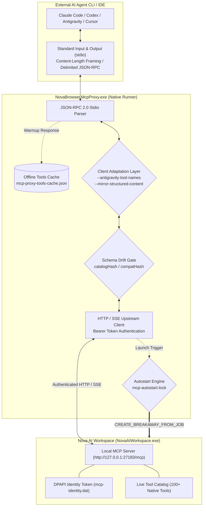
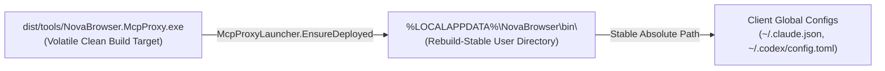
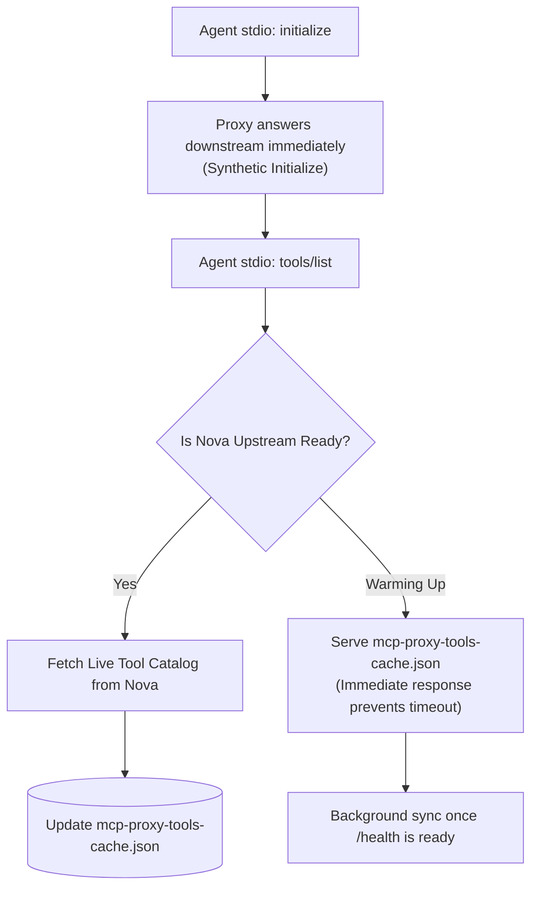
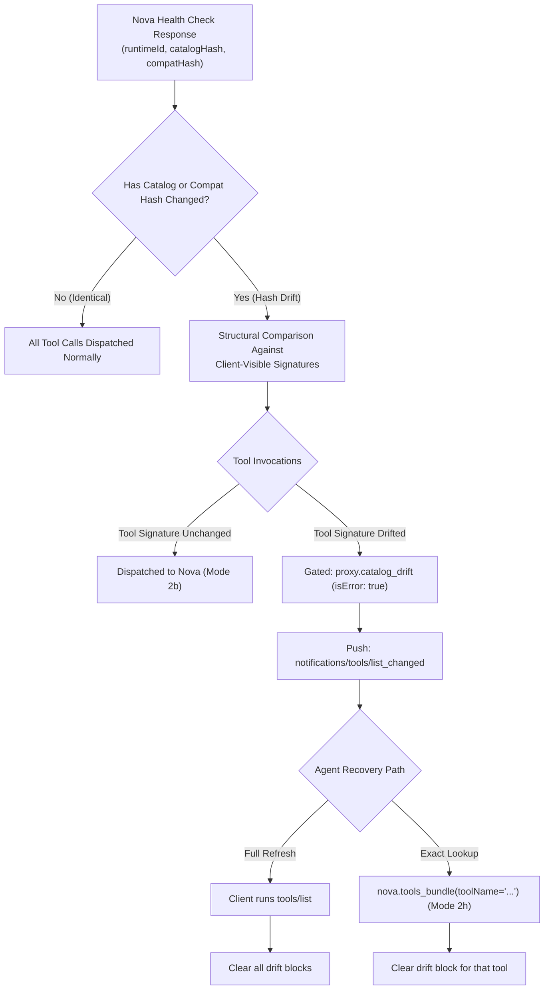
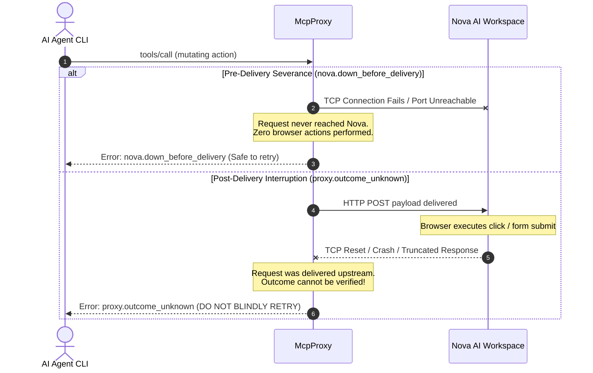

# MCP Stdio Proxy — Agent Connection Bridge & Process Runner

**Binary:** `NovaBrowser.McpProxy.exe`  
**Distribution Locations:** Shipped bundled in `dist/tools/NovaBrowser.McpProxy.exe`; automatically deployed and synchronized by Nova into the rebuild-stable user directory `%LOCALAPPDATA%\NovaBrowser\bin\NovaBrowser.McpProxy.exe`.

The **MCP Stdio Proxy** (often referred to as the **MCP Proxy Runner**) is a high-performance, single-file native executable built with .NET NativeAOT. It acts as the persistent, zero-dependency communication bridge between external AI agent command-line interfaces (such as Anthropic Claude Code, OpenAI Codex, Google Antigravity, Cursor, and Claude Desktop) and Nova's internal Model Context Protocol (MCP) HTTP/SSE server.



---

## 1. High-Level Architecture & Transport Guarantees

Unlike traditional automation bridges that depend on external JavaScript runtimes (e.g. Node.js), Nova's proxy runner is a self-contained native executable with zero external runtime requirements:

* **Bidirectional Stdio Framing:** Accepts JSON-RPC 2.0 messages over standard input and output (`stdin`/`stdout`), dynamically supporting both HTTP-style `Content-Length: ...\r\n\r\n` header framing and raw newline-delimited JSON streams.
* **Separation of Concerns:** External AI programs run as child processes inside user terminals or IDEs, communicating via stdio pipes. Nova AI Workspace is a WinUI desktop application. The proxy decouples their lifecycles so that restarting an IDE or closing a CLI session does not terminate the browser.
* **Network Independence:** This component is an **MCP transport adapter**, completely distinct from the HTTP, HTTPS, and SOCKS5 proxies used for browser traffic egress. Terminating the proxy runner closes only that agent's connection; it never affects the browser's web navigation or active tabs.

---

## 2. Rebuild-Stable Deployment Mechanics (`McpProxyLauncher`)

When integrating with external AI tools, clients save absolute file paths to the proxy binary inside their global configuration files (e.g. `~/.claude.json`, `~/.codex/config.toml`, or `%APPDATA%\Claude\claude_desktop_config.json`):



### Why the Launcher Lives in `%LOCALAPPDATA%`
During software compilation, updates, or git workspace cleans, the build output directory (`dist/`) is completely wiped and regenerated. If agent configurations pointed directly to `dist/tools/NovaBrowser.McpProxy.exe`, every clean rebuild would delete the binary and permanently break agent connectivity. 

To solve this, Nova's deployment engine (`McpProxyLauncher`):
1. **Synchronizes the Binary:** Automatically copies the bundled native proxy into `%LOCALAPPDATA%\NovaBrowser\bin\NovaBrowser.McpProxy.exe` on application boot.
2. **Mutex-Protected Upgrades:** Uses a per-user Windows named mutex (`Local\NovaBrowser_McpProxy_DeployMutex`) to serialize upgrades across parallel processes.
3. **Atomic Rename Dance:** Staged file copies and atomic file moves ensure that binary updates never leave a half-written executable on disk.
4. **Lock Deferral (`DeferredLocked`):** If an active AI agent currently holds the proxy executable open, Nova defers file replacement until the next launch rather than crashing active agent sessions.
5. **UI Reinstallation:** If an external antivirus or permission failure damages the launcher, operators can trigger an instant repair via **Settings → AI & agents → Setup → Reinstall runner**.

---

## 3. Lazy Autostart & Process Breakaway Engine

Autonomous agents frequently run scheduled tasks or CLI commands when Nova is closed. The proxy runner includes an intelligent **Lazy Autostart Engine**:

```mermaid
sequenceDiagram
    autonumber
    actor Agent as AI Agent CLI (e.g. Claude Code)
    participant Proxy as NovaBrowser.McpProxy.exe
    participant Lock as mcp-autostart.lock
    participant OS as Windows Kernel (CreateProcessW)
    participant Nova as NovaAIWorkspace.exe

    Agent->>Proxy: stdio: initialize request
    Proxy->>Proxy: Check http://127.0.0.1:27183/health (Unreachable)
    Proxy->>Lock: Acquire Autostart Lease (mcp-autostart.lock)
    
    alt Lease Owned (First Caller)
        Proxy->>OS: CreateProcessW(NovaAIWorkspace.exe, CREATE_BREAKAWAY_FROM_JOB)
        OS-->>Nova: Spawns independent desktop process
        Note over Proxy,Nova: Polls /health & mcp-boot-status.json (up to 90s)
    else Lease Held by Peer
        Note over Proxy: Joins peer wait loop; monitors existing boot
    end

    Nova-->>Proxy: http://127.0.0.1:27183/health returns status: "ready"
    Proxy->>Nova: Authenticated upstream session established
    Proxy-->>Agent: stdio: initialize response returned
```

### Key Autostart Invariants:
* **Job Object Breakaway (`CREATE_BREAKAWAY_FROM_JOB`):** CLI agents (e.g. Claude Code or terminal processes) are often executed inside Windows Job Objects that automatically terminate all child processes when the terminal exits. The proxy explicitly spawns Nova with `CREATE_BREAKAWAY_FROM_JOB` (with fallback if nested), guaranteeing that the browser stays alive even if the agent CLI closes.
* **Thundering-Herd Protection (`mcp-autostart.lock`):** If multiple agent CLIs (e.g. two parallel terminal windows plus an IDE extension) connect simultaneously while Nova is closed, the proxy uses an exclusive file lease. Exactly one proxy instance launches the browser (`Owned`); all other instances wait as observers (`JoinedPeer`), preventing duplicate browser windows.
* **Environment Variable Scrubbing:** Before launching the browser, the proxy scrubs sensitive or volatile environment variables (such as `NOVA_MCP_*` or `NOVA_TEST_*`) from the child environment block to prevent test profile contamination.
* **Rebuild Grace Window (`ExeMissingGraceMs`):** During local compilation or installer updates, `NovaAIWorkspace.exe` may temporarily disappear from disk for several seconds. Instead of failing immediately, the proxy maintains a 15-second grace window, retrying discovery until compilation completes.
* **Boot Status Diagnostics:** If the browser encounters a startup failure, it writes error markers to `%LOCALAPPDATA%\NovaBrowser\mcp-boot-status.json`. The proxy inspects this file to return clear diagnostic messages instead of hanging indefinitely.

---

## 4. Session Continuity & Offline Tool Caching

To ensure smooth agent interactions, the proxy implements resilient session recovery:



* **Synthetic Downstream Handshake:** When an agent connects, the proxy immediately completes the MCP initialization handshake downstream. The agent never suffers from RPC initialization timeouts while the desktop app is warming up.
* **Offline Tool Cache Persistence (`mcp-proxy-tools-cache.json`):** While Nova is booting, the proxy serves the cached tool catalog from disk. This allows agents to inspect available capabilities immediately without waiting for full browser UI hydration.
* **Transparent Upstream Reconnection:** If Nova is restarted or updated, the proxy maintains its stdio connection with the agent and automatically reconnects to Nova's newly spawned upstream port once `/health` responds.
* **In-Flight Cancellation:** If an agent cancels a tool call (via `notifications/cancelled`), the proxy propagates the cancellation downstream to terminate long-running browser operations promptly.

---

## 5. The Schema Drift Gate & Catalog Integrity

When Nova AI Workspace is updated or restarted with code changes during an active coding session, its native tool schemas (parameters, types, or return shapes) may change. Without protection, an agent CLI running on stale schemas would send malformed payloads that crash or produce undefined behavior.

To prevent this, the MCP proxy runner implements an automated **Schema Drift Gate**:



### Tripartite Runtime Signatures
Every response from Nova's `/health` endpoint carries three cryptographic identifiers:
1. `runtimeId`: A unique GUID generated per browser process boot.
2. `catalogHash`: A SHA-256 hash representing the complete textual tool definitions.
3. `compatHash`: A SHA-256 hash computed specifically over client-visible structural schemas (`name`, `inputSchema`, and `outputSchema`).

### Selective Fault Isolation (Modes 2b & 2c)
When a hash drift occurs:
* **Unaffected Tools Remain Usable (Mode 2b):** The proxy isolates drift to individual tool contracts. If `nova.navigate` modified its arguments but `nova.tabs` remains unchanged, an agent call to `nova.tabs` executes immediately without interruption.
* **Drifted Tools Are Blocked:** Invocations of drifted tools are intercepted by the proxy before reaching the browser, returning `{ "isError": true }` with reason code `proxy.catalog_drift`.
* **Rollback Recovery (Mode 2c):** If Nova is rolled back to its previous version, the proxy detects the restored hash and automatically clears the drift gate without requiring client restarts.

### Dynamic Contract Acknowledgment via Exact Lookup (Mode 2h)
An agent does not need to restart or dump its entire context with a full `tools/list` to unblock a drifted tool. Instead, the agent can perform an exact lookup using `nova.tools_bundle`:

```json
{
  "name": "nova_tools_bundle",
  "arguments": {
    "toolName": "nova.navigate"
  }
}
```

When Nova returns the updated contract, the proxy records the tool's new contract and immediately lifts its drift quarantine. Subsequent calls to `nova.navigate` succeed instantly.

### Additive Growth Tolerance (Mode 2i)
If a Nova update introduces new tools without altering existing tool signatures, the proxy treats this as additive growth. Existing tools continue executing with zero friction, and newly introduced tools become callable as soon as the client refreshes its tool list.

---

## 6. Exactly-Once Execution & The "Outcome Unknown" Safety Invariant

Browser automation involves both idempotent queries (e.g. `nova.read_text`, `nova.tabs`) and mutating, high-stakes side effects (e.g. `nova.input_click` on a payment confirmation button, `nova.guarded_submit_form`, or executing terminal commands).

In distributed systems, network drops during mutating operations create the classic **Two Generals Problem**: did the server execute the action before the connection dropped, or did it fail before execution?



### The Invariant: Strict Refusal to Auto-Replay
The proxy rigorously distinguishes between connection drops before and after delivery:
1. **Pre-Delivery Drop (`nova.down_before_delivery`):** The socket failed before the HTTP request payload was transmitted. The proxy guarantees that zero browser actions took place. The agent can safely retry immediately.
2. **Post-Delivery Drop (`proxy.outcome_unknown` - Modes 4, 4b, 25):** The payload was delivered, but the connection was reset or the HTTP response stream was truncated before completion. Because the browser may have successfully executed the click, submitted a form, or transferred funds, the proxy **strictly refuses to automatically replay the request**.

### Prescribed Agent Recovery Pattern
When an agent receives `proxy.outcome_unknown`:
* **NEVER blindly re-run the same tool call.**
* **Inspect the current browser state first:** Call read-only inspection tools (such as `nova.tabs`, `nova.perceive`, or `nova.read_text`) to inspect the current DOM, verify URL changes, or check for confirmation dialogs.
* **Determine next steps:** Only re-trigger the mutating action if inspection proves that the action did not take effect.

---

## 7. Execution Deadlines & The 40-Minute Duration Ceiling

Standard HTTP microservices rely on aggressive timeouts (typically 15 to 30 seconds). In autonomous browser workflows, such short timeouts are catastrophic:
* A deep crawling task (`nova.crawl_start`) or multi-page site indexing job can run for several minutes.
* Full-page visual analysis (`nova.perceive`) on complex Single Page Applications requires multi-second settlement waits.
* Screen recordings (`nova.screen_record_stop`) and video exports (`nova.video_render`) require prolonged rendering passes.

To support long-running agent workflows without artificial connection kills:
* **The 40-Minute Ceiling (`OneShotMaxDuration`):** Nova's proxy runner configures its upstream HTTP client with an extended timeout:
  ```csharp
  internal static readonly TimeSpan OneShotMaxDuration = TimeSpan.FromMinutes(40);
  ```
* **Cancellation Propagation:** If an agent explicitly cancels a task (transmitting a JSON-RPC `notifications/cancelled` frame), the proxy immediately cancels its internal upstream `CancellationToken`, aborting long-running browser operations promptly without waiting for the 40-minute deadline.

---

## 8. Protocol Version Negotiation & Upstream Clamping

The Model Context Protocol evolves over time with dated specification revisions. Nova's proxy bridges protocol differences between heterogeneous clients and Nova's internal server:

| Protocol Date | Release Milestone | Key Capabilities Supported |
| :--- | :--- | :--- |
| `2025-11-25` | Current Standard | Modern schema definitions, structured content mirroring, rich error framing. |
| `2025-06-18` | Intermediate Release | Enhanced notification streams and capability negotiation. |
| `2025-03-26` | Baseline Milestone | Tool listing, basic stdio framing, call execution. |
| `2024-11-05` | Legacy Protocol | Initial public MCP release. |

### Forward-Compatibility Echo & Clamping (Mode 19c)
When a bleeding-edge AI client connects requesting a speculative or future protocol date (e.g. `2026-06-01` or `2099-12-31`):
1. **Downstream Echo:** The proxy echoes the client's requested version in its downstream `initialize` response, satisfying client-side assertion checks.
2. **Upstream Clamping:** The proxy clamps its upstream session initialization with Nova to the highest verified server specification (`2025-11-25`), preventing version mismatch errors in the desktop application.

### Graceful Fallbacks (Modes 19b, 19d, 19e)
If a client sends an unrecognized, malformed, or nonsensical protocol string (such as non-date strings or invalid leap years), the proxy logs a diagnostic warning and transparently falls back to the default supported baseline (`2025-11-25`), maintaining connectivity without crashing.

---

## 9. Offline Tool Caching & Self-Healing Resilience

The proxy runner is designed to survive hostile disk, network, and memory states:

### Cache Self-Healing (Modes 21 & 21b)
The offline tools cache is stored at `%LOCALAPPDATA%\NovaBrowser\mcp-proxy-tools-cache.json`. If this file is corrupted (e.g. truncated during a sudden system power cut, containing invalid JSON syntax, or missing required schema properties):
* The proxy does not crash.
* It safely ignores the corrupted cache file and serves an actionable warmup message.
* Upon successfully connecting to Nova's `/health` endpoint, it fetches the authoritative catalog and atomically overwrites the corrupted file with a fresh, valid JSON document.

### Cold-Start Notification Synchronization (Mode 2f)
If a client connects when Nova is completely cold and no cache file exists, the initial `tools/list` response may return empty. As soon as Nova finishes booting and exposes its tool registry, the proxy automatically pushes a `notifications/tools/list_changed` JSON-RPC notification down the stdio stream, prompting the agent to fetch the complete tool catalog.

### Multibyte Chunk Framing Across Streams (Mode 22)
Stdio streams deliver data in arbitrary operating system chunks. When an agent or proxy emits multibyte UTF-8 characters (e.g. Unicode emojis, accented characters `üñ`, or non-Latin glyphs), a chunk boundary may split a single character across two `Content-Length` frames. Nova's stdio parser implements stream-level byte buffering, guaranteeing that multibyte sequences are never garbled or decoded as replacement characters (`\uFFFD`).

---

## 10. Complete Error Reason Code Reference Table

When a tool call cannot be completed, Nova's proxy returns a standard JSON-RPC response with `{ "isError": true }`, a descriptive text message, and an explicit machine-readable `reasonCode` in its structured payload:

| Reason Code | Category | Root Cause & Trigger Condition | Prescribed Client / Agent Action |
| :--- | :--- | :--- | :--- |
| `proxy.update_required` | Version Drift | Nova was updated to a newer version that requires an updated proxy protocol. | Restart the agent CLI session to load the updated proxy runner from `%LOCALAPPDATA%\NovaBrowser\bin\`. |
| `proxy.catalog_drift` | Schema Drift | Nova restarted with modified tool schemas. Stale parameters are blocked from delivery. | Run `tools/list` or inspect the specific tool via `nova.tools_bundle(toolName='<tool>')` to acknowledge the new contract. |
| `proxy.outcome_unknown` | In-Flight Drop | Connection dropped mid-flight after request delivery, or HTTP response was truncated. | **DO NOT BLINDLY RETRY.** Inspect current browser state (`nova.tabs`, `nova.perceive`) before repeating actions. |
| `nova.down_before_delivery` | Pre-Delivery Drop | Nova terminated or dropped the socket before the request was delivered upstream. | Zero browser actions took place. Start Nova if stopped and retry the tool call safely. |
| `nova.not_running` | Service Down | Nova AI Workspace is not running, and automatic autostart was disabled or failed to boot. | Launch Nova AI Workspace desktop application, wait for UI ready, and re-run the tool. |
| `nova.not_installed` | Environment | Activation metadata (`mcp-activation.json`) or runtime configuration is missing. | Launch Nova once interactively to initialize the profile and configure agent permissions. |
| `nova.blocked` | Modal / Security | Browser is blocked by a mandatory user sign-in prompt, trial license gate, or modal dialog. | Check `%LOCALAPPDATA%\NovaBrowser\mcp-boot-status.json` or switch to Nova's window to resolve the dialog. |
| `nova.exe_missing` | Compile / Update | `NovaAIWorkspace.exe` is temporarily absent during software build or installer update. | Wait for compilation to finish. The proxy provides a 15-second grace window and a 30-second retry-after. |

---

## 11. Commandline Switches & Client Compatibility Matrix

Different AI clients implement variations of the Model Context Protocol. Nova's proxy runner provides built-in compatibility adaptations:

```
Usage: NovaBrowser.McpProxy.exe [--version | --self-test] | [--antigravity-tool-names] [--mirror-structured-content]
```

| Switch / Flag | Target Clients | Technical Behavior & Compatibility Rationale |
| :--- | :--- | :--- |
| *(Default / No Args)* | **Claude Code**, **OpenAI Codex**, **Claude Desktop** | Canonical Nova tool naming (`nova.tabs`, `nova.navigate`) and native dual-payload delivery (`structuredContent` JSON object alongside text summaries). |
| `--antigravity-tool-names` | **Google Antigravity**, **Gemini CLI** | Replaces dots with underscores (`nova_tabs`, `nova_navigate`) for clients that reject dotted identifiers. Transparently maps incoming tool executions back to canonical dotted names, and implicitly enables structured-content mirroring. |
| `--mirror-structured-content` | **Legacy / Text-Only LLM Clients** | Copies the full structured JSON-RPC payload from `structuredContent` directly into the `content[type="text"]` block, ensuring models that discard structured objects still receive complete tool data. |
| `--version` | **Diagnostic Scripts & Installers** | Prints the proxy's exact assembly file version (e.g. `13.0.5.0`) and exits with code `0`. Used by Nova to detect version drift. |
| `--self-test` | **Operators & Health Audits** | Validates JSON-RPC framing, UTF-8 parsing, and profile directory resolution. Outputs `NovaBrowser.McpProxy self-test OK` on success. |

---

## 12. Settings UI Integration & Maintenance

Operators can monitor and manage the proxy runner directly from Nova's graphical user interface under **Menu → Settings → AI & agents → Setup**:

* **Runner Status Indicator:** Displays the active runner state:
  * `Runner ready: C:\Users\<user>\AppData\Local\NovaBrowser\bin\NovaBrowser.McpProxy.exe`
  * `Runner unavailable: <path>` (accompanied by repair instructions).
* **Reinstall Runner Button:** Re-extracts the bundled native binary, cleans up legacy scripts, re-synchronizes global client configurations, and verifies executable file integrity.
* **Activation & Bearer Token Refresh:** Refreshes connection metadata in `%LOCALAPPDATA%\NovaBrowser\mcp-activation.json` and updates encrypted DPAPI tokens.

---

## 13. Diagnostics & Operator Troubleshooting

When troubleshooting agent connectivity, technicians should consult the following diagnostic facilities:

### 1. Shared Proxy Log File
The proxy writes lifecycle and connection events to:
```
%LOCALAPPDATA%\NovaBrowser\Logs\novabrowser-mcp-stdio-proxy.log
```
* **Thread-Safe Shared Append:** Configured with `FileShare.ReadWrite | FileShare.Delete` so multiple concurrent proxy instances can log simultaneously without file contention.
* **Bounded Retention:** Automatically rotates to `.old` once the file exceeds 10 MB to prevent unbounded disk growth.

### 2. Verbose Stderr Tracing (`NOVA_MCP_PROXY_STDERR=1`)
To inspect live JSON-RPC frames and connection transitions directly in your agent terminal:
```powershell
$env:NOVA_MCP_PROXY_STDERR = "1"
claude
```
The proxy will output diagnostic lines prefixed with `[novabrowser-mcp-proxy]` to `stderr` without corrupting `stdout` protocol framing.

### 3. Exit Codes Reference
* **`0`:** Clean shutdown or successful diagnostic run (`--version`, `--self-test`).
* **`2`:** Invalid CLI arguments (e.g. unrecognized flags).
* **Non-zero:** Unhandled socket error, mutex timeout, or unexpected process termination.

---

## 14. Related Documentation

* **[Agent Setup & Quickstart Guide](../getting-started/mcp-setup.md)** — First-time agent configuration and wizard walkthrough.
* **[Agent Governance & Settings](../user-guide/settings/agent-governance-and-mcp.md)** — Permitted settings modifications and supervisory safeguards.
* **[Protocol and Transport Specification](../mcp-reference/protocol-and-transport.md)** — Protocol framing, JSON-RPC 2.0 schemas, and authentication.
* **[Agent Connection Troubleshooting](../troubleshooting/agent-connection-issues.md)** — Diagnostic decision tree for resolving agent connection issues.
* **[All Components Overview](README.md)** — Overview of all processes across Nova AI Workspace.
