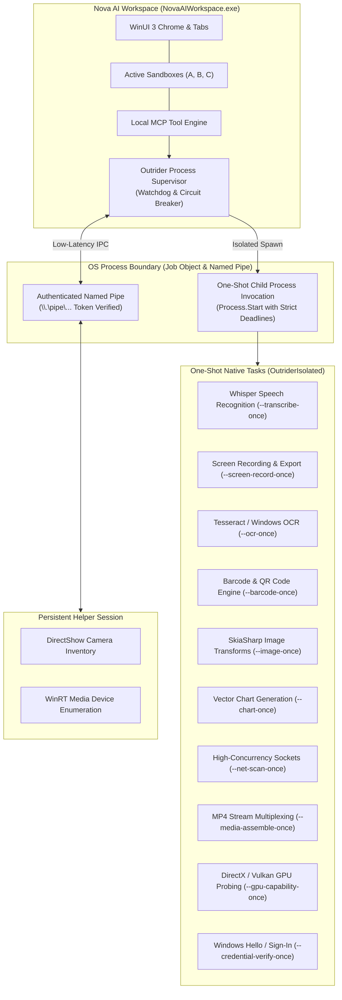
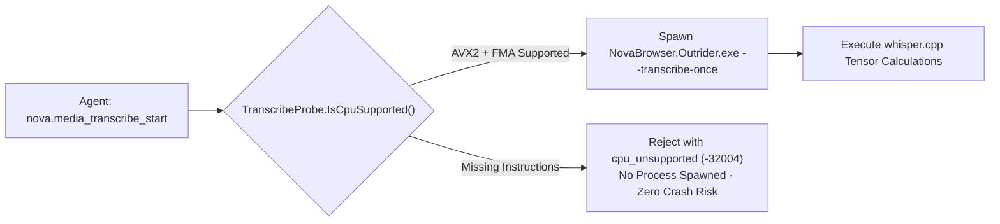

# Nova Outrider — Native Process Boundary & Hardware Engine

**Binary:** `NovaBrowser.Outrider.exe`  
**Distribution Locations:** Shipped at the application root (`dist/NovaBrowser.Outrider.exe`) and in the dependency-isolated directory `dist/OutriderIsolated/NovaBrowser.Outrider.exe`.

**Nova Outrider** is Nova's supervised native helper process. It provides an unmanaged process boundary for operating-system tasks, hardware probes, media processing, computer vision, and machine-learning inference that can hang, leak kernel handles, or crash outside managed .NET exception handling.



---

## 1. Why Native Work Needs a Process Boundary

Modern web workspaces interact deeply with physical operating-system hardware, native media codecs, and computer-vision libraries. However, unmanaged C/C++ libraries, COM interfaces, and kernel drivers introduce severe availability risks:

1. **Uncatchable Access Violations (`0xC0000005`):** If a third-party camera driver, corrupted video codec, or damaged model file dereferences an invalid memory pointer, the Windows kernel aborts the process immediately. In modern .NET runtimes, native memory faults **cannot be caught by managed `try / catch` blocks**.
2. **Illegal Instruction Faults (`0xC000001D`):** Machine learning inference routines (such as Whisper tensor matrix operations) rely on AVX2 and FMA vector extensions. Running vector instructions on an older or virtualized CPU lacking those instructions instantly terminates the executing process.
3. **Indefinite Driver Deadlocks:** Faulty virtual cameras, misconfigured audio capture filters, or buggy USB controllers can freeze indefinitely during hardware enumeration.
4. **Socket Exhaustion on Network Sweeps:** Massive-concurrency network scans (`nova.net_scan`) open hundreds of raw TCP SYN and ARP sockets. If aborted, sockets must be instantly and cleanly released by the kernel without leaking handles into the main browser process.

**Outrider solves this by providing complete fault containment:** All unmanaged operations execute inside disposable child processes. If a driver deadlocks or an image decoder crashes, **only Outrider terminates**. Nova's main browser window, tab state, active sandboxes, and MCP agent workflows remain 100% operational.

---

## 2. Dual-Mode Execution Architecture

To balance execution speed against fault containment, Outrider operates across two distinct lifecycle models:

### Mode A: Persistent Helper Session (Named Pipe)
For low-latency queries that execute frequently (such as checking available webcams when opening settings or navigating video conference pages), spawning a new process every second would introduce unacceptable overhead.

* **Named Pipe IPC:** Nova maintains a hidden, persistent Outrider helper connected via an authenticated, current-user Windows Named Pipe (`\\.\pipe\...`).
* **Handshake Verification:** Nova verifies the connecting helper's process identity, security token, and supported capability version (`ProtocolVersion = 2`) before delegating tasks.
* **Concurrency & Deadlines:** The session supports up to 3 concurrent requests with a hard 60-second deadline.
* **Parent Process Tracking:** Outrider monitors its parent Nova process; if Nova exits or crashes, the helper automatically terminates immediately.

**Persistent Session Capabilities:**
* `media.directShowVideoInputs.v1`: Enumerates legacy DirectShow video capture filters and virtual webcams.
* `media.winRtDeviceInventory.v1`: Enumerates modern Windows Media Devices (cameras, microphones, speakers) via `Windows.Devices.Enumeration`.

---

### Mode B: One-Shot Isolated Processes
Heavy compute tasks, machine learning inference, file exports, and operations with elevated crash risks are executed in **isolated one-shot processes**. Each task runs in a fresh Outrider instance and exits immediately upon completion:

| CLI Switch / Flag | Core Operation & Libraries | Associated MCP Tools & Features |
| :--- | :--- | :--- |
| **`--transcribe-once`** `<wav> <model> [lang]` | Local speech-to-text recognition using `whisper.cpp` and GGML quantized models. Multi-threaded audio decoding (WAV, MP3, Opus). | [`nova.media_transcribe_start`](../../mcp-reference/tools/media-and-transcription/nova-media-transcribe-start.md)<br>Transcription Dialog |
| **`--screen-record-once`** | Real-time screen and window video capture with WASAPI process loopback audio mixing, change detection, and Media Foundation H.264 sinks. | [`nova.screen_record_start`](../../mcp-reference/tools/visual-evidence/nova-screen-record-start.md)<br>Evidence Timeline |
| **`--video-export-once`** | Multi-frame video rendering, animated GIF generation with palette optimization, scene compositing, and zoom keyframe motion. | [`nova.video_render`](../../mcp-reference/tools/video-editing/nova-video-render.md) |
| **`--ocr-once`** `<file> [engine] [pages]` | Native document vision and text extraction using Tesseract OCR and Windows Media OCR. Supports layout analysis and bounding boxes. | [`nova.ocr_read`](../../mcp-reference/tools/files-and-documents/nova-ocr-read.md) |
| **`--barcode-once`** `<json>` | 1D and 2D barcode generation (QR, DataMatrix, Code 128, EAN) and decoding with Reed-Solomon error correction. | [`nova.barcode_generate`](../../mcp-reference/tools/files-and-documents/nova-barcode-generate.md)<br>[`nova.barcode_decode`](../../mcp-reference/tools/files-and-documents/nova-barcode-decode.md) |
| **`--image-once`** `<json>` | Hardware-accelerated image decoding and transformation via SkiaSharp/WIC. Strips EXIF/IPTC privacy metadata and generates contact sheets. | [`nova.image_info`](../../mcp-reference/tools/files-and-documents/nova-image-info.md)<br>[`nova.image_transform`](../../mcp-reference/tools/files-and-documents/nova-image-transform.md) |
| **`--chart-once`** `<json>` | Generates high-resolution vector and raster charts (bar, line, pie, XY plots) via SkiaSharp. | [`nova.chart_create`](../../mcp-reference/tools/files-and-documents/nova-chart-create.md) |
| **`--net-scan-once`** | High-concurrency network scanning. Spawns raw sockets, ARP queries, and application handshakes without socket leaks. | [`nova.net_scan`](../../mcp-reference/tools/proxy-and-network/nova-net-scan.md) |
| **`--media-assemble-once`** | Multiplexes downloaded HLS and DASH video/audio fragments into standard MP4 containers without lossy re-encoding. | Video Downloader |
| **`--gpu-capability-once`** | Probes physical GPU adapters, DirectX 12 feature levels, and Vulkan availability for local AI acceleration. | Settings > Transcription |
| **`--credential-verify-once`** | Displays the Windows Hello / OS sign-in prompt when exporting vault passwords. Kept isolated from WinUI thread loops. | Vault Password Export |

---

## 3. Hardware Vector Gates (AVX2 & FMA Protection)

Before launching heavy machine-learning jobs in Outrider, Nova executes strict pre-flight hardware checks:



* **The Illegal Instruction Crash Hazard:** Running modern matrix multiplication kernels on older CPUs (pre-Haswell, budget Celeron, or virtualized environments without AVX2 passthrough) triggers an immediate `0xC000001D` fatal crash.
* **Deterministic Pre-flight Rejection:** Nova verifies instruction support *before* invoking Outrider. If the host CPU lacks AVX2 or FMA, the call fails gracefully with `reasonCode: "cpu_unsupported"` instead of triggering a crash.

---

## 4. The Isolated Deployment Footprint (`OutriderIsolated`)

Nova's installation includes two copies of the Outrider binary:
1. `dist/NovaBrowser.Outrider.exe` (Root application directory).
2. `dist/OutriderIsolated/NovaBrowser.Outrider.exe` (Dedicated native isolation subdirectory).

### Why Outrider Has an Isolated Directory:
Heavy native tasks depend on third-party C/C++ dynamic libraries (such as `whisper.dll`, `libtesseract`, `SkiaSharp`, `HarfBuzzSharp`, and Media Foundation transforms). Placing these native DLLs in a dedicated `OutriderIsolated/` subdirectory:
* **Prevents DLL Search-Order Hijacking:** Isolates unmanaged search paths from the root desktop executable.
* **Avoids Dependency Collisions:** Ensures native libraries cannot interfere with WinUI 3 or WebView2 runtime assemblies.
* **Streamlines Updates:** Allows updating machine-learning models and OCR dictionaries (`tessdata/`, `models/`) independently of the browser executable.

---

## 5. Supervision, Deadlines & Circuit Breakers

The Outrider supervisor in Nova enforces strict operational safeguards:

1. **Watchdog Deadlines:** Every native job is assigned an explicit execution deadline (default 60 seconds; up to 180 seconds for modal UI credential dialogs). If an Outrider probe hangs in a driver loop, Nova terminates the helper process with `TerminateProcess` and returns a clean error.
2. **Instant Cancellation:** When an operator or agent aborts a task (e.g. `nova.media_transcribe_stop` or `nova.net_scan_stop`), Nova terminates the Outrider process immediately. Memory, file handles, and network sockets are instantly reclaimed by the Windows kernel.
3. **No In-Process Fallback Invariant:** If a native probe fails or crashes in Outrider, Nova **never retries the failed operation inside the interactive browser process**. It reports a degraded result with a reason code instead (for example `timeout`).
4. **Transient Driver Circuit Breakers:** If repeated camera or audio probes time out consecutively, Nova temporarily suspends further probing to prevent thrashing buggy hardware drivers.

---

## 6. Self-Test & Diagnostic Verifications

Technicians, automated test suites, and operators can verify Outrider's native libraries directly from PowerShell:

### Basic Native Self-Test
Validates Named Pipe framing, DirectShow COM interfaces, WinRT capabilities, and image rendering:
```powershell
dist\NovaBrowser.Outrider.exe --self-test
```
*(Expected output: `Nova Outrider self-test OK`).*

### Full Self-Test with OCR Engines
Verifies that Tesseract and Windows Media OCR dictionaries are correctly installed and functional:
```powershell
dist\NovaBrowser.Outrider.exe --self-test --require-ocr
```
*(Expected output: `Nova Outrider self-test OK (OCR verified)`).*

---

## 7. Related Documentation

* **[Components & Processes Overview](../README.md)** — Architectural index of all Nova processes.
* **[Local Speech Transcription](../../core-features/media-intelligence/transcription/README.md)** — Models, recognition workflows, and hardware gates.
* **[Media Intelligence Architecture](../../core-features/media-intelligence/README.md)** — Screen recording, OCR, and computer vision engines.
* **[Devices & Site Permissions](../../core-features/media-intelligence/devices-and-permissions/README.md)** — Hardware governance, webcams, and microphones.
* **[Crash Diagnostics & Performance](../../troubleshooting/performance-and-crashes.md)** — Handling driver crashes and GPU recovery.
