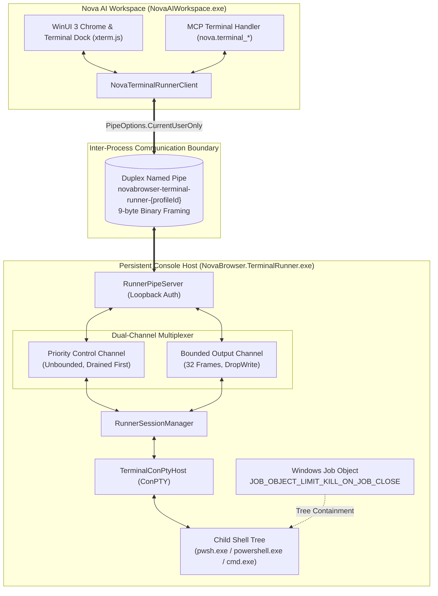
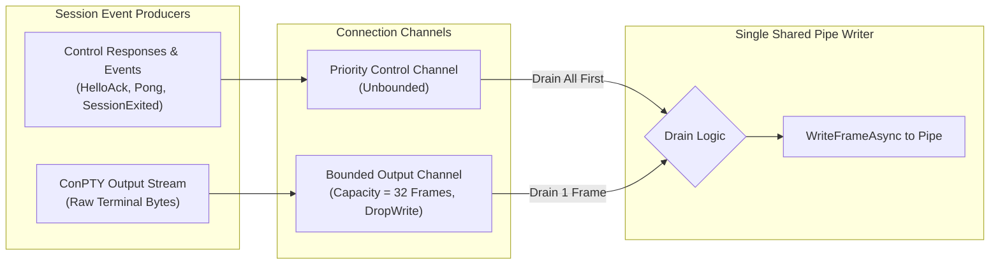
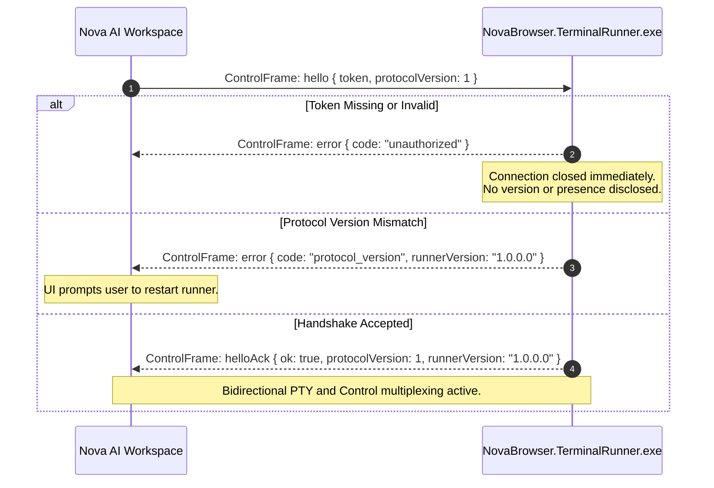
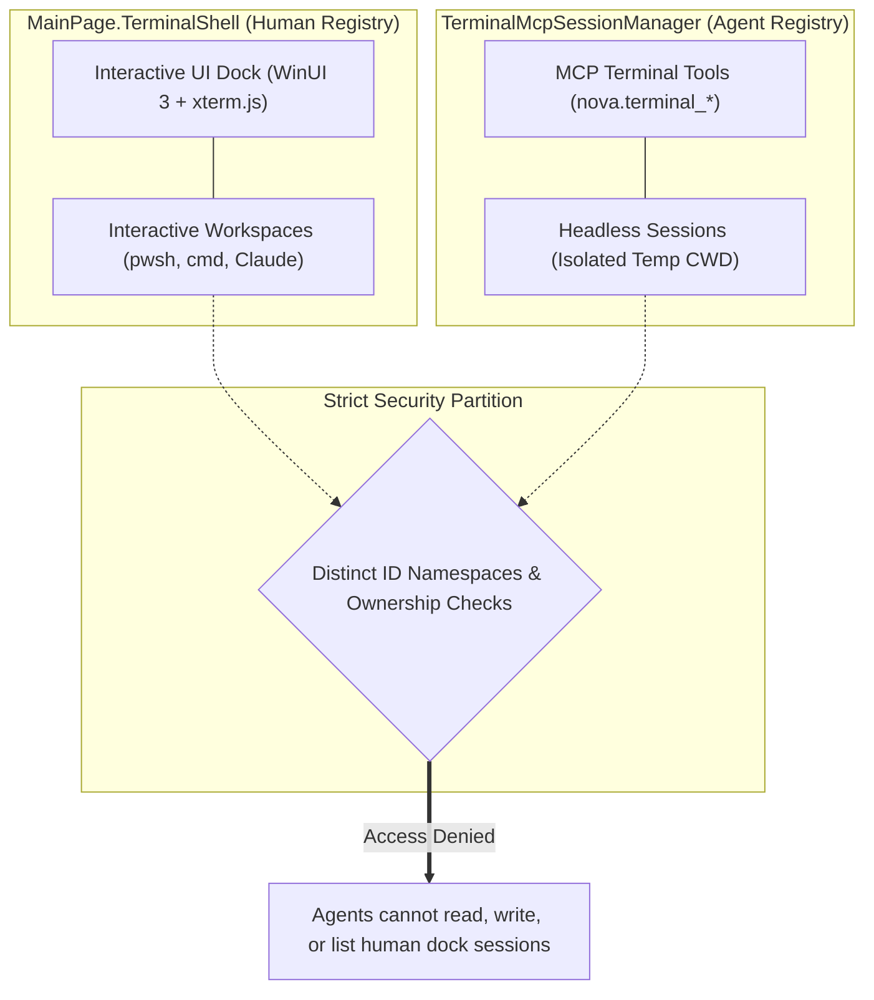

# TerminalRunner — Persistent Console Host & ConPTY Automation Engine

**Binary:** `NovaBrowser.TerminalRunner.exe`  
**Distribution Locations:** Shipped bundled in `dist/tools/NovaBrowser.TerminalRunner.exe`; automatically deployed and synchronized by Nova into `%LOCALAPPDATA%\NovaBrowser\bin\NovaBrowser.TerminalRunner.exe`.

The **Terminal Runner** is an external, dedicated helper process built with .NET. It hosts native Windows pseudo consoles (**ConPTY**) and their attached child shell processes (such as PowerShell 7, Windows PowerShell, Command Prompt, or CLI agents like Claude Code and Codex) outside the main browser application.

By decoupling console process lifecycles from the WinUI 3 desktop application, TerminalRunner ensures that background tasks, compilation jobs, and local development servers (`npm run dev`) continue executing uninterrupted even if Nova is closed, updated, or relaunched.



---

## 1. High-Level Architecture & Lifecycle Decoupling

In modern developer workflows, web browsing and terminal execution are intimately linked. Running shell tasks inside the browser's main UI process creates major reliability hazards:
* **UI Thread Contention:** Heavy console output streams (e.g. verbose build logs or live dev servers) can saturate the WinUI dispatcher and freeze interactive web browsing.
* **Fate Sharing & Process Termination:** If the browser reloads, updates its application package, or encounters an unexpected fault, all running child processes, dev servers, and active test suites would be terminated instantly.

TerminalRunner solves this through architectural separation:
1. **Window vs. Console Decoupling:** Shell processes run side-by-side with `NovaBrowser.TerminalRunner.exe`. Nova's terminal dock acts strictly as a presentation view rendered via `xterm.js`.
2. **Contrast with Outrider:** While [Outrider](outrider/README.md) is a supervised, disposable worker designed for short-lived multimedia and diagnostic probes, TerminalRunner is a **persistent, stateful host** designed for long-running process continuity.
3. **User Permission Alignment:** TerminalRunner does not act as an OS sandbox; hosted shells execute with the full security context and file permissions of the active Windows user.

---

## 2. Duplex Named Pipe Wire Protocol (9-Byte Binary Framing)

Communication between Nova and TerminalRunner takes place over a dedicated duplex named pipe using a high-performance binary envelope defined in `TerminalRunnerProtocol`:

```
+--------------------+----------------+--------------------+------------------------+
| PayloadLength (4B) | FrameType (1B) |   SessionId (4B)   |   Payload (Variable)   |
|   int32 LE (bytes) | 0=Ctrl,1=Out,2=In| int32 LE (0=Ctrl) |  UTF-8 JSON / PTY Bytes|
+--------------------+----------------+--------------------+------------------------+
```

### Framing Invariants:
* **9-Byte Fixed Header:**
  * `PayloadLength` (4 bytes, Little-Endian `int32`): Length of the subsequent payload (capped at 1 MB via `MaxFrameBytes`).
  * `FrameType` (1 byte): Discriminated frame identifier:
    * `0` (`Control`): UTF-8 JSON control messages (handshake, session management, resizing).
    * `1` (`PtyOutput`): Raw console output bytes flowing from the runner to Nova.
    * `2` (`PtyInput`): Raw console input bytes flowing from Nova to the child shell.
  * `SessionId` (4 bytes, Little-Endian `int32`): The target runner session identifier (`0` for top-level control messages).
* **Pre-Composed Atomic Writes:** Header and payload are pre-composed into a single contiguous byte array before invoking `stream.WriteAsync`. Cancellation is evaluated strictly *before* the write begins; writes are never cancelled mid-frame, preventing stream desynchronization.
* **Zero Payload Parsing:** The runner treats `PtyOutput` and `PtyInput` payloads as raw, uninterpreted byte streams. Nova parses neither shell semantics nor VT/ANSI sequences within the runner boundary.

---

## 3. Dual-Channel Multiplexing & The Slow-Consumer Guarantee

A high-output command (e.g. `git log` or verbose compiler output) can produce tens of megabytes of text in seconds. If control frames were queued behind output bytes on a single FIFO pipe, urgent management commands (such as resizing, cancellation, or ping health checks) would starve and time out.

To guarantee responsiveness, `RunnerConnection` implements a dual-channel multiplexer:



### Key Queueing Guarantees:
1. **Priority Control Draining:** The writer loop drains all available messages from the unbounded control channel before picking up a frame from the output channel. Control replies and lifecycle events are never blocked behind output replays.
2. **Replay Chunking (`ReplayChunkSize = 16 KB`):** Historical buffer replays during reconnection are sliced into 16 KB chunks, allowing interleaved control frames to pass through smoothly without head-of-line blocking.
3. **The Slow-Consumer View-Drop Guarantee:** The output channel is bounded to 32 frames in flight with `BoundedChannelFullMode.DropWrite`. If Nova's UI thread is overloaded or renders too slowly, the runner's producer detects the full channel, aborts the view attachment, and drops further streaming frames for that view.
   * **The shell and runner do not crash.**
   * The in-memory ring buffer continues recording output in the background.
   * Nova can re-attach at its own pace using `AttachSession` with a `resumeOffset`.

---

## 4. Deterministic Identity & Pipe Isolation (`TerminalRunnerIdentity`)

Nova and TerminalRunner compute a deterministic identity string based on storage paths, Windows logon sessions, and security integrity levels:

$$	ext{Seed} = 	ext{Normalize}(	ext{BaseDir}) \parallel 	ext{LogonSid} \parallel 	ext{IntegritySid}$$

$$	ext{ProfileId} = 	ext{Hex}(	ext{SHA-256}(	ext{Seed}))[0..16]$$

* **Pipe Name:** `novabrowser-terminal-runner-{profileId}`
* **Mutex Name:** `Local\NovaBrowser.TerminalRunner.{profileId}`

### Multi-Level Security Boundaries:
1. **Cross-User Protection (`PipeOptions.CurrentUserOnly`):** Enforces Windows kernel-level access checks, ensuring that named pipe instances can only be opened by processes running under the identical Windows user SID.
2. **Cross-Logon & Integrity Isolation:** Because the pipe name incorporates the user's logon session SID and mandatory integrity level SID, an elevated (Admin) process or an RDP session cannot intercept or connect to standard-user or console terminal pipes.
3. **Capability Secret Token:** On initial launch, Nova provisions a cryptographically random 64-character token in protected storage. All pipe connections must supply this token in the `hello` handshake frame. Tokens are validated using constant-time comparison (`CryptographicOperations.FixedTimeEquals`) with length padding to prevent timing attacks.

---

## 5. Handshake Protocol & Versioning Negotiation

When Nova connects to the runner's named pipe server, it executes an explicit handshake:



* **Authentication Before Disclosure:** The capability token is verified *before* protocol versions are compared. Unauthenticated callers are rejected with `unauthorized` without disclosing runner presence or version information.
* **Precise Version Mismatch Reporting:** If Nova was updated to a newer build while an older runner helper remains active, the runner returns its exact assembly version in the `protocol_version` error frame. Nova detects this condition and prompts the user to restart the runner rather than reporting a generic connection error.

---

## 6. Process Lifetime & Dual Grace Timers (`RunnerLifetime`)

TerminalRunner monitors its own lifetime using deterministic wall-clock evaluation rather than parent PID polling or fragile heartbeats:

| Operational State | Session Count | Nova Attached? | Lifetime Policy & Action |
| :--- | :---: | :---: | :--- |
| **Active Normal** | $\ge 0$ | **Yes** | **Keep Serving Indefinitely.** An attached Nova resets all idle timers. |
| **Idle Grace** | $0$ | **No** | **Exit after 10 seconds (`IdleExitGraceSeconds`).** With no active sessions and no browser attached, the runner exits promptly to release file locks for compilations and installer updates. |
| **Orphan Grace** | $> 0$ | **No** | **Retain for 24 hours (`OrphanExitGraceHours`).** Background shells (e.g. dev servers) are preserved across browser restarts or crashes. If no browser attaches within 24 hours, the runner terminates sessions to prevent permanent memory leaks. |

---

## 7. Fail-Closed Job Object Containment & Zero-Orphan Guarantee

Terminal processes frequently spawn child trees (e.g. PowerShell launching Node.js, which launches Python or compiler workers). If the runner process crashes or is terminated without cleaning up, these child processes could remain orphaned in memory indefinitely.

To prevent zombie processes, `TerminalConPtyHost` groups every child process into a native **Windows Job Object**:
* Configured with `JOB_OBJECT_LIMIT_KILL_ON_JOB_CLOSE`.
* When a terminal session is closed, or if `NovaBrowser.TerminalRunner.exe` crashes or terminates, the Windows kernel automatically closes the job handle.
* The kernel terminates the entire descendant process tree immediately and synchronously, providing a hardware-enforced **fail-closed zero-orphan guarantee**.

---

## 8. Headless Agent Registry vs. Human Dock Isolation

Nova maintains two strictly separated terminal session registries:



* **Distinct ID Namespaces:** Sessions opened via MCP (`nova.terminal_open`) are registered in `TerminalMcpSessionManager`. Human interactive sessions live in `MainPage.TerminalShell`.
* **Snooping & Injection Prevention:** An autonomous AI agent cannot query, read, or inject commands into a human developer's interactive terminal tabs.
* **Agent Ownership Scoping:** Headless sessions track their owning agent session ID (`X-Nova-Agent-Session`). Only the agent that created the session can interact with it over MCP.

---

## 9. Deterministic Sentinel Execution (`nova.terminal_run_command`)

When an AI agent executes a command via `nova.terminal_run_command`, Nova must detect when the command completes and capture its return code without interpreting arbitrary shell output or breaking ANSI formatting:

```mermaid
sequenceDiagram
    autonumber
    actor Agent as AI Agent
    participant Nova as TerminalMcpSessionManager
    participant PTY as ConPTY Shell (PowerShell)

    Agent->>Nova: nova.terminal_run_command(command="npm test", timeoutSeconds=30)
    Note over Nova: Generates nonce: NOVAEXIT_a1b2c3d4<br/>Appends isolated sentinel line
    Nova->>PTY: npm test
Write-Output "NOVAEXIT_a1b2c3d4_$(if($?){0}elseif($LASTEXITCODE){$LASTEXITCODE}else{1})_END"
    
    PTY-->>Nova: Live command output bytes (captured in ring buffer)
    Note over Nova: Polls every 50ms (256-byte scan overlap)<br/>Scans for pattern: NOVAEXIT_a1b2c3d4_(-?\d+)_END
    
    PTY-->>Nova: Raw text: NOVAEXIT_a1b2c3d4_0_END

    Note over Nova: Sentinel matched! Strips marker from transcript.<br/>Extracts exitCode: 0.
    Nova-->>Agent: Result { ok: true, exitCode: 0, output: "..." }
```

### Sentinel Construction Mechanics:
1. **Isolated Newline (`\r`):** The sentinel command is transmitted on its own line separated by `\r`, rather than concatenated with a semicolon (`;`). If a user's command ends with a trailing PowerShell comment (`git log # check history`), a semicolon would keep the sentinel commented out. A newline cleanly terminates comments.
2. **Dual Exit Code Resolution (`$?` vs. `$LASTEXITCODE`):**
   * PowerShell cmdlets update `$?` but leave `$LASTEXITCODE` unchanged.
   * Native executables update both `$LASTEXITCODE` and `$?`.
   * Nova evaluates `if($?){0}elseif($LASTEXITCODE){$LASTEXITCODE}else{1}`, correctly reporting `0` for successful cmdlets and capturing native executable failure codes.
3. **Negative Exit Code & NTSTATUS Support (`-?\d+`):** The sentinel parser matches negative return codes (e.g. `-1` or NTSTATUS access violations like `-1073741819`), ensuring aborted processes do not cause sentinel match failures.
4. **Quiet Polling with Overlap (`SentinelScanOverlapBytes = 256`):** The poller inspects only new bytes arriving since the last 50 ms tick, retaining a 256-byte window to handle sentinels split across read buffers without copying the entire ring buffer.

---

## 10. Concurrency Gate & The Pending Run Marker

To protect terminal stability during automated workflows:

* **Strict Per-Session Concurrency Gate (`SemaphoreSlim(1, 1)`):** A session accepts exactly one `run_command` at a time. If an agent dispatches a second command while one is still executing, Nova rejects it immediately with reason code `command_rejected`.
* **The Pending Run Marker (`PendingRunMarker`):** If a command times out (`timedOut: true`) or its RPC call is cancelled, **the shell command continues running in the background**. Nova records the unresolved sentinel marker as `PendingRunMarker`.
* **Typing Hazard Protection:** Any subsequent `run_command` call is blocked with `command_rejected` until the pending sentinel appears in the output stream or the agent explicitly cancels the hanging task by sending <kbd>Ctrl</kbd>+<kbd>C</kbd> via `nova.terminal_send_key(key='Ctrl+C')`. This prevents agents from blindly typing new commands into an interactive prompt or hanging process.
* **Single-Line Restriction:** Multi-line commands with embedded newlines are rejected. Uncontrolled newlines cause early line execution before the sentinel is registered, leading to exit code misattribution. Raw multi-line streams must be dispatched via `nova.terminal_write(data=...)`.

---

## 11. Settings & Supervisory Governance Boundaries

The terminal subsystem exposes configuration knobs over MCP via `nova.terminal_settings_get` and `nova.terminal_settings_set`, enforced by strict governance constraints:

| Setting Key | Allowed Values | Permitted Over MCP? | Description & Security Safeguard |
| :--- | :--- | :---: | :--- |
| `theme` | `nova`, `dark` | **Yes** | Terminal colour scheme and background contrast. |
| `fontSize` | `small`, `medium`, `large`, `xlarge` | **Yes** | Display font size in the interactive dock. |
| `programColors` | `auto`, `off` | **Yes** | Configures `NO_COLOR` environment variable handling. |
| `TerminalAgentCanControlDock` | `true`, `false` | **Read-Only** | Determines whether agents may change dock visibility. Agents cannot grant themselves dock control permissions. |
| `TerminalAutoInstallOnboarding` | `true`, `false` | **Read-Only** | Controls automatic writing of onboarding files into project repositories. Agents cannot enable this setting over MCP. |

---

## 12. CLI Diagnostic Switches & Self-Test Suite

Operators and diagnostic scripts can execute `NovaBrowser.TerminalRunner.exe` directly from the console to verify subsystem health:

```powershell
& "$env:LOCALAPPDATA\NovaBrowser\bin\NovaBrowser.TerminalRunner.exe" --self-test
```

| Switch / Argument | Operational Purpose & Validation Scope |
| :--- | :--- |
| `--self-test` | Comprehensive smoke test: validates console mode acquisition (`AllocConsole`/`AttachConsole`), named pipe loopback communication, binary framing, and capability token validation. Outputs `NovaBrowser.TerminalRunner self-test OK`. |
| `--self-test-launch` | Verifies child process creation inside a pseudo console and validates Job Object assignment. |
| `--self-test-session` | Simulates an end-to-end client session: creates a shell, writes input, reads output, and tests graceful teardown. |
| `--self-test-pipe` | Tests raw duplex pipe framing and channel multiplexing without spawning child shells. |
| `--version` | Displays the pinned file version (e.g. `1.0.0.0`) and exits with code `0`. |

### Exit Codes Reference:
* **`0`:** Clean shutdown or successful diagnostic run (`--self-test`).
* **`1`:** Unexpected runtime exception or unhandled fault.
* **`2`:** Invalid command-line arguments.
* **`3`:** Console mode acquisition failed (`ConsoleBootstrap.ConsoleMode.Failed`). ConPTY requires an active console handle; headless environments without a console cannot host pseudo consoles.

---

## 13. Related Documentation

* **[Terminal Workspaces Architecture](../core-features/terminal-workspaces/README.md)** — Architectural specification for ConPTY sessions and process runner isolation.
* **[Terminal & Console Troubleshooting](../troubleshooting/terminal-and-consoles.md)** — Resolving `command_rejected`, sentinels, timeouts, and runner pipe disconnects.
* **[User Guide: Integrated Terminal Dock](../user-guide/tools/terminal.md)** — Interactive dock layout, workspaces, and keyboard shortcuts.
* **[MCP Terminal Operations Catalog](../mcp-reference/tools/terminal-ops/README.md)** — API reference for all programmatic terminal tools.
* **[All Components Overview](README.md)** — Master catalog of all Nova helper executables and runtime processes.
