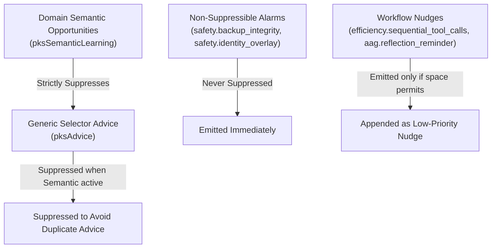
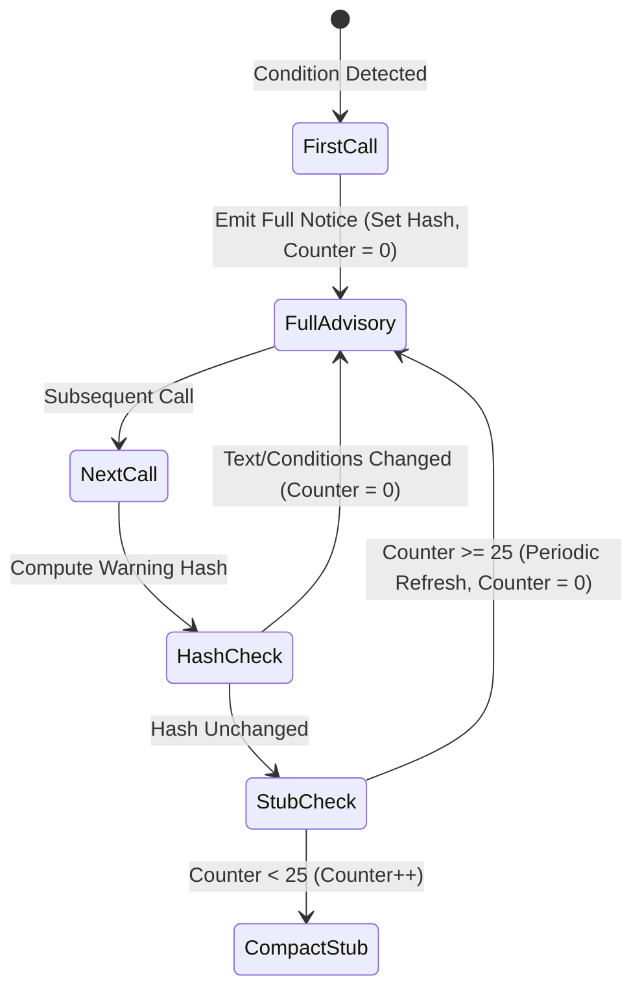

# AAG Annotation Engine & Anti-Nagging

> [!NOTE]
> This guide details the post-dispatch response enrichment pipeline, warning suppression hierarchies, and token starvation mitigation heuristics of the **Agent Awareness Gates (AAG)** subsystem in Nova AI Workspace. For pre-dispatch barriers, see [Pipeline & High-Hazard Barriers](../pipeline-and-high-hazard-barriers/README.md). For sensory and directive gates, see [Perception, Directives & Environment Gates](../perception-directives-and-environment-gates/README.md).

---

## 1. Executive Overview & Architecture

While pre-dispatch gates prevent unsafe or unready actions from executing (`Block` tier), the **AAG Annotation Engine** operates on the outbound response path. When an action executes successfully or fails with advisory warnings (`Warn` tier), the engine decorates the tool response with contextual guidance, operational advice, and recovery pathways.

A primary challenge in autonomous agent engineering is **Advisory Nagging**: repeatedly injecting large advisory notices on every tool call wastes significant context tokens and can distract the LLM's reasoning loop. Nova solves this through a deterministic **Anti-Nagging Architecture**:

```mermaid
flowchart TD
    subgraph Tool_Execution["Tool Execution Layer"]
        Exec["Handler Dispatched & Executed Successfully"]
        Raw["Raw Result Payload\n(DOM nodes, text, cookies, status)"]
    end

    subgraph Annotation_Engine["AAG Annotation Engine"]
        Eval["Evaluate Advisory Conditions\n(Backup integrity, PKS learning, Sandbox ambiguity)"]
        Hier["Apply Suppression Hierarchy\n(pksSemanticLearning > pksAdvice)"]
        Hash["Compute Warning Content Hash\n(Detect repeating notices)"]
        Counter{"SuppressedSinceFull >= 25?"}
        Full["Emit Full Advisory Text\n(content[0].text + structuredContent._aagGates)"]
        Stub["Emit Compact 1-Line Stub\n([AAG Notice: Advisories suppressed...])"]
    end

    subgraph Client["MCP Client Envelope"]
        Wire["Final tools/call JSON-RPC Response"]
    end

    Exec --> Raw
    Raw --> Eval
    Eval --> Hier
    Hier --> Hash
    Hash --> Counter
    Counter -->|Yes (or First Run)| Full
    Counter -->|No (Repeated Notice)| Stub
    Full --> Wire
    Stub --> Wire
```

---

## 2. Post-Dispatch Response Enrichment

When an MCP tool executes, the AAG engine runs an outbound enrichment pass (`ApplyAagHandlerWarningGates`). This enrichment is non-destructive: it preserves primary payload integrity while projecting structured metadata into two distinct channels:

1. **Human & Model-Readable Notice (`content[0].text`):** Prepends a formatted markdown callout to the textual response so the LLM or developer inspecting logs immediately observes the condition.
2. **Machine-Readable Gate Map (`structuredContent._aagGates`):** A typed dictionary containing the evaluated gate states, allowing programmatic orchestration layers to react without regex-parsing prompt strings.

### 2.1 Wire Format Example: Decorated Success Response

```json
{
  "content": [
    {
      "type": "text",
      "text": "[AAG Advisory: safety.sandbox_ambiguity] Multiple sandboxes active for domain 'portal.corp'. Target resolved to Sandbox A. Pass explicit targetId to eliminate ambiguity.\n\nSuccessfully retrieved 14 records from portal."
    }
  ],
  "structuredContent": {
    "status": "success",
    "recordCount": 14,
    "_aagGates": {
      "sandboxAmbiguity": {
        "gateId": "safety.sandbox_ambiguity",
        "status": "warned",
        "resolvedTarget": "tab-corp-a",
        "availableSandboxes": ["A", "B"]
      },
      "coverageScanRecommended": {
        "gateId": "task.coverage_scan_recommended",
        "status": "passed"
      }
    }
  }
}
```

---

## 3. Advisory Suppression Hierarchy

If multiple advisory conditions trigger simultaneously, presenting all of them would flood the LLM's prompt window. AAG applies a strict **Suppression Precedence Hierarchy**:



### 3.1 Hierarchy Rules

1. **Non-Suppressible Alarms:** High-hazard data loss warnings (e.g. `safety.backup_integrity`) bypass all suppression logic and are emitted on every response until formally resolved.
2. **Domain Semantic Learning Dominance:** When an active semantic learning opportunity (`pksSemanticLearning`) exists on a domain, generic selector healing recommendations (`pksAdvice`) are suppressed. This prevents confusing the agent with low-level selector patches when a high-level semantic workflow fix is pending.
3. **Identity Overlay Invariants:** If an identity or permission overlay is active (`safety.identity_overlay`), it is reported with `status: "passed"` or `"warned"` and cannot be disabled via configuration.

---

## 4. The Mail Backup Integrity Alarm (`safety.backup_integrity`)

Data preservation operations have zero margin for silent error. When Nova performs automated email connector backups (`nova.mail_backup_start`, `nova.mail_backup_status`), partial network dropouts or mailbox renumbering could lead an agent to prematurely declare that a backup is complete when messages are missing.

### 4.1 Alarm Mechanics
* If a backup job encounters unread messages, skipped folders, or sha256 checksum mismatches on disk, the `safety.backup_integrity` gate trips into an active alarm state.
* **Persistent Warning:** The alarm injects a mandatory warning banner into **every subsequent MCP response**, regardless of which tool is called.
* **Agent Mandate:** The agent is explicitly instructed: *"Do not tell the user the backup is complete. Tell them what is missing, then continue."*

### 4.2 Resolution Protocol
The alarm cannot be dismissed by ignoring it. It is cleared only when the agent or operator calls `nova.mail_backup_status` with explicit acknowledgment:

```json
{
  "tool": "nova.mail_backup_status",
  "args": {
    "profileId": "prof-work-imap",
    "acknowledge": true
  }
}
```

Once acknowledged, Nova records the audit timestamp in the [Tool Observation Bus (TOB)](../../tool-observation-bus-tob/README.md) and suppresses further alarm notices for that backup session.

---

## 5. Token Starvation Trap & Anti-Nagging Heuristics

In long-running autonomous workflows (e.g. scraping 200 items in a pagination loop), injecting a 200-word advisory warning on every single tool call results in severe **Token Starvation**:
* 200 calls $\times$ 150 tokens = 30,000 wasted context tokens.
* The model repeatedly explains that it sees the warning, displacing substantive reasoning context.

To eliminate this waste, AAG implements three deterministic anti-nagging heuristics:



### 5.1 Stable Guidance Content Hashing
* The engine passes advisory text through `ComputeBootstrapWarningHash`.
* If the generated hash matches the previous emission for this MCP client session, AAG recognizes that the agent has already been notified of this exact state.

### 5.2 The 25-Call Periodic Re-Delivery Heuristic
* Instead of completely silencing repeated warnings forever (which risks the agent forgetting long-term constraints), AAG increments a `SuppressedSinceFull` counter.
* **Calls 2–24:** Emits a concise, single-line stub consuming under 12 tokens:
  ```text
  [AAG Notice: 2 active advisories suppressed. Call tools_bundle to inspect.]
  ```
* **Call 25:** Automatically emits the full advisory text to refresh the LLM's active working memory, then resets `SuppressedSinceFull` to zero.

### 5.3 Client-Keyed Identity Tracking
* Anti-nagging counters are bound to client identity metadata (`McpClientInfo.Name` and session GUID).
* If a client disconnects and reconnects (or if a different agent persona attaches to the shared bus), counters reset to zero, ensuring new agent instances receive complete environmental orientation.

---

## 6. Client Recovery Architecture & Integration Patterns

Client orchestrators can handle AAG gates at two levels:
1. **Model-Driven Recovery:** The LLM reads `content[0].text`, parses the recommended remediation, and emits the next tool call.
2. **Programmatic Wrapper Recovery:** The client library intercepts `_meta["io.nova/aag"]` and automatically resolves predictable gates (such as `safety.perceive_first` or `user.site_note`) without expending an extra LLM inference cycle.

### 6.1 Python Automated Recovery Wrapper

The following reference implementation demonstrates programmatic self-healing using the official Model Context Protocol Python client:

```python
"""Automated AAG pre-dispatch recovery wrapper for MCP clients."""

from typing import Any, Dict


async def execute_tool_with_aag_recovery(
    client: Any, tool_name: str, args: Dict[str, Any], max_retries: int = 2
) -> Any:
  """Executes an MCP tool call with automated AAG gate self-healing."""
  attempts = 0

  while attempts <= max_retries:
    attempts += 1
    result = await client.call_tool(tool_name, args)

    # If the call succeeded, return immediately
    if not getattr(result, "is_error", False):
      return result

    # Inspect structured AAG metadata under _meta["io.nova/aag"]
    meta = getattr(result, "meta", None) or {}
    aag = meta.get("io.nova/aag")
    if not aag:
      return result  # Standard non-AAG tool error

    gate_id = aag.get("gateId")
    is_retryable = aag.get("retryable", False)
    resolution = aag.get("resolution")

    # 1. Unconditional Safety Barriers: Never retry automatically
    if gate_id in ("safety.emergency_stop", "safety.disk_space_low"):
      raise RuntimeError(f"Workflow halted by critical safety barrier: {gate_id}")

    # 2. User Policy Directives: Surface to reasoning loop or acknowledge
    if gate_id == "user.site_note":
      domain = aag.get("domain") or aag.get("currentPageUrl")
      note_key = aag.get("key")
      print(f"[AAG Directive Received] Domain: {domain}, Key: {note_key}")

      # Acknowledge directive receipt via dedicated tool
      await client.call_tool(
          "nova.domain_note_ack", {"domain": domain, "key": note_key}
      )
      # Re-dispatch original tool call
      return await client.call_tool(tool_name, args)

    # 3. Resolvable Sensory Preconditions (Perceive-First, Bootstrap)
    if is_retryable and resolution and attempts <= max_retries:
      res_tool = resolution.get("tool")
      res_args = resolution.get("args", {})
      print(f"[AAG Resolving] Executing {res_tool} to satisfy {gate_id}...")

      res_result = await client.call_tool(res_tool, res_args)
      if getattr(res_result, "is_error", False):
        raise RuntimeError(f"AAG resolution step {res_tool} failed.")

      # Retry original call after satisfying precondition
      continue

    return result

  return result
```

### 6.2 TypeScript Orchestrator Integration

```typescript
/**
 * TypeScript handler for AAG business errors in MCP agents.
 */
import { Client } from "@modelcontextprotocol/sdk/client/index.js";

interface AagBlockMeta {
  kind: string;
  gateId: string;
  gateMode: string;
  retryable: boolean;
  resolution?: {
    tool: string;
    args?: Record<string, unknown>;
  };
}

export async function invokeWithAagGuard(
  client: Client,
  toolName: string,
  toolArgs: Record<string, unknown>
): Promise<unknown> {
  const response = await client.callTool({ name: toolName, arguments: toolArgs });

  if (response.isError && response._meta?.["io.nova/aag"]) {
    const aag = response._meta["io.nova/aag"] as AagBlockMeta;

    if (aag.retryable && aag.resolution) {
      console.warn(`[AAG Guard Tripped: ${aag.gateId}] Resolving via ${aag.resolution.tool}...`);
      
      // Execute resolution tool
      await client.callTool({
        name: aag.resolution.tool,
        arguments: aag.resolution.args ?? {},
      });

      // Retry original tool call
      return await client.callTool({ name: toolName, arguments: toolArgs });
    }
  }

  return response;
}
```

---

## 7. Related Documentation

* **[Agent Awareness Gates Hub](../README.md)** — Master overview and central enforcement matrix.
* **[Pipeline & High-Hazard Barriers](../pipeline-and-high-hazard-barriers/README.md)** — Pre-dispatch pipeline stages, fail-closed barriers, and business error framing.
* **[Perception, Directives & Environment Gates](../perception-directives-and-environment-gates/README.md)** — DOM observation, MUST-read site notes, native modals, and SPA state preservation.
* **[Tool Observation Bus (TOB)](../../tool-observation-bus-tob/README.md)** — Audit telemetry and forensic recording of all gate events.
* **[Phenomenological Knowledge Store (PKS)](../../learning/phenomenological-knowledge-store-pks/README.md)** — Selector healing advice and semantic learning opportunities.

[All core features](../../README.md)
