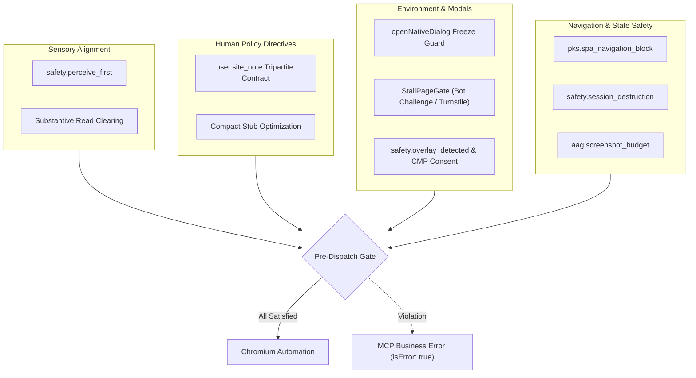
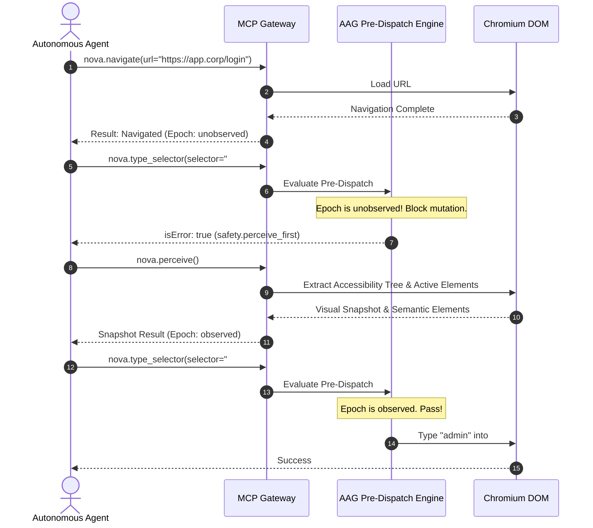
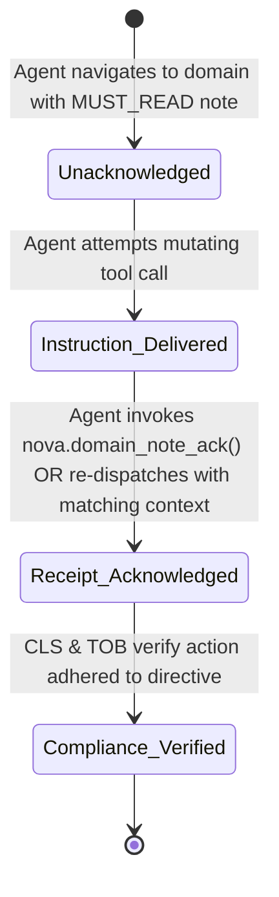
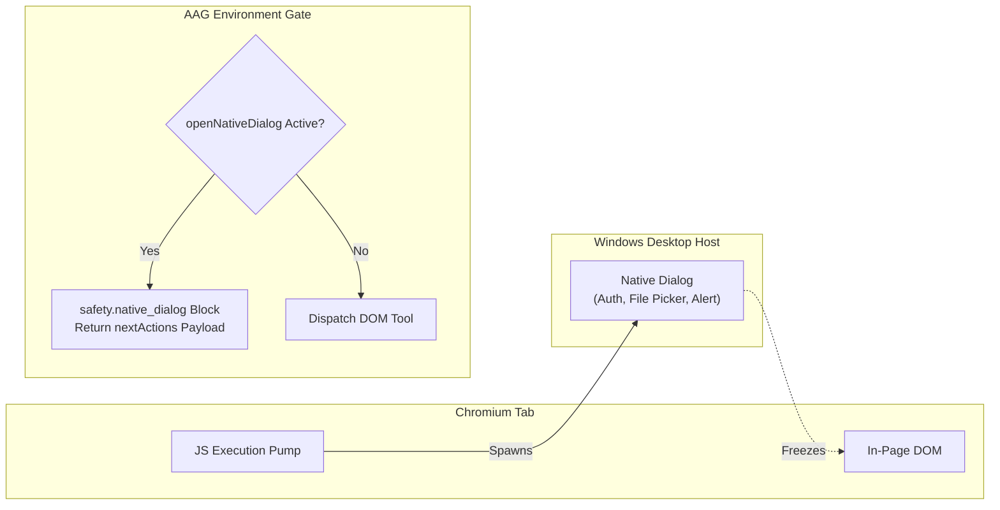

# AAG Perception, Directives & Environment Gates

> [!NOTE]
> This guide details the sensory alignment, user policy enforcement, and runtime environment gates of the **Agent Awareness Gates (AAG)** subsystem in Nova AI Workspace. For pipeline mechanics, see [Pipeline & High-Hazard Barriers](../pipeline-and-high-hazard-barriers/README.md). For master enforcement matrices, see the [Agent Awareness Gates Hub](../README.md).

---

## 1. Executive Overview & Scope

Autonomous agents frequently fail when operating across dynamic web applications because they attempt to act upon assumptions rather than confirmed environmental facts. Typical failure patterns include:
* Clicking stale selectors immediately following a URL transition before the new page has rendered ("Blind Mutation").
* Ignoring human operational guidelines authored for specific production domains.
* Attempting DOM clicks while an operating system native dialogue (e.g. file picker or HTTP authentication) has suspended the browser message pump.
* Accidentally refreshing a Single Page Application (SPA), wiping uncommitted in-memory form state.
* Flooding host memory by requesting raw uncompressed image buffers across ultra-high-resolution viewports.

AAG addresses these challenges through five specialized gate categories that govern sensory verification, directive compliance, and environmental readiness.



---

## 2. Sensory Alignment & The Perceive-First Gate (`safety.perceive_first`)

### 2.1 The Blind Mutation Problem
When an agent issues a navigation command (e.g. `nova.navigate(url='https://example.com/checkout')`), the HTTP response or DOM transition may complete asynchronously. If the agent immediately fires `nova.click_selector(selector='#submit-order')` without first observing the landing page, two catastrophic failures occur:
1. **False Execution:** The selector `#submit-order` might exist on the *previous* page, triggering an unintended click before the navigation completes.
2. **Hallucinated Layout:** The target page may have rendered an error banner, modal, or redirect that alters the entire workflow, which the agent blindly ignores.

### 2.2 The Perception Clearing Rule
To enforce sensory grounding, AAG tracks an internal **Observation Epoch**:
* Any navigation tool (`nova.navigate`, `nova.route`, `nova.back`, `nova.forward`, `nova.reload`), sandbox switch, or new tab creation resets the tab's observation epoch to `unobserved`.
* While `unobserved`, all mutating tools (`nova.click_selector`, `nova.type_selector`, `nova.select_option`, `nova.file_upload`, `nova.input_text`, `nova.input_click`) are strictly blocked.
* The block is cleared **only** when the agent executes a substantive observation primitive.



### 2.3 Substantive vs. Non-Substantive Reads

Not all read operations satisfy the perceive-first requirement:
* **Substantive Primitives (Clear Gate):**
  * `nova.perceive`: Generates a full multimodal/structural accessibility snapshot.
  * `nova.read_dom`: Returns serialized DOM hierarchy.
  * `nova.read_text`: Reads rendered textual content of the page.
  * `nova.wait_for_selector`: Explicitly awaits element synchronization.
  * `nova.eval`: Executes in-page JavaScript inspection.
* **Non-Substantive Primitives (Do Not Clear Gate):**
  * `nova.page_info` or `nova.tabs`: Only return top-level metadata (URL, title), providing no evidence that the agent has observed the actual in-page content.

### 2.4 Wire Block Example
```json
{
  "content": [
    {
      "type": "text",
      "text": "[AAG Block: safety.perceive_first] Navigation detected. Mutating action 'nova.type_selector' blocked. You must observe the page state before modifying elements. Call nova.perceive() or nova.read_text()."
    }
  ],
  "isError": true,
  "_meta": {
    "io.nova/aag": {
      "kind": "aag_block",
      "gateId": "safety.perceive_first",
      "gateMode": "block",
      "retryable": true,
      "traceId": "trace-perceive-41102",
      "resolution": {
        "tool": "nova.perceive",
        "args": {}
      },
      "settingOverride": {
        "setting": "PerceiveFirstGateMode",
        "alternatives": ["warn", "shadowblock", "off"]
      }
    }
  }
}
```

---

## 3. User Policy Directives & Tripartite Site Notes (`user.site_note`)

Nova AI Workspace empowers human operators to author **Domain Notes** (`MUST_READ` directives) for specific hostnames (e.g. `jira.corp.internal`, `aws.amazon.com`). These notes enforce non-negotiable human policies such as mandatory approval workflows, forbidden destructive buttons, or required data entry formats.

### 3.1 The Tripartite Site Note Lifecycle
To ensure that an agent cannot bypass or "forget" user guidelines, AAG enforces a 3-stage lifecycle:



1. **Stage 1: Instruction Delivered:** When an agent attempts an action on a domain governed by an active `MUST_READ` note, AAG blocks the call pre-dispatch, returning the complete directive text inside `content[0].text`.
2. **Stage 2: Receipt Acknowledged:** The agent reasoning model must review the instructions and explicitly acknowledge receipt. It can satisfy the gate by calling `nova.domain_note_ack(domain='jira.corp.internal', key='prod-safety')` or re-dispatching its call after updating its operational plan.
3. **Stage 3: Compliance Verified:** Subsequent actions are tracked in the [Tool Observation Bus (TOB)](../../tool-observation-bus-tob/README.md) and verified by the [Closed-Loop System (CLS)](../../closed-loop-system-cls/README.md) to ensure that prohibited actions were not taken.

### 3.2 Compact Stub Optimization
To prevent long user directives from repeatedly bloating the LLM's context window on every tool call, AAG employs a **Compact Stub Pattern**:
* The full directive text is transmitted only on the first encounter (`Stage 1`).
* After acknowledgment, subsequent notifications on the same domain are truncated to a lightweight stub (e.g. `[AAG Directive active: 'prod-safety' (acknowledged)]`), consuming fewer than 15 tokens.

---

## 4. Host Dialogs & Native Modals

Autonomous browser agents typically operate inside the Chromium DOM sandbox. However, certain interactions spawn operating system dialogs that freeze DOM execution entirely:
* HTTP Basic Authentication challenges
* OS File Upload / Download file pickers
* JavaScript `window.alert()`, `confirm()`, and `prompt()` modals
* Print dialogues



### 4.1 Native Dialog Resolution (`openNativeDialog`)
When a native dialog is active, any attempt to call DOM tools (`nova.click_selector`, `nova.type_selector`) will time out or hang the thread. AAG intercepts these calls and returns an immediate block containing an executable `nextActions` resolution payload:

```json
{
  "content": [
    {
      "type": "text",
      "text": "[AAG Block: safety.native_dialog] An operating system dialog is currently open, freezing page interaction. You must resolve or dismiss this dialog before interacting with DOM elements."
    }
  ],
  "isError": true,
  "_meta": {
    "io.nova/aag": {
      "kind": "aag_block",
      "gateId": "safety.native_dialog",
      "gateMode": "block",
      "retryable": true,
      "details": {
        "dialogType": "file_picker",
        "title": "Open File"
      },
      "resolution": {
        "tool": "nova.ui_confirm_native_dialog",
        "args": {
          "button": "cancel"
        }
      }
    }
  }
}
```

### 4.2 Bot Challenges & The `StallPageGate`
When an agent encounters Cloudflare Turnstile, AWS WAF, or CAPTCHA challenge pages, the DOM is deliberately stalled by third-party anti-automation scripts.
* **The 750ms Classification Budget:** Rather than immediately failing or hanging, AAG evaluates the page state against known challenge signatures. It allocates a 750ms classification budget to differentiate between a slow network load and an active anti-bot challenge.
* **Agent Escalation:** If classified as an active challenge, AAG flags the condition to the orchestrator, preventing the agent from burning tokens repeatedly retrying clicks against an unresponsive iframe.

### 4.3 Modal & CMP Overlays (`safety.overlay_detected`)
Full-screen cookie banners (CMP) and promotional modals intercept click events, causing clicks intended for underlying buttons to be swallowed or misdirected.
* AAG evaluates element hit-testing before dispatching clicks.
* If a blocking overlay covers the target coordinate, the call is rejected with `safety.overlay_detected`.
* **Resolution Hint:** Directs the agent to invoke `nova.cmp_apply(intent='accept_all')` or `nova.dismiss_blockers()`.

---

## 5. Navigation & State Safety

### 5.1 SPA Navigation Guard (`pks.spa_navigation_block`)
Modern Single Page Applications (React, Angular, Vue, Next.js) manage rich in-memory application state, drafts, and client-side routing.
* If an agent naively calls `nova.navigate` or `nova.reload` with the current URL, the browser executes a hard reload, discarding client-side cache and draft states.
* **AAG Enforcement:** When the active target is recognized as an active SPA route, AAG blocks hard reloads.
* **Bypass:** The agent must either use in-page DOM navigation primitives or explicitly pass `"force": true` to confirm an intentional hard refresh.

### 5.2 Session Destruction Barrier (`safety.session_destruction`)
Navigating away from an authenticated, transaction-critical session (e.g. leaving a checkout funnel or bank transfer flow) can invalidate authentication tokens or abort submitted transactions.
* AAG requires two explicit flags to execute a destructive navigation away from protected workflows:
  1. `"force": true`
  2. `"confirmSessionDestruction": true`

### 5.3 Dynamic Media Byte Budget (`aag.screenshot_budget`)
High-DPI viewports across multi-monitor setups can produce raw screenshot bitmaps exceeding $60\text{ MB}$. Transmitting these large binary payloads over JSON-RPC causes severe memory spikes and context window exhaustion in LLM orchestrators.

AAG enforces a tiered media budget:
* **Payload $\le 1\text{ MB}$:** Transmitted inline as standard Base64 image data.
* **Payload $1\text{ MB} - 50\text{ MB}$:** AAG automatically intercepts the buffer, saves the image to a temporary file on host disk, and returns a lightweight file path reference (`content[0].text = "Screenshot saved to C:/.../screenshot.png"`).
* **Payload $> 50\text{ MB}$:** Hard blocked pre-dispatch to prevent host out-of-memory (OOM) conditions. The agent must downscale the capture viewport or reduce quality parameters.

---

## 6. Related Documentation

* **[Agent Awareness Gates Hub](../README.md)** — Master overview and central enforcement matrix.
* **[Pipeline & High-Hazard Barriers](../pipeline-and-high-hazard-barriers/README.md)** — Pre-dispatch pipeline stages, fail-closed barriers, and business error framing.
* **[Annotation Engine & Anti-Nagging](../annotation-engine-and-anti-nagging/README.md)** — Response enrichment, suppression hierarchies, and client recovery playbooks.
* **[Domain Notes Architecture](../../learning/domain-notes/README.md)** — User-authored domain directives and acknowledgment storage.
* **[Browser Interaction](../../browser-interaction/README.md)** — DOM element selection, coordinates, and event dispatch.

[All core features](../../README.md)
