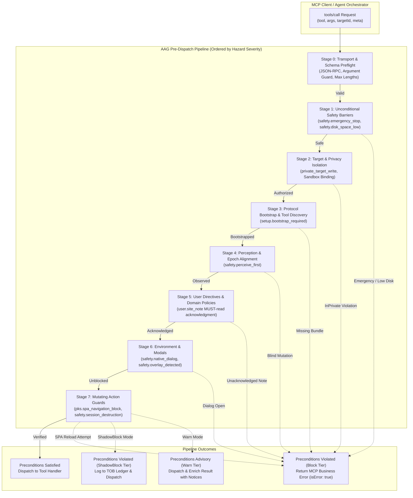
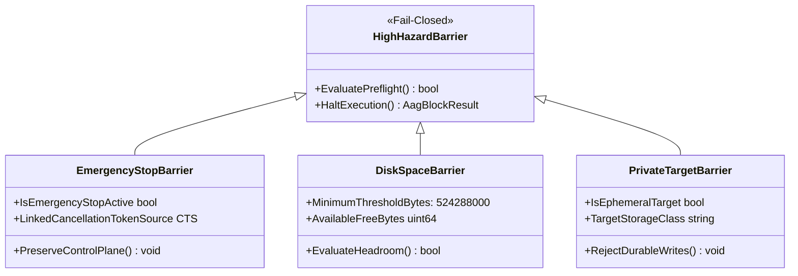
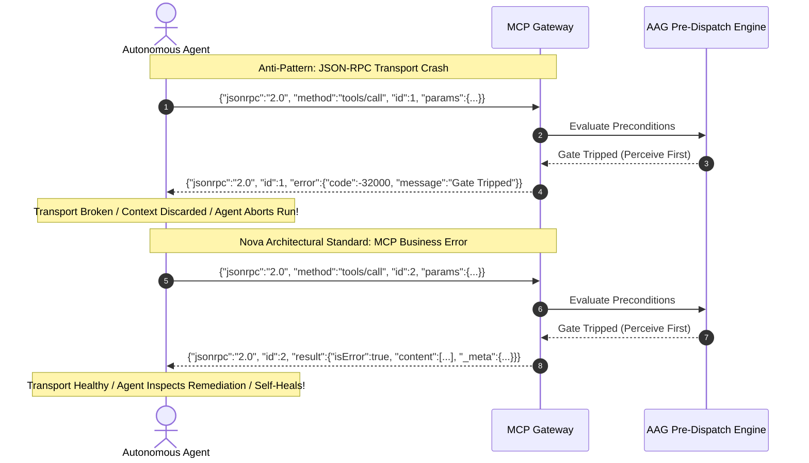
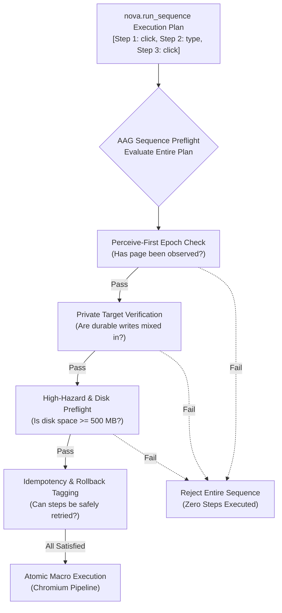

# AAG Pipeline & High-Hazard Barriers

> [!NOTE]
> This guide details the pre-dispatch evaluation pipeline, enforcement tiers, and fail-closed safety barriers of the **Agent Awareness Gates (AAG)** subsystem in Nova AI Workspace. For higher-level concepts and cross-domain enforcement matrices, refer to the [Agent Awareness Gates Hub](../README.md).

---

## 1. Executive Overview & Pipeline Architecture

Every incoming Model Context Protocol (MCP) `tools/call` request received by Nova AI Workspace traverses an ordered pre-dispatch evaluation pipeline before reaching Chromium browser instances, native OS subsystems, or local SQLite data stores. 

While the [Tool Observation Bus (TOB)](../../tool-observation-bus-tob/README.md) captures telemetry for post-action forensic recording and the [Closed-Loop System (CLS)](../../closed-loop-system-cls/README.md) validates visual outcome assertions, AAG functions as the **preemptive gatekeeper**. It evaluates whether operational preconditions, environmental readiness, host resources, and user safety directives permit tool execution to proceed.



---

## 2. The 7-Stage Pre-Dispatch Evaluation Pipeline

The evaluation pipeline is ordered strictly by hazard severity. Process-wide safety conditions and storage health are evaluated prior to parsing domain rules or verifying DOM state:

### Stage 0: Transport & Schema Preflight
* Verifies JSON-RPC 2.0 framing, tool existence, and argument schema conformity.
* Evaluates input string guard limits (e.g. `targetId` length $\le 64$ characters, selector complexity limits) to prevent memory allocation denial-of-service.

### Stage 1: Unconditional Safety Barriers
* **`safety.emergency_stop`:** Evaluates whether an operator has triggered a process-wide halt from the native host UI.
* **`safety.disk_space_low`:** Checks available storage headroom on the application data volume. If free disk space is $\le 500\text{ MB}$, all mutating tools and durable writes are blocked immediately.

### Stage 2: Target & Privacy Isolation
* **`private_target_write`:** Verifies whether the active target is an InPrivate / Incognito session. Rejects durable writes (notes, cookies, credentials, phenomenological memory) originating from ephemeral contexts.
* Resolves sandbox identity (`Sandbox A`, `Sandbox B`) and validates target tab ownership leases (`tab_claim`).

### Stage 3: Protocol Bootstrap & Tool Discovery
* **`setup.bootstrap_required`:** Evaluates whether the client has registered core capability bundles via `nova.tools_bundle(bundle='browser_automation')`.
* Enforces structured tool registration to prevent token-wasting probe cycles where agents call individual tools without loading dependent subsystem schemas.

### Stage 4: Perception & Epoch Alignment
* **`safety.perceive_first`:** Evaluates whether navigation or page creation occurred since the last substantive DOM observation.
* Protects against "Blind Mutation" where agents attempt clicks or text entry against stale DOM representations from prior URLs.

### Stage 5: User Directives & Domain Policies
* **`user.site_note`:** Queries the domain notes repository for user-authored `MUST_READ` directives bound to the current origin.
* If an unacknowledged note is present, the pipeline blocks mutating actions and surfaces the note text to the agent reasoning loop.

### Stage 6: Environment & Modals
* **`safety.native_dialog`:** Checks if an OS-level file picker, HTTP basic auth modal, or alert dialog (`openNativeDialog`) has frozen DOM interaction.
* **`safety.overlay_detected`:** Checks whether a full-screen cookie consent banner (CMP) or modal dialogue obscures the target element (`blocking_overlay_active`).

### Stage 7: Mutating Action Guards
* **`pks.spa_navigation_block`:** Detects whether an active Single Page Application (SPA) session would be destroyed by a hard browser reload.
* **`safety.session_destruction`:** Requires explicit multi-parameter confirmation (`confirmSessionDestruction: true`) before executing destructive session resets.
* **`aag.screenshot_budget`:** Enforces memory and payload limits on binary image captures.

---

## 3. Four Operational Enforcement Tiers

Every gate in AAG can be independently configured in `settings.json` across four operational modes:

| Mode | Wire Behavior | Telemetry / Audit | Execution Effect | Typical Use Case |
| :--- | :--- | :--- | :--- | :--- |
| `Off` | Zero intervention | None | Tool executes immediately without inspection. | Headless benchmark testing; legacy compatibility. |
| `Warn` | Dispatches tool; enriches response with warning | TOB event recorded with `advisory` severity | Tool mutates target; response includes remediation advice. | Non-critical best practices; capability bundle nudges. |
| `ShadowBlock` | Dispatches tool; logs simulated denial | TOB event recorded with `shadow_block` severity | Tool mutates target; gate condition evaluated for telemetry. | Canary deployments of new policy gates without production disruption. |
| `Block` | Rejects tool pre-dispatch; returns `isError: true` | TOB event recorded with `blocked` severity | Tool execution halted; structured recovery payload returned. | Destructive mutations; user directives; safety barriers. |

### 3.1 The ShadowBlock Canary Tier

The `ShadowBlock` tier is specifically designed for enterprise policy validation. When evaluating a new gate rule (such as strict CMP overlay blocking or task coverage enforcement), enabling `Block` immediately might break existing automated workflows.

Under `ShadowBlock`:
1. The AAG engine evaluates the gate condition exactly as it would in `Block` mode.
2. If the precondition fails, a detailed assertion failure is recorded in the [Tool Observation Bus (TOB)](../../tool-observation-bus-tob/README.md) audit ledger.
3. The tool call is **not** aborted; it is permitted to dispatch to Chromium.
4. Engineering teams can query TOB logs to calculate the blast radius and false-positive rate before upgrading the gate to `Block`.

```json
{
  "gateId": "safety.overlay_detected",
  "gateMode": "shadowblock",
  "evaluatedCondition": "blocking_overlay_active == true",
  "dispatched": true,
  "telemetryRecord": "tob.audit.shadow_gate_trip",
  "targetId": "tab-0912-prod"
}
```

---

## 4. Fail-Closed High-Hazard Barriers

While most awareness gates are configurable and agent-resolvable, three unconditional safety barriers are permanently active and cannot be bypassed via tool parameters:



### 4.1 Process-Wide Emergency Stop (`safety.emergency_stop`)

When an operator clicks "Emergency Stop" in the Nova host UI, the application enters an uninterruptible safety state. 

* **Mechanism:** The host runtime cancels the master `CancellationTokenSource`. All in-flight Chromium automation, scheduled script runs, and background crawling tasks are immediately aborted.
* **Control Plane Preservation:** The MCP server itself remains online to answer diagnostic queries, but every mutating tool call fails immediately.
* **Resolution Pathway:** The agent cannot resolve this barrier. It requires physical operator intervention in the native WinUI window to clear the emergency state.

#### Wire Response Example:
```json
{
  "content": [
    {
      "type": "text",
      "text": "[AAG Block: safety.emergency_stop] All automation has been halted by the operator. Control plane preserved for diagnostics. Mutating tools are disabled."
    }
  ],
  "isError": true,
  "_meta": {
    "io.nova/aag": {
      "kind": "aag_block",
      "gateId": "safety.emergency_stop",
      "gateMode": "block",
      "retryable": false,
      "traceId": "trace-emg-88129",
      "durationMs": 1
    }
  }
}
```

### 4.2 Storage Exhaustion Preflight (`safety.disk_space_low`)

Browser automation generates significant disk volume: WebView2 profile caches, screenshot buffers, DOM snapshots, network interception dumps, and SQLite task ledgers.

* **Threshold:** The pre-dispatch engine queries available disk headroom on the `%LOCALAPPDATA%\NovaBrowser` drive. If available space drops below $500\text{ MB}$ ($524{,}288{,}000\text{ bytes}$), the barrier trips.
* **Fail-Closed Protection:** All mutating operations, file uploads, screenshot captures, and database writes are rejected. Read-only DOM and text inspection remain operational.
* **Resolution Pathway:** System storage must be freed on the host. The agent can invoke diagnostic queries (`nova.device_diagnostics`) to inspect drive utilization.

### 4.3 InPrivate Target Protection (`private_target_write`)

Nova AI Workspace supports isolated InPrivate browsing tabs for sensitive operations.

* **Privacy Boundary:** Ephemeral tabs must leave zero persistent forensic traces on disk upon closure.
* **Enforced Scope:** 22+ persistent storage tools (including `nova.domain_note_upsert`, `nova.pks_upsert`, `nova.task_instance_create`, and `nova.operator_notes_store`) verify target tab classification.
* If a mutating tool attempts to persist state derived from an InPrivate tab into durable SQLite stores, AAG blocks the call with `private_target_write`.
* **Resolution Pathway:** Switch target tab context to a standard persistent sandbox profile before saving durable state.

---

## 5. Protocol Demarcation: Business Errors vs. JSON-RPC Protocol Crashes

A critical architectural distinction in Nova AI Workspace is how AAG communicates gate denials over the Model Context Protocol.



### Why Protocol Errors (`jsonrpc.error`) Are Banned for Policy Denials
In JSON-RPC 2.0, returning a top-level `error` object signifies that the **transport or protocol layer has broken** (e.g. invalid JSON, method not found, internal server crash). Most LLM orchestrators treat JSON-RPC errors as catastrophic failures: they abort the entire reasoning chain, invalidate conversational tool context, or restart the MCP client process.

### The AAG Business Error Contract
A gate trip is an **expected domain condition**, not an unhandled server crash. Therefore, AAG emits valid MCP tool results with:
1. `isError: true` at the root level.
2. A human- and model-readable explanation in `content[0].text`.
3. A structured, machine-executable recovery payload under the `_meta["io.nova/aag"]` reverse-DNS namespace.

This allows the agent's LLM to read the diagnostic instructions, execute the indicated remediation tool, and retry the operation smoothly.

---

## 6. Atomic Sequence Pre-Validation (`nova.run_sequence`)

When agents dispatch multi-step macros using `nova.run_sequence`, evaluating awareness gates individually *between* sequential steps could lead to partial execution states (e.g. Step 1 clicks, Step 2 types, Step 3 fails an AAG gate, leaving a form half-submitted).

To prevent state corruption, AAG executes **Atomic Sequence Pre-Validation**:



1. **Global Preflight:** AAG iterates through all actions in the proposed sequence. If any step violates an unconditional barrier (`emergency_stop`, `disk_space_low`, `private_target_write`), the entire sequence is rejected prior to dispatching Step 1.
2. **Epoch Synchronization:** If the sequence begins with or follows a navigation action, Step 1 must be an explicit observation primitive (`nova.perceive`, `nova.read_dom`) unless `force: true` is passed.
3. **Rollback & Idempotency Tagging:** If a step fails mid-execution due to an unexpected DOM transition, AAG tags the failure with the exact index of the halted step, preventing the agent from naively re-running the entire sequence from Step 0.

---

## 7. Wire Format & Metadata Specification

The structured metadata emitted under `_meta["io.nova/aag"]` adheres to a strict contract:

```json
{
  "content": [
    {
      "type": "text",
      "text": "[AAG Block: safety.perceive_first] DOM interaction rejected. Page state has changed since last observation. Call nova.perceive() before modifying DOM elements."
    }
  ],
  "isError": true,
  "_meta": {
    "io.nova/aag": {
      "kind": "aag_block",
      "gateId": "safety.perceive_first",
      "gateMode": "block",
      "retryable": true,
      "traceId": "trace-aag-99214-bc",
      "durationMs": 4,
      "resolution": {
        "tool": "nova.perceive",
        "args": {}
      },
      "settingOverride": {
        "setting": "PerceiveFirstGateMode",
        "alternatives": ["warn", "shadowblock", "off"]
      }
    }
  }
}
```

### Schema Definitions

| Field | Type | Required | Description |
| :--- | :---: | :---: | :--- |
| `kind` | `string` | Yes | Constant `"aag_block"`. |
| `gateId` | `string` | Yes | Unique identifier of the triggered gate (e.g. `"safety.perceive_first"`). |
| `gateMode` | `string` | Yes | Active enforcement mode (`"warn"`, `"shadowblock"`, `"block"`). |
| `retryable` | `boolean` | Yes | Indicates if automated remediation can resolve the failure. |
| `traceId` | `string` | Optional | Correlation identifier matching TOB diagnostic logs. |
| `durationMs` | `number` | Optional | Pre-dispatch gate evaluation latency in milliseconds. |
| `resolution` | `object` | Optional | Concrete tool name and arguments required to satisfy the gate. |
| `settingOverride` | `object` | Optional | Application setting key and allowable enum values to adjust policy. |

---

## 8. Related Documentation

* **[Agent Awareness Gates Hub](../README.md)** — Master overview and central enforcement matrix.
* **[Perception, Directives & Environment Gates](../perception-directives-and-environment-gates/README.md)** — DOM observation, MUST-read site notes, native modals, and SPA state preservation.
* **[Annotation Engine & Anti-Nagging](../annotation-engine-and-anti-nagging/README.md)** — Response enrichment, suppression hierarchies, and client recovery playbooks.
* **[Tool Observation Bus (TOB)](../../tool-observation-bus-tob/README.md)** — Forensic recording of all attempted, blocked, and executed actions.
* **[Closed-Loop System (CLS)](../../closed-loop-system-cls/README.md)** — Post-dispatch outcome verification and transition contracts.

[All core features](../../README.md)
