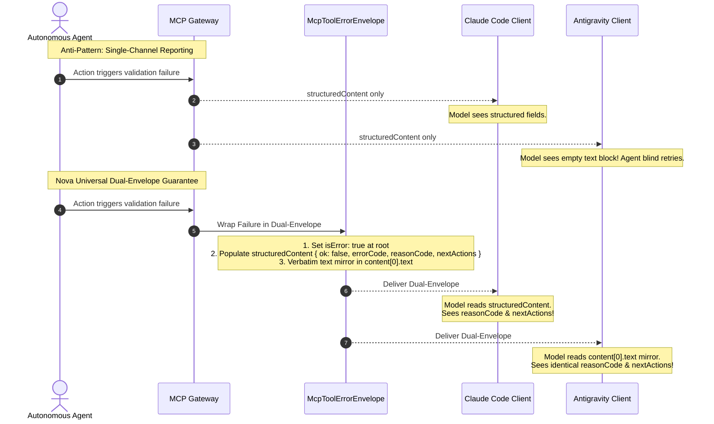
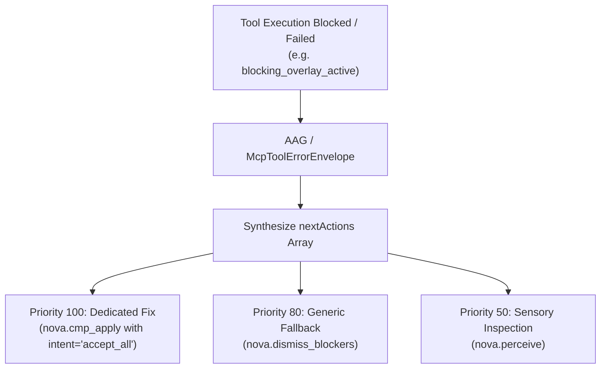
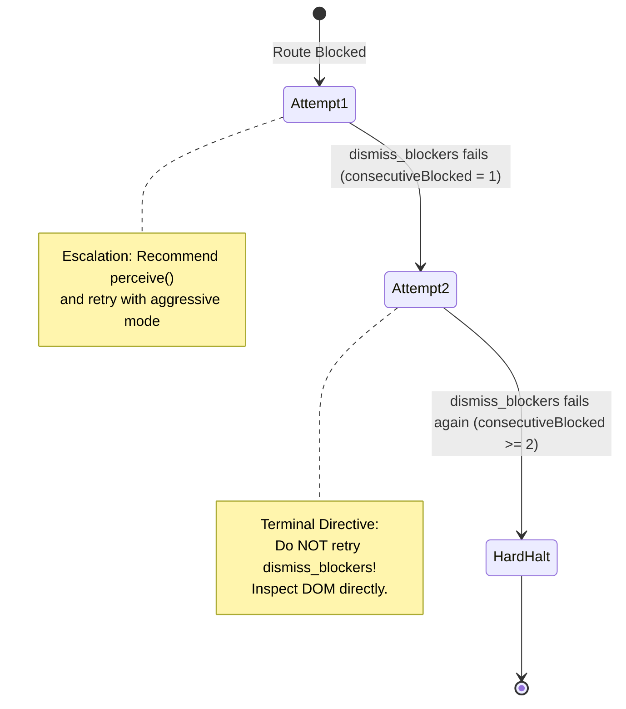

# Dual-Envelope Observability & Self-Healing

> [!NOTE]
> This guide details the universal dual-envelope error architecture, asymmetric client resilience, empty-argument protections, directional `nextActions` protocols, and anti-loop state machines within the **Agent-Native Affordances** subsystem of Nova AI Workspace. For vocabulary bridges and parameter normalizations, see [Affordance Vocabulary Bridges & Parameter Normalization](../vocabulary-bridges-and-parameter-normalization/README.md). For master overview and architectural pillars, see the [Agent-Native Affordances Hub](../README.md).

---

## 1. Executive Overview & The Client Asymmetry Hazard

In the emerging Model Context Protocol (MCP) ecosystem, client harnesses and LLM orchestrators process and present tool execution results to models with significant architectural asymmetry:

* **Claude Code:** Strongly prioritizes `structuredContent`. If `structuredContent` is present, it strips the text array from the prompt context. If a JSON-RPC transport error occurs, it presents only `error.message`, dropping all structured `data` payloads.
* **Google Antigravity:** Gives primary attention to the text block (`content[0].text`), frequently ignoring unprojected structured dictionary fields.
* **OpenAI Codex & Custom Agent Runtimes:** Inspect both text and structured content, validating responses against schema definitions.

This asymmetry introduces a catastrophic failure mode in autonomous workflows:
> **The Single-Channel Information Loss Trap:**
> If a tool server returns error diagnostics solely inside `structuredContent`, Antigravity models never see the repair hints.
> If a tool server returns error diagnostics solely inside `content[0].text`, Claude Code models strip the message.
> In both cases, the agent perceives a generic failure and enters a blind retry loop.



---

## 2. The Universal Dual-Envelope Guarantee (`McpToolErrorEnvelope`)

To ensure that actionable diagnostics reach the model regardless of which client harness is running, Nova routes all tool-level failures through `McpToolErrorEnvelope`.

### 2.1 The Three Core Guarantees

1. **Soft Error Standardization (`isError: true`):**
   * Pre-dispatch and execution failures are emitted as valid MCP tool results with `isError: true` rather than protocol-level transport disconnects (`jsonrpc.error`).
   * This preserves connection health and keeps conversational tool context intact across all clients.
2. **Structured Payload (`structuredContent`):**
   * Emits machine-readable diagnostic keys: `ok: false`, `errorCode`, `reasonCode`, `repairHint`, `nextActions`, and `retryAfterMs`.
   * Programmatic client wrappers can parse these fields to self-heal without extra model inference turns.
3. **Verbatim Text Mirroring (`content[0].text`):**
   * Serializes the exact structured dictionary into `content[0].text` preceded by a deterministic marker: `structuredContent:\n`.
   * Clients that expose only text content to their models receive 100% fidelity on all error codes, reason tokens, and remediation vectors.

### 2.2 Wire Format Example

```json
{
  "content": [
    {
      "type": "text",
      "text": "structuredContent:\n{\n  \"ok\": false,\n  \"errorCode\": -32002,\n  \"reasonCode\": \"blocking_overlay_active\",\n  \"message\": \"Element is obscured by a full-screen consent dialog.\",\n  \"repairHint\": \"Dismiss the overlay before re-attempting click.\",\n  \"nextActions\": [\n    {\n      \"priority\": 100,\n      \"tool\": \"nova.cmp_apply\",\n      \"reason\": \"Dismiss detected consent overlay\",\n      \"args\": { \"intent\": \"accept_all\" }\n    }\n  ]\n}"
    }
  ],
  "isError": true,
  "structuredContent": {
    "ok": false,
    "errorCode": -32002,
    "reasonCode": "blocking_overlay_active",
    "message": "Element is obscured by a full-screen consent dialog.",
    "repairHint": "Dismiss the overlay before re-attempting click.",
    "nextActions": [
      {
        "priority": 100,
        "tool": "nova.cmp_apply",
        "reason": "Dismiss detected consent overlay",
        "args": { "intent": "accept_all" }
      }
    ]
  }
}
```

### 2.3 Character Budgeting & Safety Caps

To prevent rogue handlers or oversized payloads from overwhelming context windows, `McpToolErrorEnvelope` enforces strict character caps on the mirrored text block:
* **Standard Thrown Errors (`MaxStructuredTextChars = 4000`):** General exceptions, validation denials, and precondition gate trips are capped at 4,000 characters.
* **Compound Macro Failures (`MaxSoftFailureTextChars = 32000`):** Multi-step tools (such as `nova.run_sequence`) that report granular per-step results across 10+ sequential actions receive a generous 32,000-character budget so that full trace histories are not truncated.

---

## 3. Clean Empty-Argument Formatting (`McpAllowedArgsMessage`)

When an autonomous agent explores zero-argument or parameterless tools (such as `nova.ui_inspect_native_dialog`), it sometimes speculatively supplies parameters (e.g. `{ "targetId": "tab-1" }`).

In naive implementations, argument validators construct error messages using raw string joins:
```text
unknown property 'targetId'. Allowed: 
```

This trailing blank string creates severe confusion: the model infers that the server encountered a parsing bug or that the allowed argument list was wiped out.

Nova intercepts zero-argument validation failures and outputs a clear, unambiguous diagnostic:
```text
The tool 'nova.ui_inspect_native_dialog' accepts no arguments.
```

The LLM immediately recognizes that the tool takes zero arguments and re-invokes it cleanly.

---

## 4. Directional Recovery & The `nextActions` Protocol

A core affordance design principle in Nova is that errors must be **directional**: an error should never merely announce that an operation failed; it must provide prioritized vectors indicating how the agent can move forward.



### 4.1 Schema of a NextAction Item

Every entry in the `nextActions` array provides complete machine-executable details:

| Field | Type | Required | Description |
| :--- | :---: | :---: | :--- |
| `priority` | `number` | Yes | Numeric weight (1–100) indicating recommendation confidence. Higher executes first. |
| `tool` | `string` | Yes | Canonical name of the tool to invoke for remediation. |
| `reason` | `string` | Yes | Human- and model-readable justification for the recommended action. |
| `args` | `object` | Optional | Concrete, pre-populated parameters for the remediation call. |

### 4.2 Concrete Example: CMP Overlay Remediation

```json
{
  "nextActions": [
    {
      "priority": 100,
      "tool": "nova.cmp_apply",
      "reason": "Dismiss detected consent overlay using vendor CMP adapter",
      "args": {
        "intent": "accept_all"
      }
    },
    {
      "priority": 80,
      "tool": "nova.dismiss_blockers",
      "reason": "Attempt generic heuristic blocker dismissal if vendor adapter fails",
      "args": {}
    }
  ]
}
```

---

## 5. Stateful Anti-Loop State Machines

When an agent encounters an obstinate modal or tricky DOM element, a common pathology is the **Infinite Retry Spiral**: the model re-dispatches the identical failing tool 20 to 50 times until conversational context or tokens expire.

Nova prevents this through stateful anti-loop state machines embedded directly in tool handlers.



### 5.1 Route-Bound Escalation in `dismiss_blockers`

Nova tracks blocker dismissal outcomes per route session (`consecutiveBlockedOnRoute`):
1. **First Failure (Attempt 1):** Returns `isError: true` and suggests:
   * Running `nova.perceive` to verify visual layout.
   * Escalating to aggressive dismissal heuristics.
2. **Second Failure (Attempt 2):** Returns a terminal anti-loop directive:
   * Recommends `nova.perceive` or `nova.read_dom`.
   * Explicitly issues the instruction: `"Do NOT retry dismiss_blockers on this route; inspect DOM directly"`.

This stateful circuit breaker forcefully interrupts looping reasoning chains before tokens are exhausted.

---

## 6. DOM Script Exception Interception in `nova.eval`

Autonomous agents regularly attempt to evaluate JavaScript expressions against elements that are not yet rendered or have disappeared from the DOM:
```javascript
document.querySelector(".checkout-button").getBoundingClientRect()
```

In standard browser runtimes, this produces an unhelpful JavaScript exception:
```text
TypeError: Cannot read properties of null (reading 'getBoundingClientRect')
```

Untrained agents frequently misinterpret this as a tool crash or browser glitch. Nova's `nova.eval` runtime catches common DOM exceptions (`null / undefined access`, `invalid selector syntax`) and enriches the message with an actionable affordance diagnosis:

```text
eval.script_threw: Cannot read properties of null (reading 'getBoundingClientRect').
Affordance Hint: The selector returned null. Call nova.read_dom() or nova.perceive() to verify element existence before querying properties.
```

By immediately identifying that the element was absent, the agent refrains from repeating the script and instead inspects the DOM hierarchy.

---

## 7. Related Documentation

* **[Agent-Native Affordances Hub](../README.md)** — Master overview and seven architectural pillars.
* **[Affordance Vocabulary Bridges & Parameter Normalization](../vocabulary-bridges-and-parameter-normalization/README.md)** — Cognitive aliases, parameter maps, and value harmonizations.
* **[Session Continuity & Layered Autonomy](../session-continuity-and-layered-autonomy/README.md)** — Tab restoration, plain-language search, and tiered control levels.
* **[Closed-Loop System (CLS)](../../closed-loop-system-cls/README.md)** — Post-action visual transition verification and assertion calculus.
* **[Tool Observation Bus (TOB)](../../tool-observation-bus-tob/README.md)** — Forensic recording of all attempted, blocked, and executed actions.

[All core features](../../README.md)
