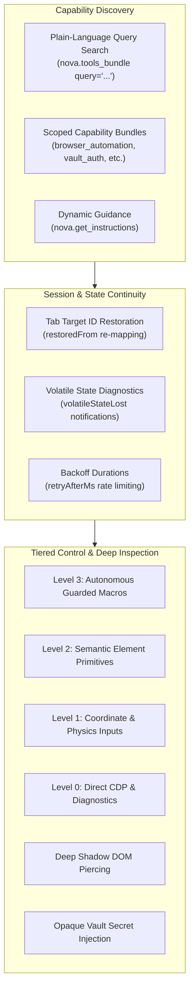
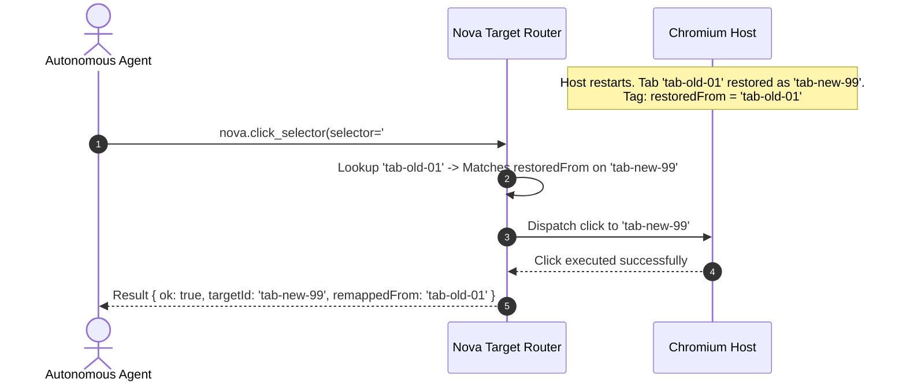
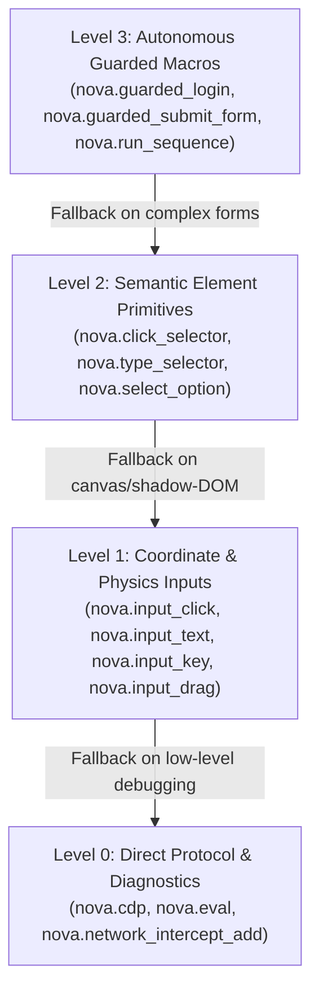

# Session Continuity & Layered Autonomy

> [!NOTE]
> This guide details tab session continuity across restarts, plain-language capability search, deep Shadow DOM piercing, opaque credential injection, tiered control levels, and boundary decisions within the **Agent-Native Affordances** subsystem of Nova AI Workspace. For vocabulary bridges, see [Affordance Vocabulary Bridges & Parameter Normalization](../vocabulary-bridges-and-parameter-normalization/README.md). For dual envelopes, see [Dual-Envelope Observability & Self-Healing](../dual-envelope-observability-and-self-healing/README.md). For master overview, see the [Agent-Native Affordances Hub](../README.md).

---

## 1. Executive Overview & Architecture

Autonomous agent interactions with web environments span multiple levels of abstraction: from high-level composite macros to low-level coordinate dispatches, cross-session tab continuity, and plain-language capability discovery.

Nova structures these capabilities into an integrated architectural framework:



---

## 2. Session Continuity Across Host & Browser Restarts

During long-running automation tasks, browser processes or the Nova host application may restart due to OS updates or memory reclamation. When browser tabs restore, Chromium assigns them brand-new internal target identifiers.

### 2.1 Transparent Target Re-Mapping (`restoredFrom`)
In standard automation environments, an agent continuing a task with a stored tab identifier immediately fails with `unknown target`. Nova's target resolution engine prevents this interruption:
* **The `restoredFrom` Attribute:** Restored tabs carry a persistent metadata tag recording their pre-restart ID.
* **Transparent Resolution:** If an agent dispatches a command using the prior ID, Nova's router automatically maps the call to the newly initialized tab instance without interrupting the execution pipeline.



### 2.2 Explicit Volatile State Diagnostics (`volatileStateLost`)
While document DOM hierarchies and persistent cookies survive tab restoration, in-memory volatile browser state does not:
* Active media captures (`nova.media_capture_start`)
* Object URLs and in-memory Blob handles (`nova.page_blobs_list`)
* Custom JavaScript MutationObservers injected via `nova.eval`

If an agent attempts an action that depends on lost volatile context, Nova catches the 8-hex tab reference and returns a structured diagnostic explaining which watchers must be re-armed on the new tab.

### 2.3 Rate-Limiting Backoff Durations (`retryAfterMs`)
When interacting with external connectors or rapid API endpoints, operations may hit temporary rate limits or cooling windows. Nova returns standard `-32029` error payloads equipped with explicit `retryAfterMs`:

```json
{
  "errorCode": -32029,
  "message": "Connector probe cooldown active. Retry after 2000ms.",
  "data": {
    "profileId": "prod-auth",
    "retryAfterMs": 2000
  }
}
```

This affordance eliminates frantic, token-wasting polling loops by specifying the exact sleep duration.

---

## 3. Plain-Language Capability Discovery

### 3.1 The "Blank Slate Fallback Trap"
When autonomous agents are unsure whether a specialized capability exists (such as layout overflow measurement, table extraction, or audio transcription), they frequently conclude the feature is missing and attempt to hand-roll fragile 50-line scripts inside `nova.eval`.

### 3.2 Task-Oriented Fuzzy Search in `nova.tools_bundle(query=...)`
To eliminate hand-rolled scripts, Nova allows agents to query capabilities using natural language task descriptions:
* **Natural Language Queries:** An agent can query:

```json
{
  "query": "measure element width overflow clipped text"
}
```
* **Stop-Word Removal & Stemming:** The query engine strips common filler words (`"how"`, `"do"`, `"I"`, `"want"`, `"to"`, `"please"`) and ranks tools based on term hits across both names and detailed descriptions.
* **OR-Combined Thresholding:** Imprecise queries succeed: asking for `"transcribe voice message audio to text"` returns `nova.media_transcribe_start`, even though none of the search terms match the tool name alone.

### 3.3 Scoped Capability Bundles
Rather than overwhelming an agent's initial context window with 100+ schemas, Nova partitions tools into on-demand functional bundles:
* `browser_automation`: Core navigation, element clicking, form entry, and tab lifecycles.
* `page_read_debug`: DOM extraction, console monitoring, network inspection, and visual diffs.
* `vault_auth`: Password retrieval, credential injection, and authenticated account switching.
* `crawler_ops`: Site exploration, link verification, and URL coverage scans.
* `proxy_management`: Traffic tunneling, proxy testing, and credentials management.

#### Transparent Gated Tool Diagnostics
If a tool is disabled due to a host configuration setting (e.g. `BrowsingMemoryEnabled = false`), calling `nova.tools_bundle(includeUnavailable=true)` returns structured explanations:
```json
{
  "toolName": "nova.memory_note",
  "available": false,
  "requiredSetting": "BrowsingMemoryEnabled",
  "reason": "Disabled by host administrator in settings.json"
}
```
This prevents agents from misdiagnosing administrative settings as broken software.

### 3.4 Tailored On-Demand Guidance (`nova.get_instructions`)
Operating instructions are delivered on demand via `nova.get_instructions`, optimized for minimal token overhead:
* **Compact Default (~5 KB):** Returns essential Trust & Safety rules, session bootstrap procedures, and plain-language search tips.
* **Specialized Operational Modes:**
  * `mode="learn"`: Activates onboarding guidance, coverage floors, and interactive semantic opportunities.
  * `mode="audit"`: Supplies accessibility and layout testing directives.
  * `topic="bug_report"`: Provides structured Markdown incident templates and log redaction instructions.

---

## 4. Deep DOM Inspection & Privacy-Preserving Execution

### 4.1 Deep Shadow DOM Piercing
Modern web components encapsulate inputs inside nested Shadow DOM trees where standard `document.querySelector` fails. Nova's `nova.get_element_rect` and `nova.get_active_element_deep` pierce shadow root boundaries automatically:
* Computes exact viewport-relative bounding boxes (`x`, `y`, `width`, `height`).
* Identifies deep active elements regardless of shadow tree nesting depth.
* Enables seamless fallback to coordinate-level clicking ([Browser Interaction](../../browser-interaction/README.md)) when DOM dispatch is obstructed.

### 4.2 Adaptive Selector Healing (`pksAdvice`)
When website updates break an element's selector, Nova's Phenomenological Knowledge Store (PKS) intercepts the failure:
* Injects alternative verified selectors directly into `structuredContent.pksAdvice`.
* Provides ranked locator candidates so the agent can self-heal without re-reading the entire page DOM.

### 4.3 Opaque Secret Injection (`nova.type_selector_secret`)
Submitting passwords, API keys, or payment details in cleartext tool arguments (`text="secret123"`) pollutes conversational logs and exposes credentials to LLM model providers.

Nova provides an opaque secret injection affordance:
* Passwords stored in Nova's local encrypted Vault are referenced by key or prepared token (`nova.vault_prepare_fill`).
* `nova.type_selector_secret` injects credentials directly into the active Chromium input element host-side.
* Cleartext credentials never enter the LLM prompt, conversational context, or MCP action logs.

---

## 5. Tiered Levels of Control (Layered Autonomy)

Nova provides four progressively lower tiers of abstraction. An agent can operate at the highest level of abstraction that succeeds, dropping down to lower levels when edge cases arise:



1. **Level 3: Autonomous Guarded Macros:** High-level compound operations (`nova.guarded_login`, `nova.guarded_submit_form`, `nova.run_sequence`) that handle waits, input verification, and form submission in a single roundtrip.
2. **Level 2: Semantic Element Primitives:** Standard DOM selector tools (`nova.click_selector`, `nova.type_selector`, `nova.select_option`). Handles scrolling into view, element readiness checks, and humanized typing.
3. **Level 1: Coordinate & Browser Inputs:** Browser input dispatch (`nova.input_click`, `nova.input_text`, `nova.input_key`, `nova.input_drag`). Interacts with arbitrary pixel coordinates, canvas games, complex SVGs, or custom web components.
4. **Level 0: Direct Protocol & Diagnostics:** Raw browser control via Chrome DevTools Protocol (`nova.cdp`), arbitrary JavaScript evaluation (`nova.eval`), and real-time request mocking.

### Contract Parity Across Levels
Lower levels provide finer physical control, but **never bypass safety contracts**:
* Coordinate clicks (`input_click`) are subject to the same tab lease checks (`tab_claim`) and emergency stops as high-level macros.
* A `cdp` command targeting an InPrivate tab cannot perform persistent writes to long-term databases.
* All levels emit structured telemetry to the [Tool Observation Bus (TOB)](../../tool-observation-bus-tob/README.md).

---

## 6. Intentional Boundary Decisions & Rejected Aliases

Not every recurring agent expectation qualifies for an alias. Where an alias would mask a conceptual misunderstanding, create semantic collisions, or compromise security, Nova explicitly **rejects the alias** and clarifies the boundary through documentation and error messaging:

### 1. `includeAllWindows` on `nova.tabs` (Deliberately Rejected)
* **Agent Expectation:** Agents coming from Playwright or CDP try calling `nova.tabs` with argument `includeAllWindows=true`.
* **Why Rejected:** Nova operates a single application window; all tabs (including multi-sandbox tabs) exist in that window. Creating an alias would reinforce the false mental model that additional hidden windows exist and prompt the agent to search for non-existent `windowId` parameters.
* **Affordance Fix:** The tool description for `nova.tabs` was updated to explicitly state that the returned list is complete and window-invariant.

### 2. `nova.route` as Request Interception (Deliberately Rejected)
* **Agent Expectation:** Playwright uses `page.route()` to define network request interception.
* **Why Rejected:** Nova already possesses a canonical tool named `nova.route` that performs Single Page Application in-page routing. Aliasing `nova.route` to request interception would cause an agent intending to mock an API to inadvertently navigate away from the current page.
* **Affordance Fix:** Network interception is canonically named `nova.network_intercept_add` with aliases `nova.intercept` and `nova.mock_request`. Playwright's `unroute` safely aliases to `nova.network_intercept_clear` because no name collision exists.

### 3. `hard` $\rightarrow$ `force` on `nova.reload` (Deliberately Rejected)
* **Agent Expectation:** Agents try `hard=true` on reload.
* **Why Rejected:** On `nova.reload`, `hard` denotes a cache-bypassing browser reload, whereas `force` denotes an AAG session-destruction gate bypass. Automatically rewriting `hard` $\rightarrow$ `force` would silently escalate a simple cache refresh into an irreversible session termination.

### 4. Ambiguous Cache Types in `nova.cache_clear` (Deliberately Rejected)
* **Agent Expectation:** Agents pass `dataTypes=['cache']`.
* **Why Rejected:** In Chromium, "cache" is genuinely ambiguous between HTTP Disk Cache (`diskCache`) and HTML5 Cache Storage API (`cacheStorage`). Automatically guessing would result in incomplete cache clears. The error message explicitly enumerates the supported valid tokens.

---

## 7. Framework Compatibility Matrix

The following matrix summarizes how Nova bridges common automation frameworks:

| Automation Concept | Playwright Convention | Selenium Convention | Anthropic Computer-Use | Canonical Nova Equivalent |
| :--- | :--- | :--- | :--- | :--- |
| **Page Navigation** | `page.goto(url)` | `driver.get(url)` | N/A | `nova.navigate(url=...)` *(alias: `goto`)* |
| **Text Typing** | `page.fill(sel, value)` | `el.send_keys(text)` | `type(text)` | `nova.type_selector(selector=..., text=...)` *(aliases: `value`, `input`)* |
| **Element Clicking**| `page.click(sel)` | `el.click()` | `left_click` | `nova.click_selector(selector=...)` *(alias: `click`)* |
| **Keyboard Press** | `page.press(key)` | `el.send_keys(Key)` | `key(key)` | `nova.input_key(key=...)` *(alias: `press`)* |
| **Script Eval** | `page.evaluate(fn)` | `driver.execute_script`| N/A | `nova.eval(expression=...)` *(aliases: `evaluate`, `exec`)* |
| **DOM Inspection** | `page.content()` | `driver.page_source` | N/A | `nova.read_dom()` *(aliases: `content`, `page_source`)* |
| **Screenshots** | `page.screenshot()` | `driver.save_screenshot`| `screenshot` | `nova.capture_screenshot()` *(alias: `screenshot`)* |
| **Scrolling** | `page.mouse.wheel()` | `ActionChains.scroll` | `{ direction, amount }` | `nova.scroll_by(deltaY=...)` *(auto-converts direction/amount)* |
| **Network Mocks** | `page.route(pattern)` | DevTools CDP | N/A | `nova.network_intercept_add(urlPattern=...)` *(alias: `intercept`)* |

---

## 8. Related Documentation

* **[Agent-Native Affordances Hub](../README.md)** — Master overview and seven architectural pillars.
* **[Affordance Vocabulary Bridges & Parameter Normalization](../vocabulary-bridges-and-parameter-normalization/README.md)** — Cognitive aliases, parameter maps, and value harmonizations.
* **[Dual-Envelope Observability & Self-Healing](../dual-envelope-observability-and-self-healing/README.md)** — Dual-envelope guarantees, error mirrors, and anti-loop state machines.
* **[Sandbox Isolation](../../sandbox-isolation/README.md)** — Isolated profiles, intent routing, and disk anchors.
* **[Browser Interaction](../../browser-interaction/README.md)** — DOM selector mechanics and coordinate input dispatch.

[All core features](../../README.md)
