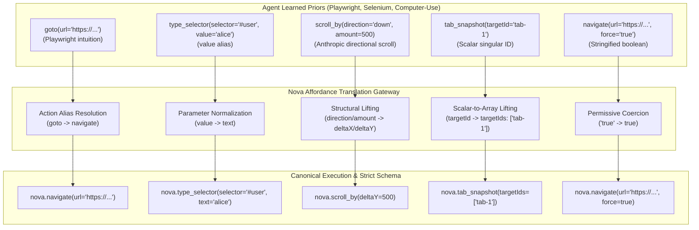
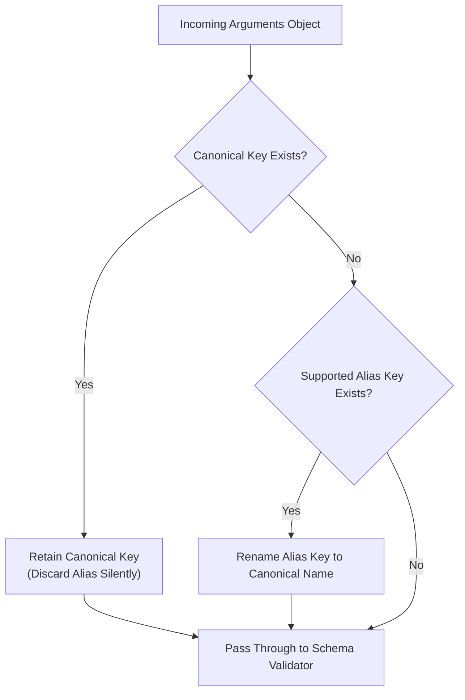

# Affordance Vocabulary Bridges & Parameter Normalization

> [!NOTE]
> This guide details the cognitive translation layers, tool alias registries, parameter normalizations, value harmonizations, and permissive type coercions within the **Agent-Native Affordances** subsystem of Nova AI Workspace. For error projection and self-healing mechanics, see [Dual-Envelope Observability & Self-Healing](../dual-envelope-observability-and-self-healing/README.md). For master overview and architectural pillars, see the [Agent-Native Affordances Hub](../README.md).

---

## 1. Executive Overview & The Cognitive Mismatch

Autonomous AI agents do not encounter automation APIs as blank slates. Pre-trained on vast corpuses of Playwright, Puppeteer, Selenium, and Anthropic Computer-Use code, Large Language Models (LLMs) arrive with deeply ingrained statistical priors:
* Navigating to a page is remembered as `page.goto(url)` or `driver.get(url)`.
* Typing text into an input is remembered as `fill(selector, value)` or `send_keys(text)`.
* Inspecting DOM content is remembered as `page.content()` or `driver.page_source`.
* Scrolling is remembered as `{ direction: "down", amount: 500 }`.

When interacting with conventional tool servers, issuing these intuitive calls results in immediate protocol errors (`-32601 Method not found` or `-32602 Invalid params`). These rigid failures burn tokens, force the agent into blind trial-and-error spirals, and undermine autonomous execution.



### The Core Architectural Tenet
> **Nova does not force AI agents to unlearn established patterns.**
> Instead, Nova's gateway translates intuitive agent representations into canonical operations prior to dispatch, while preserving strict schema validation, tab lease checks, and security gates at the execution core.

---

## 2. Action Name Bridges (Tool Aliases)

Nova maintains a high-performance in-memory alias dictionary that maps common framework verbs to canonical tools. Aliases are matched before parameter validation occurs:

| Functional Category | Incoming / Familiar Alias | Canonical Nova Tool | Framework Prior / Source |
| :--- | :--- | :--- | :--- |
| **Page Navigation** | `nova.goto` | `nova.navigate` | Playwright `page.goto()`, Puppeteer |
| | `nova.refresh` | `nova.reload` | Selenium `driver.refresh()`, Playwright |
| **Form & Input** | `nova.fill`, `nova.type` | `nova.type_selector` | Playwright `page.fill()`, Puppeteer |
| | `nova.click`, `nova.click_element` | `nova.click_selector` | Standard DOM automation |
| | `nova.press`, `nova.key`, `nova.keypress` | `nova.input_key` | Playwright `page.press()`, Computer-Use |
| | `nova.select` | `nova.select_option` | Playwright `page.selectOption()` |
| | `nova.upload` | `nova.file_upload` | File input shorthand |
| **Mouse & Viewport** | `nova.move`, `nova.mouse_move` | `nova.input_move` | Anthropic Computer-Use `mouse_move` |
| | `nova.scroll` | `nova.scroll_by` | Generic mouse wheel intuition |
| | `nova.viewport` | `nova.emulation_set_device_metrics` | Playwright `page.setViewportSize()` |
| | `nova.useragent` | `nova.emulation_set_user_agent` | Device emulation shorthand |
| **DOM Inspection** | `nova.evaluate`, `nova.run_js`, `nova.eval_js`, `nova.exec`, `nova.execute` | `nova.eval` | Playwright `page.evaluate()`, Selenium |
| | `nova.content`, `nova.page_source`, `nova.dom`, `nova.get_dom` | `nova.read_dom` | Playwright `page.content()`, Selenium |
| | `nova.text` | `nova.read_text` | Shorthand text extraction |
| | `nova.url`, `nova.title` | `nova.page_info` | Playwright `page.url()`, `page.title()` |
| | `nova.cookies` | `nova.cookie_list` | Plural cookie lookup intuition |
| | `nova.waitforselector`, `nova.wait_for_element` | `nova.wait_for_selector` | Puppeteer camelCase / Selenium wait |
| | `nova.console`, `nova.network`, `nova.messages` | `nova.console_read`, `nova.network_read`, `nova.messages_read` | Stream log noun intuition |
| | `nova.dialog` | `nova.ui_inspect_native_dialog` | Playwright `page.on('dialog')` |
| **Tab Management** | `nova.new_tab` | `nova.tab_new` | Browser tab creation shorthand |
| | `nova.close_tab` | `nova.tab_close` | Browser tab closing shorthand |
| | `nova.list_tabs`, `nova.get_tabs` | `nova.tabs` | Verb-prefixed tab queries |
| **History Navigation**| `nova.history`, `nova.history_list`, `nova.history_query`, `nova.browsing_history` | `nova.history_search` | Global browsing history query |
| | `nova.history_navigate`, `nova.history_jump` | `nova.history_go` | Per-tab back/forward jump |
| **Media & Audio** | `nova.screenshot`, `nova.take_screenshot` | `nova.capture_screenshot` | Common screenshot intuition |
| | `nova.app_screenshot` | `nova.capture_app_screenshot` | Window-level screenshot intuition |
| | `nova.transcribe`, `nova.speech_to_text`, `nova.audio_transcribe` | `nova.media_transcribe_start` | Audio transcription shorthand |
| **Network Mocking** | `nova.intercept`, `nova.network_intercept`, `nova.mock`, `nova.mock_request` | `nova.network_intercept_add` | Request interception & mocking |
| | `nova.unroute` | `nova.network_intercept_clear` | Playwright `page.unroute()` |
| | `nova.replay`, `nova.repeat`, `nova.network_repeater`, `nova.repeat_request` | `nova.network_replay` | Proxy repeater & replay tools |
| **Session Capture** | `nova.session_recording_start`, `nova.trace_start`, `nova.record_start` | `nova.session_record_start` | Tracing & recording intuition |
| | `nova.session_recording_stop`, `nova.trace_stop`, `nova.record_stop` | `nova.session_record_stop` | Tracing stop intuition |
| | `nova.session_record_decode`, `nova.session_recording_decode` | `nova.session_record_export` | Export / decoding intuition |
| **Remote Protocols**| `nova.sftp_download`, `nova.ftp_download` | `nova.sftp_get`, `nova.ftp_get` | POSIX file transfer verbs |
| | `nova.sftp_upload`, `nova.ftp_upload` | `nova.sftp_put`, `nova.ftp_put` | POSIX file transfer verbs |
| | `nova.sftp_ls`, `nova.ftp_ls` | `nova.sftp_list`, `nova.ftp_list` | POSIX directory listing verbs |
| | `nova.sftp_rm`, `nova.ftp_rm` | `nova.sftp_delete`, `nova.ftp_delete` | POSIX removal verbs |
| | `nova.sftp_mv`, `nova.ftp_mv` | `nova.sftp_rename`, `nova.ftp_rename` | POSIX rename verbs |
| | `nova.ssh_exec` | `nova.ssh_run` | Remote execution shorthand |
| **Lifecycle & Setup**| `nova.onboard`, `nova.onboarding`, `nova.setup` | `nova.install_onboarding` | Single-call onboarding |
| | `nova.quit`, `nova.exit`, `nova.shutdown`, `nova.close_app` | `nova.app_quit` | Application shutdown verbs |
| | `nova.mcp_log`, `nova.mcp_server_log` | `nova.mcp_transport_log` | Diagnostics log intuition |

---

## 3. Namespace & Client Prefix Stripping

Different MCP client environments format tool names with transport-specific prefixes:
* Claude Code flattens dots and prefixes server names: `mcp__nova__nova_tabs`
* Antigravity uses underscores: `mcp_nova_nova_tabs`
* Subagent prompts frequently echo stripped or bare function identifiers: `click_selector`

Nova normalizes tool identifiers prior to alias matching through a 3-step pipeline:
1. **Transport Prefix Stripping:** Strips leading `mcp__nova__` or `mcp_nova_`.
2. **Redundant Server Prefix Stripping:** If an agent provides `nova_click_selector`, the redundant `nova_` prefix is removed.
3. **Canonical Namespace Restoration:** Bare dot-free names (e.g. `click_selector` or `goto`) are prefixed with `nova.` so all downstream permission gates, claim checkers, and security layers operate on uniform canonical identifiers.

---

## 4. Parameter Normalization (`NormalizeCommonInputAliases`)

Parameter naming mismatches represent the single largest cause of schema rejections. Nova intercepts arguments at dispatch entry and maps recognized aliases to canonical properties.

> [!IMPORTANT]
> **The Precedence Invariant:** If both an alias and its canonical parameter are supplied in the same call, **the canonical parameter always takes precedence**. Aliases only activate when the canonical key is completely absent.



### Parameter Normalization Matrix

| Target Scope / Tools | Incoming Alias | Canonical Parameter | Design Rationale & Safety Boundary |
| :--- | :--- | :--- | :--- |
| **All Selector Tools** (`click_selector`, `type_selector`, `get_element_rect`, etc.) | `cssSelector`<br>`css`<br>`locator` | `selector` | Standardizes Selenium (`cssSelector`), Anthropic (`css`), and Playwright (`locator`) terminology. Safe across all tools because unknown properties are rejected anyway. |
| **Text Input Tools** (`nova.type_selector`, `nova.input_text`) | `value`<br>`input` | `text` | Playwright `fill(selector, value)` and Selenium `send_keys` swap between `value` and `input`. Strictly scoped to text tools so it does not collide with `select_option` or `cookie_set` (where `value` is canonical). |
| **Wait Tools** (`nova.wait_for_*`) | `pollIntervalMs`<br>`intervalMs` | `pollMs` | Reconciles Puppeteer and custom timing names with Nova's canonical interval argument. |
| **PKS Knowledge Tools** (`pks_get`, `pks_match`, `pks_patch`, `pks_upsert`, etc.) | `domain` | `scope` | Agents working with Domain Notes call the target website `domain`, while PKS calls it `scope`. Scoped strictly to PKS tools; on `domain_notes_*`, `scope` denotes sandbox level. |
| **Cookie Inspection** (`nova.cookie_list`) | `domain`<br>`name` | `domainFilter`<br>`nameFilter` | Playwright and Selenium cookie queries use `domain` and `name`. Scoped exclusively to list queries so mutating tools (`cookie_set`) retain literal `domain` and `name`. |
| **Memory Notes** (`nova.memory_note`) | `kind` | `memoryType` | Gemini agents naturally reach for `kind`. Maps to closed enum (`note\|preference\|context`) without leaking to other tools where `kind` is canonical. |
| **Text Reading** (`nova.read_text`) | `chars` | `maxChars` | Claude Code often supplies concise `chars` for output truncation. Mapped exclusively on single-region text reads. |
| **Network Replay** (`nova.network_replay`) | `id`<br>`data` / `payload`<br>`timeout` | `replayId`<br>`body`<br>`timeoutMs` | Maps HTTP client and REST terminology into replay schema. |
| **Network Interception** (`nova.network_intercept_add`, `nova.network_intercept_clear`) | `pattern` / `urlGlob`<br>`code` / `statusCode`<br>`id` / `rule` | `urlPattern`<br>`status`<br>`ruleId` | Aligns Playwright (`pattern`) and HTTP status naming conventions (`statusCode`). |
| **Navigation Tools** (`nova.navigate`, `nova.tab_new`) | `href` | `url` | Standardizes DOM anchor attribute intuition (`href`) to URL. |
| **InPrivate Isolation** (`nova.tab_new`) | `incognito` / `inPrivate`<br>`newContext` / `isolated` | `private`<br>`isolate` | Chrome (`incognito`) and Playwright (`newContext`) mental models mapped to Nova's privacy and sandbox isolation flags. |
| **Modal & Search Filters** (`wait_for_modal`, `perceive`, `search_text`) | `visible` | `visibleOnly` | Reconciles shorthand visibility filters. Strictly excluded from `wait_for_selector` (where `visible` is a poll predicate). |
| **Tab Reclaim** (`nova.tab_claim`) | `reason` | `reclaimReason` | Agents responding to claim-conflict prompts often type `reason`. Scoped strictly to `tab_claim` to prevent stripping `reason` on lifecycle tools. |

---

## 5. Complex Conversions & Structural Lifting

Beyond 1:1 key renames, Nova automatically reconciles multi-parameter structures:

### 5.1 Anthropic Computer-Use Directional Scroll Conversion
Anthropic computer-use tools instruct models to scroll using directional objects:
```json
{
  "direction": "down",
  "amount": 500
}
```
Nova's `nova.scroll_by` natively expects signed Cartesian deltas (`deltaX`, `deltaY`). The `NormalizeScrollDirectionAmountToDeltas` converter translates directional inputs automatically:
* `"down"` $\rightarrow$ `deltaY = +amount`
* `"up"` $\rightarrow$ `deltaY = -amount`
* `"right"` $\rightarrow$ `deltaX = +amount`
* `"left"` $\rightarrow$ `deltaX = -amount`

### 5.2 Automatic Scalar-to-Array Lifting
When interacting with batch operations, agents frequently pass a single scalar string instead of an array. Nova automatically lifts scalars into single-element arrays:
* Supplying `{ "targetId": "tab-1" }` to `nova.tab_snapshot` is lifted to `{ "targetIds": ["tab-1"] }`.
* Supplying `{ "messageId": "msg-101" }` to `nova.mail_delete` is lifted to `{ "messageIds": ["msg-101"] }`.

This prevents unnatural `-32602 Array expected` schema rejections when an agent operates on an individual entity.

---

## 6. Value Synonym Harmonization (`outputDetail`)

Across 14 tools in Nova's suite, the `outputDetail` parameter regulates payload token density. Over successive development waves, tools adopted varying vocabulary subsets (`minimal`, `compact`, `summary`, `full`):

| Published Tool Vocabulary | Applicable Tools | Accepted Synonyms & Normalization |
| :--- | :--- | :--- |
| `compact` / `full` / `minimal` | `back`, `click_selector`, `forward`, `history_go`, `navigate`, `reload`, `tab_new` | `summary` $\rightarrow$ `compact` |
| `full` / `minimal` / `summary` | `crawl_results`, `crawl_status`, `tabs` | `compact` $\rightarrow$ `summary` |
| `compact` / `full` | `capture_screenshot`, `eval`, `get_element_rect`, `wait_for_selector` | `summary` $\rightarrow$ `compact`<br>`minimal` $\rightarrow$ `compact` |
| `full` / `minimal` | `type_selector` | `compact` $\rightarrow$ `minimal`<br>`summary` $\rightarrow$ `minimal` |
| `full` / `summary` | `pks_get` | `compact` $\rightarrow$ `summary`<br>`minimal` $\rightarrow$ `summary` |

### The Safe Direction Principle
Value normalization maps strictly toward the nearest equivalent or slightly more informative tier. It never maps downward in a manner that would strip safety warnings, error context, or requested diagnostic metadata.

---

## 7. Permissive Primitive Coercion (`McpArgumentParser`)

LLM tokenizers frequently output numeric and boolean values as quoted JSON strings:
```json
{
  "maxChars": "5000",
  "force": "true",
  "isolate": "1"
}
```

Nova's `McpArgumentParser` performs resilient type coercion:
* **Booleans:** Accepts `"true"`, `"1"`, `true` $\rightarrow$ `true`; `"false"`, `"0"`, `false` $\rightarrow$ `false`.
* **Numbers:** Parses string tokens into `int` or `double` using invariant culture (`"5000"` $\rightarrow$ `5000`, `"1.5"` $\rightarrow$ `1.5`).
* **Enums & Closed Vocabularies:** Performs case-insensitive trimming (`"SUMMARY"` $\rightarrow$ `"summary"`).

Tokens that cannot be parsed as valid numbers or booleans continue to fail with clean, informative `-32602` validation messages.

---

## 8. Educational Feedback Loop (`InjectAliasInfo`)

Aliases in Nova serve as **transitional learning bridges**, not permanent abstractions. When an agent calls a tool via an alias, Nova executes the canonical tool and annotates the response with pedagogical metadata:

```json
{
  "structuredContent": {
    "ok": true,
    "_aliasInfo": {
      "aliasedFrom": "nova.goto",
      "canonicalTool": "nova.navigate",
      "guidance": "You called 'nova.goto', which was resolved to canonical 'nova.navigate'. Use canonical names for direct execution."
    }
  }
}
```

### Discovery vs. Execution Boundary
* **Discovery (`tools/list`):** Publishes **only canonical tools**. Aliases are never exposed in discovery schemas, keeping context clean and preventing prompt bloat.
* **Execution (`tools/call`):** Accepts aliases, normalizes parameters, executes canonical logic, and returns educational feedback.

This allows the LLM to learn canonical tool names organically without failing a single execution step.

---

## 9. Related Documentation

* **[Agent-Native Affordances Hub](../README.md)** — Master overview and seven architectural pillars.
* **[Dual-Envelope Observability & Self-Healing](../dual-envelope-observability-and-self-healing/README.md)** — Dual-envelope guarantees, error mirrors, and anti-loop state machines.
* **[Session Continuity & Layered Autonomy](../session-continuity-and-layered-autonomy/README.md)** — Tab restoration, plain-language search, and tiered control levels.
* **[Agent Awareness Gates (AAG)](../../agent-awareness-gates-aag/README.md)** — Preemptive situational validation and execution guardrails.
* **[Browser Interaction](../../browser-interaction/README.md)** — DOM selector mechanics and coordinate input dispatch.

[All core features](../../README.md)
