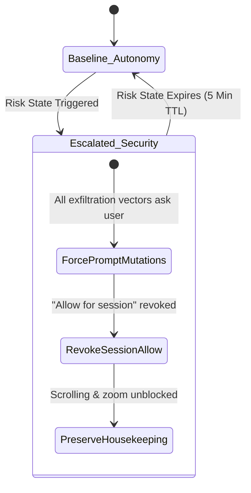
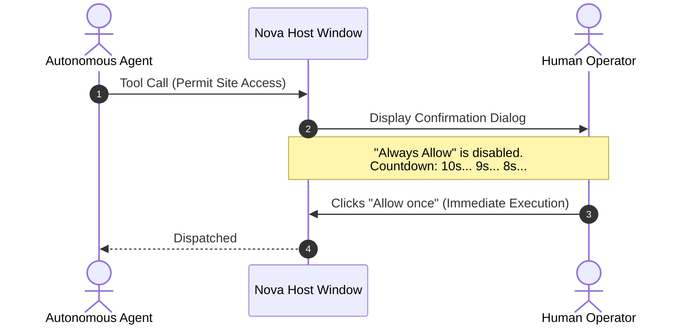
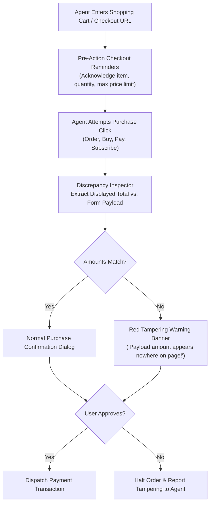

# Stepped Confirmations & Purchase Guards

> [!NOTE]
> Parts of this document describe **1.0.0-alpha.21** features, which are marked *(from alpha.21)*. This guide details action hazard classification, dynamic confirmation escalation during active risk states, reflex protection countdowns, and financial transaction safeguards within the **Agent Security** subsystem of Nova AI Workspace. For ingress screening and risk states, see [Content Screening & Risk State](../content-screening-and-risk-state/README.md). For persistent memory boundaries, see [Knowledge Poisoning & Authorship Boundaries](../knowledge-poisoning-and-authorship-boundaries/README.md). For master overview, see the [Agent Security Hub](../README.md).

---

## 1. Executive Overview & The Confirmation Model

Autonomous AI agents operate under user delegation, but certain actions carry irreversible consequences: transferring money, updating server configurations, exfiltrating session tokens, or modifying website data.

Nova enforces a **Stepped Confirmation Architecture**:
1. **Four Action Hazard Groups:** Tool calls are categorized by hazard potential. Benign navigation and DOM inspection run unimpeded; high-impact mutations require explicit confirmation.
2. **Dynamic Risk Escalation:** When an indirect prompt injection is suspected, Nova tightens confirmation requirements across the entire session, revoking session-wide approval exemptions.
3. **Reflex Protection Countdowns:** Granting permanent approvals requires a visible 10-second countdown to prevent accidental clicks.
4. **Financial Purchase Guards:** Multi-point checks verify checkout amounts, alerting the human operator if the amount submitted to a payment processor deviates from the price displayed on the webpage.

```mermaid
flowchart TD
    Call["Incoming Agent Tool Call\n(e.g. click_selector, type_selector, navigate)"]
    Classify["Action Hazard Classification\n(Critical, Modify Website, Permanent Data, Sensitive Read)"]
    RiskCheck{"Risk State Active?\n(Prompt Injection Detected?)"}

    NormalEval{"Standard Policy Gate\n(Autonomy Setting)"}
    StrictEval{"Tightened Security Gate\n(Forced User Approval)"}

    UserDialog["Host Confirmation Dialog\n(WinUI Modal)"]
    Execute["Dispatch Action to Chromium / System"]
    Reject["Reject Action (-32002 / isError: true)"]

    Call --> Classify --> RiskCheck
    RiskCheck -- No --> NormalEval
    RiskCheck -- Yes --> StrictEval

    NormalEval -->|Approved by Policy| Execute
    NormalEval -->|Confirmation Needed| UserDialog

    StrictEval -->|Housekeeping (Scroll/Zoom)| Execute
    StrictEval -->|Data Exfil / Mutation| UserDialog

    UserDialog -->|User Approves| Execute
    UserDialog -->|User Denies| Reject
```

---

## 2. The Four Action Hazard Groups

Every tool in Nova's catalog belongs to one of four functional hazard categories:

| Hazard Group | Operational Scope | Default Behavior | Example Primitives |
| :--- | :--- | :--- | :--- |
| **Critical Actions** | Reading cookie values, granting website permissions, accepting untrusted TLS certificates. | **Always Ask** (Agent must provide explicit intent rationale). | `nova.cookie_list`, `nova.permission_prompt`, `nova.tls_inspect` |
| **Modify Websites** | Modifying web state, form inputs, navigation, email sending, remote commands, and terminal executions. | Dispatches automatically under default autonomy settings. | `nova.click_selector`, `nova.type_selector`, `nova.navigate`, `nova.mail_send`, `nova.terminal_run_command` |
| **Permanent Data** | Persisting notes, learned knowledge, scheduled tasks, connector configurations, and network proxy rules. | Dispatches automatically; prompts user on destructive overwrites. | `nova.domain_note`, `nova.operator_notes_store`, `nova.pks_upsert`, `nova.scheduled_task_create` |
| **Sensitive Reads** | Extracting page text, capturing full screenshots, recording microphone/video, reading vault secrets. | Dispatches automatically within granted tab permissions. | `nova.perceive`, `nova.capture_screenshot`, `nova.vault_get` |

Human operators configure the baseline autonomy profile under **Settings → Agents → Autonomy level**, choosing between supervised, balanced, and fully autonomous operation.

---

## 3. Dynamic Risk-State Escalation

When the [Content Screening Engine](../content-screening-and-risk-state/README.md) detects an indirect prompt injection, Nova automatically overrides user autonomy settings, entering an escalated caution tier:



### 3.1 Escalation Invariants *(from alpha.21)*
* **Mandatory Prompts for Data Exfiltration:** Any action that could transmit data outside the local machine requires explicit human approval: opening a URL, clicking links, typing text, uploading files, sending emails, running remote SSH commands, or evaluating in-page scripts. This holds **even if the user previously set the action group to "never ask"**.
* **Mandatory Prompts for Durable State:** Writing or updating domain notes, operator memory, learned PKS knowledge, scheduled tasks, or proxy credentials requires confirmation for every invocation.
* **Revocation of Session Allowances:** The option *"Allow for this session"* is disabled during active risk states. Every critical invocation requires a standalone approval.
* **Uninhibited Housekeeping:** Purely cosmetic operations (scrolling, zooming, window repositioning, tab switching) continue without prompts, ensuring the browser remains responsive without compromising security.

### 3.2 Visual Alert Framing
When escalated, the host confirmation dialog displays an explicit warning header in plain text, changing the operator's decision frame from *"Is this action safe?"* to *"Did you ask the agent to perform this?"*:


If the user denies the request, Nova notifies the agent that the action followed a suspected injection and must not be retried.

---

## 4. Reflex Protection & Trusted Sites

### 4.1 The 10-Second Reflex Protection Countdown *(from alpha.21)*
Accidental reflex clicks are a known vulnerability in human-in-the-loop security. When presented with confirmation dialogs, users frequently click "Always Allow" by muscle memory.

To prevent accidental permanent authorizations:
* Options granting durable rights (such as *"Always allow this action"* or *"Always trust this site"*) unlock only after a **visible 10-second countdown timer**.
* Single-action decisions (*"Allow once"* and *"Deny"*) remain clickable immediately.



### 4.2 Trusted Sites Management *(from alpha.21)*
Certain workflows deliberately involve reviewing adversarial text or interacting with external AI review portals (e.g. an agent reading an internal ChatGPT or Claude interface).

* If a recognized domain repeatedly triggers prompt injection warnings, the operator can select **"Always trust this site and allow"**.
* Text originating from that site (and its subdomains) will no longer trip the prompt injection risk state.
* Operators can audit and revoke site exemptions at any time under **Settings → AI & agents → Confirmations & audit → Trusted sites**.

---

## 5. Financial & Payment Safeguards *(from alpha.21)*

Automated e-commerce checkout funnels represent high-risk operations where manipulated agents can inflict immediate financial damage. A sophisticated attacker does not need to inject text; altering form payloads in the DOM between cart and payment gateway is sufficient.

Nova enforces three mandatory financial safeguards across all checkout pages:



### 5.1 Pre-Action Money Directives
Upon navigating to a shopping, cart, or checkout page, the agent receives an mandatory awareness directive:
* Item name, quantity, and maximum allowable price must originate from the user's explicit instructions.
* If the checkout total differs from the user's requested budget, the agent must halt and ask.

### 5.2 Mandatory Purchase Dialogs
Any button click that places an order, initiates payment, or activates a recurring subscription triggers Nova's native confirmation dialog:
* Prompts the user **every time**, even if the agent is operating in fully automatic mode.
* Operators can configure site-level exemptions via *"Allow, and never ask about purchases on this site"*, managed under **Settings → AI & agents → Confirmations & audit → Sites where Nova does not ask about purchases**.
* If a prompt injection risk state is active, purchase confirmations are enforced unconditionally.

### 5.3 Amount Discrepancy Verification
Nova parses the active DOM to determine the total price shown to the user and compares it directly against the data payload transmitted to the payment gateway:
* If the transmitted amount differs from the visible total, Nova displays a prominent red tampering warning:


If denied, the agent is instructed that a transaction mismatch occurred, that it must not retry the purchase, and that it must report the finding to the user.

---

## 6. Related Documentation

* **[Agent Security Hub](../README.md)** — Master architecture and seven-layer defense model.
* **[Content Screening & Risk State](../content-screening-and-risk-state/README.md)** — Indirect prompt injection detection and local rule screening.
* **[Knowledge Poisoning & Authorship Boundaries](../knowledge-poisoning-and-authorship-boundaries/README.md)** — Authorship tracking, human promotion barriers, and PKS trust.
* **[Agent Awareness Gates (AAG)](../../agent-awareness-gates-aag/README.md)** — Pre-dispatch validation pipeline and fail-closed barriers.

[All core features](../../README.md)
