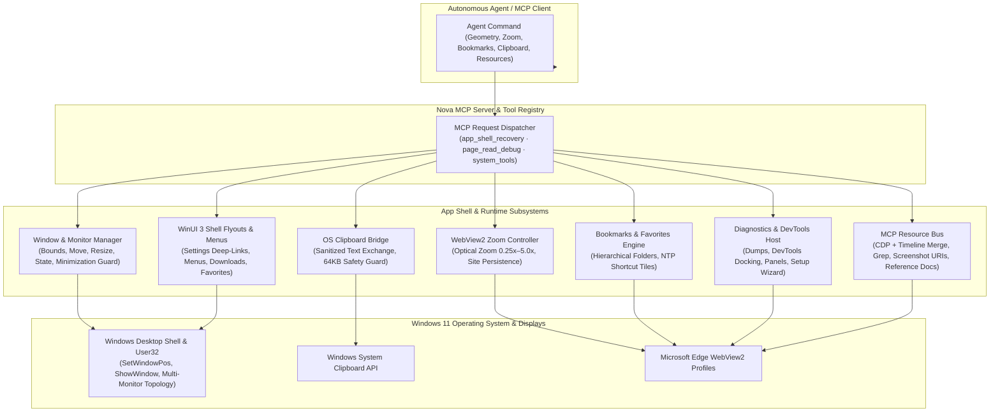
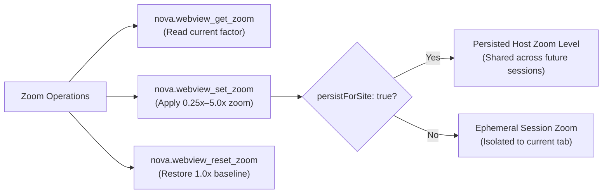
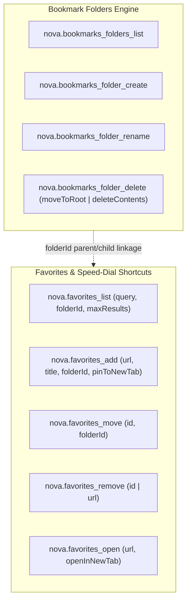
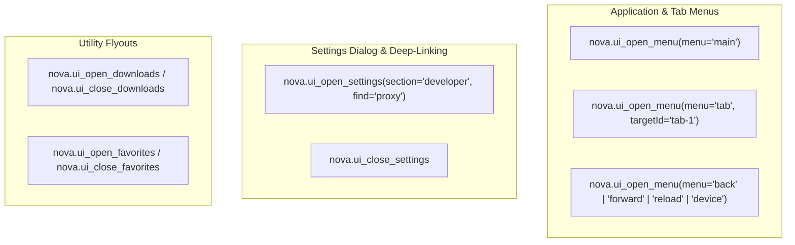
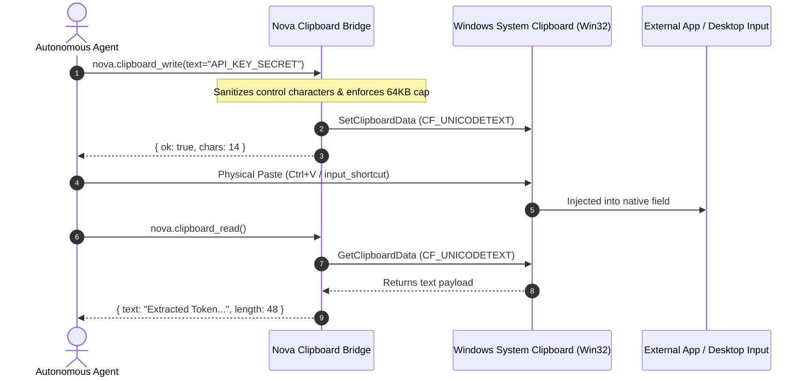
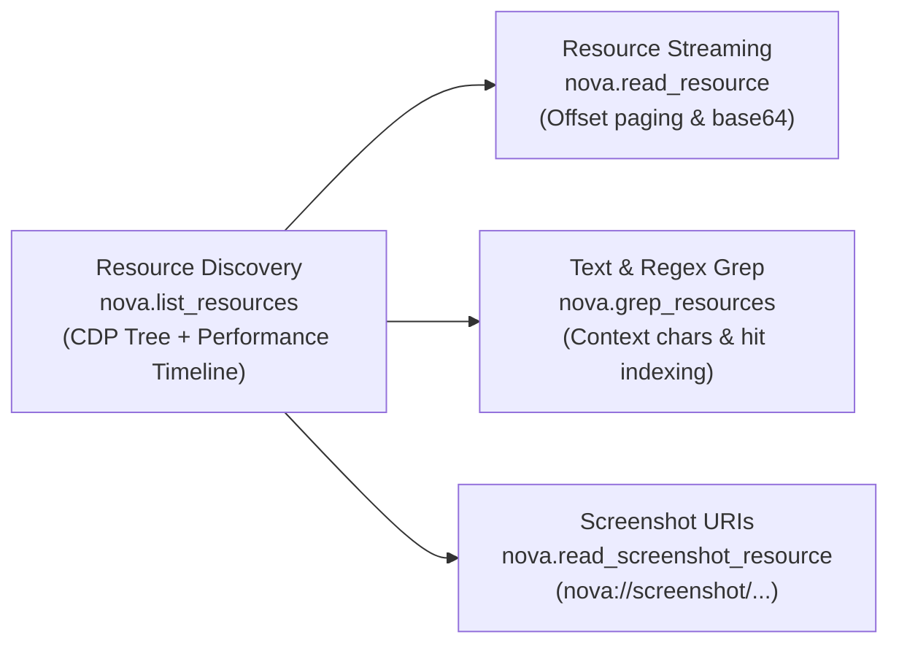

# App Shell, Window Management & Workspace Controls

> **WinUI 3 desktop window geometry, multi-monitor topologies, per-tab optical zoom, hierarchical bookmark organization, OS clipboard exchange, native shell flyouts, and MCP resource streaming.**

---

## 1. Overview & Architectural Vision

Modern autonomous web agents frequently require capabilities that extend beyond the HTML Document Object Model. Real-world workflows demand manipulating desktop application windows, adapting viewports across physical multi-monitor arrangements, adjusting per-tab optical magnification, managing bookmark and speed-dial collections, exchanging data via the operating system clipboard, triggering developer diagnostics, and reading loaded web resources without modifying page state.

Nova AI Workspace (`NovaAIWorkspace.exe`) bridges this boundary. Built upon the Windows App SDK (WinUI 3) and hosting partitioned Microsoft Edge WebView2 browser engines, Nova exposes a unified, programmatic **App Shell & Workspace Control Subsystem** via the Model Context Protocol (MCP).



---

## 2. Window Geometry & Multi-Monitor Topologies

Autonomous agents operating on human workstations must adapt to varying display resolutions, multi-monitor topologies, and window layouts without disrupting user workflows or failing due to off-screen positioning.

### 2.1 Window Inventory & Monitor Discovery

The [`nova.window_get_bounds`](../../mcp-reference/tools/app-shell-and-ui/nova-window-get-bounds.md) tool returns comprehensive geometry metadata for Nova's primary desktop window and all currently connected display adapters:

* **Host Window Geometry:** Reports `x`, `y`, `width`, and `height` in physical screen pixels (at 150% Windows display scaling, a 1920x1080 physical window corresponds to 1280x720 logical DIPs).
* **Presenter & State:** Reports `presenterKind` (`native`), `state` (`normal`, `minimized`, `maximized`), and `hasFocus`.
* **Current Monitor & Available Displays:** Details the active monitor housing the window center and an inventory of all `availableMonitors` with their resolution, display bounds, working area (excluding taskbars), and per-monitor scale factors.

```json
{
  "name": "nova_window_get_bounds",
  "arguments": {}
}
```

### 2.2 Sizing, Positioning & Monitor Migration

Nova enables agents to reposition and resize the application window with strict physical safety bounds:

* **Resizing:** [`nova.window_set_size`](../../mcp-reference/tools/app-shell-and-ui/nova-window-set-size.md) modifies window dimensions within physical limits ($200$ to $10000$ pixels).
  ```json
  {
    "name": "nova_window_set_size",
    "arguments": {
      "width": 1920,
      "height": 1080
    }
  }
  ```
* **Multi-Monitor Migration:** [`nova.window_move`](../../mcp-reference/tools/app-shell-and-ui/nova-window-move.md) relocates the window to any monitor reported in `availableMonitors` using designated placement strategies:
  * `position="center"`: Centers the window within the target monitor's usable work area.
  * `position="top_left"`: Snaps the window to the top-left coordinate of the target monitor.
  * `position="keep_offset"`: Preserves the relative offset from the source monitor's origin.

### 2.3 Window State Transitions & Minimization Recovery

Agents can programmatically adjust window presentation via [`nova.window_set_state`](../../mcp-reference/tools/app-shell-and-ui/nova-window-set-state.md):
* `state="minimize"`: Minimizes Nova to the taskbar.
* `state="maximize"`: Expands the window across the active monitor work area.
* `state="restore"`: Restores a maximized or minimized window to its previous floating geometry.
* `state="foreground"`: Restores the window if minimized and elevates it to the front of the Windows desktop Z-order.

> [!TIP]
> Prior to executing coordinate-based pointer actions, Nova's input dispatcher automatically executes an unminimization check (`SW_RESTORE`) because Windows suspends Chromium frame loops and throttles timers when a window is minimized.

---

## 3. Per-Tab Optical & Layout Zoom

Web applications often require adjusted magnification to inspect fine details, capture high-resolution evidence, or adapt dense dashboards.



* **Reading Zoom Factor:** [`nova.webview_get_zoom`](../../mcp-reference/tools/app-shell-and-ui/nova-webview-get-zoom.md) retrieves the active magnification factor (`1.0` = 100%, `1.5` = 150%, `0.8` = 80%).
* **Setting Zoom Factor:** [`nova.webview_set_zoom`](../../mcp-reference/tools/app-shell-and-ui/nova-webview-set-zoom.md) applies an optical zoom level between $0.25$ and $5.0$.
  * Setting `persistForSite: false` (default) confines the magnification to the active tab, ideal for temporary inspection or OCR clarity.
  * Setting `persistForSite: true` stores the zoom preference for that domain. Note that private/incognito tabs always ignore site persistence.
* **Resetting Zoom:** [`nova.webview_reset_zoom`](../../mcp-reference/tools/app-shell-and-ui/nova-webview-reset-zoom.md) restores the tab to the default 100% scale factor ($1.0$).

---

## 4. Hierarchical Bookmarks & Speed-Dial Favorites

Nova provides complete programmatic management over the user's bookmark database, supporting nested folder structures and New Tab Page (NTP) shortcut tiles.



### 4.1 Folder Tree Management

* **List Folders:** [`nova.bookmarks_folders_list`](../../mcp-reference/tools/app-shell-and-ui/nova-bookmarks-folders-list.md) returns the complete folder hierarchy, including folder IDs, parent linkages, and display names.
* **Create Folder:** [`nova.bookmarks_folder_create`](../../mcp-reference/tools/app-shell-and-ui/nova-bookmarks-folder-create.md) creates a new folder with an optional `parentId` for deep nesting.
* **Rename Folder:** [`nova.bookmarks_folder_rename`](../../mcp-reference/tools/app-shell-and-ui/nova-bookmarks-folder-rename.md) updates the folder display label ($1$ to $64$ printable characters).
* **Delete Folder:** [`nova.bookmarks_folder_delete`](../../mcp-reference/tools/app-shell-and-ui/nova-bookmarks-folder-delete.md) removes a folder with explicit content safety modes:
  * `mode="moveToRoot"`: Safely relocates contained bookmarks and child folders to the root level.
  * `mode="deleteContents"`: Permanently cascades the deletion to all contained items.

### 4.2 Favorite Link Lifecycle

* **Querying & Filtering:** [`nova.favorites_list`](../../mcp-reference/tools/app-shell-and-ui/nova-favorites-list.md) retrieves saved bookmarks, supporting fast multi-keyword text search (`query="github dev"`) and subtree filtering (`folderId="dev-tools"`).
* **Adding Favorites:** [`nova.favorites_add`](../../mcp-reference/tools/app-shell-and-ui/nova-favorites-add.md) creates or updates bookmark entries. Specifying `pinToNewTab: true` automatically pins the URL as a speed-dial tile on the New Tab Page.
* **Moving & Reordering:** [`nova.favorites_move`](../../mcp-reference/tools/app-shell-and-ui/nova-favorites-move.md) relocates a bookmark into a target folder or back to root (`folderId=null`).
* **Deleting:** [`nova.favorites_remove`](../../mcp-reference/tools/app-shell-and-ui/nova-favorites-remove.md) removes entries by stable unique ID or URL match.
* **Opening:** [`nova.favorites_open`](../../mcp-reference/tools/app-shell-and-ui/nova-favorites-open.md) launches a favorite URL in the current tab or spawns a fresh browser tab (`openInNewTab: true`).

---

## 5. Native WinUI 3 Shell Flyouts & Context Menus

Nova exposes programmatic hooks to open, search, and dismiss native desktop chrome flyouts and menus without requiring physical coordinate clicks:



* **Application & Context Menus:** [`nova.ui_open_menu`](../../mcp-reference/tools/app-shell-and-ui/nova-ui-open-menu.md) displays native WinUI popups:
  * `menu="main"`: Opens the primary three-dot application menu.
  * `menu="tab"`: Opens the context menu for a specific tab (`targetId`), exposing mute, duplicate, color tagging, and pinning options.
  * `menu="back"`, `menu="forward"`, `menu="reload"`: Triggers history navigation and reload context options.
  * `menu="device"`: Opens the mobile device and user agent emulation selector.
* **Deep-Linked Settings:** [`nova.ui_open_settings`](../../mcp-reference/tools/app-shell-and-ui/nova-ui-open-settings.md) opens the native settings window, supporting direct section routing (`section="connectors"`, `section="privacy_security"`, `section="developer"`, `section="ai_agents"`) and in-section keyword queries (`find="Hardwarebeschleunigung"`). Dismissed via [`nova.ui_close_settings`](../../mcp-reference/tools/app-shell-and-ui/nova-ui-close-settings.md).
* **Utility Flyouts:** Dedicated controls exist to display and dismiss the downloads tray ([`nova.ui_open_downloads`](../../mcp-reference/tools/app-shell-and-ui/nova-ui-open-downloads.md), [`nova.ui_close_downloads`](../../mcp-reference/tools/app-shell-and-ui/nova-ui-close-downloads.md)) and favorites sidebar flyout ([`nova.ui_open_favorites`](../../mcp-reference/tools/app-shell-and-ui/nova-ui-open-favorites.md), [`nova.ui_close_favorites`](../../mcp-reference/tools/app-shell-and-ui/nova-ui-close-favorites.md)).

---

## 6. Operating System Clipboard & Safe Text Bridge

Web pages frequently restrict JavaScript access to the DOM Clipboard API (`navigator.clipboard`) through origin permission policies or iframe sandboxing. Nova circumvents these limitations by communicating directly with the Windows host clipboard subsystem.



* **Safe Clipboard Read:** [`nova.clipboard_read`](../../mcp-reference/tools/app-shell-and-ui/nova-clipboard-read.md) safely extracts unicode text from the Windows system clipboard without needing web page focus or permission grants.
* **Sanitized Clipboard Write:** [`nova.clipboard_write`](../../mcp-reference/tools/app-shell-and-ui/nova-clipboard-write.md) writes text payloads into the OS clipboard.
  * **Sanitization:** Automatically filters hazardous invisible unicode formatting and control sequences.
  * **Capacity Guard:** Rejects payloads exceeding $65536$ characters to prevent memory exhaustion in downstream applications.
  * **Clear Semantics:** Writing an empty string cleanly wipes the clipboard buffer.

---

## 7. Developer Diagnostics, Crash Dumps & DevTools

Nova provides comprehensive observability, runtime introspection, and debugging tools:

### 7.1 Embedded Chrome DevTools Protocol (CDP) Panels

Agents and developers can inspect web applications using Chromium's native Developer Tools:
* **Opening DevTools:** [`nova.devtools_open`](../../mcp-reference/tools/app-shell-and-ui/nova-devtools-open.md) launches DevTools for the target tab in either `mode="popout"` (separate desktop window) or `mode="docked"` (attached bottom dock).
* **Switching Panels:** [`nova.devtools_select_panel`](../../mcp-reference/tools/app-shell-and-ui/nova-devtools-select-panel.md) immediately navigates to specific diagnostic panels: `elements`, `console`, `sources`, `network`, `performance`, `memory`, `application`, `security`, or `lighthouse`.

### 7.2 Full State Dumps & Evidence Bundles

When encountering complex rendering anomalies or network errors, [`nova.create_dump`](../../mcp-reference/tools/app-shell-and-ui/nova-create-dump.md) packages the complete runtime state:
* `mode="full"`: Captures a high-resolution screenshot, serialized DOM tree, inline JavaScript sources, and a complete MHTML web archive bundle.
* `mode="fast"`: Rapidly captures DOM and screenshot without executing network round-trips.

### 7.3 Runtime Metadata, Settings & Setup Wizard

* **Application Identity:** [`nova.app_info`](../../mcp-reference/tools/app-shell-and-ui/nova-app-info.md) reports the active executable path, version, process ID, WebView2 runtime version, and operating system build.
* **Runtime Settings Mutation:** [`nova.app_settings_set`](../../mcp-reference/tools/app-shell-and-ui/nova-app-settings-set.md) adjusts core application settings (e.g., startup restore mode, close-to-tray behavior).
* **Onboarding & Setup:** [`nova.setup_wizard_open`](../../mcp-reference/tools/app-shell-and-ui/nova-setup-wizard-open.md) and [`nova.setup_status`](../../mcp-reference/tools/app-shell-and-ui/nova-setup-status.md) govern first-run workspace configuration.
* **Audit & Telemetry:** [`nova.agent_activity_summary`](../../mcp-reference/tools/app-shell-and-ui/nova-agent-activity-summary.md) aggregates tool call history across look-back windows, while [`nova.browser_api_evidence`](../../mcp-reference/tools/app-shell-and-ui/nova-browser-api-evidence.md) statically scans loaded scripts for browser API usage (WebRTC, Geolocation, Canvas, AudioContext).

---

## 8. In-Band MCP Resource Discovery & Streaming

Nova implements native Model Context Protocol resource interfaces, allowing agents to enumerate, stream, and grep loaded web resources without modifying page code or injecting invasive content scripts.



* **Resource Enumeration:** [`nova.list_resources`](../../mcp-reference/tools/app-shell-and-ui/nova-list-resources.md) merges the live CDP resource tree with the browser's Performance Timeline, discovering lazily loaded script chunks and stylesheet bundles that standard DOM traversals miss.
* **Paged Resource Streaming:** [`nova.read_resource`](../../mcp-reference/tools/app-shell-and-ui/nova-read-resource.md) streams text or binary data with character offsets (`charOffset`, `maxChars`), allowing agents to read multi-megabyte bundles in structured windows.
* **Cross-Resource Search:** [`nova.grep_resources`](../../mcp-reference/tools/app-shell-and-ui/nova-grep-resources.md) executes high-speed literal or regular expression searches across all loaded scripts and stylesheets, reporting exact character offsets and surrounding context lines.
* **Binary Screenshot Resource Access:** [`nova.read_screenshot_resource`](../../mcp-reference/tools/app-shell-and-ui/nova-read-screenshot-resource.md) resolves `nova://screenshot/...` URIs generated by visual capture tools into raw base64 image data.
* **Built-in Reference Documentation:** [`nova.reference_docs_list`](../../mcp-reference/tools/app-shell-and-ui/nova-reference-docs-list.md), [`nova.reference_doc_read`](../../mcp-reference/tools/app-shell-and-ui/nova-reference-doc-read.md), and [`nova.get_onboarding`](../../mcp-reference/tools/app-shell-and-ui/nova-get-onboarding.md) provide instant in-band access to Nova's tool contracts, MCP guidelines, and architecture specifications.

---

## 9. Comprehensive Tool Reference Matrix

The App Shell & Workspace Control Subsystem comprises **41 specialized tools** organized across seven capability bundles:

| Subsystem Domain | Tool Name | Capability Bundle | Safety Class | Primary Capability |
| :--- | :--- | :--- | :---: | :--- |
| **Window & Monitors** | [`nova.window_get_bounds`](../../mcp-reference/tools/app-shell-and-ui/nova-window-get-bounds.md) | `app_shell_recovery` | `safe` | Read window position, dimensions, focus, and monitor list. |
| | [`nova.window_set_size`](../../mcp-reference/tools/app-shell-and-ui/nova-window-set-size.md) | `app_shell_recovery` | `normal` | Resize application window in physical pixels ($200$–$10000$). |
| | [`nova.window_move`](../../mcp-reference/tools/app-shell-and-ui/nova-window-move.md) | `app_shell_recovery` | `normal` | Relocate window across monitors (`center`, `top_left`, `keep_offset`). |
| | [`nova.window_set_state`](../../mcp-reference/tools/app-shell-and-ui/nova-window-set-state.md) | `app_shell_recovery` | `normal` | Transition state (`minimize`, `maximize`, `restore`, `foreground`). |
| **WebView2 Zoom** | [`nova.webview_get_zoom`](../../mcp-reference/tools/app-shell-and-ui/nova-webview-get-zoom.md) | `app_shell_recovery` | `safe` | Retrieve optical zoom factor for target tab. |
| | [`nova.webview_set_zoom`](../../mcp-reference/tools/app-shell-and-ui/nova-webview-set-zoom.md) | `app_shell_recovery` | `normal` | Set optical magnification factor ($0.25$–$5.0$) with site persistence option. |
| | [`nova.webview_reset_zoom`](../../mcp-reference/tools/app-shell-and-ui/nova-webview-reset-zoom.md) | `app_shell_recovery` | `normal` | Reset magnification factor to default 100% ($1.0$). |
| **Bookmarks Folders** | [`nova.bookmarks_folders_list`](../../mcp-reference/tools/app-shell-and-ui/nova-bookmarks-folders-list.md) | `browser_memory` | `safe` | List complete folder hierarchy and parent relationships. |
| | [`nova.bookmarks_folder_create`](../../mcp-reference/tools/app-shell-and-ui/nova-bookmarks-folder-create.md) | `browser_memory` | `normal` | Create new bookmark folder with optional parent nesting. |
| | [`nova.bookmarks_folder_rename`](../../mcp-reference/tools/app-shell-and-ui/nova-bookmarks-folder-rename.md) | `browser_memory` | `normal` | Rename bookmark folder ($1$–$64$ characters). |
| | [`nova.bookmarks_folder_delete`](../../mcp-reference/tools/app-shell-and-ui/nova-bookmarks-folder-delete.md) | `browser_memory` | `normal` | Delete folder with `moveToRoot` or `deleteContents` safety modes. |
| **Favorites Management** | [`nova.favorites_list`](../../mcp-reference/tools/app-shell-and-ui/nova-favorites-list.md) | `browser_memory` | `safe` | Search and filter saved favorites by keyword or folder subtree. |
| | [`nova.favorites_add`](../../mcp-reference/tools/app-shell-and-ui/nova-favorites-add.md) | `browser_memory` | `normal` | Save favorite URL with folder assignment and New Tab tile pinning. |
| | [`nova.favorites_remove`](../../mcp-reference/tools/app-shell-and-ui/nova-favorites-remove.md) | `browser_memory` | `normal` | Remove favorite by unique ID or URL match. |
| | [`nova.favorites_move`](../../mcp-reference/tools/app-shell-and-ui/nova-favorites-move.md) | `browser_memory` | `normal` | Move favorite to target folder or root. |
| | [`nova.favorites_open`](../../mcp-reference/tools/app-shell-and-ui/nova-favorites-open.md) | `browser_memory` | `normal` | Open favorite in active tab or fresh browser tab. |
| **Native Shell UI** | [`nova.ui_open_menu`](../../mcp-reference/tools/app-shell-and-ui/nova-ui-open-menu.md) | `app_shell_recovery` | `normal` | Open main, tab, back, forward, reload, or device menu flyout. |
| | [`nova.ui_open_settings`](../../mcp-reference/tools/app-shell-and-ui/nova-ui-open-settings.md) | `app_shell_recovery` | `normal` | Open native settings dialog with section deep-link and search query. |
| | [`nova.ui_close_settings`](../../mcp-reference/tools/app-shell-and-ui/nova-ui-close-settings.md) | `app_shell_recovery` | `normal` | Dismiss native settings dialog. |
| | [`nova.ui_open_downloads`](../../mcp-reference/tools/app-shell-and-ui/nova-ui-open-downloads.md) | `app_shell_recovery` | `normal` | Display downloads tray flyout. |
| | [`nova.ui_close_downloads`](../../mcp-reference/tools/app-shell-and-ui/nova-ui-close-downloads.md) | `app_shell_recovery` | `normal` | Dismiss downloads tray flyout. |
| | [`nova.ui_open_favorites`](../../mcp-reference/tools/app-shell-and-ui/nova-ui-open-favorites.md) | `app_shell_recovery` | `normal` | Open favorites sidebar flyout. |
| | [`nova.ui_close_favorites`](../../mcp-reference/tools/app-shell-and-ui/nova-ui-close-favorites.md) | `app_shell_recovery` | `normal` | Dismiss favorites sidebar flyout. |
| **OS Clipboard** | [`nova.clipboard_read`](../../mcp-reference/tools/app-shell-and-ui/nova-clipboard-read.md) | `system_tools` | `safe` | Read sanitized text from Windows system clipboard. |
| | [`nova.clipboard_write`](../../mcp-reference/tools/app-shell-and-ui/nova-clipboard-write.md) | `system_tools` | `normal` | Write sanitized text into Windows system clipboard ($64$KB limit). |
| **DevTools & Panels** | [`nova.devtools_open`](../../mcp-reference/tools/app-shell-and-ui/nova-devtools-open.md) | `app_shell_recovery` | `normal` | Open Chromium DevTools in `docked` or `popout` mode. |
| | [`nova.devtools_select_panel`](../../mcp-reference/tools/app-shell-and-ui/nova-devtools-select-panel.md) | `app_shell_recovery` | `normal` | Switch active DevTools panel (`elements`, `network`, `console`, etc.). |
| **State Dumps & Audits** | [`nova.create_dump`](../../mcp-reference/tools/app-shell-and-ui/nova-create-dump.md) | `page_read_debug` | `safe` | Package DOM, screenshot, MHTML archive, and scripts into dump bundle. |
| | [`nova.agent_activity_summary`](../../mcp-reference/tools/app-shell-and-ui/nova-agent-activity-summary.md) | `page_read_debug` | `safe` | Aggregate agent tool call statistics over configurable look-back window. |
| | [`nova.browser_api_evidence`](../../mcp-reference/tools/app-shell-and-ui/nova-browser-api-evidence.md) | `page_read_debug` | `safe` | Scan loaded script sources for sensitive web API signatures. |
| **App Governance** | [`nova.app_info`](../../mcp-reference/tools/app-shell-and-ui/nova-app-info.md) | `system_tools` | `safe` | Report application version, process ID, and runtime environment. |
| | [`nova.app_settings_set`](../../mcp-reference/tools/app-shell-and-ui/nova-app-settings-set.md) | `system_tools` | `normal` | Update core desktop application configuration keys. |
| | [`nova.setup_wizard_open`](../../mcp-reference/tools/app-shell-and-ui/nova-setup-wizard-open.md) | `system_tools` | `normal` | Launch initial workspace onboarding wizard. |
| | [`nova.setup_status`](../../mcp-reference/tools/app-shell-and-ui/nova-setup-status.md) | `system_tools` | `safe` | Check whether workspace setup and initial configuration completed. |
| **MCP Resource Bus** | [`nova.list_resources`](../../mcp-reference/tools/app-shell-and-ui/nova-list-resources.md) | `page_read_debug` | `safe` | Discover loaded scripts, stylesheets, documents, and network resources. |
| | [`nova.read_resource`](../../mcp-reference/tools/app-shell-and-ui/nova-read-resource.md) | `page_read_debug` | `safe` | Stream paged resource content via character offsets without page execution. |
| | [`nova.grep_resources`](../../mcp-reference/tools/app-shell-and-ui/nova-grep-resources.md) | `page_read_debug` | `safe` | Execute literal or regex search across all loaded web resources. |
| | [`nova.read_screenshot_resource`](../../mcp-reference/tools/app-shell-and-ui/nova-read-screenshot-resource.md) | `page_read_debug` | `safe` | Resolve binary base64 data from `nova://screenshot/...` resource URIs. |
| | [`nova.reference_docs_list`](../../mcp-reference/tools/app-shell-and-ui/nova-reference-docs-list.md) | `system_tools` | `safe` | Enumerate available in-band documentation references (`mcp`, `pks`, etc.). |
| | [`nova.reference_doc_read`](../../mcp-reference/tools/app-shell-and-ui/nova-reference-doc-read.md) | `system_tools` | `safe` | Stream in-band reference specification documents in cursor chunks. |
| | [`nova.get_onboarding`](../../mcp-reference/tools/app-shell-and-ui/nova-get-onboarding.md) | `system_tools` | `safe` | Retrieve agent orientation and onboarding guidelines. |

---

## 10. Related Documentation

* [Browser Interaction Architecture](../browser-interaction/README.md) — Low-level input dispatch, click mechanics, and physical frame timings.
* [Multi-Sandbox Session Isolation](../sandbox-isolation/README.md) — Profile partitioning, indestructible disk anchors, and identity routing.
* [Device Emulation & Responsive Testing](../device-emulation/README.md) — Viewport overriding, touch emulation, and mobile form-factors.
* [Native Dialogs & Prompts](../native-dialogs-and-prompts/README.md) — Handling certificate, authentication, permission, and download prompts.
* [Evidence Verification Mode (EVM)](../../research/evidence-verification-mode-evm/README.md) — Visual proof, screenshot capture, and closed-loop verification.

[All core features](../README.md)
