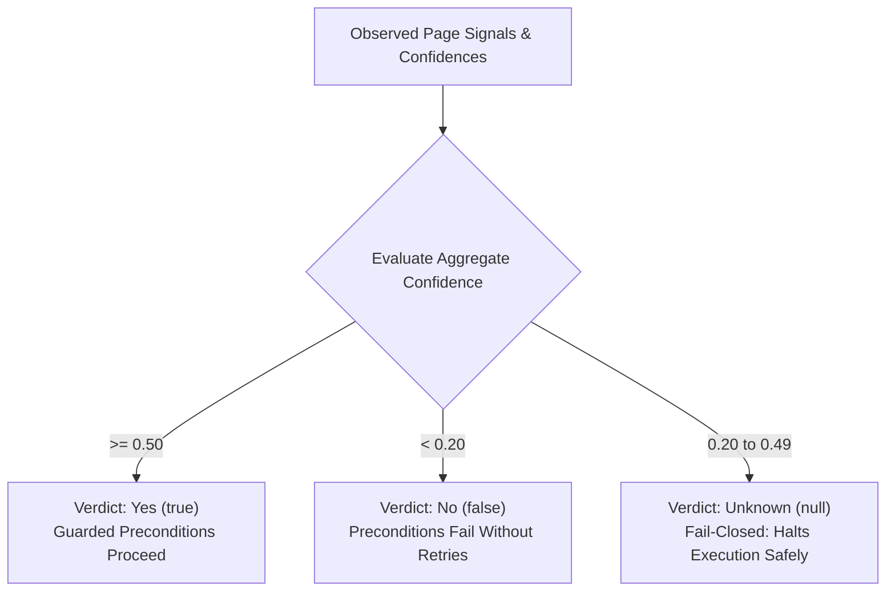
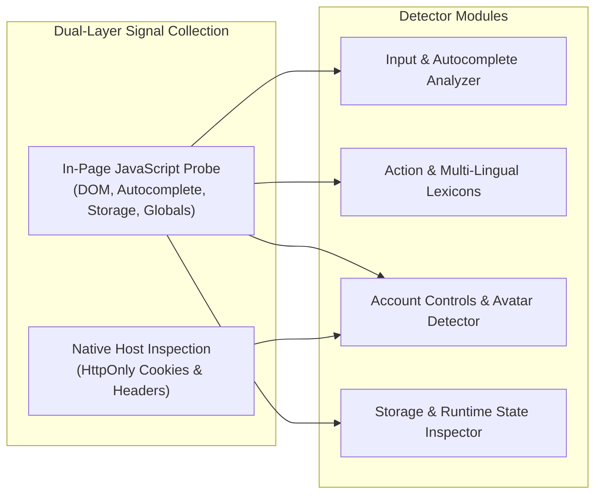
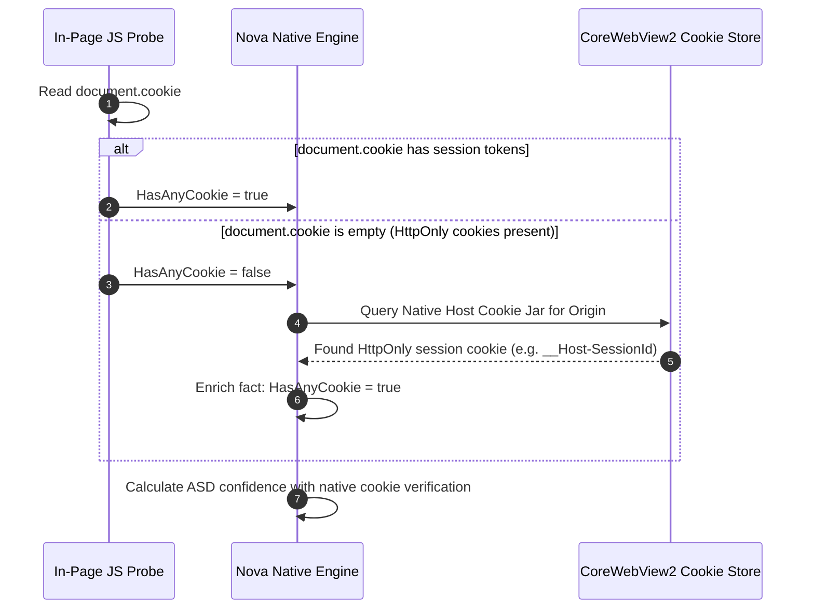
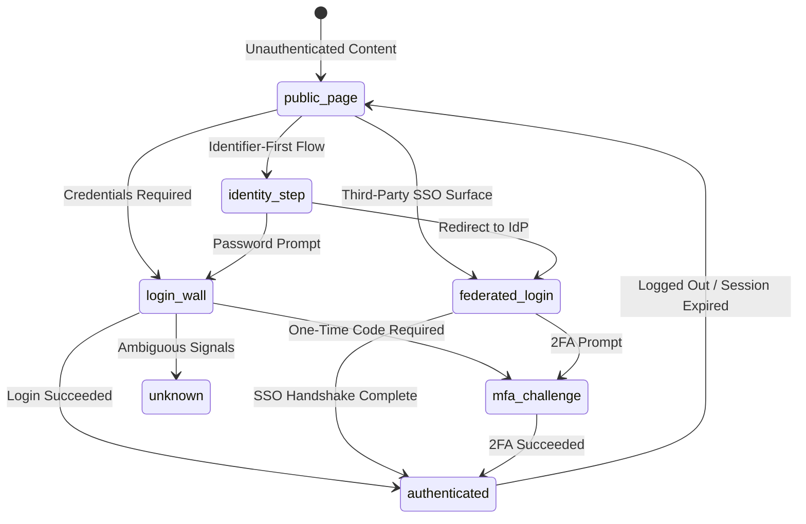

# Heuristic Probing & Tri-State Logic

Web automation frequently fails when encountering modern authentication workflows due to boolean coercion. Traditional automation frameworks evaluate authentication by asking: *"Is the user logged in?"* If the page presents an intermediate two-factor authentication challenge, an identifier-first step, or an ambiguous session rehydration state, a naive boolean check returns `false`. The automation script then re-submits saved credentials, triggering account lockouts, rate limits, or security alarms.

Nova's Auth Surface Detection (ASD) addresses this by replacing boolean assumptions with strict **Three-Valued Logic (`Yes`, `No`, `Unknown`)**, continuous confidence scoring, and multi-signal heuristic probing that bridges the gap between in-page DOM scripts and native host-level `HttpOnly` cookie inspection.

---

## 1. The Tri-State Logic Paradigm (`Yes`, `No`, `Unknown`)

In security-critical browser automation, **absence of positive evidence is not evidence of absence**:

```
+-----------------------------------------------------------------------------------------------+
| TRI-STATE VALUE | WIRE VALUE | CONFIDENCE BOUNDS       | OPERATIONAL MEANING & BEHAVIOR       |
+-----------------------------------------------------------------------------------------------+
| Yes             | true       | Confidence >= 0.50      | Positive evidence firmly verified.   |
|                 |            |                         | Preconditions succeed; actions proceed|
| No              | false      | Confidence < 0.20       | Absence of state firmly established. |
|                 |            |                         | Preconditions fail cleanly without   |
|                 |            |                         | triggering ambiguous retry loops.     |
| Unknown         | null       | 0.20 <= Confidence < 0.50| Evidence is ambiguous, conflicting,  |
|                 |            |                         | or in-flight. NEVER coerced to false.|
|                 |            |                         | Guarded tools halt safely.           |
+-----------------------------------------------------------------------------------------------+
```



### Core Invariants of the Tri-State Model
1. **No Silent Defaulting:** If an in-page script errors, if the DOM is temporarily unreadable during a framework re-render, or if conflicting indicators appear simultaneously (e.g. a visible password field on an account management page that also features a logout button), ASD returns `Unknown` (`null`).
2. **Fail-Closed Architecture:** Security gates and guarded tools treat `Unknown` as non-passing for assertions requiring explicit affirmative verification (`true`). It prevents automated scripts from assuming a session is absent and blindly firing login macros.
3. **Dual-Fact Reflection:** Facts are mapped to both simple scalar booleans (`auth.loggedIn`, `auth.loginWallVisible`) and full diagnostic assessment objects (`auth.assessment`) on the Tool Observation Bus (TOB).

---

## 2. Multi-Signal Probing Engine

ASD evaluates pages through a sandboxed, top-document probe paired with native host-level inspection. Gathered signals feed into dedicated detector modules without introducing external network dependencies:



### 2.1 DOM Input & Autocomplete Analysis
The probe inspects visible `<input>` and `<textarea>` elements across top-level documents and accessible DOM scopes:
* **Password Fields:** Counts visible fields with `type="password"`. A single password field indicates a login surface; multiple password fields indicate registration or password change workflows.
* **W3C Autocomplete Semantics:** Reads standard autocomplete tokens:
  * `autocomplete="current-password"`: Strongly weights toward an explicit login surface.
  * `autocomplete="new-password"`: Indicates account creation, onboarding, or password reset; suppresses login-wall scoring.
  * `autocomplete="one-time-code"`: Signals a Multi-Factor Authentication (MFA) challenge or SMS/TOTP step.
  * `autocomplete="username"` / `autocomplete="email"`: Identifies credential identifier fields.
* **Identifier Fields:** Evaluates visible inputs by attributes (`name`, `id`, `placeholder`, `aria-label`, `data-testid`) containing tokens like `email`, `username`, `login`, `user-id`, or `identifier`.

### 2.2 Form Linkage & Multi-Lingual Action Dictionaries
Auth surfaces vary across internationalized applications. ASD embeds multi-lingual keyword dictionaries to recognize action anchors, submission buttons, and headings across English, German, French, and Spanish:

* **Auth Action URLs (`authHrefKeywords`):** Detects navigation links pointing to `/login`, `/signin`, `/sign-in`, `/auth`, `/oauth`, `/sso`, `/account/login`, `/session`, `/connexion`, `/connect`, `/acceso`, `/entrar`, `/iniciar-sesion`, `/registro`.
* **Action Button Text (`authTextKeywords` & `submitKeywords`):** Identifies textual triggers matching:
  * English: `log in`, `login`, `sign in`, `signin`, `continue with`, `submit`, `next`.
  * German: `anmelden`, `einloggen`, `weiter`, `fortfahren`, `anmelden mit`.
  * French: `se connecter`, `connexion`, `continuer`, `suivant`, `continuer avec`.
  * Spanish: `iniciar sesion`, `acceder`, `entrar`, `continuar`, `siguiente`, `continuar con`.
* **Federated Identity Providers (`providerKeywords`):** Recognizes branded SSO buttons for `Google`, `Microsoft`, `GitHub`, `Apple`, `Okta`, and `Auth0`.
* **Auth Headings (`authHeadingKeywords`):** Inspects `<h1>`–`<h3>`, `<legend>`, and `[role="heading"]` for phrases announcing login or account access.

### 2.3 Account Controls & Authenticated Surface Detection
To determine if a page represents an already authenticated session, ASD searches for controls that only appear when logged in:
* **Logout Links (`logoutSels`):** Inspects anchors and buttons matching `a[href*="logout"]`, `a[href*="abmelden"]`, `a[href*="signout"]`, `a[href*="sign-out"]`, `button[data-testid*="logout"]`.
* **Profile & Settings Anchors:** Evaluates links matching `/profile`, `/account`, `/user`, `/settings`, `/preferences`, and corresponding localized ARIA labels (`Profil`, `Einstellungen`, `Konto`).
* **User Avatars:** Identifies user profile icons or images located inside `<header>`, `<nav>`, `[role="banner"]`, or `[role="navigation"]`. Checks image `src`, `alt`, and `class` attributes, as well as `<svg>` icons with user-related ARIA labels (`avatar`, `user`, `profile`).

---

## 3. Host-Level `HttpOnly` Cookie Inspection

In standard browser automation, client-side JavaScript (`document.cookie`) cannot read cookies marked with the W3C `HttpOnly` directive:

```
Standard Headless Browser Blind Spot:
document.cookie -> "" (HttpOnly cookie hidden by browser security)
Naive Script Conclusion: User is NOT logged in -> Trigger redundant login macro -> Session corrupted.
```

Nova bridges this gap through native host integration:



* When the in-page JavaScript probe reports `HasAnyCookie == false` on the main frame, Nova initiates a host-level asynchronous cookie query against the native profile cookie store.
* If active session cookies exist in the native store for the target origin, the probe result is enriched with `HasAnyCookie = true`.
* This ensures corporate intranets and enterprise applications using `HttpOnly` session tokens are correctly recognized as authenticated rather than mistaken for ephemeral or logged-out pages.

---

## 4. The 6 Lifecycle Stages (`auth.stage`)

ASD maps gathered signals to an explicit authentication lifecycle stage, providing agents with complete situational awareness:



### Stage Definitions

| Stage Identifier | Characteristic Surface | Key Evidentiary Signals |
| :--- | :--- | :--- |
| **`public_page`** | Standard unauthenticated content | No password fields, no login prompts, low auth confidence ($< 0.20$), standard public navigation. |
| **`login_wall`** | Traditional sign-in form | Visible password input, form submit button, login action anchors, or explicit password submit readiness. |
| **`identity_step`** | Multi-step sign-in (email/username first) | Identifier input field visible, "Continue" / "Next" action, no password field yet, auth headings present. |
| **`federated_login`** | Third-party SSO portal | Provider buttons (`Google`, `Microsoft`, `Apple`, `Okta`), no local credential inputs. |
| **`mfa_challenge`** | Two-Factor / Multi-Factor challenge | One-time code field (`autocomplete="one-time-code"`), SMS/TOTP prompts, previous auth step completed. |
| **`authenticated`** | Active logged-in user session | Visible logout controls, profile/avatar navigation, valid storage keys, or active runtime auth globals. |
| **`unknown`** | Ambiguous or conflicting page state | Signup forms with both current and new password fields, contradictory signals, or failed probe execution. |

---

## 5. Confidence Scoring Engine & Dual-Fact Reflection

The scoring engine computes continuous confidence values between `0.0` and `1.0`:

### 5.1 Login Wall Scoring Weights
* Password input inside a form with a submit button: **Base `0.90`**.
* Standalone visible password field: **Base `0.65`**.
* Identity step surface with "Continue" trigger: **Base `0.75`** (or `0.60` without explicit step action).
* Federated SSO surface: **Base `0.55`**.
* Presence of "Forgot Password" or login actions adds $+0.10$ each (clamped to `1.0`).
* **Signup Discounting:** If `new-password`, second password confirmation, or terms-and-conditions checkboxes appear without `current-password`, login confidence is discounted to $\le 0.20$ to prevent false positives during user registration.

### 5.2 Authenticated Scoring Weights
* Visible logout link: **Base `0.95`**.
* $\ge 3$ account controls (profile link, settings link, avatar in header): **`0.80`**.
* 2 account controls: **`0.45`** (yields `Unknown`).
* 1 account control: **`0.20`** (yields `No`).
* Active auth globals or SPA state stores: **Up to `0.90`** depending on storage backing.
* Active login walls or password fields depress logged-in confidence to $\le 0.30$.

### 5.3 Dual-Fact Mapping on the Tool Observation Bus (TOB)
Verdicts are published to the Tool Observation Bus (TOB) and dual-facts dictionary:

```json
{
  "auth.loginWallVisible": false,
  "auth.loggedIn": true,
  "auth.mfaChallenge": false,
  "auth.authError": false,
  "auth.stage": "authenticated",
  "auth.persistence": "persistent",
  "auth.assessment": {
    "loginConfidence": 0.05,
    "loggedInConfidence": 0.95,
    "evidence": [
      "logout_link_found",
      "user_avatar_header",
      "httponly_session_cookie"
    ],
    "persistenceTier": "persistent",
    "framework": "React"
  }
}
```

---

## 6. Related References

* [Auth Surface Detection Hub](../README.md): Master overview of auth detection and surface safety in Nova.
* [Identity Overlays & SSO Detection](../identity-overlays-and-sso-detection/README.md): Detecting Google One Tap, Entra, and enterprise identity overlays.
* [Surface Safety & Crawler Shield](../surface-safety-and-crawler-shield/README.md): Multi-lingual lexicon shield and crawler SSRF protection.
* [Site Data Management](../../site-data-management/README.md): Cookie jar architecture and Web Storage inspection.

---

[ASD Hub](../README.md) · [All Core Features](../../README.md)
