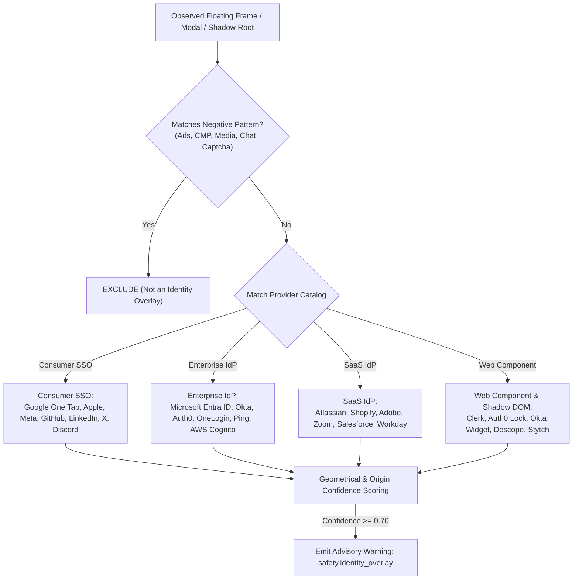
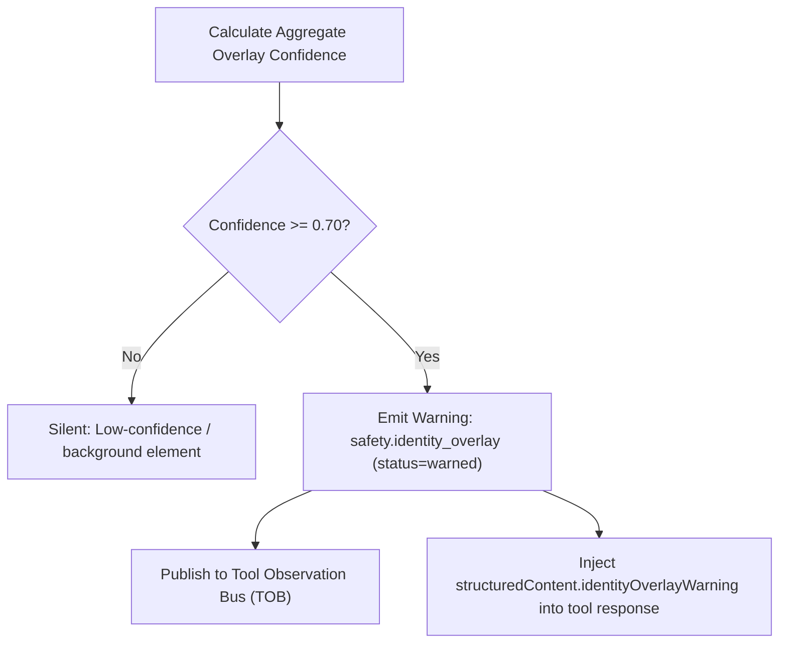

# Identity Overlays & SSO Detection

Modern web applications increasingly embed third-party identity providers into floating modal dialogs, cross-origin iframes, and encapsulated Web Components—such as Google One Tap, Microsoft Entra ID (formerly Azure AD), Okta Sign-In widgets, and Apple Sign-In prompts. 

When autonomous agents interact with web pages, these floating overlays pose severe interaction hazards: they intercept mouse clicks, obscure underlying form inputs, alter `z-index` stacking contexts, and prompt for credentials without changing the top-level URL.

Nova's `IdentityOverlayDetector` provides automated, non-invasive detection of identity overlays across four catalog families while filtering out non-auth overlays (such as cookie banners, advertisements, and chat widgets).

---

## 1. The Challenge of Floating Identity Overlays

Standard DOM automation assumes that visible elements belong to the top-level document tree and can be clicked directly. Identity overlays break this model in four critical ways:

```
Top-Level Document (https://shop.example.com)
├── Main Navigation & Search Bar
├── Product Grid (Agent attempting to click "Add to Cart")
└── Floating Cross-Origin Iframe (z-index: 1000000, fixed)
    └── Google One Tap (https://accounts.google.com/gsi/iframe/select)
        └── Intercepts click intended for "Add to Cart"!
```

1. **Click Hijacking:** A floating overlay positioned with `position: fixed` and a high `z-index` captures pointer events intended for elements positioned behind it.
2. **Cross-Origin Framing:** Overlays often execute within isolated `<iframe>` elements hosted on third-party domains (`accounts.google.com`, `login.microsoftonline.com`). In-page scripts in the parent window cannot inspect the iframe's internal DOM due to Same-Origin Policy (SOP).
3. **Shadow DOM Encapsulation:** Client-side authentication libraries (such as Auth0 Lock or Clerk) render UI inside open or closed Shadow DOM roots, hiding markup from standard query selectors.
4. **Transient Appearance:** Overlays frequently delay their appearance by 500 ms to 2 seconds after page load, popping up precisely as an agent dispatches an interaction.

---

## 2. The 4 Catalog Provider Families

Nova's `IdentityOverlayDetector` scans candidate frames, modals, and shadow roots against four catalog families:



### 1. Consumer Single Sign-On (`ConsumerSso`)
* **Google Identity Services (GIS):** Matches `accounts.google.com`, `/gsi/`, `credential_picker`, `<iframe id="gsi_">`.
* **Apple Sign-In:** Matches `appleid.apple.com`, `appleid.cdn-apple.com`.
* **Meta / Facebook Login:** Matches `connect.facebook.net`, `facebook.com/plugins/login_button`.
* **Developer & Social Providers:** GitHub (`github.com/login/oauth`), GitLab, LinkedIn, X/Twitter, Discord, Slack, Dropbox, Amazon.

### 2. Enterprise Identity Providers (`EnterpriseIdp`)
* **Microsoft Entra ID / MSA:** Matches `login.microsoftonline.com`, `login.live.com`, `msft.sts.microsoft.com`.
* **Okta:** Matches `okta.com`, `okta-emea.com`, `okta-preview.com`.
* **Auth0 by Okta:** Matches `auth0.com`, `*.auth0.com`, `cdn.auth0.com`.
* **Federated Enterprise Suites:** OneLogin, Ping Identity, Duo Security, JumpCloud, Cloudflare Access, AWS Cognito, Keycloak.

### 3. SaaS Identity Providers (`SaasIdp`)
* Dedicated corporate identity hubs embedded by multi-tenant platforms: Atlassian (`id.atlassian.com`), Shopify (`accounts.shopify.com`), Adobe (`auth.services.adobe.com`), Zoom, Salesforce, Workday.

### 4. Web Components & Open Shadow DOM (`WebComponentIdentity`)
* Custom web components that encapsulate login forms: `<auth0-lock>`, `<okta-signin-widget>`, `<clerk-sign-in>`, `<apple-id-signin-button>`, and Google Identity containers (`<g_id_onload>`).
* Nova's probe traverses open shadow roots recursively to discover encapsulated identity forms that naive DOM query selectors miss.

---

## 3. Negative Pattern Exclusion (Eliminating False Positives)

To prevent misidentifying non-authentication overlays (such as cookie banners, live chat popups, or advertisements) as identity prompts, Nova enforces strict exclusion filters:

```
+-----------------------------------------------------------------------------------------------+
| OVERLAY CATEGORY      | EXCLUDED ORIGINS & PATTERNS                                           |
+-----------------------------------------------------------------------------------------------+
| Advertising & Tracking| doubleclick.net, googlesyndication.com, adsrvr.org, criteo, taboola   |
| Cookie Consent (CMP)  | onetrust, cookielaw, cookiebot, didomi, usercentrics, sourcepoint     |
| Embedded Media        | youtube.com/embed, vimeo.com, spotify.com/embed, twitch.tv/embed       |
| Live Chat & Support   | intercom.io, zendesk.com, crisp.chat, drift.com, tawk.to, freshchat.com|
| Bot Challenges        | recaptcha, hcaptcha, challenges.cloudflare.com (Turnstile), arkose    |
+-----------------------------------------------------------------------------------------------+
```

If an observed modal or iframe matches any negative filter pattern, it is immediately discarded from the identity evaluation pipeline, ensuring that cookie banners or live chat popups do not trip authentication alarms.

---

## 4. Geometrical Confidence Scoring & Advisory Warnings

Once an overlay matches an identity provider catalog, Nova calculates a continuous confidence score between `0.0` and `1.0`:

```
Confidence Calculation:
Base Provider Confidence: 0.38 - 0.45
+ 0.20  Visible Cross-Origin Iframe
+ 0.15  Overlay Geometry (>= 10% viewport area or >= 12,000 px^2)
+ 0.10  High z-index (>= 1000) or position: fixed / absolute
+ 0.10  Auth-Related Title / Accessible Name ("Sign in with Google")
- 0.25  Dampening: Offscreen, very small (< 1000 px^2), or pointer-events: none
```



### The `safety.identity_overlay` Advisory Warning
When aggregate confidence meets or exceeds `0.70`, Nova emits an advisory warning across two channels:
1. **Agent Awareness Gates (AAG):** Evaluates `safety.identity_overlay` with `status="warned"`. The gate is advisory (does not block execution) but alerts the agent that a floating prompt is obscuring the viewport.
2. **Structured MCP Payload:** The active tool response includes structured metadata:

```json
{
  "identityOverlayWarning": {
    "detected": true,
    "providerFamily": "ConsumerSso",
    "providerName": "Google One Tap",
    "confidence": 0.85,
    "frameOrigin": "https://accounts.google.com",
    "geometry": {
      "viewportAreaPercent": 14.5,
      "zIndex": 2147483647,
      "position": "fixed"
    },
    "recommendation": "Overlay is obscuring the viewport. Dismiss overlay or interact directly before clicking background elements."
  }
}
```

---

## 5. Non-Invasive Agent Mitigation Strategies

When an agent receives an `identityOverlayWarning`, it should follow established mitigation patterns:

1. **Explicit Dismissal:** If the workflow does not require authentication via the overlay, dismiss the prompt using its native close button (e.g. clicking the `✕` on a Google One Tap banner using `nova.click_selector`).
2. **Intentional Sign-In:** If authentication with that identity provider is intended, click the federated sign-in button directly.
3. **Avoid Blind Clicks:** Do not attempt to click background elements while the overlay is active; pointer events will either be intercepted by the overlay or blocked by the browser.

---

## 6. Related References

* [Auth Surface Detection Hub](../README.md): Master architecture of authentication detection in Nova.
* [Heuristic Probing & Tri-State Logic](../heuristic-probing-and-tri-state-logic/README.md): Probing mechanics, `HttpOnly` cookie inspection, and confidence scoring.
* [Surface Safety & Crawler Shield](../surface-safety-and-crawler-shield/README.md): Surface safety lexicons, SSRF protection, and crawler gating.
* [Agent Awareness Gates (AAG)](../../agent-awareness-gates-aag/README.md): Real-time pre-action safety rules and advisory warnings.

---

[ASD Hub](../README.md) · [All Core Features](../../README.md)
