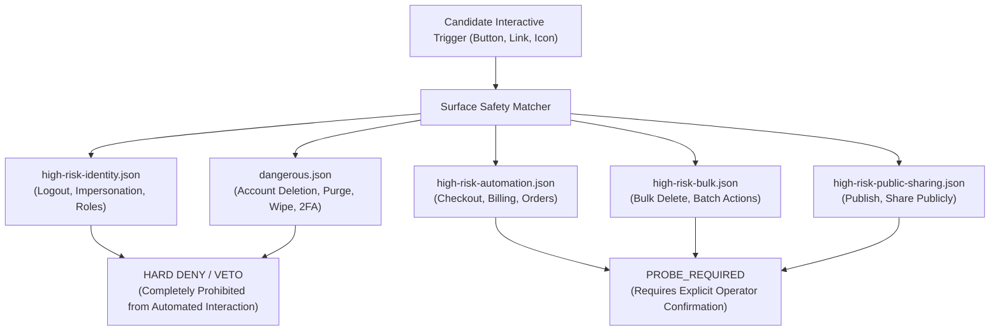
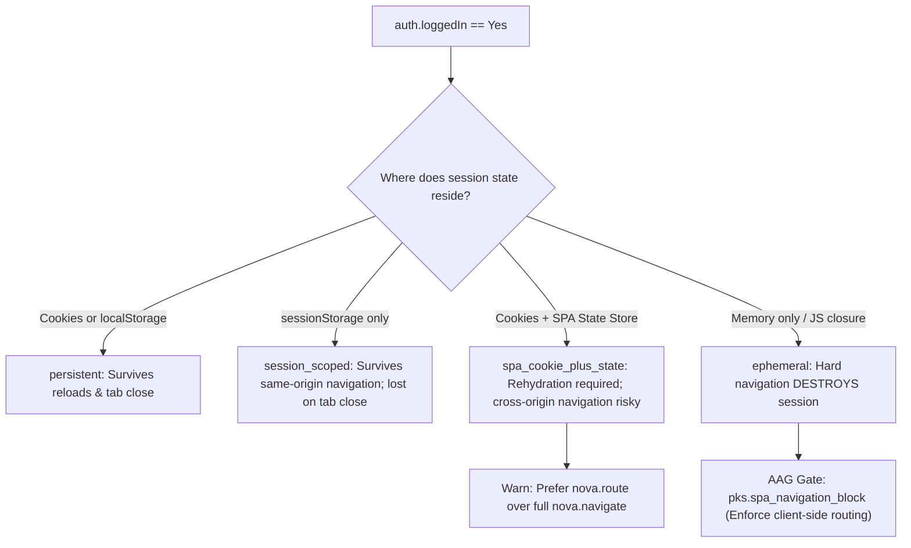
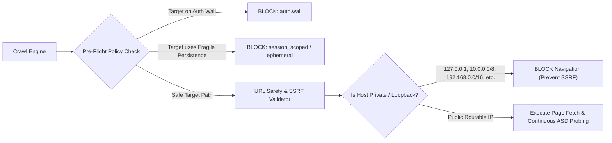
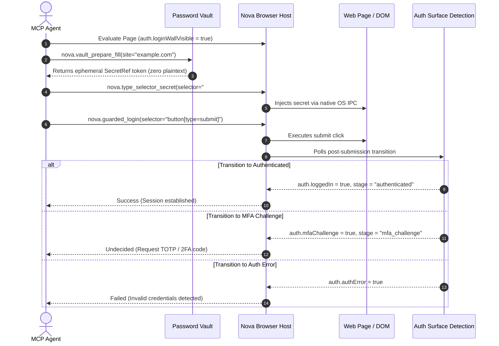

# Surface Safety & Crawler Shield

When autonomous agents explore web applications (`nova.explore_surface`) or execute background indexing crawls (`nova.crawl_start`), indiscriminate interaction with interface triggers poses severe risks: clicking `Logout` terminates active user sessions, clicking `Delete Workspace` destroys data, and clicking `Place Order` executes unintended financial transactions. Furthermore, detached crawlers navigating internal corporate networks risk Server-Side Request Forgery (SSRF) vulnerabilities.

Nova integrates the **Surface Safety Lexicon Shield**, **Session Persistence Navigation Gates**, and **SSRF Defense-in-Depth** to guarantee that autonomous exploration remains strictly confined to safe, read-only operational boundaries.

---

## 1. The Surface Safety Lexicon Shield

Nova embeds multi-lingual JSON lexicon dictionaries that categorize interface elements into strict risk tiers:

### 1.1 Multi-Lingual Risk Lexicons

| Lexicon Category | Target Languages | Example Triggers Matched | Autonomous System Action |
| :--- | :--- | :--- | :--- |
| **`HighRiskIdentity`** | DE, EN, ES, FR | `logout`, `abmelden`, `sign out`, `se déconnecter`, `cerrar sesión`, `switch profile`, `impersonate`, `assume role`, `transfer admin`. | **HARD DENY.** Crawlers and automated explorers are strictly prohibited from clicking identity-altering triggers. |
| **`Dangerous`** | DE, EN, ES, FR (9,000+ phrases) | `delete account`, `alle daten löschen`, `cancel subscription`, `abo kündigen`, `2fa zurücksetzen`, `reset 2fa`, `purge`, `wipe`, `destroy`. | **HARD DENY.** Irreversible destructive mutations are vetoed immediately. |
| **`HighRiskAutomation`** | DE, EN, ES, FR | `buy now`, `jetzt kaufen`, `place order`, `kostenpflichtig bestellen`, `checkout`, `pay`, `zahlen`. | **PROBE_REQUIRED.** Financial checkout triggers require human-in-the-loop confirmation. |
| **`HighRiskBulk`** | DE, EN, ES, FR | `bulk delete`, `alle löschen`, `select all and delete`, `batch cancel`. | **PROBE_REQUIRED.** High-volume mutations are quarantined. |
| **`HighRiskPublicSharing`** | DE, EN, ES, FR | `share publicly`, `öffentlich freigeben`, `publish to web`, `make public`. | **PROBE_REQUIRED.** Privacy-altering visibility toggles require approval. |
| **`SafeReadonly`** | Multi | `view`, `details`, `expand`, `anzeigen`, `öffnen`. | **ALLOW.** Read-only inspection triggers are permitted. |
| **`SafeNavigation`** | Multi | `next`, `previous`, `page 2`, `weiter`, `zurück`. | **ALLOW.** Pagination and read-navigation triggers are permitted. |

### 1.2 The 5-Module Surface Safety Pipeline
Candidate triggers are evaluated through a deterministic 5-module evaluation pipeline:
1. **SemanticAllowModule:** Identifies declarative open controls (e.g. `
`, ARIA popups, tabs, accordions) designed for safe content disclosure.
2. **DomContextHardDenyModule (Structural Veto):**
   * Denies form-owned submit elements (`input[type="submit"]`, `<button>` defaulting to submit inside `<form>`).
   * Denies form-associated action overrides (`formaction`, `formmethod`).
   * Denies file download triggers (`download` attribute).
   * Denies external protocol schemes (`mailto:`, `tel:`, `javascript:`).
   * Denies confirmation dialog triggers (`role="alertdialog"`).
3. **KeywordSoftEvidenceModule (Lexicon Shield):** Matches element text, accessible names, titles, and IDs against multi-lingual lexicon fragments. Triggers matching `HighRiskIdentity` or `Dangerous` receive an immediate veto.
4. **HeuristicQualificationModule:** Evaluates complex disclosure patterns (custom elements with popup heuristics).
5. **ReadNavQualificationModule:** Qualifies read-only pagination controls (`load more`, `next page`).

**The Governing Invariant:** *Hard Deny > Runtime Invariants > Strong Allow > Soft Evidence.* A trigger matching `logout` or `delete account` can **never** be clicked by autonomous exploration, regardless of its semantic markup or button appearance.

---

## 2. Session Persistence Tiers & Navigation Safety

A web application's authentication state can reside across volatile storage tiers. A destructive page reload or cross-origin navigation can instantly destroy an in-memory session:

### 2.1 The Four Persistence Tiers
1. **`persistent`:** Backed by persistent cookies or `localStorage` auth tokens. Survives full-page hard refreshes (`nova.reload`), tab recycling, and browser restarts.
2. **`session_scoped`:** Backed by `sessionStorage`. Survives same-origin navigations within the same tab, but is completely lost if the tab closes.
3. **`spa_cookie_plus_state`:** Cookies exist, but active user state is managed in an in-memory client store (Redux, Pinia, Vuex) or runtime auth global. Hard reloads may cause state desynchronization.
4. **`ephemeral`:** Pure memory-only authentication (e.g. JWT held only in a JavaScript closure). Any standard browser reload or external navigation causes **immediate, unrecoverable session loss**.

### 2.2 Navigation Safety Gate
Whenever an agent invokes navigation tools (`nova.navigate`, `nova.reload`), Nova's navigation safety gate evaluates the target context:
* **10-Minute Persistence Cache:** Caches persistence classifications per `(profileId, origin)` for up to 10 minutes to minimize IPC latency.
* **Fail-Open Deadline:** Enforces a 3-second deadline; if the renderer is wedged, the gate logs a diagnostic warning and proceeds rather than permanently freezing execution.
* **Cross-Origin Enforcement:**
  * For `session_scoped`, cross-origin navigation is blocked (`auth.session_scoped_cross_origin`).
  * For `spa_cookie_plus_state`, cross-origin navigation is blocked, while same-origin issues an advisory warning.
  * For `ephemeral`, **any full-page navigation or reload is strictly blocked** (`auth.ephemeral`) unless the agent explicitly confirms session destruction (`confirmSessionDestruction: true`).

---

## 3. Crawler Integration & SSRF Defense-in-Depth

The web crawler (`nova.crawl_start`) shares ASD and surface safety engines to maintain security boundaries while indexing web applications:

### 3.1 Target-Bound Pre-Flight Gating
When an agent attempts a target-bound crawl (`nova.crawl_start(targetId=...)`), Nova performs a pre-flight probe using ASD:
* **Interactive Login Wall (`auth.wall`):** If the target tab currently shows an authentication surface, the crawl is blocked (`-32001`): *"Target-bound crawl blocked: the visible target currently shows an auth/login surface that should be continued in the live tab."*
* **Session Storage & Ephemeral State:** If the target relies on `sessionStorage` or in-memory closures (`ephemeral`), detached background WebViews cannot inherit the volatile memory. The crawl is blocked, advising the agent to use in-tab link traversal (`nova.crawl_links`) instead.

### 3.2 Continuous Auth Parity Monitoring
During crawling, every newly loaded page is continuously evaluated by ASD:
* **Login Wall Avoidance:** If a crawl encounters `auth.loginWallVisible == true` on a public crawl, it halts along that path to prevent becoming trapped in authentication loops.
* **Target Auth Parity Verification:** When a crawl is bound to an authenticated tab session, Nova continuously compares the crawl's authentication status against the target tab. If the target is logged in but the crawler encounters a login wall or logged-out state, the crawler aborts immediately with error code `crawl.target_session_mismatch`.

### 3.3 Network Boundary & SSRF Prevention
To prevent autonomous crawlers from being weaponized for Server-Side Request Forgery (SSRF) or scanning private internal intranets, Nova enforces strict network boundary validation:
* **Scheme Restrictions:** Crawlers strictly permit `http://` and `https://` URLs.
* **Prohibited Hostnames:** Blocks `localhost` and all `.local` mDNS domains.
* **Private & Link-Local IP Blocking:** Literal IP addresses and DNS-resolved target IPs are strictly blocked if they fall within private ranges:
  * `127.0.0.0/8` (IPv4 Loopback)
  * `10.0.0.0/8` (Private Class A)
  * `172.16.0.0/12` (Private Class B)
  * `192.168.0.0/16` (Private Class C)
  * `169.254.0.0/16` (Link-Local / APIPA / Cloud Metadata Services like `169.254.169.254`)
  * `::1` (IPv6 Loopback) and `fe80::/10` (IPv6 Link-Local)

### 3.4 Ghost Surface Reaper
Headless crawling utilizes hidden WebViews. If a crawl job terminates unexpectedly, leaked WebViews could continue executing scripts or playing background media:
* Every hidden crawl WebView is registered with its active job ID and idle timestamp.
* A background sweeper evaluates registered surfaces every 60 seconds.
* Any hidden WebView remaining idle without navigation or script execution for $\ge 5$ minutes is automatically disposed and garbage collected.

---

## 4. Guarded Login Contracts & Hardware Re-Authentication

Submitting authentication credentials requires deterministic synchronization between password vaults, form submission, and ASD verification:

### 4.1 Non-Idempotent Contract in `nova.guarded_login`
`nova.guarded_login` enforces Closed-Loop System (CLS) invariants tailored to authentication:
* **Non-Idempotent Retry Policy:** Authentication submissions are inherently non-idempotent. If network latency occurs or an intermediate MFA prompt appears, automated retries are prohibited to prevent account lockouts.
* **Frame Scoping:** If a login form is embedded within an `<iframe>`, `nova.guarded_login` accepts an optional `frameId`, scoping both click execution and fact assertions directly to that frame context.

### 4.2 Zero-Leak Credential Redaction & Password Vault
* **SecretRef Tokens:** Agents call `nova.vault_prepare_fill` to receive a time-bounded, origin-bound `SecretRef` token.
* **Direct IPC Injection:** The secret is injected via `nova.type_selector_secret`. Plaintext passwords never enter LLM prompt context or tool call transcripts.
* **PKS Token Redaction:** The Procedural Knowledge Store strips sensitive query tokens (`?code=...`, `?token=...`, `?session=...`) from redirect URLs before logging interaction evidence.

### 4.3 Native Dialog Authentication
Network-layer challenges (HTTP 401 Basic, Digest, TLS Client Certificates) bypass DOM scripts:
* **HTTP Basic / Digest:** Resolved via `nova.ui_auth_prompt_resolve(decision='use_vault' | 'confirm' | 'cancel')`.
* **TLS Client Certificates:** Resolved via `nova.ui_client_certificate_prompt_resolve(decision='send' | 'send_none')`.

### 4.4 Sensitive Action Re-Authentication Gate
Revealing or exporting credentials from Nova's Password Vault requires operator presence:
* **Hardware Biometrics First:** Triggers Windows Hello (`UserConsentVerifier`) requiring fingerprint or facial recognition.
* **Credential UI Fallback:** Falls back to Win32 Credential UI (`CredUIPromptForWindowsCredentials`).
* **Hardware-Backed TTL:** A successful biometric confirmation suppresses re-prompts for a strictly limited Time-To-Live (TTL) cache.

---

## 5. Related References

* [Auth Surface Detection Hub](../README.md): Master overview of auth detection and surface safety in Nova.
* [Heuristic Probing & Tri-State Logic](../heuristic-probing-and-tri-state-logic/README.md): Tri-State logic, confidence engine, and `HttpOnly` inspection.
* [Identity Overlays & SSO Detection](../identity-overlays-and-sso-detection/README.md): Google One Tap and enterprise identity prompt detection.
* [Crawler & Discovery](../../crawler-and-discovery/README.md): Autonomous site crawling and target parity verification.
* [Closed-Loop System (CLS)](../../closed-loop-system-cls/README.md): Precondition gates and stability assertion contracts.

---

[ASD Hub](../README.md) · [All Core Features](../../README.md)
