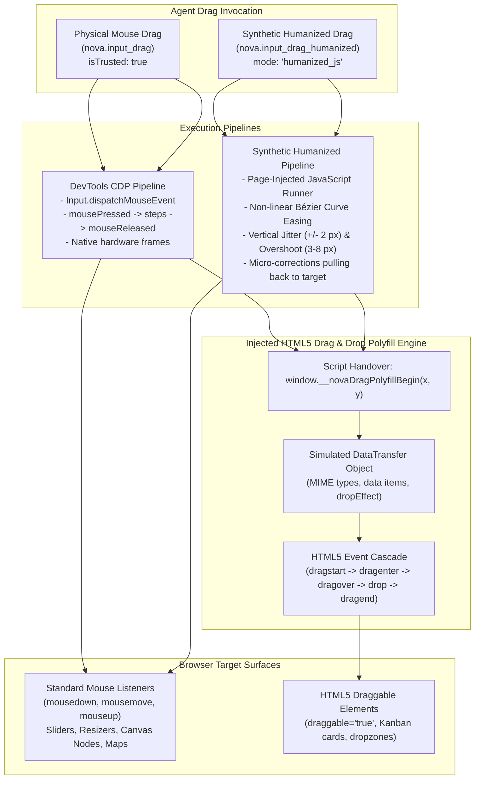

# Drag & Drop Architecture & Polyfill

> "Physical mouse gestures and HTML5 Drag & Drop are two different worlds in web engines; bridging them reliably requires deep protocol understanding and behavioral realism."
>
> — Browser Input Engineering Invariants

> [!NOTE]
> Dragging and dropping elements on the modern web encompasses two fundamentally different technical paradigms: low-level continuous mouse gestures (sliders, resizers, canvas nodes, map panning) and high-level HTML5 Drag and Drop (DnD) specifications (`draggable="true"` Kanban boards, sortable lists, file dropzones). Nova provides two complementary drag execution paths—**Physical DevTools Drag** (`isTrusted: true`) and **Synthetic Humanized Drag** with Bézier easing—backed by an automatically injected **HTML5 Drag and Drop Polyfill** that bridges physical mouse movements to the HTML5 `DataTransfer` event cascade in WinUI 3 WebView2.

---

## 1. Overview & Architectural Role

In modern web engines, dragging elements is divided across two incompatible subsystems:



---

## 2. Comprehensive Documentation Index

For exhaustive technical implementations, kinematic curves, and polyfill handover specifications, consult the specialized architecture guides:

```
public/docs/core-features/browser-interaction/drag-and-drop/
├── README.md                                 # This domain hub
├── physical-and-humanized-drag/
│   └── README.md                             # Physical CDP drag, Bézier easing, jitter, overshoot, and verification best practices
└── webview2-html5-polyfill/
    └── README.md                             # WinUI 3 WebView2 limitation, __novaDragPolyfillBegin handover, CultureInfo, DataTransfer
```

| Architecture Guide | Focus & Key Concepts | Primary Components |
| :--- | :--- | :--- |
| **[Physical DevTools Drag vs. Synthetic Humanized Drag](physical-and-humanized-drag/README.md)** | Comparison of physical hardware events (`isTrusted: true`) vs synthetic humanized profiles (`mode: "humanized_js"`), cubic Bézier easing curves, perpendicular physiological jitter ($\pm 2$ px), deliberate overshoot ($3$–$8$ px) with pullback corrections, and post-drag outcome verification via `nova.wait_for_eval`. | `nova.input_drag`<br>`nova.input_drag_humanized`<br>`BézierEasing`<br>`isTrusted: true`<br>`nova.wait_for_eval` |
| **[WinUI 3 WebView2 HTML5 Drag & Drop Polyfill](webview2-html5-polyfill/README.md)** | Addressing the WebView2 limitation where CDP mouse events fail to trigger native OS drag sessions on `draggable="true"` elements, deterministic script handover (`window.__novaDragPolyfillBegin`), culture-invariant floating-point serialization (`CultureInfo.InvariantCulture`), and simulated `DataTransfer` object cascade. | `__novaDragPolyfillBegin`<br>`NovaDataTransfer`<br>`CultureInfo.InvariantCulture`<br>`draggable="true"` |

---

## 3. Core Operational Invariants for Autonomous Agents

When automating drag-and-drop interactions in Nova, agents must follow these operational rules:

1. **Movement Does Not Guarantee Acceptance:**
   Never assume that completing an `input_drag` or `input_drag_humanized` gesture succeeded in changing application state. Web backends may reject the drop or snap sliders back. Always verify state changes using [`nova.wait_for_eval`](../../../mcp-reference/tools/dom-and-reading/nova-wait-for-eval.md) or [`nova.perceive`](../../dom-perception/multimodal-perception/README.md).
2. **Choose the Right Drag Profile:**
   * Use **`nova.input_drag`** for Canvas editors, maps, sliders, native scrollbars, and security-critical forms where `isTrusted: true` is strictly enforced.
   * Use **`nova.input_drag_humanized`** when interacting with behavioral anti-bot protected sites or workflows where natural human motor jitter and overshoot are beneficial.
3. **Rely on the Automatic HTML5 Polyfill:**
   You do not need to manually dispatch `dragstart` or instantiate `DataTransfer` objects for Kanban boards (Jira, Trello). Nova detects draggable elements at the starting coordinates and manages the event cascade automatically.

---

## Related Documentation

* [Browser Interaction Architecture Overview](../README.md)
* [Physical DevTools Drag vs. Synthetic Humanized Drag](physical-and-humanized-drag/README.md)
* [WinUI 3 WebView2 HTML5 Drag & Drop Polyfill](webview2-html5-polyfill/README.md)
* [Low-Level Input Dispatch Architecture](../input-dispatch/README.md)
* [Selectors & Shadow DOM Architecture](../selectors-and-shadow-dom/README.md)
* [Closed-Loop System (CLS)](../../closed-loop-system-cls/README.md)
* [Tool Reference: `nova.input_drag`](../../../mcp-reference/tools/browser-automation/nova-input-drag.md)
* [Tool Reference: `nova.input_drag_humanized`](../../../mcp-reference/tools/browser-automation/nova-input-drag-humanized.md)
