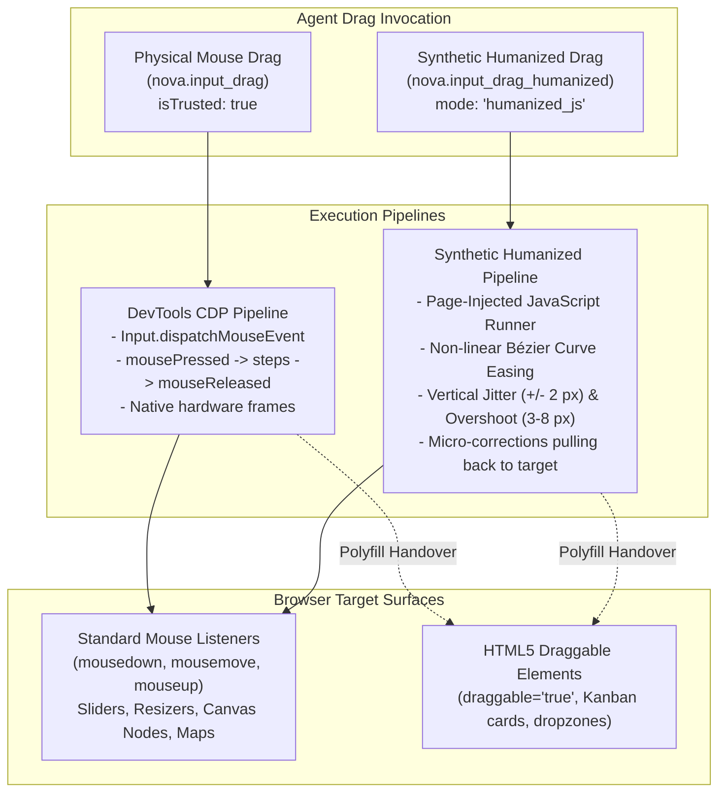
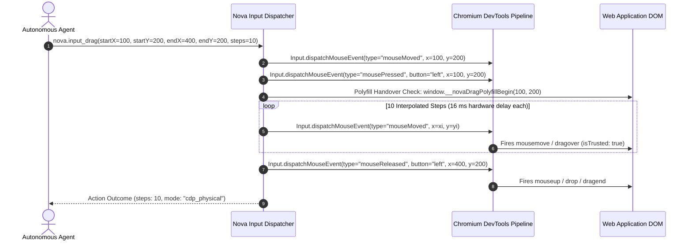
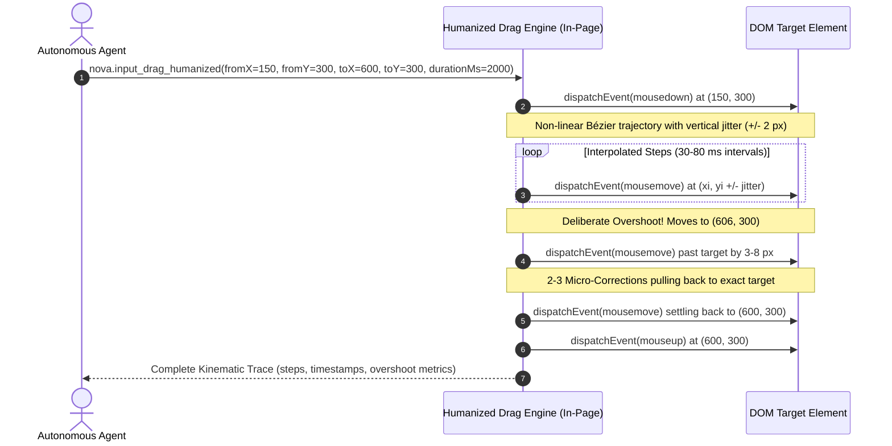

# Physical DevTools Drag vs. Synthetic Humanized Drag

> [!NOTE]
> Dragging and dropping elements on the modern web encompasses two fundamentally different technical paradigms: low-level continuous mouse gestures (sliders, resizers, canvas nodes, map panning) and high-level HTML5 Drag and Drop (DnD) specifications. Nova AI Workspace provides two complementary drag execution paths—**Physical DevTools Drag** ([`nova.input_drag`](../../../../mcp-reference/tools/browser-automation/nova-input-drag.md)) and **Synthetic Humanized Drag** ([`nova.input_drag_humanized`](../../../../mcp-reference/tools/browser-automation/nova-input-drag-humanized.md))—balancing physical authenticity against behavioral bot mitigation tolerance.

---

## 1. Architectural Overview & Drag Paths

Automating drag gestures requires selecting between native protocol hardware events and behavioral kinematic emulation:



---

## 2. Technical Comparison: Physical vs. Humanized

| Dimension | Physical DevTools Drag (`nova.input_drag`) | Synthetic Humanized Drag (`nova.input_drag_humanized`) |
| :--- | :--- | :--- |
| **Execution Path** | Chromium DevTools Protocol (`Input.dispatchMouseEvent`) | Page-injected JavaScript runner |
| **Event Authenticity** | **Physical (`event.isTrusted === true`)** | **Synthetic (`event.isTrusted === false`)**, reported as `mode: "humanized_js"` |
| **Kinematic Profile** | Linear interpolation across evenly spaced steps (default: 10 steps) | Non-linear Bézier curve, vertical jitter ($\pm 2$ px), overshoot ($3$–$8$ px), and pullback corrections |
| **Duration & Timing** | Hardware frame intervals (~16 ms per step) | Configurable duration ($500$–$10,000$ ms, default randomized $1,800$–$2,400$ ms) |
| **Anti-Bot Tolerance** | High (native browser engine event) | Behavioral heuristic tolerance (emulates natural human motor kinematics) |
| **Primary Use Cases** | HTML5 Canvas, sliders, native scrollbars, map panning, strict authentication | Behavioral bot mitigation bypass, human simulation workflows |

---

## 3. Physical DevTools Drag (`nova.input_drag`)

`nova.input_drag` delivers genuine hardware peripheral events through the Chromium DevTools Protocol:



### Parameter Specifications:
* **Coordinates:** Supports `startX`, `startY`, `endX`, `endY` or aliased parameter names `fromX`, `fromY`, `toX`, `toY`. If a `selector` is provided, Nova resolves the starting point to the geometric center of the target element.
* **`steps` (integer, default: 10):** The number of intermediate linear interpolation points along the gesture vector.
* **`button` (string, default: `"left"`):** The mouse button held during the drag (`"left"`, `"middle"`, `"right"`).

---

## 4. Synthetic Humanized Drag (`nova.input_drag_humanized`)

Automated scripts that drag objects in mathematically straight lines with uniform velocity are easily flagged by behavioral anti-bot heuristics. Real human hand movements exhibit non-linear acceleration, minor perpendicular tremors, and slight overshoots:



### Kinematic Emulation Mechanics:

1. **Non-Linear Bézier Easing:** Interpolates the trajectory using cubic Bézier velocity curves (slow initial acceleration, steady mid-stroke glide, and deceleration near target).
2. **Perpendicular Jitter (`jitterPx`):** Injects pseudo-random vertical fluctuations (default: $\pm 2$ px, configurable from $0$ to $10$ px) perpendicular to the drag vector, modeling physiological hand tremors.
3. **Deliberate Overshoot & Correction:** The trajectory intentionally carries $3$ to $8$ pixels beyond the destination before performing $2$ to $3$ corrective micro-pullbacks to settle on the target.
4. **Configurable Duration:** `durationMs` ranges from $500$ ms to $10,000$ ms. If omitted, Nova randomizes the duration between $1,800$ ms and $2,400$ ms.
5. **Trace Reporting:** The tool outcome includes an exhaustive telemetry array recording all intermediate coordinates, timestamps, and deviation metrics.

> [!WARNING]
> While humanized drag provides realistic kinematics, events are dispatched via page script and carry `event.isTrusted === false`. If a target page requires genuine hardware events, use `nova.input_drag`.

---

## 5. Verifying Drag Outcomes

> [!IMPORTANT]
> **Movement $\neq$ Persistence:**
> A completed drag gesture does **not** guarantee that the web application accepted the resulting state. A slider may snap back to its origin if an API request fails, or a reordered Kanban card may revert if the server rejected the move.

### Verification Best Practices:

1. **Verify State Following Drag:**
   Drag tools do not take inline transition contracts. Verify the resulting application state in the call that follows the drag using [`nova.wait_for_eval`](../../../../mcp-reference/tools/dom-and-reading/nova-wait-for-eval.md):
   ```json
   {
     "expression": "Number(document.querySelector('input#price-slider').value) >= 75",
     "timeoutMs": 3000
   }
   ```
2. **Visual Evidence Verification:**
   Request an immediate post-action visual inspection via [`nova.perceive`](../../../dom-perception/multimodal-perception/README.md) to confirm that the dragged card or slider handle is physically positioned in the new dropzone.

---

## 6. Practical Agent Invocation Examples

### Physical Slider Adjustment via Coordinates

```json
{
  "targetId": "tab-101",
  "startX": 200,
  "startY": 450,
  "endX": 450,
  "endY": 450,
  "steps": 15
}
```

### Humanized Drag with Custom Jitter on a Kanban Board

```json
{
  "targetId": "tab-101",
  "fromX": 150,
  "fromY": 250,
  "toX": 550,
  "toY": 250,
  "durationMs": 2200,
  "jitterPx": 3
}
```

---

## Related Documentation

* [Drag & Drop Architecture Hub](../README.md)
* [WebView2 HTML5 Polyfill Architecture](../webview2-html5-polyfill/README.md)
* [Low-Level Input Dispatch Architecture](../../input-dispatch/README.md)
* [Selectors & Shadow DOM Architecture](../../selectors-and-shadow-dom/README.md)
* [Closed-Loop System (CLS)](../../../closed-loop-system-cls/README.md)
* [Tool Reference: `nova.input_drag`](../../../../mcp-reference/tools/browser-automation/nova-input-drag.md)
* [Tool Reference: `nova.input_drag_humanized`](../../../../mcp-reference/tools/browser-automation/nova-input-drag-humanized.md)
