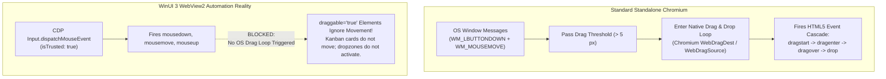

# WinUI 3 WebView2 HTML5 Drag & Drop Polyfill

> [!NOTE]
> A critical limitation in Windows desktop browser automation is that Chromium DevTools Protocol (CDP) mouse events **do not trigger native Chromium drag sessions** for elements with `draggable="true"` inside WinUI 3-hosted WebView2 instances. Without specialized intervention, automated drag gestures over Kanban boards (Jira, Trello, GitHub Projects), sortable lists, and file upload dropzones fail completely. Nova AI Workspace resolves this through an automatically injected **HTML5 Drag & Drop Polyfill Engine** that bridges physical mouse movements to the HTML5 `DataTransfer` event cascade.

---

## 1. The WinUI 3 WebView2 Limitation

In standard Chromium browsers, dragging an HTML5 draggable element (`<div draggable="true">`) requires a sequence of native operating system window messages:



### Why Native CDP Mouse Events Fail:

1. **Missing OS-Level Drag Messages:** WebView2 embedded inside WinUI 3 processes synthetic CDP mouse events through its internal compositor, but does not route them through the Windows Desktop `DoDragDrop` OLE COM API.
2. **Ignored `draggable="true"` Handlers:** The browser's native drag manager never awakens. The target card highlights briefly upon `mousedown`, but moving the pointer across the screen simply triggers standard `mousemove` events, which draggable containers actively suppress.
3. **Dropzone Inactivity:** Destination dropzones listening for `dragenter`, `dragover`, and `drop` events remain completely idle.

Nova solves this by intercepting drag gestures at the browser runtime and synthesizing the complete HTML5 Drag & Drop specification in-flight.

---

## 2. Injected Polyfill Architecture & Event Cascade

When `nova.input_drag` or `nova.input_drag_humanized` is invoked, Nova executes a coordinated handover check and event synthesis:

```mermaid
flowchart LR
    Start["CDP mousePressed over draggable='true'"] --> Handover["Handover: window.__novaDragPolyfillBegin(x, y)"]
    Handover --> Threshold["Monitor Movement Delta (> 5 px)"]
    Threshold --> DragStart["Synthesize 'dragstart'\nCreate Mock DataTransfer Object"]
    DragStart --> DragOver["Synthesize 'dragenter' & 'dragover'\nUpdate dropEffect (copy, move, link)"]
    DragOver --> MouseUp["CDP mouseReleased over Dropzone"]
    MouseUp --> Drop["Synthesize 'drop'\nForward DataTransfer Payload"]
    Drop --> DragEnd["Synthesize 'dragend'\nCleanup Drag State"]
```



---

## 3. The Deterministic Handover Check

Before dispatching mouse movement steps, Nova queries the page to evaluate whether an element at the start coordinates requires HTML5 drag handling:

```javascript
(function(){
  try {
    return !!(window.__novaDragPolyfillBegin && window.__novaDragPolyfillBegin(x, y));
  } catch(e) {
    return false;
  }
})()
```

### Handover Lifecycle:

1. **Hit-Testing:** The polyfill inspects the DOM element directly beneath $(x, y)$ using `document.elementFromPoint(x, y)`.
2. **Ancestor Scanning:** If the immediate element lacks `draggable="true"`, the polyfill traverses upward through parent nodes to locate the nearest draggable container (such as a Kanban card wrapper).
3. **Activation State:** If a draggable container is located, the polyfill arms its internal state machine, returning `true` to Nova's host dispatcher. If no draggable element exists (e.g. dragging a canvas or map), the polyfill returns `false`, allowing pure CDP mouse movements to proceed uninterrupted.

---

## 4. Culture-Invariant Numeric Formatting

A subtle, real-world bug in cross-platform Windows automation occurs when injecting JavaScript expressions containing decimal coordinates:

```csharp
// UNSAFE: Relies on current thread culture
string script = $"window.__novaDragPolyfillBegin({x}, {y})";
// On German / European Windows: produces "window.__novaDragPolyfillBegin(12,5, 45,8)"
// JavaScript parses this as FOUR separate arguments: (12, 5, 45, 8)!
```

### Nova's Invariant:
Nova strictly formats all coordinate expressions using `CultureInfo.InvariantCulture`:

```csharp
string script = string.Format(
    CultureInfo.InvariantCulture,
    "window.__novaDragPolyfillBegin({0:F2}, {1:F2})",
    x, y);
// Guaranteed Output: "window.__novaDragPolyfillBegin(12.50, 45.80)"
```

This guarantees that coordinate serialization never corrupts floating-point arguments, regardless of the host machine's regional settings.

---

## 5. `DataTransfer` Object Simulation

Modern web applications rely heavily on the `event.dataTransfer` object to pass state (such as task IDs, JSON metadata, or MIME types) from the dragged element to the target dropzone.

Nova's polyfill implements a simulated `DataTransfer` engine:

```javascript
class NovaDataTransfer {
  constructor() {
    this.data = {};
    this.types = [];
    this.dropEffect = "move";
    this.effectAllowed = "all";
  }

  setData(format, data) {
    const key = format.toLowerCase();
    this.data[key] = String(data);
    if (!this.types.includes(key)) {
      this.types.push(key);
    }
  }

  getData(format) {
    return this.data[format.toLowerCase()] || "";
  }

  clearData(format) {
    if (format) {
      delete this.data[format.toLowerCase()];
      this.types = this.types.filter(t => t !== format.toLowerCase());
    } else {
      this.data = {};
      this.types = [];
    }
  }
}
```

### Polyfill Invariants:
* **MIME Support:** Supports standard types (`text/plain`, `text/html`, `text/uri-list`) and custom framework types (`application/x-jira-card-id`).
* **`dropEffect` Feedback:** Tracks `dropEffect` mutations performed by dropzone `dragover` handlers (`"copy"`, `"move"`, `"link"`, `"none"`).
* **Cleanup on Release:** Upon `dragend` or `mouseup`, all synthesized objects are garbage-collected to prevent memory leaks in long-running single-page applications.

---

## 6. Practical Agent Invocation Examples

### Dragging a Draggable Kanban Card to a New Column

```json
{
  "targetId": "tab-101",
  "startX": 220,
  "startY": 340,
  "endX": 650,
  "endY": 340,
  "steps": 12
}
```

### Dragging by Element Selector with Automatic Centering

```json
{
  "targetId": "tab-101",
  "selector": "div.kanban-card[data-task-id='DEV-402']",
  "endX": 750,
  "endY": 400
}
```

---

## Related Documentation

* [Drag & Drop Architecture Hub](../README.md)
* [Physical DevTools Drag vs. Synthetic Humanized Drag](../physical-and-humanized-drag/README.md)
* [Low-Level Input Dispatch Architecture](../../input-dispatch/README.md)
* [Selectors & Shadow DOM Architecture](../../selectors-and-shadow-dom/README.md)
* [Closed-Loop System (CLS)](../../../closed-loop-system-cls/README.md)
* [Tool Reference: `nova.input_drag`](../../../../mcp-reference/tools/browser-automation/nova-input-drag.md)
