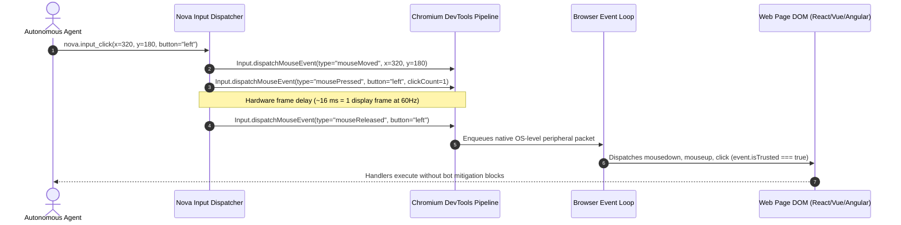

# Low-Level Input Dispatch Architecture

> "When an agent types or clicks, the browser should feel real hardware under the hood, not a script poking the DOM."
>
> — Chromium DevTools Protocol Engineering Notes

> [!NOTE]
> The Input Dispatch subsystem is Nova AI Workspace's foundational layer for delivering hardware-accurate mouse, keyboard, and scrolling events directly into web applications. By routing actions through Microsoft Edge WebView2's native Chromium DevTools Protocol (CDP) pipeline, Nova generates genuine browser events (`isTrusted: true`), restores throttled presentation surfaces, prevents character drops in complex rich-text editors, integrates first-class Monaco and CodeMirror adapters, and executes smart container scrolling with stalled-loader rebound recovery.

---

## 1. Overview & Architectural Role

A fundamental distinction in modern web automation is whether an event is trusted by the browser engine:



---

## 2. Comprehensive Documentation Index

For exhaustive technical implementations, hardware timing intervals, and container auto-detection algorithms, consult the specialized architecture guides:

```
public/docs/core-features/browser-interaction/input-dispatch/
├── README.md                                 # This domain hub
├── pointer-and-keyboard-pipelines/
│   └── README.md                             # Physical pointer sequence, ~16ms delays, chunked typing, Monaco/CodeMirror adapters
└── advanced-scrolling-mechanisms/
    └── README.md                             # Smart scrolling container auto-detection, saturation signals, rebound recovery
```

| Architecture Guide | Focus & Key Concepts | Primary Components |
| :--- | :--- | :--- |
| **[Pointer & Keyboard Dispatch Pipelines](pointer-and-keyboard-pipelines/README.md)** | Physical DevTools pointer dispatch (`isTrusted: true`), calibrated ~16 ms hardware frame delays, click count semantics (single, double, triple), window minimization restoration (`SW_RESTORE`), chunked typing with paced micro-delays for rich-text editors, Monaco and CodeMirror model adapters, and strict modifier depression/release ordering. | `nova.input_click`<br>`nova.type_selector`<br>`nova.input_shortcut`<br>`MonacoModelAdapter`<br>`CodeMirrorModelAdapter` |
| **[Advanced Scrolling Mechanisms](advanced-scrolling-mechanisms/README.md)** | Why window-level scrolling fails in modern component architectures, smart scrolling container auto-detection and scoring (`nova.scroll_smart`), feed saturation signal diagnostics, stalled-loader rebound recovery for infinite feeds, route container caching, relative scrolling (`nova.scroll_by`), and physical coordinate wheel events (`nova.input_wheel`). | `nova.scroll_smart`<br>`nova.scroll_by`<br>`nova.scroll_element`<br>`nova.input_wheel`<br>`ReboundManeuver` |

---

## 3. Core Operational Invariants for Autonomous Agents

When dispatching input events through Nova, agents should adhere to the following principles:

1. **Use `type_selector` for Reactive Editors:**
   When typing into modern rich-text editors (Notion, Slack, ProseMirror, Slate), never use raw string insertion. Use [`nova.type_selector`](../../../mcp-reference/tools/browser-automation/nova-type-selector.md) with `clearFirst: true` and `verify: true` to ensure the text is accepted without character drops.
2. **Prefer `scroll_smart` for Infinite Feeds:**
   Do not guess pixel offsets or target `window` directly. Call [`nova.scroll_smart`](../../../mcp-reference/tools/browser-automation/nova-scroll-smart.md) and inspect the returned saturation diagnostics (`grewThisScroll`, `stableRounds`) to determine whether more content is available.
3. **Verify Minimization & Visibility:**
   Nova automatically restores minimized windows before input delivery. However, ensure background tabs are brought to active presentation if visual confirmation is required.

---

## Related Documentation

* [Browser Interaction Architecture Overview](../README.md)
* [Pointer & Keyboard Dispatch Pipelines](pointer-and-keyboard-pipelines/README.md)
* [Advanced Scrolling Mechanisms](advanced-scrolling-mechanisms/README.md)
* [Drag & Drop Architecture & Polyfill](../drag-and-drop/README.md)
* [Selectors & Shadow DOM Architecture](../selectors-and-shadow-dom/README.md)
* [Closed-Loop System (CLS)](../../closed-loop-system-cls/README.md)
* [Tool Reference: `nova.input_click`](../../../mcp-reference/tools/browser-automation/nova-input-click.md)
* [Tool Reference: `nova.type_selector`](../../../mcp-reference/tools/browser-automation/nova-type-selector.md)
* [Tool Reference: `nova.scroll_smart`](../../../mcp-reference/tools/browser-automation/nova-scroll-smart.md)
