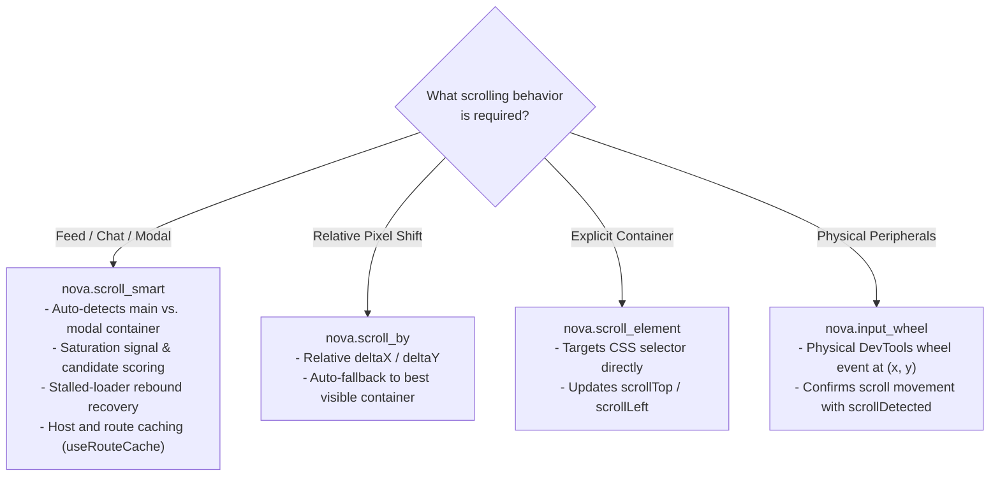
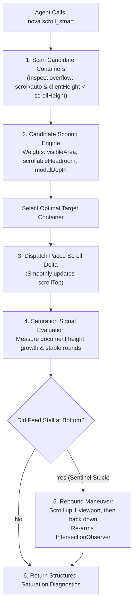

# Advanced Scrolling Mechanisms & Container Auto-Detection

> [!NOTE]
> Standard browser automation tools attempt to scroll pages by executing `window.scrollTo(0, y)`. In modern Single Page Applications (SPAs), message feeds, and modal dialogs, this naive approach fails because scrolling is isolated inside nested `<div>` containers rather than the root `window` object. Nova AI Workspace provides an **Advanced Scrolling Subsystem**—headlined by [`nova.scroll_smart`](../../../../mcp-reference/tools/browser-automation/nova-scroll-smart.md)—that auto-detects active scroll containers, evaluates feed saturation signals, performs stalled-loader rebound recovery, and executes physical coordinate wheel ticks ([`nova.input_wheel`](../../../../mcp-reference/tools/browser-automation/nova-input-wheel.md)).

---

## 1. The Modern Scrolling Challenge

In modern web applications, content scrolling is rarely bound to the root HTML body:

```
┌────────────────────────────────────────────────────────────────────────┐
│                        Scrolling Failure Traps                         │
├──────────────────────────────────┬─────────────────────────────────────┤
│ Web Application Pattern          │ Impact on Naive Automation          │
├──────────────────────────────────┼─────────────────────────────────────┤
│ Isolated Inner Containers        │ Calling window.scrollTo() does      │
│ (Sidebars, Modals, Feed Panes)   │ nothing; the container holding the  │
│                                  │ target elements never moves.        │
├──────────────────────────────────┼─────────────────────────────────────┤
│ Stalled IntersectionObservers    │ Infinite feeds stop lazy-loading    │
│ (Frozen Infinite Feeds)          │ because the scroll sentinel passed  │
│                                  │ the observer threshold too quickly. │
├──────────────────────────────────┼─────────────────────────────────────┤
│ Unknown Feed Saturation          │ Agents cannot tell if they reached  │
│ (Infinite Loop vs End of Page)   │ the end of a list or if data is     │
│                                  │ still loading over the network.     │
└──────────────────────────────────┴─────────────────────────────────────┘
```

Nova resolves these hurdles through four complementary scrolling channels:



---

## 2. Smart Scrolling (`nova.scroll_smart`)

`nova.scroll_smart` is Nova's primary tool for Single Page Applications, infinite feeds, and chat interfaces:

```json
{
  "targetId": "tab-101",
  "deltaY": 800,
  "useRouteCache": true
}
```



### Key Architectural Capabilities:

1. **Container Auto-Detection & Scoring:** Evaluates all candidate scrollable containers (`main`, `dialog`, message lists, overflow containers) based on visible area, scrollable headroom, and DOM depth, selecting the optimal target automatically.
2. **Saturation Signal Diagnostics:** The response includes rich saturation diagnostics (`grewThisScroll`, `stableRounds`, and hints) to help agents determine whether more items are currently lazy-loading or if the feed has reached the bottom.
3. **Stalled-Loader Rebound Recovery:** On infinite-scroll feeds, lazy-loaders frequently stall when scrolled continuously to the bottom—the page stops loading new items because the underlying `IntersectionObserver` sentinel is stuck offscreen. Nova automatically performs a **rebound maneuver**: scrolling upward by approximately one viewport (negative `deltaY`) and then back down, re-triggering the observer threshold.
4. **Host & Route Caching (`useRouteCache: true`):** Learns and caches last-known-good scroll containers per host and route key, accelerating repeat interactions.

---

## 3. Complementary Scrolling Tools

### A. Relative Scrolling (`nova.scroll_by`)
Dispatches relative pixel offsets (`deltaX`, `deltaY`):
* If the root window cannot scroll, it automatically falls back to the best visible scrollable container.
* Useful for general document panning.

### B. Element-Scoped Scrolling (`nova.scroll_element`)
Explicitly targets a specific container identified by a CSS selector:
* Updates `scrollTop` or `scrollLeft` directly.
* Ideal when multiple independent scroll panes (e.g. navigation tree, code canvas, document outline) reside on the same screen.

### C. Physical Coordinate Wheel Ticks (`nova.input_wheel`)
Dispatches physical mouse wheel ticks at exact viewport coordinates $(x, y)$:
* Routes through the DevTools `Input.dispatchMouseEvent` pipeline.
* Inspects whether the document or underlying container actually moved, returning `scrollDetected: true/false`.
* Essential for interactive maps (Leaflet, Mapbox, Google Maps) and custom canvas viewports that listen exclusively to mouse wheel events.

---

## 4. Practical Agent Invocation Examples

### Smart Scrolling Down an Infinite Feed

```json
{
  "targetId": "tab-101",
  "deltaY": 1200,
  "useRouteCache": true
}
```

### Scrolling a Specific Sidebar Navigation Container

```json
{
  "targetId": "tab-101",
  "selector": "nav.sidebar-navigation",
  "deltaY": 400
}
```

### Physical Mouse Wheel Zoom at Map Coordinates

```json
{
  "targetId": "tab-101",
  "x": 640,
  "y": 400,
  "deltaY": -120
}
```

---

## Related Documentation

* [Low-Level Input Dispatch Hub](../README.md)
* [Pointer & Keyboard Dispatch Pipelines](../pointer-and-keyboard-pipelines/README.md)
* [Drag & Drop Architecture & Polyfill](../../drag-and-drop/README.md)
* [Selectors & Shadow DOM Architecture](../../selectors-and-shadow-dom/README.md)
* [Tool Reference: `nova.scroll_smart`](../../../../mcp-reference/tools/browser-automation/nova-scroll-smart.md)
* [Tool Reference: `nova.scroll_by`](../../../../mcp-reference/tools/browser-automation/nova-scroll-by.md)
* [Tool Reference: `nova.scroll_element`](../../../../mcp-reference/tools/browser-automation/nova-scroll-element.md)
* [Tool Reference: `nova.input_wheel`](../../../../mcp-reference/tools/browser-automation/nova-input-wheel.md)
