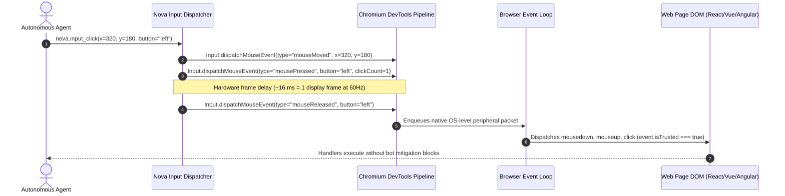
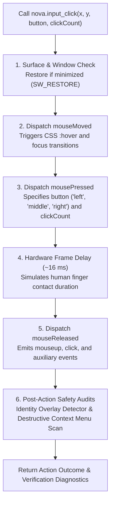

# Pointer & Keyboard Dispatch Pipelines

> [!NOTE]
> When autonomous agents interact with reactive web applications, modern front-end frameworks (React, Vue, Svelte) and rich-text editors (ProseMirror, Slate, Lexical, Monaco) rigorously scrutinize incoming peripheral events. Discarding timing intervals or injecting unverified text strings leads to dropped keystrokes, broken cursor tracking, and bot detection bans. The **Pointer & Keyboard Dispatch Pipelines** within Nova AI Workspace route actions directly through Chromium DevTools Protocol (CDP) to produce genuine hardware events (`isTrusted: true`), enforce frame-calibrated timing delays, and integrate specialized code editor adapters.

---

## 1. Physical vs. Synthetic Event Authenticity

A fundamental dividing line in browser automation is event trust:



### Event Authenticity Comparison:

| Dimension | Script Injections (`element.click()`, `dispatchEvent`) | Nova DevTools Dispatch (`nova.input_*`) |
| :--- | :--- | :--- |
| **Event Trust Flag** | `event.isTrusted === false` | **`event.isTrusted === true`** |
| **Peripheral Stack** | Synthetic JavaScript object instantiated in page | Dispatched from browser process via native CDP pipeline |
| **Bot Detection Tolerance** | Flagged or rejected by Cloudflare, reCAPTCHA, and enterprise portals | **Accepted as genuine hardware interaction** |
| **CSS Pseudo-States** | Does not trigger `:hover`, `:active`, or `:focus-visible` styles | **Fully updates CSS pseudo-classes and layout state** |
| **Event Timing** | Synchronous execution blocks page JavaScript loop | **Asynchronous event queue preserves natural frame timing** |

---

## 2. Pointer Dispatch Sequence (`nova.input_click`, `nova.input_move`)

When executing [`nova.input_click`](../../../../mcp-reference/tools/browser-automation/nova-input-click.md) or [`nova.click_selector`](../../../../mcp-reference/tools/browser-automation/nova-click-selector.md), Nova generates a calibrated peripheral sequence:



### Calibrated Execution Steps:

1. **Window State & Minimization Check:** Nova inspects the host window handle. If minimized, Nova restores it (`SW_RESTORE`), as Chromium suspends frame rendering and input dispatch in minimized states.
2. **Pointer Movement (`mouseMoved`):** Emits a pointer move event to the exact coordinates $(x, y)$, triggering CSS `:hover` states, tooltips, and element focus transitions.
3. **Button Press (`mousePressed`):** Emits a button press event with the specified `button` (`"left"`, `"middle"`, `"right"`) and `clickCount`:
   * `clickCount = 1`: Standard single click.
   * `clickCount = 2`: Double-click (selects words, opens files).
   * `clickCount = 3`: Triple-click (selects entire paragraphs or code lines).
4. **Hardware Frame Delay (~16 ms):** Nova enforces a calibrated ~16 ms delay (corresponding to one screen refresh frame at 60 Hz) between press and release. Web applications measuring press-to-release duration (to differentiate clicks from dragging) register the gesture as a valid click.
5. **Button Release (`mouseReleased`):** Emits the release event, completing the physical click cycle and firing `click` handlers.
6. **Traffic & Navigation Observation (`observe`):** Action tools (`nova.click_selector`, `nova.input_click`, `nova.input_key`, `nova.type_selector`, `nova.select_option`, `nova.choose_option`) accept `observe={...}` to monitor network requests (fetch, XHR, WebSocket), single-page navigation transitions, and post-action element states within the same tool call, eliminating roundtrips and separate read invocations.

---

## 3. Keyboard & Text Insertion Subsystems

Web applications utilize diverse input controls ranging from simple HTML `<input>` tags to multi-layer rich-text editors and code canvases:

```mermaid
flowchart TD
    InputType{"What kind of input\nis being targeted?"}

    InputType -->|Simple Input / Search Bar| FastText["nova.input_text\n- Direct Input.insertText\n- Near-instantaneous string insertion\n- Focused element required"]

    InputType -->|Rich-Text Editor\n(ProseMirror, Slate, Lexical, Draft.js)| ChunkedType["nova.type_selector\n- Paced chunked typing with micro-delays\n- Hardware Ctrl+A + Backspace clearing\n- Read-back verification"]

    InputType -->|Monaco Code Editor\n(VS Code Web, GitHub Codespaces)| MonacoModel["Monaco Model Adapter\n- Direct model.setValue() via main world\n- In-expression SHA-256 hash verification\n- Zero character drops"]

    InputType -->|CodeMirror Editor\n(CodeMirror 5/6, DevTools, REPLs)| CodeMirrorModel["CodeMirror Model Adapter\n- Direct view.dispatch() transaction\n- Text hash validation"]

    InputType -->|Functional Keys & Hotkeys| KeyShortcut["nova.input_key & nova.input_shortcut\n- Windows Virtual Key mapping\n- Strict modifier sequences (Ctrl, Shift, Alt, Meta)"]
```

### 1. Fast Text Insertion (`nova.input_text`)
Dispatches text using the DevTools `Input.insertText` command:
* Near-instantaneous insertion of strings into the currently focused DOM element.
* Ideal for long search queries, URLs, and standard form inputs where typing latency is unnecessary.
* **Requirement:** The target element must already hold focus.

### 2. The Chunked Typing Engine (`nova.type_selector`)
In modern rich-text editors (Notion, Slack, Google Docs, Linear, Jira), injecting an entire paragraph instantaneously via `insertText` creates race conditions in the framework's internal transaction queues, dropping characters, duplicating strings, or corrupting cursor positions:

* **Hardware Content Clearing:** If `clearFirst=true`, Nova dispatches a physical `Ctrl+A` followed by `Backspace` rather than mutating `.value = ""`. This ensures framework change listeners, dirty flags, and undo histories update naturally.
* **Paced Micro-Chunk Delivery:** The input string is divided into small character slices. Nova pauses briefly (~16–30 ms) between slices to allow the browser's JavaScript event loop to process state updates and re-render the virtual DOM.
* **Read-Back Verification:** Immediately following completion, Nova reads the element's actual `.value` or `.innerText` to confirm that the text was accepted by the page without character drops.

### 3. Specialized Code Editor Model Adapters
For professional development interfaces, Nova includes specialized model adapters that bypass DOM cursor emulation entirely:

* **Monaco Editor Adapter (`monaco_model`):** Targets the Monaco Editor (VS Code Web, GitHub Codespaces). Executes directly within the page's main world context to access `monaco.editor`, replacing content atomically via `editor.getModel().setValue()`. Verifies the operation using an in-expression **SHA-256 hash comparison**.
* **CodeMirror Model Adapter (`codemirror_model`):** Targets CodeMirror 5 and 6 instances by dispatching transactions directly into the editor view (`view.dispatch()`), eliminating character truncation in large code blocks.

### 4. Functional Keys & Shortcuts (`nova.input_key`, `nova.input_shortcut`)
* **`nova.input_key`:** Emulates physical key press and release cycles (`rawKeyDown` + `keyUp`) mapped to Windows Virtual Key codes (`Enter`, `Tab`, `Escape`, `Backspace`, `Delete`, arrow keys).
* **`nova.input_shortcut`:** Dispatches complex multi-key combinations (e.g. `Ctrl+Shift+K`, `Alt+F4`, `Ctrl+V`). Nova depresses modifier keys in sequence, dispatches the primary key, and releases modifiers in strict reverse order to prevent stuck-key states in the browser engine.

---

## 4. Post-Action Safety Audits

Every interactive pointer dispatch undergoes automated post-action auditing:

1. **Identity Overlay Detector:** Inspects newly appeared DOM elements to verify whether an overlay attempts to mimic a native operating system login dialog, corporate SSO prompt, or phishing form.
2. **Destructive Context Menu Scan:** Right-click actions (`button="right"`) trigger an automated scan of the resulting context menu. If destructive triggers (e.g. account deletion, data purge, token revocation) are exposed, Nova returns explicit safety warnings.

---

## 5. Practical Agent Invocation Examples

### Physical Double-Click to Select a Word

```json
{
  "targetId": "tab-101",
  "x": 450,
  "y": 280,
  "button": "left",
  "clickCount": 2
}
```

### Chunked Rich-Text Typing with Read-Back Verification

```json
{
  "targetId": "tab-101",
  "selector": "div.ProseMirror[contenteditable='true']",
  "text": "Deployment verified: all automated tests passed with zero errors.",
  "clearFirst": true,
  "verify": true
}
```

### Dispatching a Multi-Key Shortcut (`Ctrl+Shift+P`)

```json
{
  "targetId": "tab-101",
  "modifiers": ["ctrl", "shift"],
  "key": "P"
}
```

---

## Related Documentation

* [Low-Level Input Dispatch Hub](../README.md)
* [Advanced Scrolling Mechanisms](../advanced-scrolling-mechanisms/README.md)
* [Drag & Drop Architecture & Polyfill](../../drag-and-drop/README.md)
* [Selectors & Shadow DOM Architecture](../../selectors-and-shadow-dom/README.md)
* [Closed-Loop System (CLS)](../../../closed-loop-system-cls/README.md)
* [Tool Reference: `nova.input_click`](../../../../mcp-reference/tools/browser-automation/nova-input-click.md)
* [Tool Reference: `nova.type_selector`](../../../../mcp-reference/tools/browser-automation/nova-type-selector.md)
* [Tool Reference: `nova.input_shortcut`](../../../../mcp-reference/tools/browser-automation/nova-input-shortcut.md)
