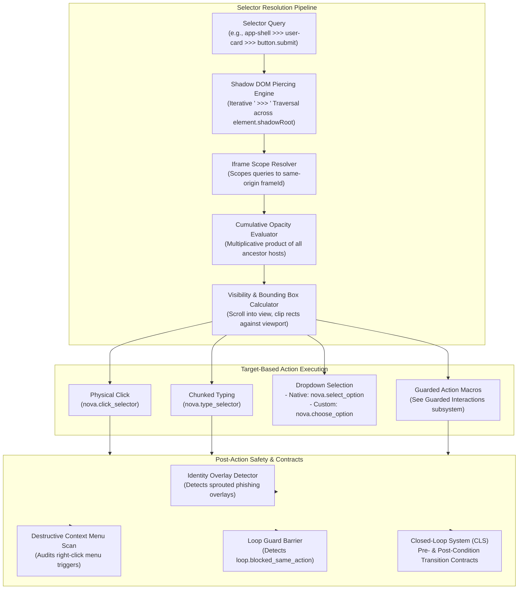

# Selectors, Shadow DOM & Custom Components

> "A selector that breaks on the first Web Component boundary is useless in modern web applications; resilient automation requires crossing shadow trees and validating state transitions atomically."
>
> — Autonomous Web Automation Guidelines

> [!NOTE]
> Web applications increasingly encapsulate user interfaces inside Web Components, open Shadow DOM boundaries, iframes, and dynamic ARIA component frameworks. Standard DOM queries like `document.querySelector()` cannot penetrate Shadow DOM trees or manipulate custom dropdown menus. Nova AI Workspace provides a robust selector resolution engine capable of piercing open shadow roots via the ` >>> ` combinator, calculating cumulative ancestor opacity, manipulating both native and custom dropdowns ([`nova.choose_option`](../../../mcp-reference/tools/browser-automation/nova-choose-option.md)), and executing composite **Guarded Action Macros** backed by closed-loop verification contracts.

---

## 1. Overview & Architectural Role

Nova's selector resolution pipeline decouples element query syntax from physical execution:



---

## 2. Comprehensive Documentation Index

For exhaustive technical implementations, opacity algorithms, and custom combobox mechanics, consult the specialized architecture guides:

```
public/docs/core-features/browser-interaction/selectors-and-shadow-dom/
├── README.md                                 # This domain hub
├── shadow-dom-and-ancestor-opacity/
│   └── README.md                             # Shadow DOM >>> combinator, cumulative ancestor opacity product, clipping
└── dropdowns-and-component-selection/
    └── README.md                             # Native select vs custom ARIA comboboxes, nova.choose_option, safety audits
```

| Architecture Guide | Focus & Key Concepts | Primary Components |
| :--- | :--- | :--- |
| **[Shadow DOM Piercing & Ancestor Opacity](shadow-dom-and-ancestor-opacity/README.md)** | Piercing open Shadow DOM boundaries via ` >>> `, iframe query scoping (`frameId`), multiplicative cumulative ancestor opacity calculations, exceptions for invisible click/upload overlays (`opacity: 0`), and visible bounding box viewport clipping. | `ShadowCombinator`<br>`CumulativeOpacityEvaluator`<br>`IframeScopeResolver`<br>`nova.click_selector` |
| **[Dropdowns & Custom Component Selection](dropdowns-and-component-selection/README.md)** | Comparison of native `<select>` elements (`nova.select_option`) vs custom ARIA comboboxes (`nova.choose_option`), matching options by visible label, substring, or index, autonomous popover menu opening/closing verification, and post-action safety audits (Identity Overlay, Loop Guard). | `nova.choose_option`<br>`nova.select_option`<br>`IdentityOverlayDetector`<br>`LoopGuard` |

> [!TIP]
> For composite, high-impact interactions such as sending AI chat messages, submitting transactional checkout forms, or authenticating through login walls, refer to the dedicated **[Guarded Interactions & Form Automation](../../guarded-interactions/README.md)** subsystem.

---

## 3. Core Operational Invariants for Autonomous Agents

When targeting elements and selecting options through Nova, agents should adhere to the following principles:

1. **Use ` >>> ` for Web Components:**
   When targeting elements encapsulated in custom tags (Salesforce, Lit, Shoelace), chain each shadow boundary with ` >>> ` (e.g., `host-tag >>> inner-tag >>> button`).
2. **Prefer `choose_option` Over Blind Clicks for Dropdowns:**
   Never attempt to automate custom comboboxes by clicking the trigger and then searching for an option with raw coordinates. Call [`nova.choose_option`](../../../mcp-reference/tools/browser-automation/nova-choose-option.md) with the visible option label; Nova manages opening, scrolling, selecting, and closing atomically.
3. **Respect `loop.blocked_same_action`:**
   If a tool invocation returns `reasonCode: "loop.blocked_same_action"`, halt immediately. The loop guard has intervened to prevent an infinite loop on a non-responsive or disabled element.

---

## Related Documentation

* [Browser Interaction Architecture Overview](../README.md)
* [Shadow DOM Piercing & Ancestor Opacity](shadow-dom-and-ancestor-opacity/README.md)
* [Dropdowns & Custom Component Selection](dropdowns-and-component-selection/README.md)
* [Low-Level Input Dispatch Architecture](../input-dispatch/README.md)
* [Drag & Drop Architecture & Polyfill](../drag-and-drop/README.md)
* [Guarded Interactions & Form Automation](../../guarded-interactions/README.md)
* [Tool Reference: `nova.click_selector`](../../../mcp-reference/tools/browser-automation/nova-click-selector.md)
* [Tool Reference: `nova.choose_option`](../../../mcp-reference/tools/browser-automation/nova-choose-option.md)
* [Tool Reference: `nova.select_option`](../../../mcp-reference/tools/browser-automation/nova-select-option.md)
