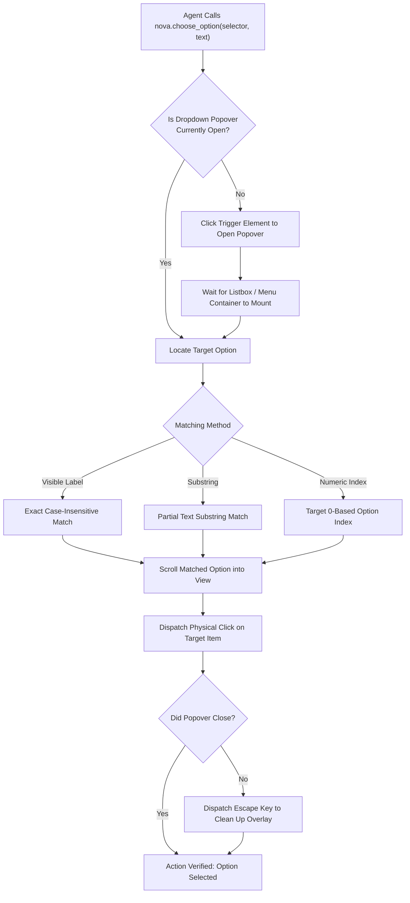
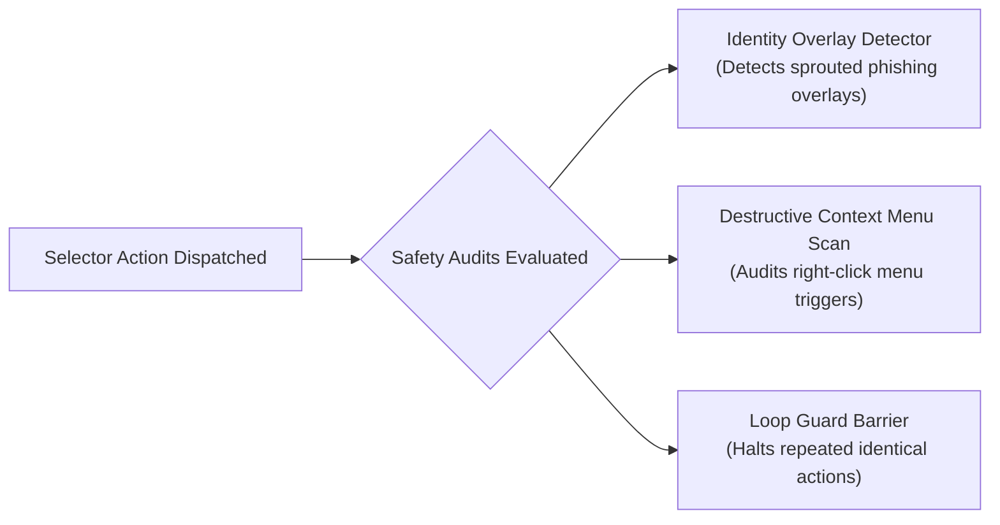

# Dropdowns, Custom Component Selection & Safety Audits

> [!NOTE]
> Enterprise web applications built with modern frontend frameworks (React, Angular, Vue) have largely replaced standard HTML `<select>` tags with complex, unstyled ARIA component libraries (such as Radix UI, Headless UI, React Select, Ant Design, and Material-UI). These custom widgets lack standard `<select>` properties and require multi-step interaction: clicking the trigger, waiting for the popover menu to mount, scrolling to the item, and confirming closure. Nova AI Workspace resolves this through [`nova.choose_option`](../../../../mcp-reference/tools/browser-automation/nova-choose-option.md) and [`nova.select_option`](../../../../mcp-reference/tools/browser-automation/nova-select-option.md), backed by automated post-action safety audits and Loop Guard barriers.

---

## 1. The Modern Dropdown Divide

Selecting an option on the web follows two fundamentally different technical patterns:

```mermaid
graph TD
    DropdownType{"What kind of dropdown\nis on the page?"}

    DropdownType -->|Native HTML <select>| NativeSelect["nova.select_option\n- Manipulates <select> by value attribute\n- Emulates change and input events\n- Matches technical value strings"]

    DropdownType -->|Custom UI Component\n(Radix, Headless UI, React Select, AntD)| CustomSelect["nova.choose_option\n- Matches by visible label, substring, or index\n- Auto-opens menu, scrolls item into view, selects\n- Verifies popover closure\n- Dual-compatible with native <select>"]
```

---

## 2. Native HTML `<select>` Elements (`nova.select_option`)

For traditional web forms utilizing native `<select>` tags:

```json
{
  "targetId": "tab-101",
  "selector": "select#country-picker",
  "value": "DE"
}
```

### Execution Invariants:
1. **Property Mutation:** Sets the native `.value` property on the `<select>` element.
2. **Event Dispatch:** Dispatches both `input` and `change` events with `bubbles: true`, ensuring that reactive framework bindings (such as Angular `[(ngModel)]` or React controlled states) update synchronously.
3. **Verification:** Inspects the element's resulting `.value` to confirm that the requested option existed and was successfully selected.

---

## 3. Universal Custom Dropdowns (`nova.choose_option`)

Modern enterprise interfaces rarely use native `<select>` elements. Instead, they implement floating popover menus using `div[role="combobox"]`, `div[role="listbox"]`, and dynamic portal overlays.

`nova.choose_option` automates the entire lifecycle of custom dropdown interaction:



### Key Advantages of `nova.choose_option`:

* **Matching by Visible Text:** Agents specify human-readable labels (e.g. `"Germany"` or `"Express Shipping"`) rather than obscure technical database IDs (e.g. `"de-iso-3166"`).
* **Autonomous Popover Management:** Automatically detects whether the dropdown list is already open or needs to be clicked open first.
* **Dual Compatibility:** If supplied with a standard HTML `<select>` element, `nova.choose_option` seamlessly delegates to native selection, resolving the option by visible label rather than requiring value attributes.

---

## 4. Post-Action Safety Scans & Loop Guard

Every interactive selector-based action is audited immediately post-dispatch:



1. **Identity Overlay Detector:** Detects if a newly opened modal or overlay mimics an external authentication provider or phishing prompt, alerting the agent before sensitive data is entered.
2. **Destructive Context Menu Scan:** If a right-click action is executed, Nova inspects the resulting context menu for dangerous triggers (e.g., delete, clear all, revoke credentials) and attaches explicit safety warnings.
3. **Loop Guard Barrier (`loop.blocked_same_action`):** If an agent repeatedly executes the exact same failing action at the same URL (e.g., clicking a disabled button in an infinite loop), Nova's loop guard halts execution, prevents further click dispatch, and returns actionable remediation guidance.

---

## 5. Practical Agent Invocation Examples

### Selecting from a Custom Radix / Tailwind Combobox

```json
{
  "targetId": "tab-101",
  "selector": "div[role='combobox']#plan-selector",
  "text": "Enterprise Annual"
}
```

### Selecting by Option Index in a Custom Dropdown

```json
{
  "targetId": "tab-101",
  "selector": "button#billing-frequency",
  "index": 1
}
```

### Native HTML Select by Value

```json
{
  "targetId": "tab-101",
  "selector": "select#currency",
  "value": "EUR"
}
```

---

## Related Documentation

* [Selectors & Shadow DOM Architecture Hub](../README.md)
* [Shadow DOM Piercing & Ancestor Opacity](../shadow-dom-and-ancestor-opacity/README.md)
* [Low-Level Input Dispatch Architecture](../../input-dispatch/README.md)
* [Drag & Drop Architecture & Polyfill](../../drag-and-drop/README.md)
* [Closed-Loop System (CLS)](../../../closed-loop-system-cls/README.md)
* [Tool Reference: `nova.choose_option`](../../../../mcp-reference/tools/browser-automation/nova-choose-option.md)
* [Tool Reference: `nova.select_option`](../../../../mcp-reference/tools/browser-automation/nova-select-option.md)
