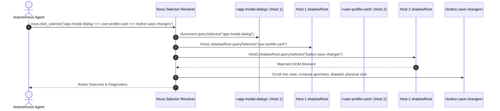

# Shadow DOM Piercing & Cumulative Ancestor Opacity

> [!NOTE]
> Modern enterprise portals—such as Salesforce Lightning, ServiceNow, Workday, and web applications built with Lit, Shoelace, or native Web Components—encapsulate elements behind open Shadow Roots and multi-level CSS opacity hierarchies. Standard CSS selectors cannot cross shadow boundaries, and standard visibility checks fail to compute the true rendered opacity of deeply nested elements. Nova AI Workspace resolves this through the **` >>> ` Shadow Piercing Combinator**, multiplicative ancestor opacity calculations, and visible viewport clipping.

---

## 1. The Shadow DOM Piercing Engine (` >>> `)

The Shadow DOM specification encapsulates a component's internal markup and styles from the outer document. Standard CSS selectors like `document.querySelector('button.save')` cannot cross a shadow boundary.

Nova extends standard CSS selectors with the **` >>> ` piercing combinator**. Each segment separated by ` >>> ` is an independent CSS selector; each ` >>> ` transitions from the matched element into its open shadow root:

```css
/* Piercing two levels of nested Web Components to target a button */
app-modal-dialog >>> user-profile-card >>> button.save-changes
```



### Traversal Invariants:

1. **Open Shadow Roots Only:**
   Traversal follows `element.shadowRoot`. Because browser engines expose this property only for open shadow roots, closed shadow roots cannot be crossed via CSS selectors. For elements encapsulated in closed shadow roots, agents should use perceptual Call-To-Action handles (`ctaRef` from [`nova.perceive`](../../../dom-perception/multimodal-perception/README.md)) or coordinate-based input.
2. **Iframe Scope Resolver (`frameId`):**
   Queries can be targeted directly within embedded frames by supplying a `frameId` parameter, scoping element resolution to the same-origin frame's document context.

---

## 2. Cumulative Ancestor Opacity Calculations

An element's effective visual opacity does not depend solely on its own CSS `opacity` property; it depends on its entire ancestor hierarchy across Shadow DOM hosts.

Nova computes the **multiplicative product** of the target element's CSS `opacity` and all ancestor hosts:

$$\text{Effective Opacity} = \text{Opacity}_{\text{target}} \times \prod_{i=1}^{n} \text{Opacity}_{\text{ancestor}_i}$$

```
┌────────────────────────────────────────────────────────────────────────┐
│                   Cumulative Opacity Evaluation                        │
├──────────────────────────────────┬──────────────┬──────────────────────┤
│ Hierarchy Node                   │ Local CSS    │ Cumulative Product   │
├──────────────────────────────────┼──────────────┼──────────────────────┤
│ <app-modal-dialog> (Host 1)      │ opacity: 0.8 │ 0.8                  │
├──────────────────────────────────┼──────────────┼──────────────────────┤
│   <user-profile-card> (Host 2)   │ opacity: 0.5 │ 0.8 * 0.5 = 0.4      │
├──────────────────────────────────┼──────────────┼──────────────────────┤
│     <button class="save-changes">│ opacity: 0.9 │ 0.4 * 0.9 = 0.36     │
└──────────────────────────────────┴──────────────┴──────────────────────┘
```

### Protection & Exception Invariants:

* **Click & Upload Exception (Opacity = 0):** Elements with an effective opacity of 0 (such as an invisible `<input type="file">` overlaid on top of a styled upload button) remain valid targets for physical clicks and file uploads. Nova recognizes standard web patterns where transparent inputs receive user gestures.
* **Screenshot Refusal:** Element-scoped screenshot captures of fully transparent elements are refused, as capturing them would produce only the background layer behind them.

---

## 3. Visible Bounding Rectangles & Viewport Clipping

Before dispatching pointer actions, Nova executes a deterministic geometry calculation:

1. **Scroll into View:** Scrolls the target element into the current viewport using `scrollIntoView({ block: 'center', inline: 'center' })`.
2. **Ancestor Overflow Clipping:** Computes the element's bounding rectangle and clips it against all ancestor overflow containers (`overflow: hidden`, `auto`, or `scroll`).
3. **Viewport Bounds Intersection:** Verifies that the resulting clipped rectangle has positive dimensions ($width > 0$ and $height > 0$). If an element is completely scrolled out of view or obscured by an ancestor's clipped boundary, Nova reports an actionable visibility warning.

---

## 4. Practical Agent Invocation Examples

### Clicking an Element Piercing Open Shadow Roots

```json
{
  "targetId": "tab-101",
  "selector": "salesforce-page-host >>> record-detail-card >>> button#save-btn",
  "autoDismissBlockers": true
}
```

### Typing into a Nested Shadow DOM Field

```json
{
  "targetId": "tab-101",
  "selector": "app-settings-dialog >>> profile-section >>> input#user-name",
  "text": "Joel Aniol",
  "clearFirst": true
}
```

---

## Related Documentation

* [Selectors & Shadow DOM Architecture Hub](../README.md)
* [Dropdowns & Custom Component Selection](../dropdowns-and-component-selection/README.md)
* [Low-Level Input Dispatch Architecture](../../input-dispatch/README.md)
* [Drag & Drop Architecture & Polyfill](../../drag-and-drop/README.md)
* [DOM Perception & Structured Reading](../../../dom-perception/README.md)
* [Tool Reference: `nova.click_selector`](../../../../mcp-reference/tools/browser-automation/nova-click-selector.md)
* [Tool Reference: `nova.type_selector`](../../../../mcp-reference/tools/browser-automation/nova-type-selector.md)
