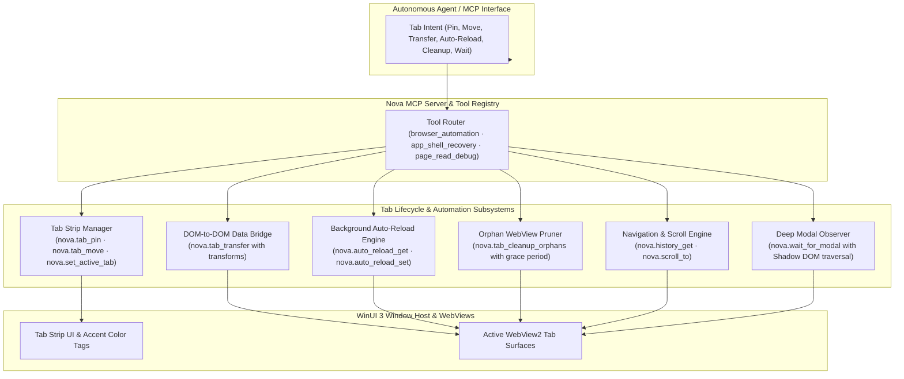
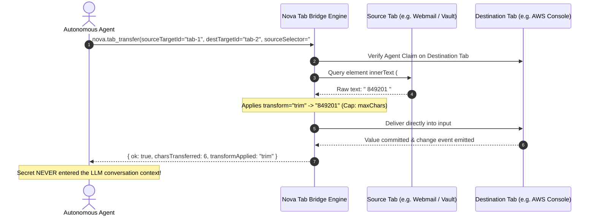
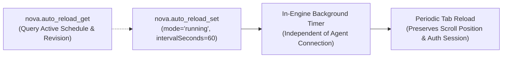
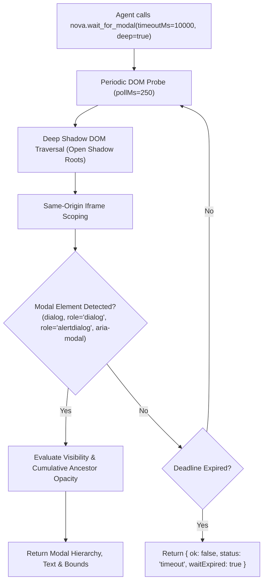

# Tab Lifecycle, Session Transfer & Automation

> **Tab pinning, visual reordering, cross-sandbox DOM data transfer, background auto-reload scheduling, orphan cleanup, history traversal, coordinate scrolling, and deep modal detection.**

---

## 1. Overview & Architectural Vision

Managing browser tabs in an autonomous agent environment involves more than opening and closing URLs. In complex multi-tasking workflows, agents must organize visual workspaces, maintain persistent monitoring dashboards, bridge data between isolated tabs without leaking secrets into conversation transcripts, prune abandoned webviews to manage system memory, and detect asynchronous modal dialogs across open Shadow DOM boundaries.

While [Multi-Sandbox Session Isolation](../../sandbox-isolation/README.md) manages physical WebView2 profile boundaries and disk anchors on the filesystem, the **Tab Lifecycle & Automation Subsystem** governs the operational lifetime of active browser tabs within Nova AI Workspace (`NovaAIWorkspace.exe`).



---

## 2. Tab Organization & Lifetime Management

Nova provides programmatic controls for managing tabs within the native WinUI 3 tab strip:

### 2.1 Tab Focus & Pinning

* **Switching Active Tab:** [`nova.set_active_tab`](../../../mcp-reference/tools/browser-automation/nova-set-active-tab.md) elevates a specified tab or sandbox target to active focus, synchronizing the WinUI 3 viewport.
  ```json
  {
    "name": "nova_set_active_tab",
    "arguments": {
      "targetId": "tab-102"
    }
  }
  ```
* **Pinning Tabs:** [`nova.tab_pin`](../../../mcp-reference/tools/browser-automation/nova-tab-pin.md) locks a tab to the far left of the tab strip. Pinned tabs shrink to their site favicon, are protected against accidental bulk closure (`Close other tabs`), and automatically restore upon application restart.
  ```json
  {
    "name": "nova_tab_pin",
    "arguments": {
      "targetId": "tab-102",
      "pinned": true
    }
  }
  ```

### 2.2 Tab Reordering & Strip Arrangement

* **Reordering Tabs:** [`nova.tab_move`](../../../mcp-reference/tools/browser-automation/nova-tab-move.md) repositions a tab next to another tab within the same sandbox profile. Setting `insertAfter: true` (default) places it immediately to the right; `false` places it to the left.

### 2.3 Orphan WebView Cleanup

Over long-running agent workflows or automated browsing tasks, agents frequently spawn transient tabs that become neglected or abandoned.
* **Pruning Idle Tabs:** [`nova.tab_cleanup_orphans`](../../../mcp-reference/tools/browser-automation/nova-tab-cleanup-orphans.md) detects and terminates inactive tabs whose idle duration exceeds `graceMinutes` (default: $15$ minutes, range: $1$–$720$).
* **Dry-Run Preview:** Passing `dryRun: true` returns candidate orphan tabs and their idle durations without closing them, allowing agents to audit candidate lists before triggering reclamation.
* **Protection Boundaries:** Pinned tabs, tabs with active agent leases, and tabs with active media playback are strictly excluded from orphan cleanup.

---

## 3. Cross-Tab & Cross-Sandbox DOM Data Transfer (`nova.tab_transfer`)

In enterprise automation, agents frequently need to transfer data between distinct tabs—for example, extracting a One-Time Password (OTP) or bearer token from an email tab and inserting it into a login form in another tab.

Traditionally, agents had to read the text into their conversational context and then type it into the destination form. This approach introduces severe risks:
1. **Secret Leakage:** Sensitive credentials, session keys, and personal data become permanently etched into the LLM conversation transcript and log files.
2. **Hallucination & Corruption:** Multi-token strings, base64 hashes, or whitespace-sensitive keys can be slightly altered during LLM generation.
3. **Context Overhead:** Moving megabytes of data through the prompt consumes large token budgets.

[`nova.tab_transfer`](../../../mcp-reference/tools/browser-automation/nova-tab-transfer.md) provides an **in-engine DOM-to-DOM text bridge**:



### Supported Transforms

* `transform="none"`: Transmits raw innerText verbatim.
* `transform="trim"`: Strips leading and trailing whitespace and newline sequences.
* `transform="number"`: Parses and extracts the first valid numeric sequence, ignoring surrounding labels (e.g., extracting `123456` from `"Your verification code is 123456."`).

---

## 4. Background Auto-Reload Scheduling (`nova.auto_reload_*`)

Autonomous agents monitoring real-time operational feeds (build pipelines, server monitoring consoles, auction listings, delivery statuses) previously had to sit in active tool loops, polling and reloading the page manually.

Nova provides in-engine **Background Auto-Reload Scheduling**:



* **Inspecting Active Schedules:** [`nova.auto_reload_get`](../../../mcp-reference/tools/browser-automation/nova-auto-reload-get.md) reports the current schedule state (`running`, `paused`, `off`), configured interval, and the optimistic concurrency `revision`.
* **Configuring Schedules:** [`nova.auto_reload_set`](../../../mcp-reference/tools/browser-automation/nova-auto-reload-set.md) creates or updates the auto-reload timer:
  * **Interval:** Configurable between $30$ and $86400$ seconds (24 hours).
  * **Modes:** `mode="running"` starts or resumes periodic reloads; `mode="paused"` suspends reloads while keeping the interval; `mode="off"` completely deletes the schedule.
  * **Optimistic Concurrency Guard (`expectedRevision`):** Ensures that concurrent agents or automated jobs do not overwrite each other's schedules. Pass `0` when setting up a fresh schedule.
  * **Idempotency Key (`clientRequestId`):** Guarantees safe retries without accidental schedule duplication.
  * **Claim Requirement:** To prevent rogue agents from disrupting human sessions, configuring an auto-reload requires the calling agent to hold an active lease claim on the target tab.

---

## 5. Navigation History & Coordinate Scrolling

### 5.1 Tab History Traversal

[`nova.history_get`](../../../mcp-reference/tools/browser-automation/nova-history-get.md) retrieves the complete navigation history stack for a designated tab:
* Reports current entry index, total entry count, and the URL and page title of each step in the back/forward queue.
* Enables agents to inspect past navigational transitions without executing speculative `nova.back` or `nova.forward` calls.

### 5.2 Absolute Coordinate Scrolling

While [`nova.scroll_smart`](../input-dispatch/advanced-scrolling-mechanisms/README.md) dynamically scores and scrolls feed containers, [`nova.scroll_to`](../../../mcp-reference/tools/browser-automation/nova-scroll-to.md) allows exact physical pixel placement:
* **Top of Page:** `nova.scroll_to(y=0)` immediately snaps the document to the very top.
* **Exact Offsets:** Accepts horizontal `x` and vertical `y` coordinates in CSS pixels, ensuring repeatable positioning for visual regressions and screenshot alignments.

---

## 6. Deep Modal & Dialog Detection (`nova.wait_for_modal`)

Modern single-page applications (SPAs) frequently trigger asynchronous modal popups, cookie consent walls, multi-factor authentication dialogs, or terms-of-service gates long after navigation events complete.

[`nova.wait_for_modal`](../../../mcp-reference/tools/browser-automation/nova-wait-for-modal.md) provides an asynchronous, shadow-piercing modal observation engine:



* **Shadow DOM & Iframe Piercing (`deep: true`):** Recursively inspects custom Web Components, nested shadow roots, and same-origin iframe hierarchies where standard CSS queries fail.
* **Visible-Only Filtering (`visibleOnly: true`):** Ignores hidden templates, inactive modals, or elements with zero bounding rects.
* **Resumable Watches (`resumable: true`):** If a modal takes longer than the single-call deadline, Nova returns a `watchId`. Agents can resume waiting via `nova.wait_continue(watchId)` without restarting probe intervals.
* **Visual Evidence Capture (`includeScreenshot: true`):** Captures visual proof of the modal upon detection with configurable formatting (`screenshotFormat="png"` or `"jpeg"`).

---

## 7. Tool Reference Matrix

The Tab Lifecycle & Automation subsystem includes **10 specialized tools**:

| Tool Name | Capability Bundle | Safety Class | Primary Capability | Key Parameters |
| :--- | :--- | :---: | :--- | :--- |
| [`nova.set_active_tab`](../../../mcp-reference/tools/browser-automation/nova-set-active-tab.md) | `browser_automation` | `normal` | Switch host window focus to a designated tab or sandbox. | `targetId` (required) |
| [`nova.tab_pin`](../../../mcp-reference/tools/browser-automation/nova-tab-pin.md) | `browser_automation` | `normal` | Pin or unpin a tab in the WinUI 3 tab strip. | `targetId` (required)<br>`pinned` (required, boolean) |
| [`nova.tab_move`](../../../mcp-reference/tools/browser-automation/nova-tab-move.md) | `browser_automation` | `normal` | Reorder a tab next to another tab in the same sandbox. | `targetId` (required)<br>`targetTabId` (required)<br>`insertAfter` (optional, boolean) |
| [`nova.tab_transfer`](../../../mcp-reference/tools/browser-automation/nova-tab-transfer.md) | `browser_automation` | `normal` | Transfer DOM text directly between two tabs without LLM context exposure. | `sourceTargetId` (required)<br>`destTargetId` (required)<br>`sourceSelector` (required)<br>`destSelector` (required)<br>`transform` (`none`, `trim`, `number`) |
| [`nova.tab_cleanup_orphans`](../../../mcp-reference/tools/browser-automation/nova-tab-cleanup-orphans.md) | `browser_automation` | `normal` | Prune inactive, unattached tabs exceeding an idle grace window. | `dryRun` (optional, boolean)<br>`graceMinutes` (optional, default: 15) |
| [`nova.auto_reload_get`](../../../mcp-reference/tools/browser-automation/nova-auto-reload-get.md) | `browser_automation` | `safe` | Retrieve current background auto-reload schedule and revision. | `targetId` (required) |
| [`nova.auto_reload_set`](../../../mcp-reference/tools/browser-automation/nova-auto-reload-set.md) | `browser_automation` | `normal` | Configure periodic background auto-reload timer. | `targetId` (required)<br>`mode` (`running`, `paused`, `off`)<br>`intervalSeconds` ($30$–$86400$)<br>`expectedRevision` (required)<br>`clientRequestId` (required) |
| [`nova.history_get`](../../../mcp-reference/tools/browser-automation/nova-history-get.md) | `browser_automation` | `safe` | Retrieve navigation history back/forward traversal stack. | `targetId` (optional, default: 'active') |
| [`nova.scroll_to`](../../../mcp-reference/tools/browser-automation/nova-scroll-to.md) | `browser_automation` | `normal` | Scroll viewport to absolute horizontal and vertical pixel coordinates. | `y` (required)<br>`x` (optional, default: 0) |
| [`nova.wait_for_modal`](../../../mcp-reference/tools/browser-automation/nova-wait-for-modal.md) | `browser_automation` | `safe` | Asynchronously observe and await dialogs and Shadow DOM modals. | `timeoutMs` (optional, default: 10000)<br>`deep` (optional, boolean)<br>`resumable` (optional, boolean) |

---

## 8. Related Documentation

* [Browser Interaction Architecture](../README.md) — Low-level input dispatch, click mechanics, and physical frame timings.
* [Advanced Scrolling Mechanisms](../input-dispatch/advanced-scrolling-mechanisms/README.md) — Dynamic container scoring, feed saturation, and rebound recovery.
* [Multi-Sandbox Session Isolation](../../sandbox-isolation/README.md) — Partitioned profiles, indestructible disk anchors, and identity routing.
* [Scheduled Tasks & Background Automation Engine](../../scheduled-tasks/README.md) — Persistent cron jobs and recurring background execution.
* [User Guide: Tabs & Windows](../../../user-guide/browser/tabs-and-windows.md) — Desktop UI instructions for managing browser tabs and windows.

[Browser interaction overview](../README.md) · [All core features](../../README.md)
