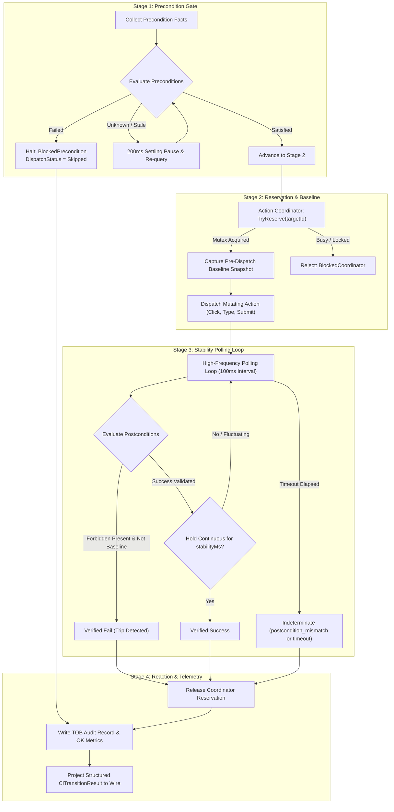
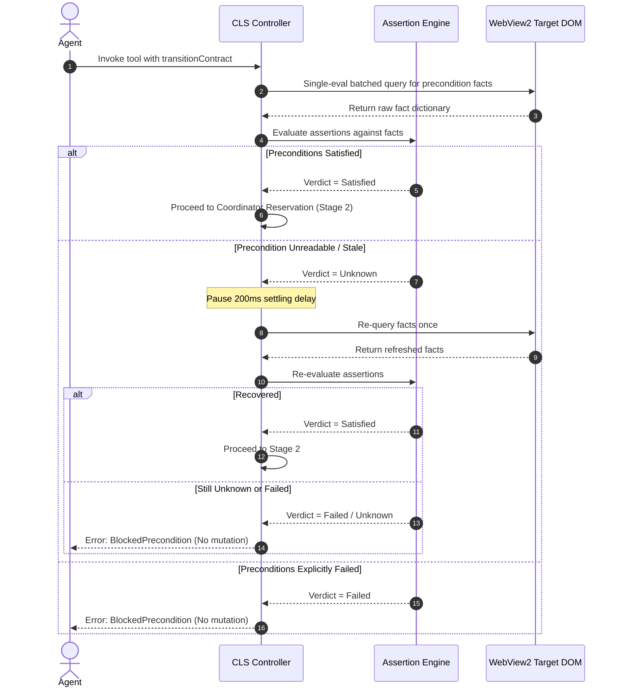
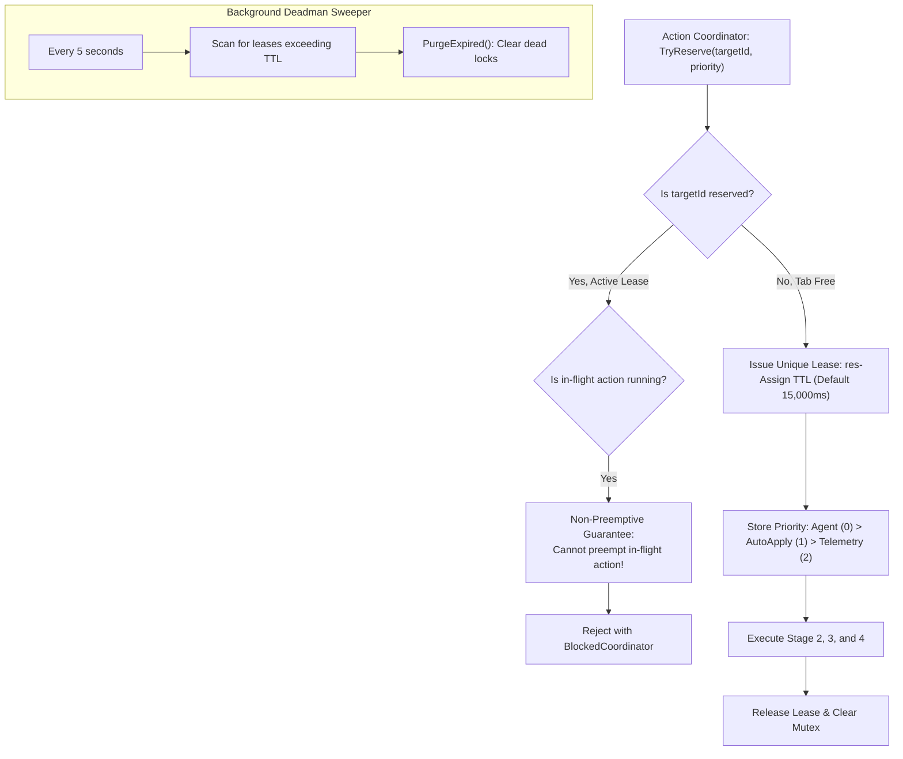

# Control Loop & Precondition Gates

In production browser automation, dispatching input events without verifying surface readiness is the leading cause of broken flows, partial submissions, and race-condition crashes. When an automation framework fires a click event while a modal is still animating, an authentication form is hydrating, or a background blocker is rendering, the operation fails silently or produces unintended side effects.

Nova's **Closed-Loop System (CLS)** eliminates fire-and-forget automation through a deterministic, serialized **4-Stage Control Loop** paired with **Fail-Closed Precondition Gates** and the **Action Coordinator** tab-level mutex.

---

## 1. The 4-Stage Control Loop Architecture

Every closed-loop interaction—whether explicitly defined by an agent via a `transitionContract` or synthesized implicitly by compound tools—executes through four sequential, non-bypassable stages:



### Stage Summary

| Stage | Name | Primary Responsibility | Failure Consequence |
| :--- | :--- | :--- | :--- |
| **Stage 1** | **Precondition Gate** | Verifies target state readiness prior to mutation. Pure read-only check. | Blocks action dispatch entirely (`actionDispatched: false`). Zero side effects on the page. |
| **Stage 2** | **Reservation & Baseline** | Enforces tab mutex serialization and captures pre-dispatch baseline facts. | Rejects with `BlockedCoordinator` if a higher-priority or concurrent action holds the tab. |
| **Stage 3** | **Stability Polling** | Asynchronously samples postconditions until success settles continuously or timeout expires. | Emits `verified_fail` on forbidden triggers, or `indeterminate` on timeout / contract mismatch. |
| **Stage 4** | **Reaction & Telemetry** | Releases locks, updates PKS phenomenon health, and projects diagnostics to MCP response. | Surfaces granular failure codes and structured error trees to guide agent recovery. |

---

## 2. Precondition Gating Mechanics

Precondition gates act as an unyielding firewall between agent intent and browser DOM mutations. Before any mouse click, keystroke sequence, or form submission is sent to WebView2, CLS checks that all required conditions evaluate to `true`.



### 2.1 Fail-Closed Execution Semantics
* **Zero Mutation Guarantee:** If preconditions fail (`ClEvalVerdict.Failed`), the action is **never dispatched**. Neither synthetic mouse clicks, native CDP inputs, nor script evaluations touch the page.
* **Deterministic Wire Response:**
  * `applied: false`
  * `actionDispatched: false`
  * `stage: "precondition_check"`
  * `reasonCode: "guarded_commit.blocked_precondition"`
  * `verificationStatus: "skipped"`
* **Prevents Blind Submissions:** A common automation bug occurs when an agent attempts to submit an email draft before entering a recipient address. An open-loop driver clicks "Send" and triggers an unhandled browser alert. With CLS, a precondition such as `form.fields.valid == true` intercepts the call, preventing the broken submission before it happens.

### 2.2 Stale Fact Recovery & The 200 ms Settling Window
Modern single-page applications (SPAs) frequently trigger asynchronous DOM updates, micro-task queues, and virtual DOM diffing. When an action is dispatched immediately following a previous step, page facts may momentarily report as stale (`ClFactFreshness.Stale`) or unreadable (`null`):
1. **Initial Assessment:** The `AssertionEngine` evaluates the precondition bucket. If unreadable facts result in an `Unknown` (`null`) verdict, CLS does **not** reject immediately.
2. **Settling Delay:** CLS enters an internal **200 ms settling pause**, allowing the browser's JavaScript event loop and renderer layout tree to stabilize.
3. **Re-Collection Pass:** Facts are queried fresh from the target frame.
4. **Final Gate:** If the second evaluation passes, execution proceeds seamlessly. If it remains `Unknown` or evaluates to `Failed`, CLS halts with `BlockedPrecondition`.

### 2.3 Precondition Bucket Structure
Preconditions can be declared using either `all` (logical AND) or `any` (logical OR) conjunctions:

```json
{
  "preconditions": {
    "all": [
      {
        "factKey": "composer.sendButton.clickable",
        "operator": "eq",
        "expected": true
      },
      {
        "factKey": "composer.hasText",
        "operator": "eq",
        "expected": true
      }
    ]
  }
}
```

* **`all` (Conjunctive):** Every child assertion must evaluate to `true`. If any child is `false`, the bucket fails.
* **`any` (Disjunctive):** At least one child assertion must evaluate to `true`. Useful when multiple alternate valid entry surfaces exist (e.g. desktop navigation vs mobile hamburger drawer).

---

## 3. Action Coordinator Architecture

Autonomous browser sessions frequently involve competing actors operating within the same workspace:
1. **Interactive Agent Calls:** The primary LLM agent issuing tool requests (`nova.click_selector`, `nova.type_selector`).
2. **Ambient Auto-Apply:** Background autonomous routines clearing cookie banners and transient blockers.
3. **Telemetry & Health Probes:** Background workers monitoring DOM liveness and collecting diagnostic traces.

Without centralized serialization, two processes attempting to click different buttons simultaneously cause mouse coordinate collisions, focus stealing, and page corruption. Nova resolves this with the **Action Coordinator**.



### 3.1 Per-Tab Mutex Serialization
* **Granular Target Scoping:** The coordinator tracks reservations by `targetId` (the active tab or WebView2 instance). A locked tab in Sandbox A does not block actions in Sandbox B.
* **Serialized Pipelines:** Only one mutating pipeline may hold the reservation for a specific tab at any given instant.

### 3.2 Priority Hierarchy
When multiple requests queue for the same target, the coordinator resolves contention strictly by priority integer (lower integer denotes higher priority):

| Priority Level | Numeric Value | Owner / Subsystem | Behavior on Contention |
| :--- | :--- | :--- | :--- |
| **`Agent`** | `0` (Highest) | Direct LLM agent commands (`click_selector`, `type_selector`). | Immediately pre-empts pending lower-priority background tasks waiting in queue. |
| **`AutoApply`** | `1` (Medium) | Autonomous background remediation (cookie dismissal). | Yields immediately to incoming agent commands. |
| **`Telemetry`** | `2` (Lowest) | Non-mutating diagnostic probes and DOM samplers. | Runs only during idle windows; immediately blocked by agent or auto-apply. |

### 3.3 The In-Flight Non-Preemption Invariant
While an incoming `Agent` request has higher priority than an `AutoApply` request waiting in line, **an action already in-flight is never preempted**:
* Once an `AutoApply` click has passed Stage 1 and acquired the mutex, it is allowed to complete its Stage 3 stability polling loop uninterrupted.
* Preempting an action mid-click could leave forms half-filled or modals half-closed, creating indeterminate page states.
* Incoming agent calls arriving while an action is in flight receive an immediate `BlockedCoordinator` with retry advice to wait for the ongoing transition to complete.

### 3.4 Deadman TTL & Deadlock Prevention
To guarantee that a crashed renderer or stuck JavaScript loop never leaves a tab permanently locked:
* **Unique Reservation Identifier:** Every acquired lease receives an atomic token (`res-<counter:X8>`).
* **Hardware Deadman Ceiling:** Every reservation enforces an explicit hard ceiling (default 15,000 ms).
* **`PurgeExpired()` Sweeper:** A periodic sweep clears any reservation whose timestamp exceeds its TTL, restoring the tab to an unreserved state and logging an alert to the Tool Observation Bus.

---

## 4. Stage 2: Reservation & Baseline Capture Mechanics

Stage 2 transitions the control loop from passive reading to active mutation:

```
+-----------------------------------------------------------------------------------------------+
| STAGE 2 SEQUENCE OF OPERATIONS                                                                |
+-----------------------------------------------------------------------------------------------+
| 1. TryReserve(targetId, Priority.Agent) -> Acquire per-tab mutex.                             |
| 2. Pre-Dispatch Snapshot -> Capture current state of all facts referenced in 'forbidden'.     |
| 3. Input Dispatch -> Fire native mouse click, keystrokes, or form submission via CDP.        |
| 4. Timestamp Recording -> Store dispatchEpochMs for verification latency calculation.          |
+-----------------------------------------------------------------------------------------------+
```

### 4.1 Capturing the Pre-Dispatch Baseline Snapshot
Why does Stage 2 record a baseline snapshot before firing the input?
* In web applications, error elements or URL paths are often in a transitional state. For example, if an agent clicks "Login" while on `/login`, the current URL is `/login`. If a contract lists `page.urlChanged` or flags `/login` as a forbidden terminal state, the fact that `/login` was present *prior to the click* must not trigger a false failure.
* The baseline snapshot preserves the exact state of all forbidden conditions before mutation. If a forbidden condition was already active before the action occurred, Stage 3's baseline filter suppresses the failure trigger.

### 4.2 Dispatch Execution
Dispatch is performed through Nova's native input pipelines:
* **Mouse Clicks:** Element bounds are resolved from the layout engine, and synthetic or native hardware input coordinates are calculated.
* **Text Input:** Dispatched via character-by-character typing or atomic value injection with optional Enter key submission.
* **Form Submission:** Triggered via explicit submit button clicks or standard form submit event dispatch.

---

## 5. Wire Response Specification for Precondition & Coordinator Blocks

When an action is blocked at Stage 1 or Stage 2, Nova returns structured telemetry that explains precisely why execution halted, preventing guessing loops:

### Precondition Block Wire Response
```json
{
  "ok": false,
  "status": "blocked",
  "applied": false,
  "stage": "precondition_check",
  "reasonCode": "guarded_commit.blocked_precondition",
  "retryable": false,
  "retryAdvice": "check_postcondition_first",
  "verificationStatus": "skipped",
  "message": "Action blocked: Preconditions failed. The target surface is not in a valid state for this action.",
  "postconditionDiagnostics": {
    "contractName": "guarded_commit.preconditions",
    "factKey": "composer.sendButton.clickable",
    "op": "eq",
    "expectedState": true,
    "observedState": false,
    "assertionError": null,
    "elapsedMs": 204,
    "outcomeVerdict": "failed"
  }
}
```

### Coordinator Mutex Contention Wire Response
```json
{
  "ok": false,
  "status": "blocked",
  "applied": false,
  "stage": "coordinator_reservation",
  "reasonCode": "guarded_commit.blocked_coordinator",
  "retryable": true,
  "retryAdvice": "safe_to_retry",
  "verificationStatus": "skipped",
  "message": "Action blocked: Target tab is currently reserved by an in-flight operation. Safe to retry after short back-off.",
  "postconditionDiagnostics": {
    "contractName": "action_coordinator",
    "factKey": "runtime.targetReserved",
    "op": "eq",
    "expectedState": false,
    "observedState": true,
    "assertionError": null,
    "elapsedMs": 12,
    "outcomeVerdict": "failed"
  }
}
```

---

## 6. Architectural Invariants

The control loop and precondition subsystem enforces these strict guarantees:

1. **No Mutation on Failed Preconditions:** A failed precondition will never dispatch mouse or keyboard events to the page.
2. **Deterministic Settling:** Stale facts are given exactly one 200 ms settling cycle; they never spin into unbounded polling loops during Stage 1.
3. **Tab Mutex Exclusivity:** Only one mutating operation can execute on a specific tab at any single point in time.
4. **Agent Primacy:** Interactive agent actions take precedence over background tasks, but never break in-flight non-preemption guarantees.
5. **Leak-Proof TTL:** Every coordinator lock automatically self-destructs if not released within 15,000 ms.

---

## Related Documentation

* **[Master Architecture Hub](../README.md)** — Complete overview of the Closed-Loop System.
* **[Transition Contracts & Assertion Calculus](../transition-contracts-and-assertion-calculus/README.md)** — Detailed contract authoring, operators, and stability hold mechanics.
* **[Retry Policies & Knowledge Feedback](../retry-policies-and-knowledge-feedback/README.md)** — Idempotency handling, ambiguity resolution, and PKS learning feedback.
* **[Tool Observation Bus (TOB)](../../tool-observation-bus-tob/README.md)** — Server-side audit logging of executed control loop events.
* **[Agent Awareness Gates (AAG)](../../agent-awareness-gates-aag/README.md)** — Pre-execution situational awareness and workspace leases.
