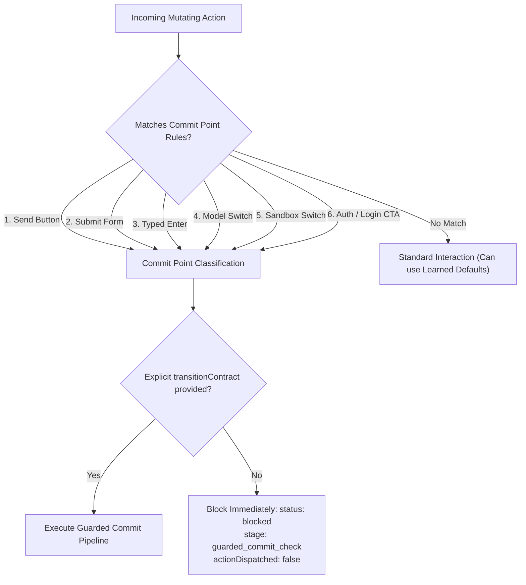
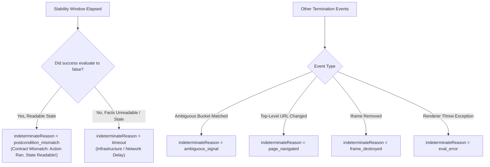
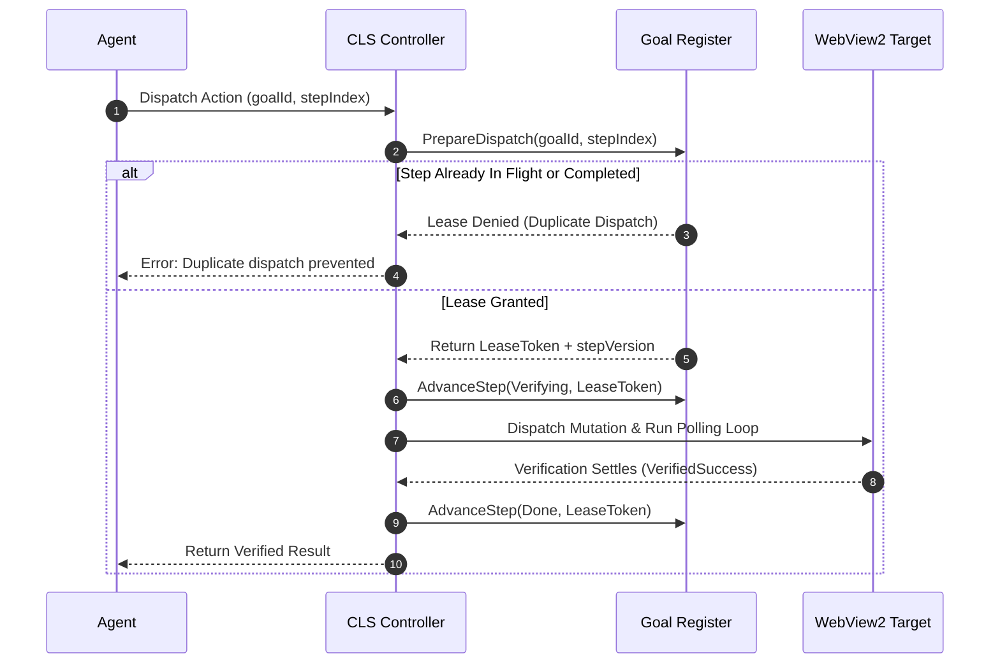
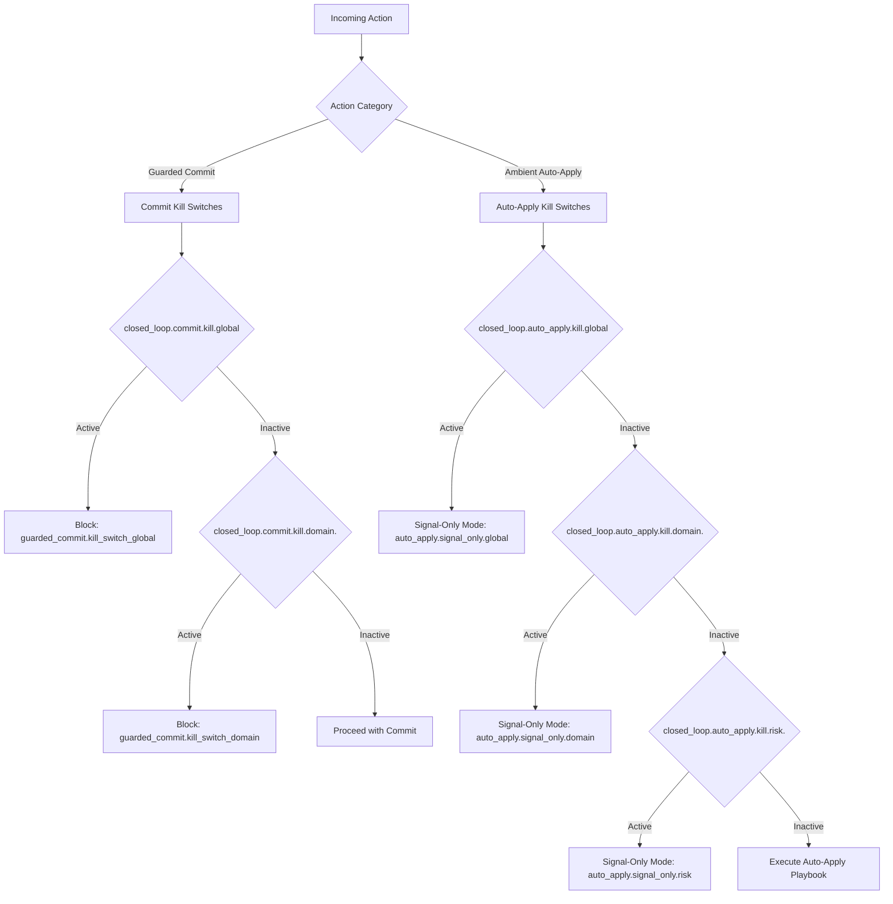
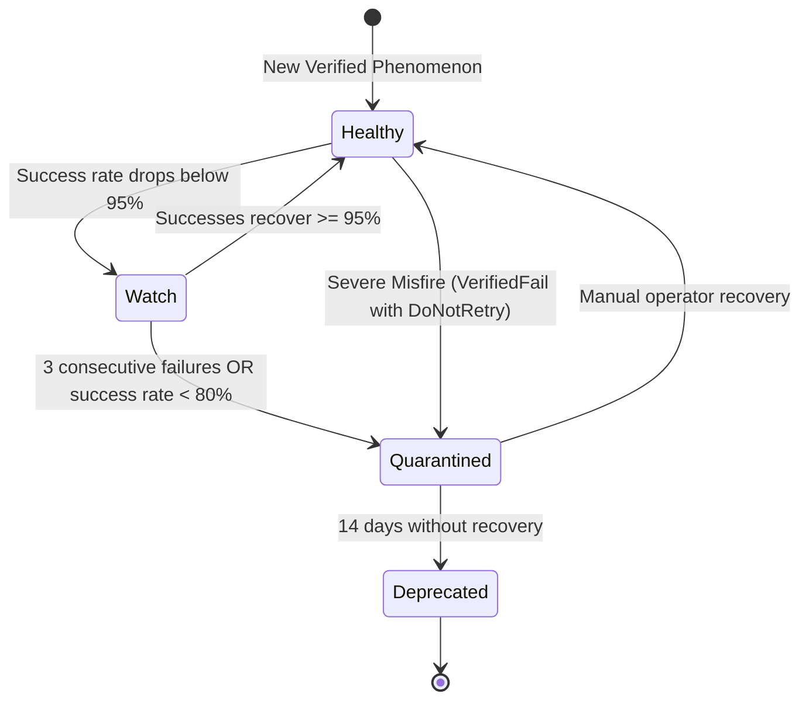

# Retry Policies & Knowledge Feedback

In automated browser operations, deciding what to do *after* an action concludes is as critical as verifying the action itself. If an action fails or produces an indeterminate signal, blind retries can lead to catastrophic consequences: duplicate bank charges, duplicate email dispatches, or corrupted account state. Conversely, failing to learn from observed outcomes causes agents to repeatedly attempt fragile interactions.

Nova's **Closed-Loop System (CLS)** addresses this through **Commit Point Classification**, **Safe Retry Policies**, **Granular Indeterminate Diagnostics**, and deep integration with the **Goal Register**, the **Phenomenological Knowledge Store (PKS)**, and the **Tool Observation Bus (TOB)**.

---

## 1. Commit Point Classification & Pre-Commit Preview

Not all browser interactions carry the same blast radius. Clicking an informational navigation tab is low risk; clicking **"Send Message"**, **"Submit Order"**, or switching active models is a **Commit Point**.

### 1.1 Commit Point Classification Rules
Nova automatically classifies an action as a commit point if any of the following conditions are met:



1. **Send Buttons:** Selectors matching `send-button`, `send_button`, or `data-testid="send"`.
2. **Submit Forms:** Buttons or inputs matching `[type="submit"]` or `type="submit"`.
3. **Typed Enter:** Invocations of `nova.type_selector` with `pressEnter: true`.
4. **Model Switches:** Selectors matching `model-selector`, `model-switch`, or `data-testid="model"`.
5. **Sandbox Switches:** Selectors matching `sandbox-switch`, `workspace-switch`, or `sandbox-selector`.
6. **Authentication Actions:** Selectors matching `login`, `sign-in`, or `signin` combined with `button`, `submit`, or `[role="button"]`.

### 1.2 Pre-Commit Preview via `nova.perceive` (`commitPointCtas`)
Traditional automation drivers only detect that an action is dangerous after it has been executed. Nova provides proactive awareness:
* When an agent calls `nova.perceive`, Nova scans all interactive call-to-actions (CTAs) and flags commit points in `structuredContent.commitPointCtas`.
* The returned CTA objects contain the exact element ref IDs and highlight which buttons will require an explicit `transitionContract`.
* Agents know before attempting a click that a contract must be supplied, eliminating trial-and-error round-trips.

### 1.3 Missing-Contract Gate & Starter Hint
If an agent attempts to execute a commit point without providing a `transitionContract`, Nova halts execution immediately:
* **Response Status:** `status: "blocked"`, `stage: "guarded_commit_check"`.
* **Action Dispatched:** `actionDispatched: false` (Zero DOM side effects).
* **Copyable Starter Contract:** To assist the agent, Nova includes a complete, copyable starter contract in the error payload:

```json
{
  "actionKind": "submit_form",
  "postconditions": {
    "success": {
      "any": [
        { "factKey": "page.urlChanged", "operator": "eq", "expected": true },
        { "factKey": "form.successIndicator.visible", "operator": "eq", "expected": true }
      ]
    }
  }
}
```

---

## 2. Retry Policies & Derived Advice

CLS cleanly separates the questions: *"Did the action dispatch?"*, *"Was the intended outcome verified?"*, and *"Is it safe to retry?"*

```
+-----------------------------------------------------------------------------------------------+
| RETRY POLICIES AND ADVICE MATRIX                                                              |
+-----------------------------------------------------------------------------------------------+
| Configured Policy | Observed Verdict   | Derived retryAdvice       | retryable | Agent Guidance|
+-----------------------------------------------------------------------------------------------+
| idempotent        | Failure or Timeout | safe_to_retry             | true      | Safe to rerun.|
| non_idempotent    | Any non-success    | check_postcondition_first | false     | DO NOT retry  |
|                   |                    |                           |           | blindly! Check|
|                   |                    |                           |           | page state.   |
| no_retry          | Any non-success    | do_not_retry              | false     | Never retry.  |
| Any               | verified_fail      | do_not_retry              | false     | Forbidden state|
|                   |                    |                           |           | tripped.      |
+-----------------------------------------------------------------------------------------------+
```

### 2.1 The Danger of Blind Non-Idempotent Retries
Consider an agent submitting a form on an e-commerce checkout page. The agent clicks "Place Order". The server processes the payment, but a slow network prevents the order confirmation page from loading before the agent's timeout expires.
* In open-loop automation, the agent sees a timeout, catches the exception, and runs the click step again. The customer is charged twice.
* In CLS, the action is configured with `retryPolicy: "non_idempotent"`. When the window elapses without a definitive signal, CLS marks `retryable: false` and sets `retryAdvice: "check_postcondition_first"`. The agent is instructed to query page state (e.g. via `nova.perceive`) rather than blindly repeating the mutation.

---

## 3. Dissecting Indeterminate Reasons (`ClIndeterminateReason`)

When verification does not reach a definitive `verified_success` or `verified_fail`, CLS returns `indeterminate` along with a precise diagnostic attribution:



### 3.1 `postcondition_mismatch` vs `timeout`
This is one of Nova's most critical architectural safeguards:

> [!IMPORTANT]
> **Contract Mismatch vs. Network Timeout**
> 
> Nova distinguishes between *"no usable signal arrived from the page"* (`timeout`) and *"Nova successfully read the page state, but it did not match what your contract asserted"* (`postcondition_mismatch`).
> 
> If the observation window closes and the success assertions evaluated to `Failed`, Nova emits `postcondition_mismatch`. This signals to the agent that the action **already dispatched** and the page was readable, but the interface transitioned to a state the caller did not anticipate (such as an unexpected confirmation layout). This attribution prevents agents from assuming the click failed and submitting duplicate requests!

### 3.2 Granular Reasons Catalog
* **`postcondition_mismatch`:** The action dispatched and state was readable, but assertions failed to match before the window expired.
* **`timeout`:** The window elapsed without receiving a definitive signal (e.g. continuous spinner or pending network request).
* **`ambiguous_signal`:** An assertion in the `ambiguous` bucket matched (e.g. an MFA prompt or security challenge appeared).
* **`page_navigated`:** Top-level navigation destroyed the active DOM context before stability could be established.
* **`frame_destroyed`:** The iframe hosting the target element was detached from the DOM during polling.
* **`eval_error`:** A JavaScript execution exception occurred within the renderer during fact evaluation.

---

## 4. Learned Default Contracts (`OutcomeCandidateStore`)

Requiring agents to manually author transition contracts for every minor navigation click would impose unacceptable cognitive overhead. To provide closed-loop guarantees on standard clicks without agent effort, Nova provides **Learned Default Contracts**.

```mermaid
flowchart TD
    Click["Agent calls nova.click_selector WITHOUT contract"] --> CommitCheck{"Is Target a Commit Point?"}
    CommitCheck -->|Yes| Gate["Missing-Contract Gate: Block Execution"]
    CommitCheck -->|No| StoreCheck{"OutcomeCandidateStore has promoted candidate?"}

    StoreCheck -->|No (Fewer than 10 evals)| Plain["Dispatch Unguarded Interaction"]
    StoreCheck -->|Yes (10+ evals @ 90%+ agreement)| Synthesize["Synthesize learned:<id> Contract"]

    Synthesize --> Dispatch["Dispatch Click"]
    Dispatch --> Polling["Run Stability Polling Loop"]
    Polling --> FeedBack["Feed Outcome Back to Candidate Store (Hit / Miss)"]
```

### 4.1 Candidate Promotion Criteria
The `OutcomeCandidateStore` monitors interactions locally:
1. When an unguarded click occurs, Nova records candidate postconditions in shadow evaluation mode.
2. An assertion must be observed at least **10 times** with an agreement rate $\ge 90\%$ before being promoted to an active learned contract.
3. Once promoted, subsequent unguarded clicks on that selector automatically inherit the learned verification contract.

### 4.2 The Success-Only Safety Invariant
To prevent learned contracts from breaking existing agent workflows:
* A learned contract populates **only** the `postconditions.success.all` bucket.
* It contains **no preconditions**, **no forbidden bucket**, and **no ambiguous bucket**.
* If a learned postcondition fails to match, CLS returns `indeterminate`, **never `verified_fail`**. An out-of-date learned contract will never falsely fail an action!

---

## 5. Goal Register Integration

When an agent executes multi-step plans via **`nova.goal_register`**, CLS synchronizes transition outcomes directly with the goal's step lifecycle state machine:



### 5.1 Duplicate Dispatch Prevention
* **Atomic Step Leases:** `GoalRegister.PrepareDispatch` assigns an atomic lease token to the active step.
* If a concurrent subagent or background task attempts to dispatch against the same step, execution is rejected immediately, incrementing `closed_loop.duplicate_dispatch_prevented.total`.
* Prevents race conditions in complex multi-agent execution graphs.

### 5.2 Step Status Mapping
* `verified_success` $\rightarrow$ Step advances to `GrStepStatus.Done`.
* `verified_fail` $\rightarrow$ Step advances to `GrStepStatus.Failed`.
* `indeterminate` $\rightarrow$ Step advances to `GrStepStatus.Ambiguous`.

---

## 6. Hierarchical Kill Switches

Operators must be able to disable automated actions or auto-apply routines instantly in production without application restarts or code changes. CLS provides a multi-tier hierarchy of **Kill Switches** backed by the PKS Key-Value store:



### Kill Switch Reference Catalog

| Switch Scope | KV Key Pattern | Effect When Active | Reason Code |
| :--- | :--- | :--- | :--- |
| **Global Commit Kill** | `closed_loop.commit.kill.global` | Completely blocks all guarded commit point tools across all tabs. | `guarded_commit.kill_switch_global` |
| **Domain Commit Kill** | `closed_loop.commit.kill.domain.<scope>` | Blocks commit point tools exclusively on the specified domain. | `guarded_commit.kill_switch_domain` |
| **Global Auto-Apply Kill** | `closed_loop.auto_apply.kill.global` | Switches all auto-apply remediation to observation-only (no clicks). | `auto_apply.signal_only.global` |
| **Domain Auto-Apply Kill** | `closed_loop.auto_apply.kill.domain.<scope>` | Disables remediation clicks on a specific domain. | `auto_apply.signal_only.domain` |
| **Risk-Class Kill** | `closed_loop.auto_apply.kill.risk.<class>` | Disables auto-apply for specific risk levels (`readonly`, `dismissive`, `auth`, `transactional`). | `auto_apply.signal_only.risk` |
| **Playbook Revision Kill** | `closed_loop.auto_apply.kill.playbook.<scope>.<id>.r<rev>` | Disables a specific revision of a single PKS playbook. | `auto_apply.signal_only.playbook_revision` |

* **Flexible Truthy Parsing:** A switch is active if its value equals `1`, `true`, `yes`, `on`, `enabled`, `block`, or `signal_only`.

---

## 7. Outcome Feedback & Phenomenon Health State Machine

Every completed transition contract feeds back into Nova's Phenomenological Knowledge Store (PKS), continuously adjusting the health rating of matching UI phenomena:



### 7.1 Health Classifications
* **Healthy:** Success rate $\ge 95\%$ over 30 days and 0 unrecovered severe misfires.
* **Watch:** Success rate between $80\%$ and $95\%$.
* **Quarantined:** Success rate $< 80\%$, $\ge 3$ consecutive failures, or a **Severe Misfire** (`verified_fail` where retry advice is `do_not_retry`).
* **Deprecated:** Quarantined phenomenon unrecovered after 14 days.

### 7.2 Selector Ambiguity Protection (`telemetry_ambiguous_selector`)
When attributing a transition outcome to a stored phenomenon, Nova requires exact route and selector matching. If multiple phenomena claim the same selector on the same route segment, Nova skips health updates with reason code `telemetry_ambiguous_selector`, preventing corrupted health records.

---

## 8. OK Store Telemetry Metrics Catalog

Every closed-loop transition writes atomic metrics into the local Operational Knowledge (OK) store:

| Metric Key | Type | Description |
| :--- | :--- | :--- |
| `closed_loop.dispatch.total` | Counter | Total mutating actions dispatched through CLS. |
| `closed_loop.verified_success.total` | Counter | Total transitions meeting all success assertions and stability holds. |
| `closed_loop.indeterminate.total` | Counter | Total transitions that timed out or returned indeterminate signals. |
| `closed_loop.blocked_precondition.total` | Counter | Total actions halted before dispatch due to failing preconditions. |
| `closed_loop.duplicate_dispatch_prevented.total`| Counter | Redundant dispatches blocked by Goal Register step leases. |
| `closed_loop.verification_latency_ms` | Gauge | Duration of the verification loop from dispatch to final verdict. |
| `closed_loop.quarantine_entries.total` | Counter | Playbooks moved to quarantine due to severe misfires or failures. |
| `closed_loop.transition.result` | Structured JSON | Full transition summary (action kind, statuses, duration, retry policy). |

---

## Related Documentation

* **[Master Architecture Hub](../README.md)** — Complete overview of the Closed-Loop System.
* **[Control Loop & Precondition Gates](../control-loop-and-precondition-gates/README.md)** — Control loop lifecycle, tab mutex coordination, and fail-closed gates.
* **[Transition Contracts & Assertion Calculus](../transition-contracts-and-assertion-calculus/README.md)** — Assertion syntax, operators, and stability hold mechanics.
* **[Tool Observation Bus (TOB)](../../tool-observation-bus-tob/README.md)** — Server-side audit logging of executed transition verification traces.
* **[Phenomenological Knowledge Store (PKS)](../../learning/phenomenological-knowledge-store-pks/README.md)** — Stored playbooks and phenomenon health tracking.
* **[Ambient Auto-Apply](../../learning/ambient-auto-apply/README.md)** — Autonomous background blocker remediation.
