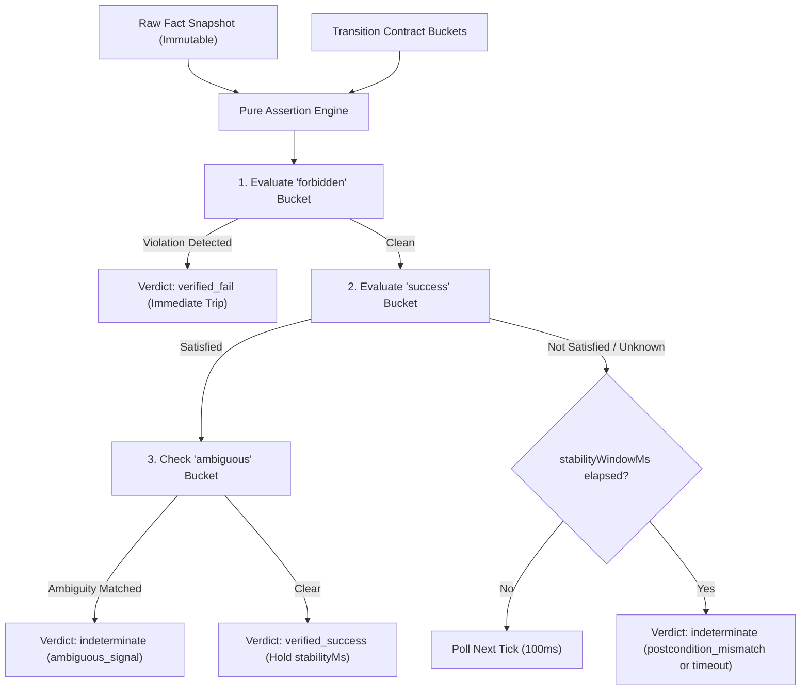
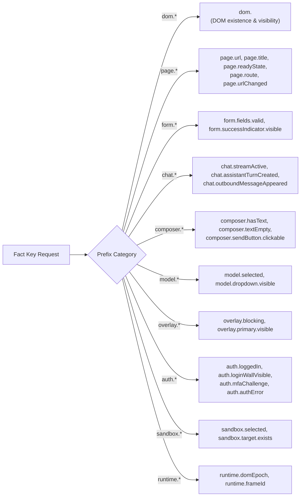
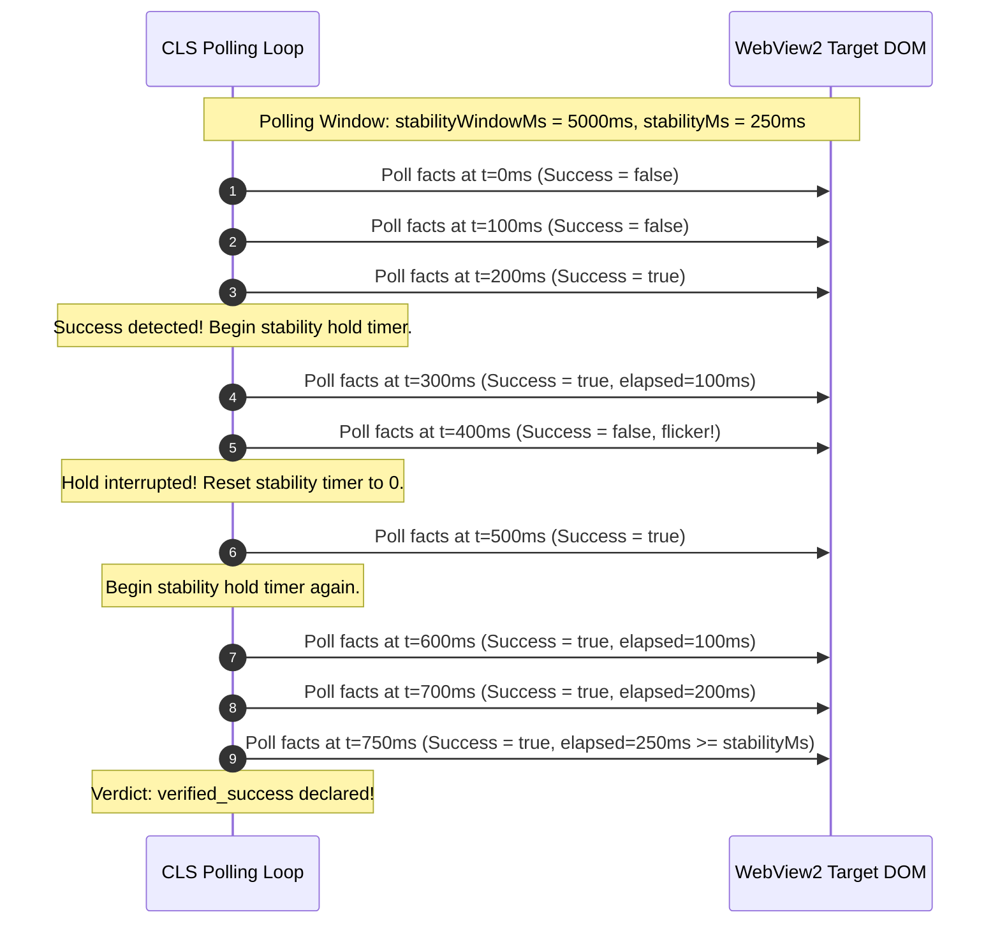

# Transition Contracts & Assertion Calculus

In complex web applications, verifying whether an action succeeded cannot be reduced to a single DOM property or an HTTP 200 status code. An interface might immediately clear an input box while an asynchronous error banner is being rendered, or a URL might remain unchanged for several seconds while a background server job processes a checkout.

Nova's **Closed-Loop System (CLS)** handles this complexity through **Transition Contracts** evaluated by a pure, deterministic **Assertion Engine**. By combining tri-state logic, multi-operator comparison calculus, scoped semantic selectors, and continuous stability holding, CLS makes UI state transitions mathematically verifiable.

---

## 1. Transition Contract Schema & Structure

A transition contract defines the complete behavioral expectation of a browser mutation. Agents pass contracts via the `transitionContract` argument on mutating tools such as `nova.click_selector` and `nova.type_selector`:

```json
{
  "actionKind": "submit_form",
  "retryPolicy": "non_idempotent",
  "ambiguityPolicy": "signal",
  "stabilityWindowMs": 8000,
  "stabilityMs": 200,
  "preconditions": {
    "all": [
      {
        "factKey": "form.fields.valid",
        "operator": "eq",
        "expected": true
      }
    ]
  },
  "postconditions": {
    "success": {
      "any": [
        {
          "factKey": "page.urlChanged",
          "operator": "eq",
          "expected": true
        },
        {
          "factKey": "form.successIndicator.visible",
          "operator": "eq",
          "expected": true
        }
      ]
    },
    "forbidden": {
      "any": [
        {
          "factKey": "dom.div.form-error-banner",
          "operator": "eq",
          "expected": true
        }
      ]
    },
    "ambiguous": {
      "any": [
        {
          "factKey": "auth.mfaChallenge",
          "operator": "eq",
          "expected": true
        }
      ]
    }
  }
}
```

### Contract Fields Reference

| Field | Type | Required | Description |
| :--- | :--- | :--- | :--- |
| **`actionKind`** | String | Yes | Classification of the operation (`submit_form`, `send_message`, `dismiss_overlay`, `select_option`, `custom`). Governs default timeouts and stability windows. |
| **`retryPolicy`** | String | No | Idempotency strategy: `idempotent`, `non_idempotent`, or `no_retry`. Defaults to `non_idempotent` for commit points. |
| **`ambiguityPolicy`** | String | No | Strategy when ambiguous signals fire: `signal` (return indeterminate with diagnostic), `retry_once`, or `abort`. |
| **`stabilityWindowMs`**| Number | No | Total polling observation window in milliseconds (2,000 to 8,000 ms). |
| **`stabilityMs`** | Number | No | Duration in milliseconds that success conditions must continuously hold before declaring victory (0 to 250 ms). |
| **`preconditions`** | Object | No | Bucket of assertions that must evaluate to `true` *before* action dispatch. |
| **`postconditions`** | Object | Yes | Container holding `success`, `forbidden`, and `ambiguous` assertion buckets. |

---

## 2. The Pure Assertion Engine (`AssertionEngine`)

At the core of verification is the `AssertionEngine`—an in-memory, zero-side-effect evaluation engine. It takes an immutable snapshot of target facts and evaluates assertions using strict **Three-Valued Logic (`true`, `false`, `null`)**:



### 2.1 The Frozen Truth Table
Individual assertions evaluate to `true` (Satisfied), `false` (Failed), or `null` (Unknown). When aggregating assertions within buckets, CLS adheres to this truth table:

| Assertion Bucket | All Children `true` | At Least One `true`, None `false` | At Least One `false` | Any `null` (Unknown), None `false` |
| :--- | :--- | :--- | :--- | :--- |
| **`all` (AND)** | **Satisfied** (`true`) | Unknown (`null`) | **Failed** (`false`) | Unknown (`null`) |
| **`any` (OR)** | **Satisfied** (`true`) | **Satisfied** (`true`) | Failed (`false`) | Unknown (`null`) |
| **`forbidden`** | **Failed** (`false` - Violation!) | **Failed** (`false` - Violation!) | **Satisfied** (`true` - Clean) | Unknown (`null`) |

### 2.2 Precedence Hierarchy
When combining bucket outcomes across an evaluation tick, CLS enforces strict precedence:
$$\text{Forbidden Violation} > \text{Success Match} > \text{Ambiguous Signal} > \text{Unknown / Timeout}$$

1. **Forbidden Violation:** If an assertion in the `forbidden` bucket matches (`true`), the verification loop halts immediately with `verified_fail`. No amount of partial success can override a confirmed error state.
2. **Success Match:** If all required success assertions pass, the engine evaluates whether ambiguous conditions are present.
3. **Ambiguous Signal:** If an ambiguous condition fires (e.g. an unexpected CAPTCHA or MFA step), it demotes what would have been a success to `indeterminate` with reason code `ambiguous_signal`.
4. **Unknown / Timeout:** If the window closes without meeting success or forbidden criteria, CLS returns `indeterminate`.

---

## 3. The 10 Comparison Operators

The engine supports 10 strongly typed comparison operators:

```
+-----------------------------------------------------------------------------------------------+
| COMPARISON OPERATORS REFERENCE                                                                |
+-----------------------------------------------------------------------------------------------+
| Operator     | Syntax      | Supported Types | Evaluation Behavior                            |
+-----------------------------------------------------------------------------------------------+
| eq           | "eq"        | All JSON types  | Structural deep-equality. Recursively checks   |
|              |             |                 | objects and arrays; strict primitive match.    |
| not_eq / neq | "not_eq"    | All JSON types  | Negation of deep-equality.                     |
| exists       | "exists"    | Any             | true if fact is present and not null/undefined.|
| not_exists   | "not_exists"| Any             | true if fact is missing, null, or undefined.   |
| contains     | "contains"  | String          | Case-sensitive substring match (Ordinal).      |
| gt           | "gt"        | Number          | Numeric greater than (observed > expected).    |
| lt           | "lt"        | Number          | Numeric less than (observed < expected).       |
| gte          | "gte"       | Number          | Numeric greater than or equal (observed >= exp)|
| lte          | "lte"       | Number          | Numeric less than or equal (observed <= exp).  |
+-----------------------------------------------------------------------------------------------+
```

### 3.1 Unreadable Fact Handling & Degradation Invariant
A critical flaw in standard automation scripts is treating an unreadable fact as `false`. For instance, if a network blip or DOM detachment makes an element temporarily unqueryable, a naive script evaluating `composer.hasText == false` would conclude that the input cleared successfully!

Nova prevents this through the **Fact Degradation Invariant**:
* An unreadable fact or an internal probe exception is reported as JSON `null`.
* Comparing `null` against a concrete expected value (e.g. `expected: true` with `operator: eq`) yields **`Unknown` (`null`)**, **never `false`**.
* The polling loop continues to wait for valid data rather than prematurely triggering a false mismatch.

### 3.2 Diagnostic Trace Error Codes
Every evaluated assertion produces an immutable diagnostic trace containing one of the following diagnostic codes when evaluation cannot complete normally:

* **`fact_not_found`:** The requested fact key was not produced by any registered fact provider.
* **`stale_fact`:** The fact was marked stale due to a navigation epoch increment (`runtime.domEpoch`).
* **`fact_unreadable`:** The DOM node could not be resolved or was detached during evaluation.
* **`frame_mismatch`:** The fact was observed in a different frame context than the asserted `frameId`.
* **`type_mismatch`:** The operator cannot compare the observed and expected types (e.g. executing `gt` against string values).

---

## 4. Fact Key Vocabulary & Grammar

To prevent subtle runtime failures caused by misspelled fact keys, Nova enforces a strict fact key vocabulary. Unknown prefixes or malformed keys are rejected up front with JSON-RPC error `-32602`.



### Complete Prefix Reference

| Prefix Group | Fact Keys | Purpose & Verification Target |
| :--- | :--- | :--- |
| **`dom.<selector>`** | Arbitrary CSS selectors (e.g. `dom.#modal-close`, `dom.button.submit`) | Dynamic element presence and removal verification. Evaluated directly in the target frame. |
| **`page.*`** | `page.url`<br>`page.title`<br>`page.readyState`<br>`page.route`<br>`page.urlChanged` | Top-level document navigation, URL transitions, title changes, and client-side routing. |
| **`form.*`** | `form.fields.valid`<br>`form.successIndicator.visible` | Form validation status and post-submit confirmation indicators. |
| **`chat.*`** | `chat.streamActive`<br>`chat.assistantTurnCreated`<br>`chat.outboundMessageAppeared` | AI response streaming signals and messenger message count tracking. |
| **`composer.*`** | `composer.hasText`<br>`composer.textEmpty`<br>`composer.sendButton.clickable` | Text entry validation and composer clearance post-send. |
| **`model.*`** | `model.selected`<br>`model.dropdown.visible` | LLM model picker switching and menu states. |
| **`overlay.*`** | `overlay.blocking`<br>`overlay.primary.visible` | Dialog dismissal, modal blockers, and cookie banners. |
| **`auth.*`** | `auth.assessment`<br>`auth.stage`<br>`auth.loggedIn`<br>`auth.loginWallVisible`<br>`auth.authError`<br>`auth.mfaChallenge` | Authentication state, sign-in walls, MFA prompts, and login error alerts. |
| **`sandbox.*`** | `sandbox.selected`<br>`sandbox.target.exists` | Multi-sandbox profile routing and target binding. |
| **`runtime.*`** | `runtime.domEpoch`<br>`runtime.frameId` | DOM revision tracking and subframe context identification. |

### 4.1 Scoped Semantic Fact Keys (`@css=...`)
While global semantic fact keys automatically resolve the primary active composer or submit button, web applications frequently feature multiple entry surfaces (e.g. a main prompt box, an inline comment field, and a sidebar search input).

Nova solves this via **Scoped Semantic Fact Keys**:
```text
composer.hasText@css=%23custom-chat-input
composer.sendButton.clickable@css=.sidebar-submit-btn
```

1. **Target Scoping:** The selector following `@css=` is URL-encoded.
2. **Contextual Evaluation:** Nova scopes the semantic fact evaluation strictly to the element tree rooted at the matched selector.
3. **Shadow DOM Traversal:** Up to **80 open shadow roots** are traversed automatically by `novaCollectRoots`, resolving encapsulated web components without requiring custom piercing selectors.

---

## 5. Stability Verification Dynamics

A major pitfall in UI automation is reacting to transient states. For example, clicking a button may immediately cause a spinner to flash for 50 milliseconds before an error dialog appears. If a poller inspects the DOM during that 50 ms window, it might prematurely report success.

CLS solves this with **Continuous Stability Holding**:



### 5.1 Continuous Stability Hold (`stabilityMs`)
* To be declared `verified_success`, all success assertions must hold **continuously and without interruption** for the full duration of `stabilityMs` (typically 100 to 250 ms).
* If the success condition flickers to `false` at any point during the hold window, the timer resets to zero and polling continues.

### 5.2 Short-Circuit Optimization
* For operations where state changes are permanent and immediate (such as form navigation or chat stream initiation), `stabilityMs` can be set to `0`.
* When `ShortCircuitOnSuccess == true` and `stabilityMs == 0`, CLS exits the verification loop on the very first tick where success is confirmed, eliminating artificial latency.

### 5.3 Baseline Suppression Invariant
Consider an agent submitting a form on `/checkout`. The URL before the click is `/checkout`. If the contract specifies:
```json
{
  "postconditions": {
    "forbidden": {
      "any": [
        { "factKey": "page.url", "operator": "contains", "expected": "/checkout" }
      ]
    }
  }
}
```
If Stage 3 evaluated this forbidden condition naively, the fact that the page is *still on `/checkout`* during the first 50 ms before the server redirects would trigger an immediate failure trip!

CLS prevents this via **Baseline Suppression**:
1. In Stage 2, before the click is dispatched, CLS captures the state of all facts referenced in the `forbidden` bucket.
2. During Stage 3 polling, if a forbidden assertion matches, CLS compares it against the pre-dispatch baseline.
3. If the condition was **already present prior to dispatch**, it is recognized as a pre-existing state and **suppressed** until the page has had an opportunity to transition.
4. Only newly emergent forbidden states trigger a failure trip.

---

## 6. Real-World Transition Contract Templates

### 6.1 Modal / Overlay Dismissal (`dismiss_overlay`)
```json
{
  "actionKind": "dismiss_overlay",
  "retryPolicy": "idempotent",
  "stabilityWindowMs": 3000,
  "stabilityMs": 250,
  "postconditions": {
    "success": {
      "all": [
        {
          "factKey": "overlay.blocking",
          "operator": "eq",
          "expected": false
        }
      ]
    },
    "forbidden": {
      "any": [
        {
          "factKey": "dom.div.modal-backdrop",
          "operator": "exists",
          "expected": true
        }
      ]
    }
  }
}
```

### 6.2 Chat Message Submission (`send_message`)
```json
{
  "actionKind": "send_message",
  "retryPolicy": "non_idempotent",
  "ambiguityPolicy": "signal",
  "stabilityWindowMs": 5000,
  "stabilityMs": 0,
  "preconditions": {
    "all": [
      {
        "factKey": "composer.hasText",
        "operator": "eq",
        "expected": true
      }
    ]
  },
  "postconditions": {
    "success": {
      "any": [
        {
          "factKey": "composer.textEmpty",
          "operator": "eq",
          "expected": true
        },
        {
          "factKey": "chat.streamActive",
          "operator": "eq",
          "expected": true
        }
      ]
    },
    "forbidden": {
      "any": [
        {
          "factKey": "dom.div.composer-error-alert",
          "operator": "eq",
          "expected": true
        }
      ]
    }
  }
}
```

### 6.3 Dropdown Option Selection (`select_option`)
```json
{
  "actionKind": "select_option",
  "retryPolicy": "idempotent",
  "stabilityWindowMs": 2000,
  "stabilityMs": 100,
  "postconditions": {
    "success": {
      "all": [
        {
          "factKey": "model.selected",
          "operator": "eq",
          "expected": "gpt-4o"
        },
        {
          "factKey": "model.dropdown.visible",
          "operator": "eq",
          "expected": false
        }
      ]
    }
  }
}
```

---

## Related Documentation

* **[Master Architecture Hub](../README.md)** — Complete overview of the Closed-Loop System.
* **[Control Loop & Precondition Gates](../control-loop-and-precondition-gates/README.md)** — Control loop lifecycle, tab mutex coordination, and fail-closed gates.
* **[Retry Policies & Knowledge Feedback](../retry-policies-and-knowledge-feedback/README.md)** — Idempotency handling, ambiguity resolution, and PKS learning feedback.
* **[Tool Observation Bus (TOB)](../../tool-observation-bus-tob/README.md)** — Server-side audit logging of executed transition verification traces.
* **[Phenomenological Knowledge Store (PKS)](../../learning/phenomenological-knowledge-store-pks/README.md)** — Stored playbooks and selector fingerprints.
