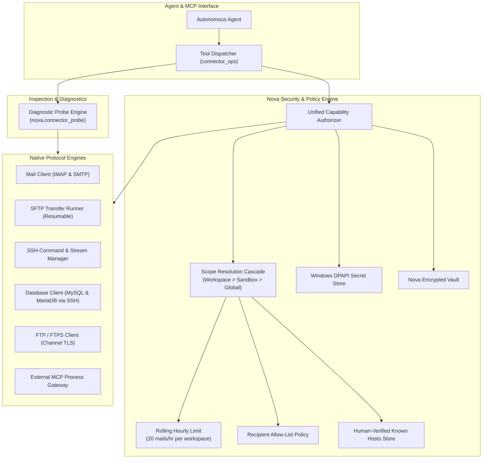
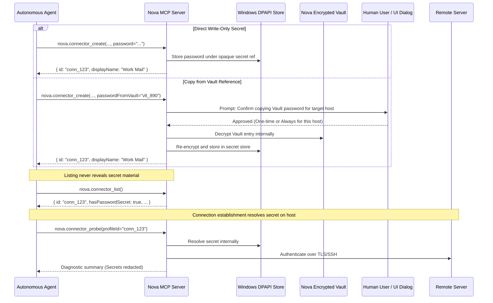
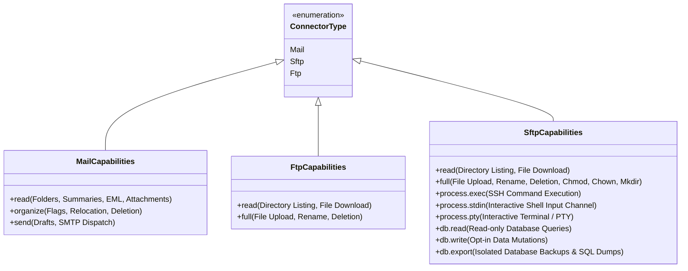
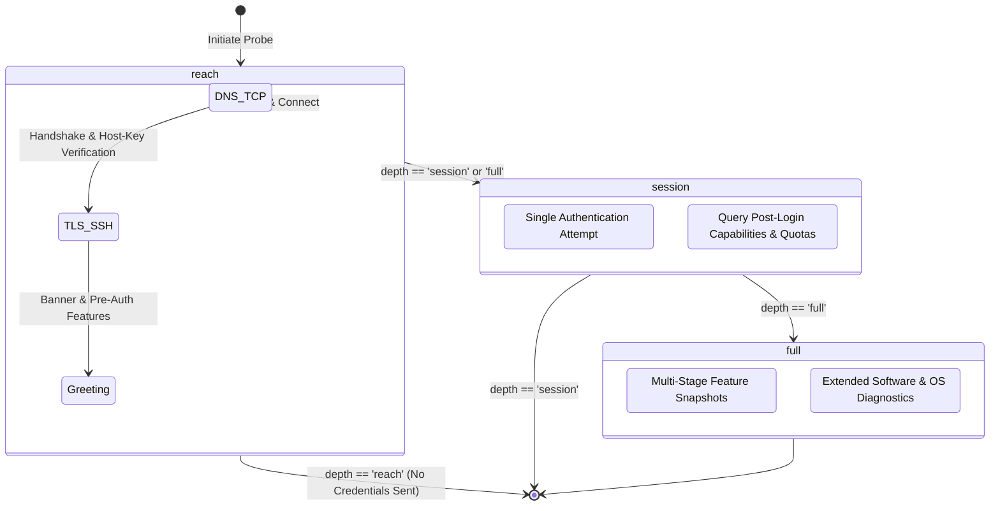

# Connectors Architecture & Security

Connectors represent authenticated remote communication channels managed natively by Nova. They enable autonomous agents to interact with mailboxes (IMAP/SMTP), remote file systems (SFTP/FTP), shell environments (SSH), and external Model Context Protocol (MCP) services while keeping credentials strictly isolated on the host.

Nova's connector subsystem is governed by a unified security model that decouples credential ownership from agent operations. Credentials are stored write-only via Windows Data Protection API (DPAPI) or resolved dynamically from Nova's encrypted Vault. Access control is enforced through multi-tiered capability grants, workspace boundaries, send limits, and non-destructive diagnostic probes.

---

## Connector Subsystems

| Subsystem | Underlying Protocols | Primary Capabilities | Core Operations |
| :--- | :--- | :--- | :--- |
| **[Mail: IMAP & SMTP](mail/README.md)** | IMAP (RFC 3501) & SMTP (RFC 5321) | `read`, `organize`, `send` | Message search, reading, tagging, drafting, sending, `.eml` exports, background mailbox archiving |
| **[Secure Shell (SSH)](ssh/README.md)** | SSH-2 (RFC 4251-4254) | `process.exec`, `process.stdin`, `process.pty` | Batch command execution, background long-running sessions, interactive stdin streaming, interactive terminals (PTY) for full-screen programs, stream capture |
| **[Database: MySQL & MariaDB over SSH](ssh/README.md#database-queries-over-ssh)** | MySQL & MariaDB client over SSH-2 | `db.read`, `db.write`, `db.export` | Password-isolated SQL queries, single-statement enforcement, read-only transactions, database user privilege audit (`SHOW GRANTS`), multi-database profile management, and verified server-side SQL dumps (`nova.db_export`) |
| **[SSH File Transfer (SFTP)](sftp/README.md)** | SFTP over SSH-2 | `read`, `full` | Directory synchronization, resumable uploads/downloads, atomic commit recovery, parallel acceleration |
| **[FTP & FTPS](ftp-and-ftps/README.md)** | FTP (RFC 959) & FTPS (RFC 4217) | `read`, `full` | Directory listing, explicit/implicit TLS transfers, passive mode negotiation, resumable single-file jobs |
| **[External MCP Servers](external-mcp/README.md)** | stdio, Streamable HTTP, SSE | Aggregated tools | Subprocess orchestration, configuration import (Claude/VS Code), token authentication, tool call proxying |

---

## Credential Storage & Secret Isolation

Nova implements a strict zero-leakage security posture for connection credentials. Agents utilize remote services without ever having access to raw passwords, SSH private keys, or passphrases:

### Key Security Invariants

1. **Write-Only Storage:** Passwords, passphrases, and private key paths are ingested once via `nova.connector_create` or `nova.connector_update` and encrypted using Windows DPAPI. Profiles hold only opaque reference keys.
2. **Metadata Projection Sanitization:** The profile metadata record exposed via `nova.connector_list` strips all secret values. It exposes boolean presence indicators (`hasPasswordSecret`, `hasPrivateKey`, `hasKeyPassphrase`) rather than raw credentials.
3. **Vault Integration (`passwordFromVault`):** Instead of passing raw credentials in plain text over JSON-RPC, an agent can supply a Vault entry identifier obtained from `nova.vault_list`. Nova resolves the password internally. To prevent cross-origin credential harvesting, Nova triggers an interactive confirmation dialog displaying the Vault entry alongside the target host names. Users can grant an "Always" decision for that specific login-host pair, enabling subsequent unattended runs.
4. **SSH Host-Key Verification Gate:** All SSH and SFTP connections require prior host-key verification. When a connection is initiated to an unknown host or if the host key changes, Nova halts the connection attempt before sending any authentication credentials. Host keys must be reviewed and confirmed by a human operator in Nova Settings. Agents cannot confirm or modify host keys.

---

## Unified Capability & Grant Architecture

Permissions are evaluated dynamically through a multi-dimensional capability model across three grant modes and three hierarchical scopes.

### Grant Modes

* **`ask` (Default):** Interactive mode. Prompts the human operator for confirmation upon the first use within a session. In unattended or scheduled task contexts (`unattended=true`), calls requiring an `ask` confirmation fail closed immediately with error code `-32033` (`connector_approval_required`).
* **`always`:** Autonomous execution permitted. Bypasses interactive prompts for that specific capability. For mail read operations, an `always` grant can be further constrained by explicit folder and sender allow-lists.
* **`blocked`:** Explicit administrative block. Any attempt to invoke the capability is rejected immediately.

### Scope Resolution Hierarchy

When an agent requests a capability, Nova resolves grants using a strictest-context-first rule:

$$\text{Active Grant} = \text{Lookup}(\text{Workspace}) \succ \text{Lookup}(\text{Sandbox}) \succ \text{Lookup}(\text{Global}) \succ \text{Default}(\text{ask})$$

1. **Workspace Scope:** Bound to Nova's host-verified terminal or scheduled task workspace directory. A grant configured at workspace level overrides broader sandbox and global rules (e.g., an account can be set to `always` in the accounting project workspace but remain `blocked` elsewhere). Workspace context is validated via host-issued signed tokens; caller-supplied context IDs are rejected.
2. **Sandbox Scope:** Bound to an isolated browsing profile container (`A`, `B`, etc.).
3. **Global Scope:** System-wide baseline applied when no workspace or sandbox grant exists.

### Type-Specific Capabilities

* **Mail Stages:**
  - `read`: Listing folders, querying message metadata, reading message bodies and attachments.
  - `organize`: Setting message flags (`Seen`, `Flagged`), moving messages between folders, deleting messages.
  - `send`: Creating drafts and transmitting messages via SMTP.
* **FTP Stages:**
  - `read`: Directory inspection and downloading files.
  - `full`: Uploading files, renaming, and deleting remote files.
* **SFTP Stages:**
  - `read`: Listing directories and downloading files.
  - `full`: Uploads, deletions, directory creation, symbolic link management, and permission changes (`chmod`, `chown`).
  - `process.exec`: Spawning one-shot commands or background SSH sessions. Its own grant: full file access does not include it. When unset, the first command asks once (an unattended run fails closed).
  - `process.stdin`: Streaming interactive standard input into an active SSH session (`nova.ssh_run_write`). This capability is strictly opt-in and **never** inherits weaker grants.
  - `process.pty`: Opening a full interactive terminal / pseudo-terminal on the server (`nova.ssh_shell_open`) for full-screen programs and interactive prompts. The most powerful process stage; strictly opt-in and **never** inherits weaker grants.
  - `db.read`: Read-only queries against databases configured for the SFTP connection (`nova.db_query` with `mode='read'`). Evaluated independently of file access.
  - `db.write`: Data mutations (`INSERT`, `UPDATE`, `DELETE`) against configured databases (`nova.db_query` with `mode='write'`). Strictly opt-in; never inherits `db.read` or `process.exec`.
  - `db.export`: Creating verified server-side SQL dump exports (`nova.db_export`). Evaluated independently of `db.read` and `db.write`; the resulting file is a complete export of database data.

---

## Diagnostic Probe Engine (`nova.connector_probe`)

The diagnostic probe engine allows agents and developers to inspect remote infrastructure without mutating remote state. It separates verifiable evidence from client-side inferences.

### Depth Levels

1. **`reach` (Default):**
   - Transmits **zero credentials**.
   - Executes DNS resolution, TCP connection, TLS handshake (or SSH transport layer and host-key exchange), captures server banner, and reads pre-authentication capabilities.
   - Ideal for health checks, TLS inspection, and reachability tests without risk of account lockout.
2. **`session`:**
   - Performs all `reach` actions, then executes **exactly one** authentication attempt per service (up to two for Mail: IMAP and SMTP).
   - If authentication succeeds, queries read-only system facts (e.g., IMAP namespaces, storage quotas, SFTP file system statistics via `statvfs`).
   - If authentication fails, it never retries, preventing fail2ban triggers.
3. **`full`:**
   - Opens the exact same network connections as `session` without additional aggressiveness.
   - Gathers multi-stage protocol snapshots (`preTls`, `postTls`, `postAuth`) and deep software version metadata.

### Truth Model & Capability States

Every reported capability item is tagged with a provenance state and source:

* `advertised`: The remote server explicitly claimed support (e.g., in IMAP `CAPABILITY` or FTP `FEAT`).
* `inferred`: Deduced by protocol analysis heuristics.
* `observed`: Witnessed directly during wire exchange.
* `verified`: Cryptographically or functionally validated by Nova.
* `notTested`: The capability was not evaluated during this probe (never collapsed into `unsupported`).
* `blockedByPolicy`: Supported remotely but suppressed by local security policy.

### Probe Safeguards

* **Rate Limiting & Result Caching:** Probes executed with identical arguments within 30 seconds return cached results (`cached: true`).
* **Authentication Lockout:** Following an `auth_failed` result, subsequent login probes for that profile are locked out for 60 seconds (`-32029` with `retryAfterMs`), requiring human credential verification before retrying.
* **Redacted Protocol Transcript:** When requested via `includeTranscript=true`, wire exchanges undergo two-tier redaction: credentials, tokens, personal identifiers, and mailbox folder names are stripped. All server responses are explicitly tagged as `untrusted_remote`.
* **Zero Side Effects:** Remote file writes, flag mutations, message retrievals, and mail sending are structurally disabled (`sideEffects.writes = 0`).

---

## Security Policies & Boundary Enforcement

1. **Rolling Hourly Send Limit:** Mail accounts are restricted to transmitting at most 20 messages per rolling 60-minute window per workspace. Exceeding this budget triggers an automatic hold with an explicit cooldown timer.
2. **Recipient Allow-Lists (`AllowedRecipients`):** Mail accounts support an allow-list of authorized destination addresses (e.g., `accounting@domain.com`) and wildcard domain patterns (e.g., `domain.com` or `@domain.com`). Sending to unlisted recipients requires explicit user confirmation.
3. **Local Filesystem Sandboxing:** File transfers, attachment downloads, and export operations are restricted to the local `Downloads` directory or the current workspace root directory. Path traversal attempts (`../`) are blocked before execution.
4. **Dangerous Attachment Isolation:** Attachments matching executable extensions (`.exe`, `.bat`, `.cmd`, `.ps1`, `.vbs`, `.js`, etc.) are quarantined upon download with an added `.isolated` file extension, preventing accidental shell execution.
5. **Insecure Connection Guard:** Plaintext transport (`security='none'`) or invalid TLS certificate exceptions require both the global user setting ("Allow insecure mail and FTP connections for debugging") and explicit per-call opt-in (`allowInsecure=true`).

---

## Web Page of a Connection

Every connection can name the web page that belongs to it, such as the webmail of a mail account or a hoster's file manager for SFTP/FTP. Set it under **Settings > Connectors** (field "Web page for this connection") or with `webInterfaceUrl` on `nova.connector_create` / `nova.connector_update`. Only full `https://` or `http://` addresses without a user name or password are accepted.

Nova stores only the address. How to work that page (open a sent message, find an upload folder) is learned by agents and kept as domain notes for its domain. `nova.connector_list` returns `webInterface` with the address and, as `knownTasks`, the names of the notes already saved for it, so the next agent can follow a known way instead of searching again. When a way stops working, the agent re-checks it on the page and updates the note. Nova has no built-in link formats for particular webmail products; the notes are the knowledge.

---

## Database Query Subsystem over SSH (MySQL & MariaDB)

Nova allows agents to query MySQL and MariaDB databases running on or accessible from the SSH host without granting raw interactive shell access (`process.exec`). Databases are configured per SFTP profile via Nova Settings or programmatically via [`nova.connector_database_set`](../../mcp-reference/tools/connectors-and-mail/nova-connector-database-set.md).

### Zero-Leakage Architecture

Database passwords never appear on the command line, in environment variables, in `/proc/*/cmdline`, or in agent transcripts. Nova delivers credentials using a transient option file passed directly through standard input (`--defaults-file=/dev/stdin` or isolated temporary file with `umask 077` permissions).

### Multi-Tier Safety Gates

1. **Pre-Execution AST Classification:** Every query is analyzed before transmission. Nova allows only a single SQL statement per execution. Multiple statements separated by semicolons, SQL comments (`--`, `/* ... */`), backslashes outside string literals, newlines within strings, DDL (`DROP`, `ALTER`, `CREATE`), DCL (`GRANT`, `REVOKE`, `KILL`), and filesystem functions (`LOAD_FILE`, `INTO OUTFILE`) are blocked immediately.
2. **Read-Only Transaction Enforcement:** When executed with `mode='read'`, queries run within a server-enforced `START TRANSACTION READ ONLY` envelope with strict statement timeouts. Any unexpected data mutation is stopped at the database engine level.
3. **Privilege Audit (`SHOW GRANTS`):** On every query execution, Nova inspects the effective database user privileges via `SHOW GRANTS`. Queries flag whether the user is read-only (`readOnlyUser: true`) and warn if the user holds dangerous administrative grants (`GRANT ALL`, `SUPER`, `PROXY`).

### Multi-Database Profile Management

A single SFTP connector profile can host multiple named database configurations (e.g., `Shop`, `Analytics`). Agents execute queries via [`nova.db_query`](../../mcp-reference/tools/connectors-and-mail/nova-db-query.md) by specifying `profileId`, `databaseId`, and `sql`. Configurations can be removed with [`nova.connector_database_delete`](../../mcp-reference/tools/connectors-and-mail/nova-connector-database-delete.md).

### Automated Database Backups & Exports (`nova.db_export`)

Nova enables agents to back up configured MySQL and MariaDB databases without exposing database credentials or requiring root shell access (`process.exec`).

* **Direct Tool Execution:** Invoked via [`nova.db_export`](../../mcp-reference/tools/connectors-and-mail/nova-db-export.md) using the stored database login from Nova Settings or Vault.
* **Server-Side Dump Engine:** Executes the remote server's native `mysqldump` or `mariadb-dump` client. Credentials are transmitted via stdin option files (`--defaults-file=/dev/stdin`), preventing credential exposure in process argument lists.
* **phpMyAdmin & Shared Hosting Portability:** By default (`portable=true`), Nova strips `DEFINER` clauses and MariaDB sandbox headers, allowing SQL dumps to import cleanly on shared hosting platforms and phpMyAdmin environments without `SUPER` privileges.
* **Format & Compression:** Supports compressed gzip dumps (`format='sql.gz'`, default) and plain-text SQL files (`format='sql'`).
* **Asynchronous Lifecycle & Integrity Verification:** Exports run as asynchronous server jobs. Nova publishes the resulting file in `~/.nova-db-exports/<exportId>/` only after verifying that the dump writer exited with code 0, the gzip stream validates cleanly, and the final line contains `-- Dump completed`.
* **Honest Omission Reporting:** Status reports explicitly enumerate omitted database routines, events, or triggers (`objectsOmitted`) if the database user lacks `TRIGGER` or administrative grants.

---

## Connection Notes & Human Infrastructure Context

Connections support an operator-defined note (`note`, up to 500 characters) configured via Settings or through `nova.connector_create` / `nova.connector_update`.

Connection notes capture vital operational context that cannot be derived from network probing alone—such as hosting provider names, data center locations, management panel URLs (cPanel, Plesk), server roles, maintenance windows, or internal ticket identifiers.

Notes are stored locally in the connection database (`notes.db`, schema version 2+) alongside the connector profile. When an agent calls `nova.connector_list`, the sanitized `note` string is included in the profile metadata, providing immediate operational context without exposing credentials or requiring manual re-discovery.

---

## MCP Tool Catalog (`connector_ops`)

| Tool | Purpose | Key Parameters |
| :--- | :--- | :--- |
| [`nova.connector_list`](../../mcp-reference/tools/connectors-and-mail/nova-connector-list.md) | Lists configured accounts and resolved capability grants | `type` (optional: `mail`, `sftp`, `ftp`) |
| [`nova.connector_create`](../../mcp-reference/tools/connectors-and-mail/nova-connector-create.md) | Registers a new mail account or server connection | `displayName`, `type`, `username`, `password`, `passwordFromVault`, `authMode`, `privateKeyPath`, `host`, `port`, `security`, `note` |
| [`nova.connector_update`](../../mcp-reference/tools/connectors-and-mail/nova-connector-update.md) | Updates existing connection endpoints or credentials | `id`, updated configuration fields, `allowInsecure`, `note` |
| [`nova.connector_delete`](../../mcp-reference/tools/connectors-and-mail/nova-connector-delete.md) | Removes a connector profile and cleans up orphan secrets | `id` |
| [`nova.connector_grant_set`](../../mcp-reference/tools/connectors-and-mail/nova-connector-grant-set.md) | Sets access mode (`ask`, `always`, `blocked`) for a capability | `profileId`, `capability`, `mode`, `scope`, `allowedMailFolders`, `allowedMailSenders` |
| [`nova.connector_recipient_set`](../../mcp-reference/tools/connectors-and-mail/nova-connector-recipient-set.md) | Replaces the allowed recipient list for a mail account | `profileId`, `recipients` |
| [`nova.connector_probe`](../../mcp-reference/tools/connectors-and-mail/nova-connector-probe.md) | Performs non-destructive network & capability diagnostics | `profileId`, `depth` (`reach`, `session`, `full`), `includeTranscript`, `allowInsecure` |
| [`nova.db_query`](../../mcp-reference/tools/connectors-and-mail/nova-db-query.md) | Executes isolated SQL queries on a remote MySQL/MariaDB database over SSH | `profileId`, `databaseId`, `sql`, `mode` (`read`, `write`), `maxRows`, `timeoutMs` |
| [`nova.db_export`](../../mcp-reference/tools/connectors-and-mail/nova-db-export.md) | Exports a configured database to a verified server-side SQL dump ready for phpMyAdmin | `profileId`, `databaseId`, `exportId`, `format`, `portable`, `waitSeconds` |
| [`nova.connector_database_set`](../../mcp-reference/tools/connectors-and-mail/nova-connector-database-set.md) | Configures or updates a database definition linked to an SFTP connection | `profileId`, `databaseId`, `label`, `username`, `passwordFromVault`, `defaultDatabase`, `host`, `port` |
| [`nova.connector_database_delete`](../../mcp-reference/tools/connectors-and-mail/nova-connector-database-delete.md) | Removes a database definition from an SFTP connection | `profileId`, `databaseId` |

---

## Detailed Protocol Guides & Subsystems

* **[Mail Architecture (IMAP & SMTP)](mail/README.md)**:
  * [Mailbox Navigation, Hierarchy & Search](mail/mailbox-navigation-and-search/README.md): IMAP folder discovery, listing, and query execution.
  * [Reading, Organizing & Quarantined Attachments](mail/reading-organizing-and-attachments/README.md): Message retrieval, flag mutation, and dangerous file isolation.
  * [Composition, Outbox & Rolling Rate Limits](mail/composition-sending-and-rate-limits/README.md): Draft creation, recipient allow-lists, and 20 mails/hr throttles.
  * [Local Archiving, EML Export & Backup Pipelines](mail/local-archive-and-backups/README.md): Background mailbox backup runs and single-message EML extraction.
* **[Secure Shell (SSH) Execution](ssh/README.md)**:
  * [Command Execution, Host Verification & Channels](ssh/command-execution-and-channels/README.md): Synchronous execution, output truncation, and host-key security gates.
  * [Background Sessions, Output Streaming & Stdin Injection](ssh/background-sessions-and-streaming/README.md): Asynchronous execution, non-blocking polling, and active session stdin streaming.
  * [Interactive Pseudo-Terminals (PTY)](ssh/interactive-pty-terminals/README.md): Raw terminal sessions, window resizing, ANSI escape sequences, and text-mode user interfaces.
* **[SSH File Transfer Protocol (SFTP)](sftp/README.md)**:
  * [Resumable Transfer Engine, Prefix Windows & Acceleration](sftp/resumable-engine-and-acceleration/README.md): 4-phase state machine, 1 MB prefix verification, and 8x parallel stream acceleration.
  * [Directory Inspection & POSIX Filesystem Mutations](sftp/directory-inspection-and-filesystem-mutations/README.md): POSIX octal permissions, numeric UIDs/GIDs, symlink targets, and root path guards.
* **[FTP & FTPS Architecture](ftp-and-ftps/README.md)**:
  * [Dual-Channel Transport, TLS Negotiation & Security](ftp-and-ftps/dual-channel-transport-and-security/README.md): Control vs. data channel encryption, explicit TLS (`AUTH TLS`), passive NAT traversal, and insecure debugging gate.
  * [Resumable Transfers, File Operations & Recovery](ftp-and-ftps/resumable-transfers-and-file-operations/README.md): Single-file background transfers, `APPE` offset checks, and safe-staging overwrite renaming with rollback.
* **[External MCP Server Orchestration](external-mcp/README.md)**:
  * [Server Lifecycle, Process Isolation & Transports](external-mcp/server-lifecycle-and-transports/README.md): Subprocess lifecycle (`stdio`), Streamable HTTP/SSE transports, token security, and config imports.
  * [Site Discovery & OAuth 2.1 Dynamic Client Registration](external-mcp/site-discovery-and-oauth-negotiation/README.md): Well-known discovery probes (`/.well-known/mcp.json`), RFC 7591 dynamic client registration, and PKCE user consent.

---

[All core features](../README.md) · [Privacy and Vault](../privacy/vault-and-secrets/README.md) · [Alpha limitations](../../../ALPHA.md)
