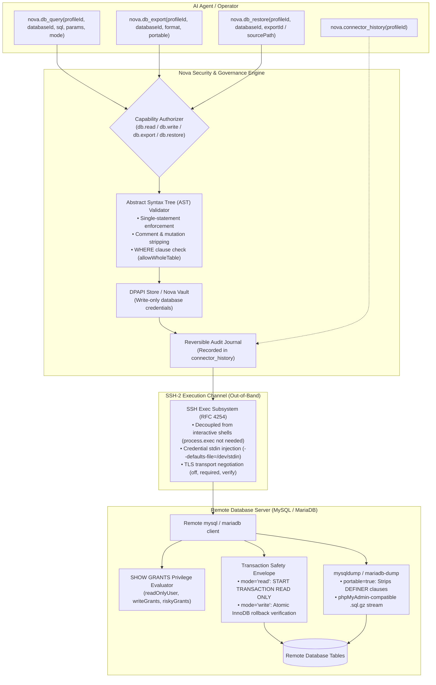
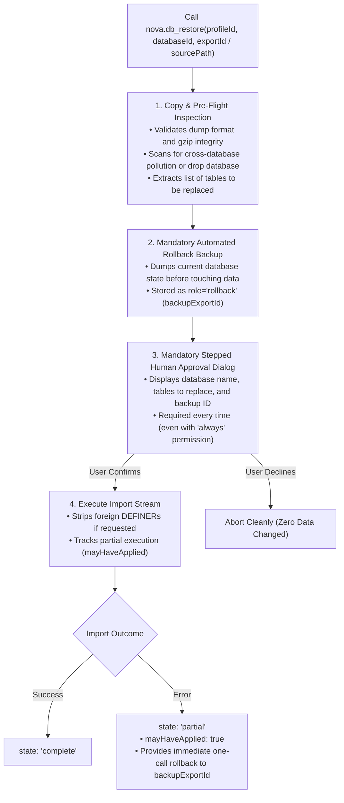

# Database Management & SQL Isolation Architecture (MySQL & MariaDB over SSH)

Relational databases store the critical state of modern web applications: user accounts, product catalogs, financial ledgers, and operational telemetry. When autonomous AI agents or developers need to inspect database schemas, verify migrations, debug transaction anomalies, or execute verified backups and restores on remote servers, traditional methods (such as opening interactive SSH shells and typing MySQL commands manually) introduce severe security vulnerabilities: passwords leak into shell history and process tables (`/proc/*/cmdline`), multi-statement SQL injections can destroy tables, and unconstrained updates can corrupt live data.

Nova AI Workspace provides a native, credential-isolated database management engine ([`nova.db_query`](../../../mcp-reference/tools/connectors-and-mail/nova-db-query.md), [`nova.db_export`](../../../mcp-reference/tools/connectors-and-mail/nova-db-export.md), and [`nova.db_restore`](../../../mcp-reference/tools/connectors-and-mail/nova-db-restore.md)). Operating entirely over secure SSH-2 execution channels, Nova enables autonomous agents to query, export, and restore remote MySQL and MariaDB databases with strict Abstract Syntax Tree (AST) inspection, server-enforced read-only transaction envelopes, zero credential exposure, and mandatory rollback safety nets.

---

## 1. High-Level Architecture & Execution Flow



---

## 2. Zero Credential Exposure & Secret Isolation

Database credentials (usernames, schemas, and passwords) in Nova are strictly decoupled from agent visibility:
1. **Zero Password Leakage:** Database credentials are registered via Nova Settings (**Settings > Connectors > SFTP > Databases…**) or programmatically via [`nova.connector_database_set`](../../../mcp-reference/tools/connectors-and-mail/nova-connector-database-set.md). Passwords are encrypted using the Windows Data Protection API (DPAPI) or resolved dynamically from the Nova Vault (`passwordFromVault`).
2. **Standard Input Piping:** When executing a query, export, or restore, Nova feeds credentials to the remote database client exclusively via standard input (`--defaults-file=/dev/stdin` or a transient, permissions-locked file with `umask 077`). Passwords **never touch command-line arguments, process inspection lists (`/proc/*/cmdline`), or agent conversation transcripts**.
3. **Write-Only References:** The agent references databases solely by their configured `databaseId` (e.g. `shop_production`). Listing tools ([`nova.connector_list`](../../../mcp-reference/tools/connectors-and-mail/nova-connector-list.md)) return only structural metadata (`id`, `label`, `host`, `port`, `defaultDatabase`, `tls`, `userCanWrite`), keeping secrets inaccessible.

---

## 3. Abstract Syntax Tree (AST) Validation & Safety Envelopes

Every SQL query submitted to `nova.db_query` undergoes strict pre-flight parsing before network packets are transmitted to the SSH host:

```
+-----------------------------------------------------------------------------------+
| VALIDATION RULE            | ENFORCEMENT & FAILURE CODE                           |
+-----------------------------------------------------------------------------------+
| Single-Statement Only      | Semicolon-separated statement chains are rejected    |
|                            | before connection. Multi-statement injection is      |
|                            | impossible.                                          |
+----------------------------+------------------------------------------------------+
| SQL Comment Stripping      | SQL comments (-- or /* ... */) are disallowed to     |
|                            | prevent query obfuscation.                           |
+----------------------------+------------------------------------------------------+
| Schema Mutation Blocking   | CREATE, ALTER, DROP, TRUNCATE, and RENAME statements |
|                            | are disallowed. Schema changes must be made via      |
|                            | dedicated migrations, not arbitrary tool queries.    |
+----------------------------+------------------------------------------------------+
| Administrative Lockdown    | GRANT, REVOKE, KILL, SET GLOBAL, and FLUSH statements|
|                            | are forbidden.                                       |
+----------------------------+------------------------------------------------------+
| File Operation Blocker     | LOAD DATA INFILE, LOAD_FILE(), and INTO OUTFILE are  |
|                            | blocked, preventing remote filesystem exfiltration.  |
+----------------------------+------------------------------------------------------+
| WHERE Clause Guard         | In mode='write', UPDATE or DELETE queries without    |
|                            | an explicit WHERE clause are rejected                |
|                            | (db.write_without_where) unless allowWholeTable=true.|
+-----------------------------------------------------------------------------------+
```

### Read Safety: Server-Enforced Read-Only Transactions
When running in default read mode (`mode="read"`):
* Nova wraps the query in a server-side read-only transaction: `START TRANSACTION READ ONLY`.
* Even if an unrecognized mutation were to bypass client-side regex checks, the database engine itself enforces read-only semantics at the storage layer and aborts the statement.
* Server-side statement timeouts (`timeoutMs`) kill runaway queries automatically.

---

## 4. Prepared Statements & Parameter Binding (`params`)

To eliminate SQL injection risks when incorporating external input (e.g. text from web forms, user input, or parsed HTML):
* The `sql` parameter supports `?` positional parameter placeholders.
* Parameter values are passed in the `params` array (`string`, `number`, `boolean`, or `null`).
* The statement is transmitted to the server as a native prepared statement: parameter values are never interpolated into the SQL string and require no manual quoting or escaping.
* True and false are automatically mapped to `1` and `0`. Binary payloads can be passed as hex strings combined with `UNHEX(?)`.

### Atomic Multi-Write Transactions (`statements`)
For transactional mutations requiring multiple writes, callers pass `statements=[{"sql": "...", "params": [...]}, ...]`:
* Nova verifies that every target table uses a transactional engine (e.g. `InnoDB`). If non-transactional engines (`MyISAM`, `MEMORY`) or views are detected, Nova refuses execution (`db.transaction_not_atomic`).
* Statements execute within a single transaction: either all succeed (`commitState: "committed"`) or all are rolled back (`commitState: "rolled_back"`), indicating the exact index where failure occurred (`failedAt`).

---

## 5. Privilege Auditing (`SHOW GRANTS`)

Nova does not rely solely on client-side constraints. Every database connection automatically executes `SHOW GRANTS` against the server to audit the actual user privileges:

```json
{
  "privileges": {
    "readOnlyUser": true,
    "userCanWrite": false,
    "writeGrants": [],
    "riskyGrants": []
  }
}
```

* **`readOnlyUser`:** Confirms that the database account has only read privileges (`SELECT`), ensuring defense-in-depth.
* **`riskyGrants`:** Flags administrative permissions such as `SUPER`, `FILE`, `GRANT OPTION`, or `SHUTDOWN`.

---

## 6. Server-Side SQL Exports (`nova.db_export`)

When backing up databases or preparing migrations, [`nova.db_export`](../../../mcp-reference/tools/connectors-and-mail/nova-db-export.md) executes server-side dumps via `mysqldump` or `mariadb-dump`:
* **Zero Host Memory Overhead:** Dumps execute directly on the remote server, writing to a private, permissions-locked directory (`.sql` or `.sql.gz`).
* **phpMyAdmin & Shared-Hosting Compatibility (`portable: true`):**
  * By default, Nova strips `DEFINER` clauses and MariaDB sandbox headers.
  * Omits `CREATE DATABASE` and `USE` statements, ensuring that exports can be imported into any database selected in phpMyAdmin without requiring `SUPER` or administrator privileges.
* **Asynchronous Execution & Status Polling:** Long-running dumps execute as background jobs. Callers track state via `exportId` (`running`, `finalizing`, `done`, `failed`).
* **Systemd Logind Protection:** Nova detects if the SSH server runs systemd `KillUserProcesses`. If active (`endsWithSession: true`), Nova warns that the dump could be killed upon SSH logout and provides `waitSeconds` to ensure completion before disconnect.

---

## 7. Safe Database Restores & Rollback Pipeline (`nova.db_restore`)

Restoring a database dump is an inherently destructive operation that overwrites existing records. [`nova.db_restore`](../../../mcp-reference/tools/connectors-and-mail/nova-db-restore.md) enforces an ironclad multi-step safety net:



### Restore Invariants:
1. **Automated Rollback Backup First:** Nova never applies an export or foreign dump without first taking a full backup of the target database's existing state (`role: "rollback"`).
2. **Mandatory Human Confirmation:** The UI prompts the operator before every restore, showing the exact tables that will be replaced. Even if the agent has standing permissions, unattended runs cannot execute restores.
3. **Foreign SQL File Import with `dryRun`:** Foreign `.sql.gz` dumps located on the server can be dry-run with `dryRun: true` to inspect replaced tables, collations, and syntax errors without making any changes.

---

## 8. TLS Encryption Modes & Verification

Connections to remote database servers can be encrypted independently of the SSH tunnel:

| TLS Mode | Parameter Configuration | Security Guarantee | Handshake Failure State |
| :--- | :--- | :--- | :--- |
| **`off`** | `tls: "off"` | Plaintext connection over SSH tunnel / local socket. | N/A |
| **`required`** | `tls: "required"` | Enforces TLS encryption between client and database server. | `tls_failed` if server does not support TLS |
| **`verify`** | `tls: "verify"`, `tlsCaPath: "/path/ca.pem"` | Enforces TLS encryption AND cryptographically verifies the server certificate against a custom CA bundle. | `tls_failed` if certificate or hostname does not match |

Every query and probe returns a structured `tls` block reporting whether encryption was active, what cipher and protocol version was negotiated, and whether the certificate was verified.

---

## 9. Reversible Audit Journal (`nova.connector_history`)

All database write operations (`mode="write"`), exports, and restores are permanently recorded in Nova's local encrypted journal ([`nova.connector_history`](../../../mcp-reference/tools/connectors-and-mail/nova-connector-history.md)).

Entries include timestamps, statement summaries (with passwords and tokens automatically redacted), affected row counts, export file paths, and initiating agent identities, allowing operators to audit database interactions post-mortem.

---

## 10. MCP Protocol Examples

### Example 1: Read-Only Prepared Query
```json
{
  "name": "nova.db_query",
  "arguments": {
    "profileId": "cn_sftp_prod",
    "databaseId": "shop_db",
    "sql": "SELECT id, email, created_at FROM users WHERE status = ? LIMIT 10",
    "params": [
      "active"
    ],
    "mode": "read"
  }
}
```

### Example 2: Atomic Multi-Write Transaction
```json
{
  "name": "nova.db_query",
  "arguments": {
    "profileId": "cn_sftp_prod",
    "databaseId": "shop_db",
    "mode": "write",
    "statements": [
      {
        "sql": "UPDATE accounts SET balance = balance - ? WHERE id = ?",
        "params": [
          100.5,
          101
        ]
      },
      {
        "sql": "UPDATE accounts SET balance = balance + ? WHERE id = ?",
        "params": [
          100.5,
          202
        ]
      }
    ]
  }
}
```

### Example 3: Server-Side Database Export (phpMyAdmin Compatible)
```json
{
  "name": "nova.db_export",
  "arguments": {
    "profileId": "cn_sftp_prod",
    "databaseId": "shop_db",
    "format": "sql.gz",
    "portable": true,
    "waitSeconds": 30
  }
}
```

### Example 4: Dry-Run Inspection of a Server-Side Backup
```json
{
  "name": "nova.db_restore",
  "arguments": {
    "profileId": "cn_sftp_prod",
    "databaseId": "shop_db",
    "sourcePath": "/var/backups/shop_20261105.sql.gz",
    "dryRun": true
  }
}
```

---

## 11. Related Documentation

* [Master Connectors Hub](../README.md): Overview of all remote connector subsystems.
* [Secure Shell (SSH) Architecture](../ssh/README.md): Underlying SSH-2 transport, PTY terminals, and command runners.
* [SSH File Transfer (SFTP) Architecture](../sftp/README.md): Transferring exported SQL dumps between server and local host.
* [Settings User Guide: Connectors](../../../user-guide/settings/connectors.md): Configuring database endpoints and TLS settings in the UI.
* [MCP Tool Reference: `nova.db_query`](../../../mcp-reference/tools/connectors-and-mail/nova-db-query.md): Parameter schema and query options.
* [MCP Tool Reference: `nova.db_export`](../../../mcp-reference/tools/connectors-and-mail/nova-db-export.md): Export options and format details.
* [MCP Tool Reference: `nova.db_restore`](../../../mcp-reference/tools/connectors-and-mail/nova-db-restore.md): Restore safety rules and backup verification.
