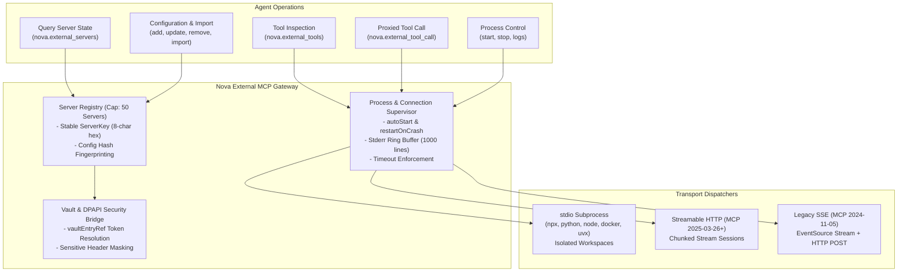
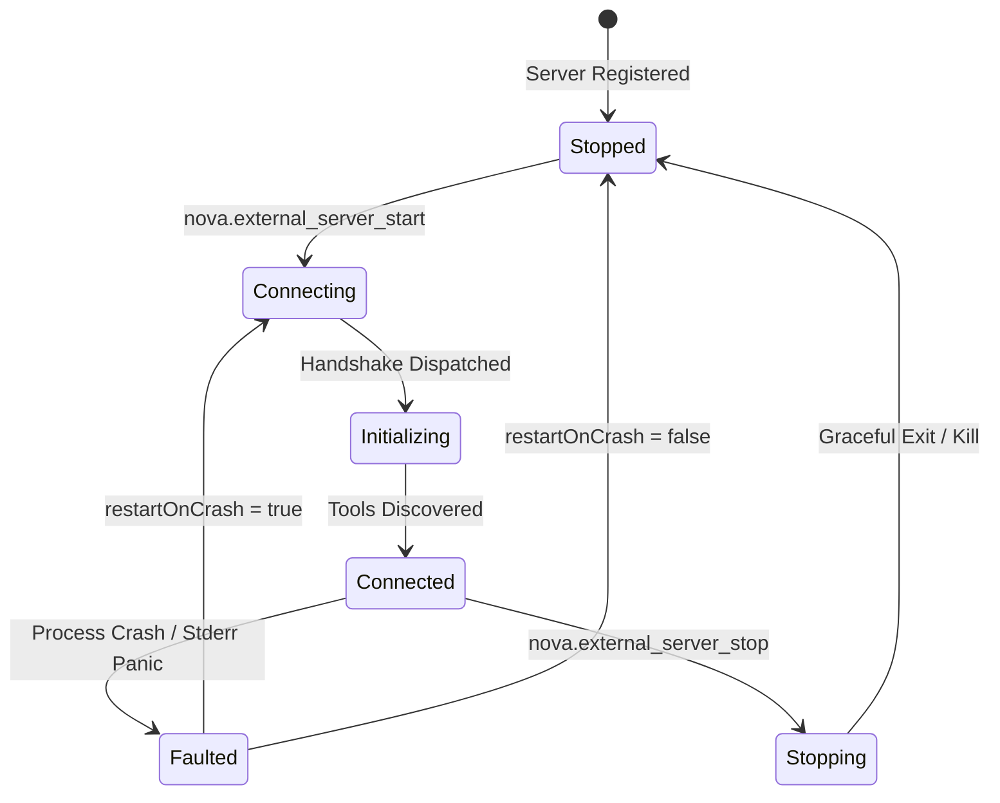
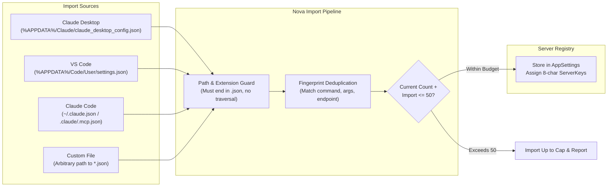

# External MCP Server Lifecycle & Multi-Transport Architecture

Nova AI Workspace functions as an intelligent aggregation gateway and client for the Model Context Protocol (MCP). It enables autonomous agents to orchestrate local developer tools, containerized services, and remote cloud APIs through a unified interface. The gateway supports multiple transport protocols, process supervision with crash recovery, Windows DPAPI secret protection, 1-click configuration import, and proxied tool dispatch.



---

## 1. Supported Transport Protocols

Nova accommodates the evolving MCP transport specifications across three distinct engines:

| Transport | Implementation & Lifecycle | Typical Use Cases | Configuration Attributes |
| :--- | :--- | :--- | :--- |
| **`stdio`** | Nova spawns, monitors, and terminates a local child process. Streams standard input and output; continuously captures standard error into an in-memory ring buffer. | Local developer CLIs, Playwright browser controllers, database query proxies (`npx`, `python`, `node`, `uvx`, `docker`). | `command`, `args`, `cwd`, `env` |
| **`http`** | Streamable HTTP transport based on the modern specification (MCP 2025-03-26+). Maintains a persistent HTTP session with streaming request and response bodies. | Remote microservices, cloud-hosted AI tooling, Kubernetes-hosted tool clusters. | `endpointUrl`, `headers`, `authMode`, `bearerToken`, `vaultEntryRef` |
| **`sse`** | Server-Sent Events transport based on legacy specification (MCP 2024-11-05). Maintains an incoming SSE stream for server events and issues HTTP POST requests for client tool calls. | Legacy MCP endpoints, custom proxy bridges. | `endpointUrl`, `headers`, `authMode`, `bearerToken`, `vaultEntryRef` |

---

## 2. Process Supervision & Crash Resilience (`stdio`)

When managing local subprocesses via `stdio`, Nova implements active supervisory controls:



1. **Isolated Workspace Folders:** If the working directory (`cwd`) is omitted during registration, Nova creates and binds a persistent per-server workspace located in Nova's local data directory under `workspaces/external-mcp`. This prevents third-party tools from polluting the application root or user home directory.
2. **Crash Recovery (`restartOnCrash`):** When enabled, if a managed subprocess crashes unexpectedly (e.g. unhandled exception, OOM, or abnormal exit), Nova's supervisor detects termination, marks the server `Faulted`, and triggers automatic reconnection.
3. **Execution Timeouts:**
   * **Handshake Timeout (`startupTimeoutMs`):** Governs the `initialize` handshake and tool discovery (bounded between 5,000 ms and 120,000 ms, default: 30,000 ms).
   * **Request Timeout (`defaultRequestTimeoutMs`):** Governs individual tool calls (bounded between 5,000 ms and 600,000 ms, default: 120,000 ms). A hard ceiling of 10 minutes (`HardCapTimeoutMs = 600_000`) is strictly enforced.
4. **Stderr Ring Buffer & Diagnostics:** Subprocess stderr output is captured into an in-memory ring buffer holding up to 1,000 lines. Agents can inspect live logs at any time via `nova.external_server_logs` without attaching a debugger.

---

## 3. Secret Management & Vault Integration

Authentication for remote HTTP and SSE servers supports both anonymous connections and Bearer token authentication:

1. **Precedence of Vault References:** When configuring Bearer tokens, Nova supports direct storage (`bearerToken`) or encrypted Vault storage (`vaultEntryRef`). If both are present, **`vaultEntryRef` takes absolute precedence**. Nova resolves and decrypts the secret using Windows DPAPI at the exact instant of HTTP session creation.
2. **Fingerprint Masking:** To prevent token leaks in status outputs, logs, or diagnostic reports, tokens are never printed or hashed directly. Nova calculates an 8-character SHA-256 fingerprint (`bearer:<fingerprint>`) to track configuration state securely.
3. **Sensitive Header Stripping:** Custom headers configured under `headers` (e.g. `X-API-Key`, `Authorization`) are automatically redacted in diagnostic listings.

---

## 4. 1-Click Configuration Import (`nova.external_server_import`)

Agents and users can import existing MCP server setups directly from external IDEs and tools without manual JSON recreation:



### Import Security Guards

* **Path & Extension Validation:** The importer verifies that target files exist and possess a valid `.json` extension. Arbitrary binary files or scripts are rejected.
* **Deduplication Engine:** The importer checks command lines, arguments, and endpoints against already registered servers. Identical configurations are skipped to prevent duplicate instances.
* **Capacity Ceiling:** Nova enforces a system limit of **50 external servers** (`MaxExternalServers = 50`). If an import payload would cause the total count to exceed 50, Nova imports as many as allowed up to the ceiling, skips the remainder, and reports a detailed breakdown in `skipped`.

---

## 5. Tool Call Dispatching & Provider Compatibility

### Proxied Tool Invocation (`nova.external_tool_call`)
Agents do not connect directly to external processes; instead, they route tool calls through Nova's unified gateway:
* The gateway validates that the external server is running and healthy.
* It forwards arguments directly to the external server via JSON-RPC.
* Raw text and structured content returned by the external tool are projected faithfully into the MCP response.

### Compatibility Switches
* **`allowedTools` Whitelisting:** Administrators or agents can restrict which tools an external server exposes. Passing `allowedTools: ["query_db"]` hides all other tools exported by that server. Passing `null` exposes all tools.
* **`numericRequestIds`:** Certain legacy or non-standard MCP providers fail when request IDs are sent as JSON strings. Enabling `numericRequestIds: true` causes Nova to transmit JSON integer IDs while maintaining strict response correlation.

---

## 6. MCP Protocol Examples

### Adding a Local Stdio Server (`nova.external_server_add`)

```json
{
  "name": "nova.external_server_add",
  "arguments": {
    "displayName": "Playwright Automation",
    "transport": "stdio",
    "command": "npx",
    "args": "-y @playwright/mcp@latest",
    "autoStart": true,
    "restartOnCrash": true
  }
}
```

#### Structured Response

```json
{
  "ok": true,
  "serverKey": "7b8a1c9d",
  "status": "configured",
  "displayName": "Playwright Automation",
  "transport": "stdio",
  "running": false,
  "healthy": true
}
```

---

### Starting the Server & Inspecting Tools

```json
{
  "name": "nova.external_server_start",
  "arguments": {
    "serverKey": "7b8a1c9d"
  }
}
```

Once started, query available tools via `nova.external_tools`:

```json
{
  "name": "nova.external_tools",
  "arguments": {
    "serverKey": "7b8a1c9d",
    "includeSchema": true
  }
}
```

---

### Executing an External Tool (`nova.external_tool_call`)

```json
{
  "name": "nova.external_tool_call",
  "arguments": {
    "serverKey": "7b8a1c9d",
    "toolName": "browser_navigate",
    "arguments": {
      "url": "https://example.com"
    }
  }
}
```

---

### Importing Existing Configurations (`nova.external_server_import`)

```json
{
  "name": "nova.external_server_import",
  "arguments": {
    "source": "claude_desktop",
    "autoStart": false
  }
}
```

---

## 7. Operational Best Practices

> [!TIP]
> **Use Isolated Workspaces:** Leave `cwd` empty when adding stdio servers unless a specific project folder is required. Nova automatically provisions an isolated, persistent working directory.

> [!IMPORTANT]
> **Enable Crash Resilience:** For external CLI tools running in long-lived agent sessions, set `restartOnCrash: true` to ensure transient failures do not permanently disable capabilities.

> [!CAUTION]
> **Check Stderr on Startup Failure:** If `nova.external_server_start` fails during the handshake, immediately call `nova.external_server_logs(serverKey="...", lines=50)` to inspect the subprocess's raw error output.

---

## Related Documentation

* [Site Discovery & OAuth 2.1 Negotiation](../site-discovery-and-oauth-negotiation/README.md)
* [External MCP Gateway Architecture Hub](../README.md)
* [Connectors Subsystem Overview](../../README.md)
* [Tool: `nova.external_servers`](../../../../mcp-reference/tools/external-mcp/nova-external-servers.md)
* [Tool: `nova.external_server_add`](../../../../mcp-reference/tools/external-mcp/nova-external-server-add.md)
* [Tool: `nova.external_server_start`](../../../../mcp-reference/tools/external-mcp/nova-external-server-start.md)
* [Tool: `nova.external_server_logs`](../../../../mcp-reference/tools/external-mcp/nova-external-server-logs.md)
* [Tool: `nova.external_tools`](../../../../mcp-reference/tools/external-mcp/nova-external-tools.md)
* [Tool: `nova.external_tool_call`](../../../../mcp-reference/tools/external-mcp/nova-external-tool-call.md)
* [Tool: `nova.external_server_import`](../../../../mcp-reference/tools/external-mcp/nova-external-server-import.md)
