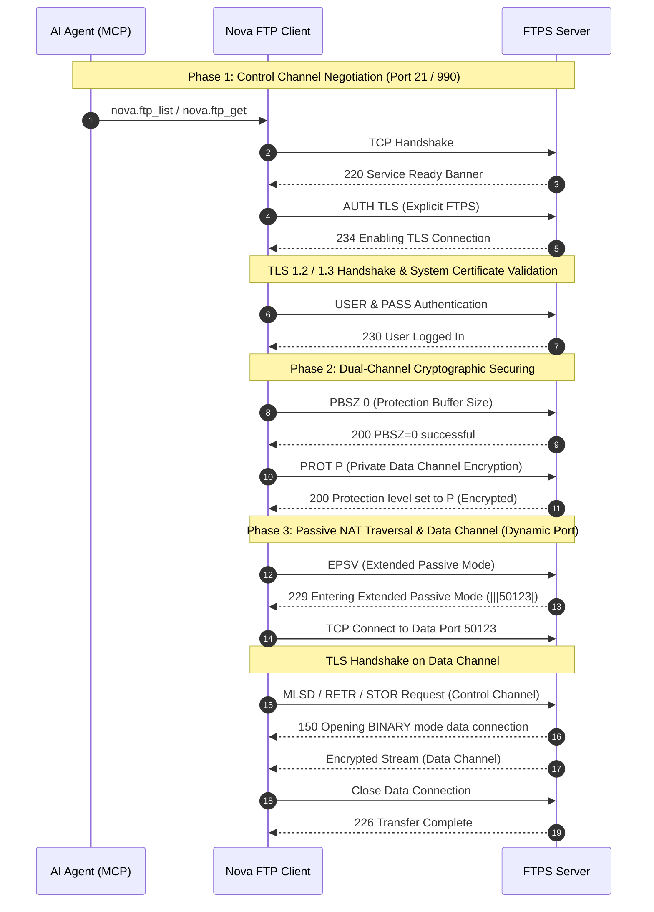
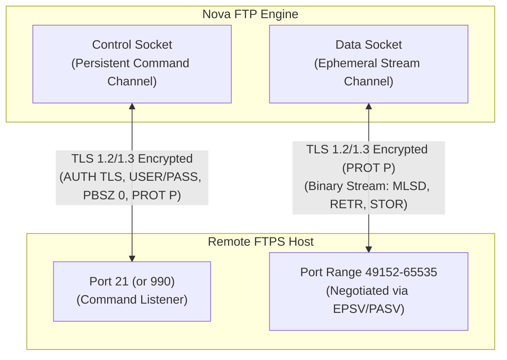
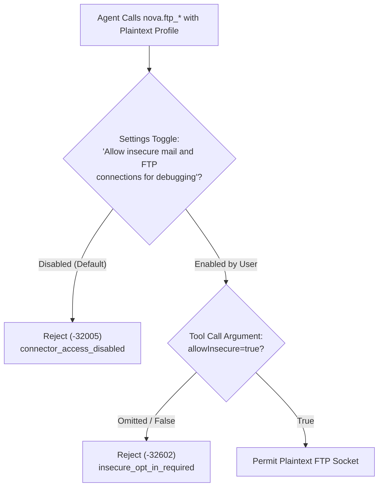

# Dual-Channel FTP/FTPS Transport & Security Architecture

Nova AI Workspace provides secure, RFC-compliant file transfer over File Transfer Protocol (FTP, RFC 959) and FTP over TLS (FTPS, RFC 4217). Built on an isolated dual-channel model, Nova enforces cryptographic data-channel privacy, strict certificate trust chains, passive-mode NAT traversal, and a two-stage gate for legacy plaintext debugging.

---

## 1. Transport Security Modes

The `ftp` connector profile supports four transport security configurations matching remote server capabilities:

| Security Mode | Transport Protocol | Default Port | Cryptographic Characteristics |
| :--- | :--- | :--- | :--- |
| **`auto`** | Explicit FTPS (RFC 4217) | **21** | Connects in plaintext, immediately sends `AUTH TLS`, and upgrades control and data channels to TLS 1.2/1.3. **Never silently downgrades to cleartext.** |
| **`start_tls`** | Explicit FTPS | **21** | Canonical alias for explicit FTPS. Enforces TLS negotiation prior to user credential exchange. |
| **`ssl_on_connect`** | Implicit FTPS | **990** | Initiates an immediate TLS handshake upon socket connection before receiving the initial server greeting banner. |
| **`none`** | Plaintext FTP (RFC 959) | **21** | Unencrypted legacy transport. Transmits passwords and file contents in cleartext. Blocked by Nova's Insecure Connection Gate. |

---

## 2. Dual-Channel Cryptography: Control vs. Data Channels

Unlike unified protocols such as SSH/SFTP or HTTPS, FTP isolates command control from binary payloads across two independent TCP streams:

### Control Channel Security (`AUTH TLS`)
1. **Initial Handshake:** In explicit modes (`auto`, `start_tls`), Nova initiates an unencrypted TCP connection to port 21. Before sending authentication details, Nova issues `AUTH TLS`.
2. **Credential Protection:** User credentials (`USER` and `PASS`) are transmitted **only after** the TLS session is established.
3. **Audit Logging Hygiene:** Hostnames, usernames, and passwords are strictly excluded from console and trace logs (`LogHost = false`, `LogUserName = false`, `LogPassword = false`).

### Data Channel Privacy (`PROT P`)
By default, the FTP standard allows unencrypted data transfers even over an encrypted control connection. Nova eliminates this security flaw:
1. **Buffer Negotiation (`PBSZ 0`):** Issues `PBSZ 0` to confirm stream-based TLS framing.
2. **Mandatory Data Privacy (`PROT P`):** Issues `PROT P` (*Private*) to mandate TLS encryption for all file transfers and directory listings.
3. **No Cleartext Fallback:** Connections negotiating unencrypted data channels (`PROT C` / *Clear*) are rejected as insecure.

---

## 3. The Insecure Connection Gate

Nova strictly blocks unencrypted plaintext connections (`security='none'`) by default to prevent accidental credential leakage across networks.

To execute operations against a plaintext FTP server, a **two-man rule** must be satisfied:
1. **Human Operator Consent:** The user must explicitly enable *"Allow insecure mail and FTP connections for debugging"* in Nova Settings.
2. **Agent Explicit Flag:** The agent must explicitly pass `allowInsecure: true` in the tool invocation arguments.

If either check fails, Nova aborts execution immediately with reason code `insecure_opt_in_required` before transmitting any network packets.

---

## 4. Certificate Validation & Revocation

All FTPS connections enforce rigorous X.509 certificate validation through the Windows platform certificate trust store:

* **System Certificate Authority Chain:** Certificates must chain to a recognized trusted root authority. Self-signed or unverified certificates are rejected with `FtpInvalidCertificateException` (reason code: `operation_failed`).
* **Online Revocation Checks:** Nova enforces active revocation checking (`ValidateCertificateRevocation = true`). Revoked certificates abort connection establishment immediately.
* **Zero Blind Bypass:** Nova disables arbitrary certificate bypass flags (`ValidateAnyCertificate = false`). Agents cannot suppress certificate errors.

---

## 5. Passive Mode NAT Traversal (`EPSV` / `PASV`)

Active FTP connections require the remote server to initiate inbound TCP connections to the client, which are blocked by modern corporate firewalls, NAT routers, and endpoint protection software.

Nova resolves this by enforcing **Passive Mode NAT Traversal** (`FtpDataConnectionType.AutoPassive`):
1. **Extended Passive Mode (`EPSV`, RFC 2428):** Nova queries the server for a data port using `EPSV`. This works across both IPv4 and IPv6 without exposing client or server network topology.
2. **Standard Passive Fallback (`PASV`):** If the remote server responds that `EPSV` is unrecognized, Nova gracefully falls back to legacy `PASV`.

---

## 6. Single-Transfer Channel Constraint

Unlike modern multi-channel multiplexed protocols (such as SFTP or HTTP/2), standard FTP control channels support only **one active data transfer at a time**:
* While a file payload or directory listing is actively streaming across the data socket, the control channel is locked awaiting final transfer completion status (`226 Transfer Complete`).
* Nova's transfer runner explicitly configures `Capabilities.ConcurrentRequests = false`, queuing file transfer tasks sequentially rather than attempting parallel channel concurrency.

---

## 7. Troubleshooting & Error Codes

| Error Status | Reason Code | Root Cause & Resolution |
| :--- | :--- | :--- |
| `insecure_opt_in_required` | `insecure_transport_opt_in_required` | A plaintext FTP profile was invoked without `allowInsecure: true` or without the human operator enabling insecure connections in Settings. |
| `auth_failed` | `auth_failed` | Remote server rejected the supplied username or password. Check credentials in Nova Vault / Settings. |
| `operation_failed` | `operation_failed` | The FTPS certificate is untrusted, expired, or revoked; or the server failed to negotiate `AUTH TLS` / `PROT P`. |
| `unreachable` | `unreachable` | Socket connection timed out or was refused. Verify firewall rules and passive port range on the server. |

---

## Related Documentation

* [FTP Resumable Transfers & File Operations](../resumable-transfers-and-file-operations/README.md)
* [FTP & FTPS Connector Architecture Hub](../README.md)
* [SFTP Resumable Engine & Acceleration](../../sftp/resumable-engine-and-acceleration/README.md)
* [Tool: `nova.ftp_list`](../../../../mcp-reference/tools/connectors-and-mail/nova-ftp-list.md)
* [Tool: `nova.ftp_get`](../../../../mcp-reference/tools/connectors-and-mail/nova-ftp-get.md)
* [Tool: `nova.ftp_put`](../../../../mcp-reference/tools/connectors-and-mail/nova-ftp-put.md)
