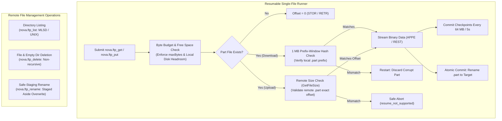
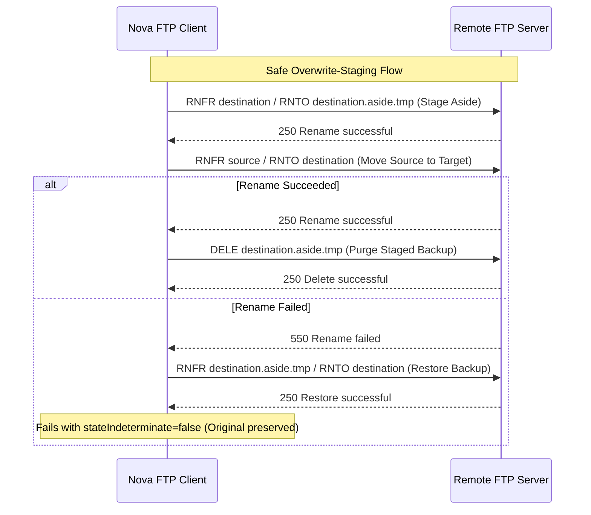

# FTP Resumable Transfers & Remote File Operations

Nova AI Workspace provides durable, crash-resilient file operations over FTP and FTPS. While respecting the single-stream constraints of RFC 959, Nova wraps file downloads and uploads in an asynchronous, SQLite-backed transfer engine featuring cryptographic prefix checks, atomic renaming, and strict destination staging to prevent data loss.



---

## 1. Single-File Transfer Architecture

Unlike SFTP (which supports multiplexed streams and recursive directory tree replication), FTP and FTPS are constrained by protocol design:
* **Single Transfer per Connection:** Standard FTP control channels cannot process concurrent commands while a data socket is active.
* **Single-File Scope:** `nova.ftp_get` and `nova.ftp_put` operate exclusively on individual regular files. Directory recursion (`recursive=true`) and symbolic links are rejected with `remote_link_rejected`.
* **Asynchronous Execution:** Transfers run as background jobs managed by `ConnectorTransferRunner`. Tool invocations wait up to `wait` seconds (default: 60) before returning a `jobId` with `state: "running"`.

---

## 2. Resumable Transfers & Verification Invariants

Interrupted or paused transfers resume safely without redundant byte transmission or data corruption:

### Download Resumption (`nova.ftp_get`)
1. **Local Part Staging:** Data is downloaded into a `<filename>.part` file.
2. **Prefix-Window Verification:** When resuming an interrupted download, Nova reads a 1 MB verification window (`PrefixWindowBytes = 1,048,576`) immediately preceding the recorded offset. If the cryptographic hash of this window matches the remote source, streaming resumes; if it mismatches, the invalid partial file is discarded and the transfer restarts from offset 0.
3. **Atomic Commit:** Once byte parity is verified, the file is committed via an atomic filesystem rename.

### Upload Resumption (`nova.ftp_put`)
1. **Remote Part Offset Verification:** Because FTP does not support positioned random-access writes, an upload can only resume by appending (`APPE`).
2. **Server Size Pre-Check:** Before issuing `APPE`, Nova queries the remote file size via `GetFileSize(path, -1)`. If the remote part does not end at the exact recorded offset, Nova halts immediately with `resume_not_supported` rather than appending data at the wrong offset.
3. **Commit via Temporary Part:** Uploads write to a temporary remote `.part` file. The final target is replaced only after full payload delivery and size verification.

---

## 3. Checkpointing & Network Recovery

Transfer jobs are backed by Nova's local SQLite database (`ConnectorTransferStore`):

| Mechanism | Configuration | Description |
| :--- | :--- | :--- |
| **Volume Cadence** | Every **64 MB** (`CheckpointBytes`) | Byte counters and SHA-256 stream states are committed durably. |
| **Time Cadence** | Every **5 seconds** (`CheckpointInterval`) | Guarantees progress saves on low-speed connections. |
| **Transient Retries** | Up to **5 retries** | Network losses and temporary server responses (`4xx`) are retried with exponential backoff and jitter. |
| **Permanent Failures** | Immediate fail-closed | Permanent server error responses (`5xx`) fail immediately without retry loops. |

---

## 4. Local Filesystem Sandboxing

Local file paths are strictly sandboxed:
* `localPath` must reside within the user's `Downloads` directory or the active workspace root (`LocalRoots`).
* Accessing files outside the sandbox requires an explicit `local.read` (for uploads) or `local.write` (for downloads) connector grant, and local file access must be enabled in Nova Settings.
* Path traversal vectors (`../`, invalid drive specifications) are rejected with error code `-32602`.

---

## 5. Remote Filesystem Mutations

### Directory Inspection (`nova.ftp_list`)
* **Listing Parsers:** Automatically negotiates machine-readable RFC 3659 `MLSD` listings, gracefully falling back to standard UNIX `LIST` format.
* **Untrusted Metadata Masking:** Filenames containing control characters or bidirectional Unicode overrides are masked with `unsafeName: true` to prevent terminal spoofing.
* **Result Bounding:** Queries are bounded by `maxEntries` (1 to 1000, default 200). Truncated results flag `hasMore: true`.

### Overwrite-Safe File Renaming (`nova.ftp_rename`)
Standard FTP server implementations often delete the target file before verifying whether the rename can succeed. Nova enforces a **safe-staging rename pattern**:



1. **Stage Aside:** If the destination file already exists and `overwrite: true` is set, Nova renames the existing file to a temporary sibling path (`.aside.tmp`).
2. **Rename Source:** The source file is renamed to the destination.
3. **Cleanup or Rollback:**
   * If the rename succeeds, the staged aside file is deleted.
   * If the rename fails, Nova automatically restores the aside file back to its original destination (`TryRenameBackAsync`), preserving data integrity.
4. **Directory Protection:** Overwriting an existing directory via rename is strictly prohibited (`destination_exists`).

### Deletion (`nova.ftp_delete`)
* **Single-Item Scope:** Deletes a single regular file (`DELE`) or empty directory (`RMD`).
* **Non-Recursive Policy:** Recursive directory deletion is intentionally not exposed for FTP/FTPS. Attempting to delete a directory containing files fails with `directory_not_empty`.
* **Symlink Rejection:** Remote symbolic links are rejected (`remote_link_rejected`) to prevent accidental destruction of external targets.

### Protected Remote Roots
Attempting to rename, move, or delete the root directory (`/`) or current working directory (`.`) is blocked with reason code `protected_remote_root`.

---

## 6. MCP Protocol Examples

### Resumable Download (`nova.ftp_get`)

```json
{
  "name": "nova.ftp_get",
  "arguments": {
    "profileId": "conn-ftp-archive",
    "remotePath": "/incoming/dataset_2026.zip",
    "localPath": "C:\\Users\\Operator\\Downloads\\dataset_2026.zip",
    "maxBytes": 10737418240,
    "wait": 15
  }
}
```

#### Structured Response (Active Background Job)

```json
{
  "ok": true,
  "jobId": "tr_9c8b7a6f5e4d3c2b1a098765",
  "attempt": 1,
  "operation": "ftp_get",
  "profileId": "conn-ftp-archive",
  "state": "transferring",
  "terminal": false,
  "running": true,
  "resumed": false,
  "progress": {
    "phase": "transferring",
    "bytesCompleted": 2147483648,
    "bytesTotal": 8589934592,
    "filesCompleted": 0,
    "filesTotal": 1,
    "currentFile": "dataset_2026.zip",
    "currentFileBytes": 2147483648,
    "currentFileTotal": 8589934592,
    "rateBytesPerSecond": 26214400,
    "etaSeconds": 245
  },
  "remotePath": "/incoming/dataset_2026.zip",
  "localPath": "C:\\Users\\Operator\\Downloads\\dataset_2026.zip",
  "suggestedPollMs": 5000,
  "nextAction": "poll_ftp_transfer_status"
}
```

---

### Polling Transfer Status (`nova.ftp_transfer_status`)

```json
{
  "name": "nova.ftp_transfer_status",
  "arguments": {
    "jobId": "tr_9c8b7a6f5e4d3c2b1a098765"
  }
}
```

---

### Safe Renaming with Overwrite (`nova.ftp_rename`)

```json
{
  "name": "nova.ftp_rename",
  "arguments": {
    "profileId": "conn-ftp-archive",
    "remotePath": "/incoming/dataset_2026.zip.tmp",
    "destinationRemotePath": "/incoming/dataset_2026.zip",
    "overwrite": true
  }
}
```

#### Structured Response

```json
{
  "ok": true,
  "status": "renamed",
  "changed": true,
  "affectedRemotePaths": [
    "/incoming/dataset_2026.zip.tmp",
    "/incoming/dataset_2026.zip"
  ]
}
```

---

## 7. Operational Best Practices

> [!TIP]
> **Resuming Interrupted Jobs:** To resume an interrupted or stopped FTP transfer, repeat the **identical** `nova.ftp_get` or `nova.ftp_put` invocation with the same arguments. Nova automatically matches the job specification and continues from the validated byte offset.

> [!IMPORTANT]
> **Budget Ceilings:** Always pass `maxBytes` when downloading files of unknown size from public or legacy FTP servers to avoid saturating storage or exceeding network quotas.

> [!WARNING]
> **No Recursive Operations:** Do not attempt to download or delete entire directory hierarchies over FTP. If multi-file directory transfers are required, prefer the [SFTP subsystem](../../sftp/README.md).

---

## Related Documentation

* [Dual-Channel FTP/FTPS Transport & Security Architecture](../dual-channel-transport-and-security/README.md)
* [FTP & FTPS Connector Architecture Hub](../README.md)
* [SFTP Resumable Engine & Acceleration](../../sftp/resumable-engine-and-acceleration/README.md)
* [Tool: `nova.ftp_get`](../../../../mcp-reference/tools/connectors-and-mail/nova-ftp-get.md)
* [Tool: `nova.ftp_put`](../../../../mcp-reference/tools/connectors-and-mail/nova-ftp-put.md)
* [Tool: `nova.ftp_transfer_status`](../../../../mcp-reference/tools/connectors-and-mail/nova-ftp-transfer-status.md)
* [Tool: `nova.ftp_transfer_stop`](../../../../mcp-reference/tools/connectors-and-mail/nova-ftp-transfer-stop.md)
* [Tool: `nova.ftp_rename`](../../../../mcp-reference/tools/connectors-and-mail/nova-ftp-rename.md)
* [Tool: `nova.ftp_delete`](../../../../mcp-reference/tools/connectors-and-mail/nova-ftp-delete.md)
