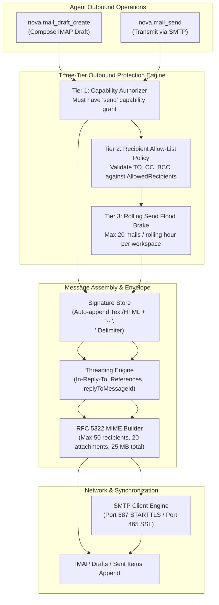
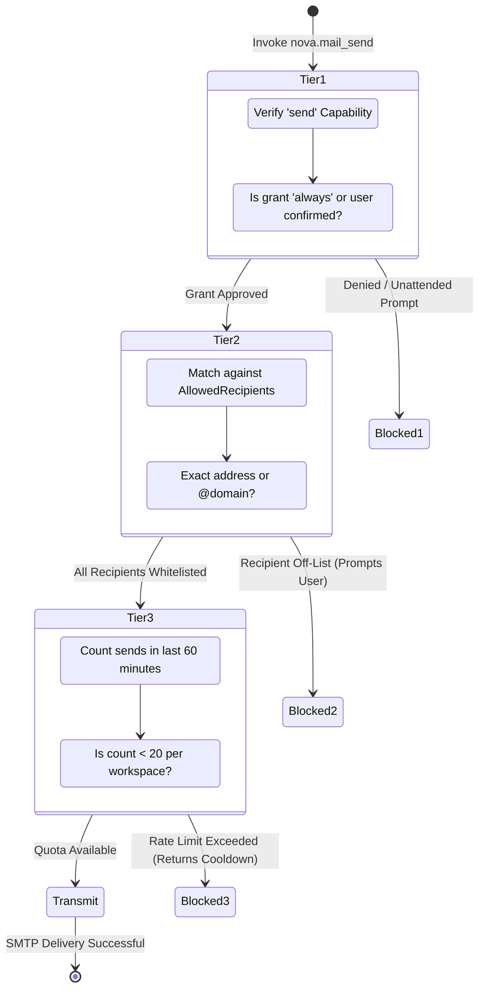

# Message Composition, Outbound Delivery & Rate Limits

The outbound mail transmission subsystem governs message drafting, signature injection, SMTP delivery, and abuse prevention. Because unauthorized or excessive email transmission can compromise corporate domain reputation, trigger anti-spam blocklists, or result in accidental data exfiltration, Nova enforces a three-tiered protection architecture: capability verification, recipient allow-list validation, and a rolling hourly flood brake.



---

## 1. Composition Drafting (`nova.mail_draft_create`)

Autonomous agents can compose and stage messages directly in the remote mailbox's `\Drafts` folder without transmitting them immediately over SMTP:

* **Human-in-the-Loop Review:** Draft creation allows an agent to assemble complex emails (with tables, attachments, and formatted text) for human operator review before delivery.
* **Server Synchronization:** Nova resolves the server's dedicated `\Drafts` folder and commits the message as an unread draft with the `\Draft` IMAP flag set.

### Signature Store Integration
Nova includes a persistent signature store per connector profile (`ConnectorMailSignatureStore`). When drafting or sending messages:
* Plain-text signatures (`signatureText`) are appended automatically separated by the standard RFC 3676 delimiter (`-- \n`).
* HTML signatures (`signatureHtml`) are injected immediately preceding the closing `</body>` tag.
* To bypass signature injection (e.g. for machine-to-machine automated alerts), agents can supply `"includeSignature": false`.

---

## 2. Outbound SMTP Delivery (`nova.mail_send`)

`nova.mail_send` constructs and delivers RFC 5322 / MIME messages over the connector's outgoing SMTP endpoint (standard ports **587** with STARTTLS or **465** with implicit SSL).

### Message Constraints & Sizing Limits
To preserve system stability and conform to global mail standards, Nova enforces strict payload boundaries:
* **Recipients:** Maximum **20 recipients** each in `to`, `cc`, and `bcc` (maximum **50 recipients total** across all fields).
* **Attachments:** Maximum **20 attachments** per email.
* **Payload Size:** Maximum **25 MB combined message size** (including base64 transfer encoding overhead). Larger datasets should be transferred via [SFTP](../../sftp/README.md) or [Downloads](../../../downloads/README.md).
* **Priority & Tracking:** Supports `priority: "high"` / `"normal"` / `"low"` and `requestReadReceipt: true` (injecting `Disposition-Notification-To`).

### Conversation Threading
To maintain coherent email threads:
* Passing `replyToMessageId` automatically extracts `Message-ID` from the referenced email and populates both `In-Reply-To` and `References` headers.
* Passing `inReplyTo` and `references` explicitly allows agents to link into existing arbitrary conversation threads.

---

## 3. The Three-Tier Outbound Protection Architecture

Outbound email transmission requires passing three independent validation gates:



### Tier 1: Capability Authorizer (`send`)
The connector profile must have the `send` capability granted:
* In unattended runs (e.g. background scheduled tasks), calling `nova.mail_send` on an account configured with `ask` fails closed with error code `-32033` (`connector_approval_required`).
* An explicit `always` grant must be set in Nova Settings or via `nova.connector_grant_set`.

### Tier 2: Recipient Allow-List Policy (`AllowedRecipients`)
Configured on the connector profile via `nova.connector_recipient_set`, the recipient allow-list ensures agents cannot leak data or contact arbitrary external addresses without human awareness:
* **Allowed Formats:**
  - **Full Addresses:** e.g. `"billing@partner.com"` (exact match, case-insensitive domain, case-preserved local-part).
  - **Domain Matches:** e.g. `"@partner.com"` or `"partner.com"` (matches any recipient at that domain).
* **Strict Evaluation:** Up to 200 entries (max 254 characters each per RFC 5321). Wildcards and regex patterns are intentionally prohibited to eliminate bypass vulnerabilities.
* **Unlisted Destinations:** If any recipient in `to`, `cc`, or `bcc` is not covered by the allow-list, Nova triggers an interactive user confirmation modal displaying the unlisted addresses. In unattended runs, the request is rejected immediately.

### Tier 3: Rolling Send Flood Brake (`MailSendRateLimiter`)
To neutralize runaway loops caused by prompt injection or logic errors in agent scripts, Nova maintains an in-memory rolling rate limiter:
* **The Quota:** Maximum **20 messages per rolling 60-minute window per workspace context**.
* **Rolling Window:** When a message is sent, its timestamp enters a FIFO queue. Exactly 60 minutes later, the slot frees up.
* **Cooldown Feedback:** If an agent attempts a 21st transmission within the hour, Nova rejects the call with a non-retryable reason code, specifying `retryAfterSeconds` until the oldest timestamp expires so the agent does not spin in a tight retry loop.

---

## 4. Transmission Example & Response Schema

```json
// nova.mail_send
{
  "profileId": "conn_mail_work",
  "to": ["accounting@partner.com"],
  "cc": ["manager@company.com"],
  "subject": "Invoice Approval - Project Alpha",
  "bodyText": "Hello Team,\n\nThe invoice for Project Alpha has been approved.\n\nBest regards,\nAutomated Accounts Bot",
  "priority": "normal",
  "includeSignature": true
}
```

```json
{
  "content": [
    {
      "type": "text",
      "text": "Email sent successfully to 1 recipient(s)."
    }
  ],
  "structuredContent": {
    "profileId": "conn_mail_work",
    "messageId": "<nova-send-20261017-093500-14205@company.com>",
    "recipients": {
      "to": ["accounting@partner.com"],
      "cc": ["manager@company.com"],
      "bcc": []
    },
    "subject": "Invoice Approval - Project Alpha",
    "sentDate": "2026-10-17T09:35:00Z",
    "savedToSentFolder": true,
    "rateLimit": {
      "sendsInWindow": 4,
      "maxSendsPerHour": 20,
      "remainingSends": 16
    }
  }
}
```

---

## 5. Practical Agent Recipes

### Recipe 1: Compose and Stage a Draft for Review
```json
// nova.mail_draft_create
{
  "profileId": "conn_mail_work",
  "to": ["client@customer.com"],
  "subject": "Draft Proposal - Web Migration",
  "bodyText": "Hi Alex,\n\nPlease review the attached draft proposal for the upcoming migration.\n\nBest regards,\nNova Agent",
  "priority": "high"
}
```

### Recipe 2: Threaded Reply with Rate Limit Monitoring
```json
// nova.mail_send
{
  "profileId": "conn_mail_work",
  "to": ["invoices@partner.com"],
  "replyToMessageId": "<stmt-2026-10-05@partner.com>",
  "subject": "Re: Monthly Statement - October 2026",
  "bodyText": "Thank you. We have received the statement and queued it for payment.",
  "includeSignature": true
}
```

---

## 6. Related Tools & Documentation

* [`nova.mail_send` Tool Reference](../../../../mcp-reference/tools/connectors-and-mail/nova-mail-send.md)
* [`nova.mail_draft_create` Tool Reference](../../../../mcp-reference/tools/connectors-and-mail/nova-mail-draft-create.md)
* [`nova.connector_recipient_set` Tool Reference](../../../../mcp-reference/tools/connectors-and-mail/nova-connector-recipient-set.md)
* [`nova.connector_grant_set` Tool Reference](../../../../mcp-reference/tools/connectors-and-mail/nova-connector-grant-set.md)
* [Mailbox Navigation, Pagination & Search](../mailbox-navigation-and-search/README.md)
* [Local Mail Archive & Background Backups](../local-archive-and-backups/README.md)
* [Mail Architecture Overview](../README.md)
