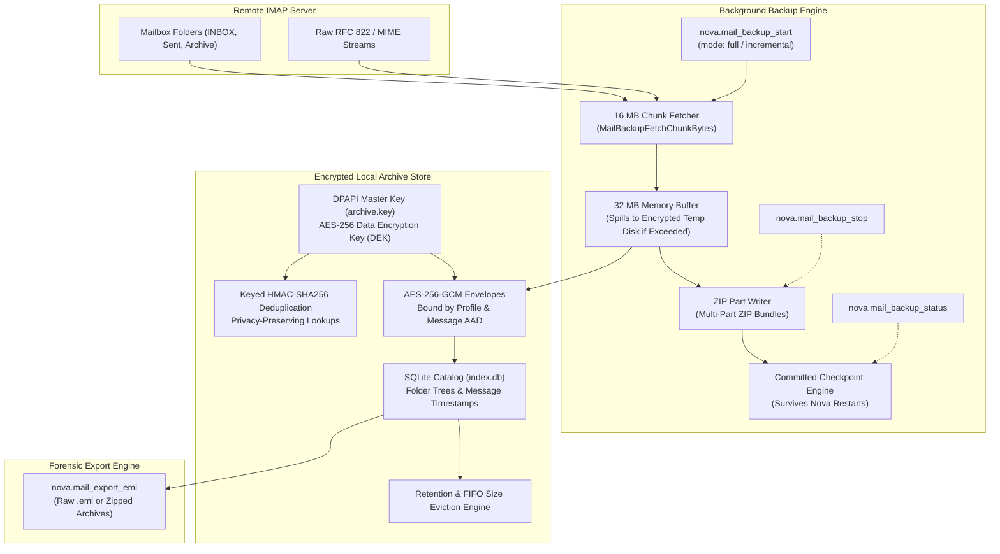
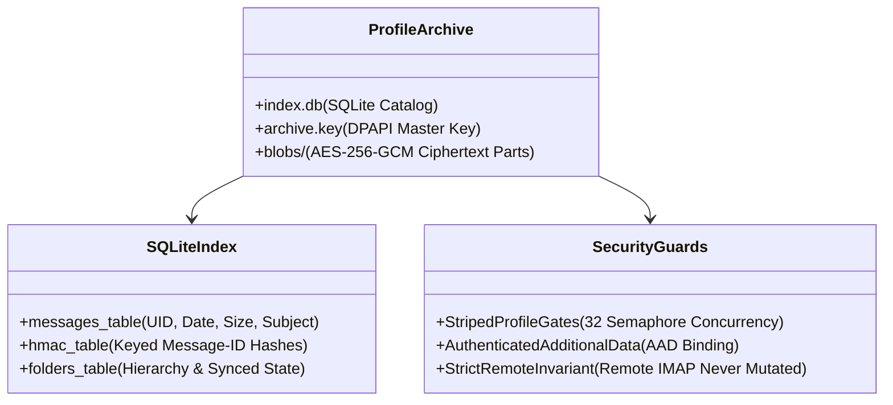

# Local Mail Archive & Background Backups

The local archive and backup subsystem provides enterprise-grade message persistence, forensic archiving, and offline availability. It incorporates an encrypted local SQLite/AES-256-GCM message store and an asynchronous, resumable multi-part backup engine capable of streaming entire corporate mailboxes without dropping oversized messages or stalling agent operations.



---

## 1. Resumable Background Mailbox Backups (`nova.mail_backup_*`)

Mailbox backups execute asynchronously in the background. Once triggered via `nova.mail_backup_start`, the operation runs independently of JSON-RPC tool timeouts, allowing agents to continue interacting with tabs, terminals, and web pages while gigabytes of email are ingested.

### Key Backup Engine Invariants

1. **Zero Message Dropping:** Standard mail clients often discard or truncate messages exceeding fixed size limits (e.g. 20 MB). Nova's backup fetcher streams messages using 16 MB chunks (`MailBackupFetchChunkBytes`), reliably archiving massive legal discovery files and multi-gigabyte mailboxes.
2. **Memory Buffer with Disk Spillover:** Payloads up to 32 MB are held in memory buffers; oversized attachments or single giant messages automatically spill to encrypted temporary disk files to prevent Out-Of-Memory (OOM) faults.
3. **Multi-Part ZIP Packaging:** Mail is segmented into clean multi-part ZIP volumes (`backup-part-001.zip`, `backup-part-002.zip`), ensuring individual archives never exceed standard filesystem boundaries.
4. **Crash-Resilient Checkpointing:** Checkpoints only advance when a ZIP part is fully committed and verified on disk. If Nova terminates unexpectedly or the network drops, calling `nova.mail_backup_start` with `"mode": "incremental"` resumes directly from the last verified checkpoint without re-downloading previously processed parts.
5. **Graceful Termination:** Invoking `nova.mail_backup_stop` signals the writer to flush the active memory buffer, finalize the current ZIP part, and commit the checkpoint cleanly before shutting down.

### Backup Lifecycle Commands

| Tool | Purpose | Key Parameters |
| :--- | :--- | :--- |
| [`nova.mail_backup_start`](../../../../mcp-reference/tools/connectors-and-mail/nova-mail-backup-start.md) | Initiates an asynchronous backup job. | `profileId`, `destinationFolder`, `mode` (`full` / `incremental`), `folders` |
| [`nova.mail_backup_status`](../../../../mcp-reference/tools/connectors-and-mail/nova-mail-backup-status.md) | Queries live progress, byte counts, and phase. | `profileId`, `jobId` |
| [`nova.mail_backup_stop`](../../../../mcp-reference/tools/connectors-and-mail/nova-mail-backup-stop.md) | Gracefully aborts or finishes a running backup. | `profileId`, `jobId` |

### Status Example
```json
// nova.mail_backup_status
{
  "profileId": "conn_mail_work",
  "jobId": "mbk_20261017_093012"
}
```

```json
{
  "content": [
    {
      "type": "text",
      "text": "Backup in progress: 1420/2500 messages (56.8%), 412 MB transferred."
    }
  ],
  "structuredContent": {
    "jobId": "mbk_20261017_093012",
    "profileId": "conn_mail_work",
    "status": "running",
    "mode": "incremental",
    "messagesProcessed": 1420,
    "messagesTotal": 2500,
    "bytesTransferred": 432014080,
    "currentFolder": "INBOX/Orders",
    "partsCreated": 2,
    "elapsedSeconds": 145,
    "estimatedRemainingSeconds": 110
  }
}
```

---

## 2. Encrypted Local Mail Archive Architecture

For rapid local search and offline reference, Nova maintains a profile-isolated, encrypted local archive (`ConnectorMailArchiveStore`):



### 1. DPAPI Master Key (`archive.key`)
Each connector profile directory contains an `archive.key` storing an AES-256 Data Encryption Key (DEK). The DEK is encrypted using the Windows Data Protection API (DPAPI) tied to the current Windows user account. It is decrypted in memory only when accessing the archive.

### 2. AES-256-GCM Envelope Encryption
Message bodies and MIME structures are stored as encrypted blobs using Authenticated Encryption with Associated Data (AEAD):
* **Unique IVs:** Every record utilizes a unique 96-bit initialization vector generated via cryptographic random number generators.
* **AAD Binding:** The Authenticated Additional Data binds the ciphertext to the profile ID and message identifier, preventing cross-profile record substitution or tampering.

### 3. Keyed HMAC-SHA256 Deduplication
To prevent duplicate downloads without exposing sensitive identifiers, deduplication lookups use HMAC-SHA256 keyed with the profile's DEK. An attacker inspecting the SQLite database cannot reverse the Message-ID hashes or map external communication graphs.

### 4. Retention & FIFO Size Eviction
Administrators can configure automated retention policies:
* **Age Retention:** Messages older than the specified retention window (e.g. 90 days) are pruned automatically.
* **FIFO Size Eviction:** If the local archive approaches configured disk ceilings (`MaxArchiveMessageBytes`), the oldest read records are evicted first to maintain bounded storage footprint.
* **Strict Remote Invariant:** Local archive pruning, corruption recovery, or cache deletions **never mutate the remote IMAP server**.

---

## 3. Forensic EML Export (`nova.mail_export_eml`)

Agents can export verified, uncorrupted RFC 822 `.eml` files for legal discovery, audit trails, or importing into external analytical tools:

```json
// nova.mail_export_eml
{
  "profileId": "conn_mail_work",
  "folder": "INBOX",
  "uids": [14205, 14218],
  "destinationPath": "C:\\Users\\Operator\\Downloads\\LegalExport",
  "format": "zip"
}
```

* **Filesystem Sandboxing:** Destination paths are validated against the standard sandbox (Downloads or Workspace roots).
* **Format Flexibility:** Supports exporting single `.eml` files or bundling batches into a consolidated `.zip` archive.
* **Integrity Guarantee:** Exports preserve all original MIME boundaries, cryptographic signatures (DKIM / PGP), and raw header fields.

---

## 4. Practical Agent Recipes

### Recipe 1: Run an Incremental Mailbox Backup
```json
// Step 1: Start background backup
// nova.mail_backup_start
{
  "profileId": "conn_mail_work",
  "destinationFolder": "C:\\Users\\Operator\\Downloads\\MailBackups",
  "mode": "incremental"
}

// Step 2: Poll status periodically until finished
// nova.mail_backup_status
{
  "profileId": "conn_mail_work",
  "jobId": "mbk_20261017_093012"
}
```

### Recipe 2: Export Critical Audit Emails to Workspace
```json
// nova.mail_export_eml
{
  "profileId": "conn_mail_work",
  "folder": "INBOX",
  "uids": [14205],
  "destinationPath": "C:\\Users\\Operator\\Downloads\\Audit_Oct2026.eml",
  "format": "eml"
}
```

---

## 5. Related Tools & Documentation

* [`nova.mail_backup_start` Tool Reference](../../../../mcp-reference/tools/connectors-and-mail/nova-mail-backup-start.md)
* [`nova.mail_backup_status` Tool Reference](../../../../mcp-reference/tools/connectors-and-mail/nova-mail-backup-status.md)
* [`nova.mail_backup_stop` Tool Reference](../../../../mcp-reference/tools/connectors-and-mail/nova-mail-backup-stop.md)
* [`nova.mail_export_eml` Tool Reference](../../../../mcp-reference/tools/connectors-and-mail/nova-mail-export-eml.md)
* [Mailbox Navigation, Pagination & Search](../mailbox-navigation-and-search/README.md)
* [Message Composition & Rate Limits](../composition-sending-and-rate-limits/README.md)
* [Mail Architecture Overview](../README.md)
