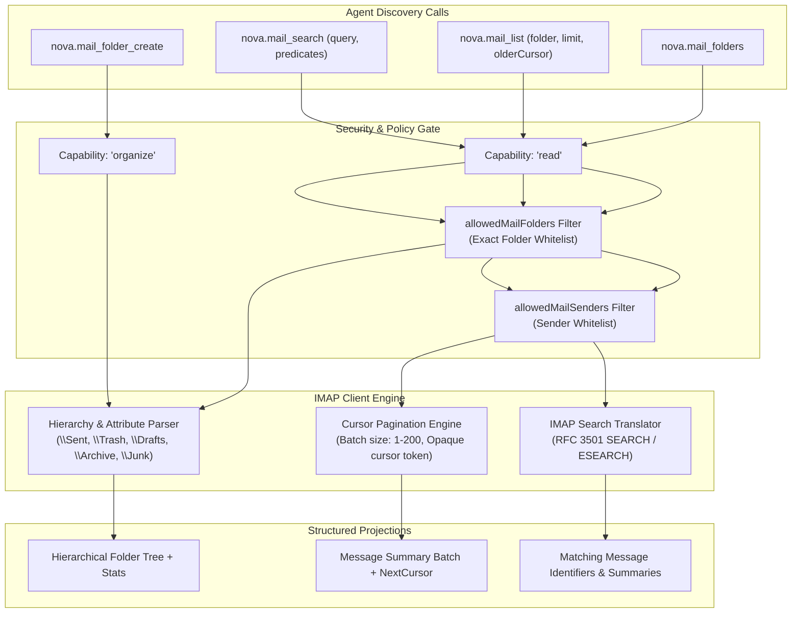
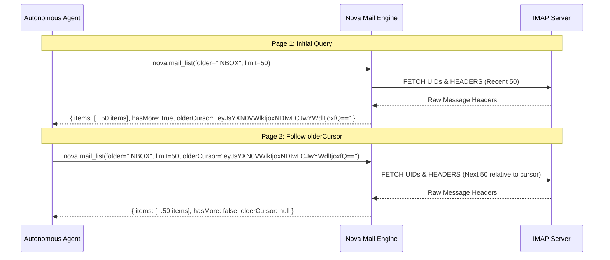

# Mailbox Navigation, Pagination & Search

The mail navigation and discovery subsystem provides efficient, memory-bounded exploration of remote IMAP mailboxes. It combines hierarchical folder discovery, cursor-based pagination, and server-side search indexing to handle mailboxes containing hundreds of thousands of messages without excessive memory consumption or network overhead.



---

## 1. Hierarchical Folder Discovery (`nova.mail_folders`)

IMAP servers organize messages into hierarchical mailbox folders separated by server-defined delimiters (typically `/` or `.`).

### Standard Server Flags & Attributes

When an agent invokes `nova.mail_folders`, Nova executes an RFC 3501 `LIST` command and annotates each folder with canonical role attributes:

| Standard Attribute | Description | Typical Mail Client Role |
| :--- | :--- | :--- |
| `\Sent` | Dedicated sent messages folder. | Outgoing transmission archive |
| `\Drafts` | Unfinished messages and composition drafts. | Draft storage |
| `\Trash` | Deleted messages awaiting permanent purge. | Recycling bin / Trash |
| `\Archive` | Long-term message archive. | General archive |
| `\Junk` | Spam and unsolicited bulk mail. | Spam / Junk filter |
| `\All` | Virtual unified mailbox (e.g. Gmail "All Mail"). | Master repository |
| `\HasChildren` / `\HasNoChildren` | Structural indicator of child folders. | Tree navigation |

### Request & Response Schema
```json
// nova.mail_folders
{
  "profileId": "conn_mail_work"
}
```

```json
{
  "content": [
    {
      "type": "text",
      "text": "Found 6 mailbox folders."
    }
  ],
  "structuredContent": {
    "profileId": "conn_mail_work",
    "folders": [
      {
        "name": "INBOX",
        "path": "INBOX",
        "attributes": ["\\HasChildren"],
        "delimiter": "/",
        "messageCount": 1420,
        "unreadCount": 14,
        "isSubscribed": true
      },
      {
        "name": "Orders",
        "path": "INBOX/Orders",
        "attributes": ["\\HasNoChildren"],
        "delimiter": "/",
        "messageCount": 380,
        "unreadCount": 0,
        "isSubscribed": true
      },
      {
        "name": "Sent Items",
        "path": "Sent Items",
        "attributes": ["\\Sent", "\\HasNoChildren"],
        "delimiter": "/",
        "messageCount": 890,
        "unreadCount": 0,
        "isSubscribed": true
      }
    ]
  }
}
```

---

## 2. Dynamic Folder Creation (`nova.mail_folder_create`)

Agents with the `organize` capability can create new folders within the remote mailbox hierarchy:

```json
// nova.mail_folder_create
{
  "profileId": "conn_mail_work",
  "folderName": "INBOX/VendorInvoices"
}
```

* **Delimiter Invariance:** Nova automatically resolves the server's native delimiter (`/` or `.`) to construct the appropriate RFC 3501 `CREATE` command.
* **Parent Hierarchy:** If parent folders do not exist, standard IMAP servers create intermediate non-selectable hierarchy nodes.

---

## 3. Cursor-Based Message Pagination (`nova.mail_list`)

Retrieving full folder contents in a single unconstrained request causes memory exhaustion and JSON-RPC transport timeouts on mailboxes containing tens of thousands of messages. Nova mandates cursor-based pagination.



### Pagination Contract
* **`limit`:** Maximum number of messages to return per page. Allowed range: **1 to 200** (default: 50).
* **`olderCursor`:** Opaque, base64-encoded token tracking the traversal position backwards in time. To fetch older messages, the agent supplies `olderCursor` returned from the prior page.
* **`sinceCursor`:** Optional token to retrieve only newer messages arriving after the initial fetch point.
* **Reverse Chronological Order:** Results are sorted newest-first by default, allowing agents to immediately process recent communications.
* **Summary Projection:** To conserve bandwidth, `nova.mail_list` returns only essential envelope fields: `uid`, `messageId`, `from`, `to`, `subject`, `date`, `flags` (`seen`, `flagged`, `answered`), `hasAttachments`, and `sizeBytes`. Full bodies and MIME parts are fetched selectively via `nova.mail_read`.

---

## 4. Structured Server-Side IMAP Search (`nova.mail_search`)

Rather than downloading message lists and filtering client-side, `nova.mail_search` compiles structured criteria into optimized IMAP RFC 3501 `SEARCH` / `ESEARCH` commands executed directly by the mail server.

```mermaid
graph LR
    subgraph QueryFilters["Search Arguments"]
        F1["from: 'accounting@vendor.com'"]
        F2["subject: 'Invoice 2026'"]
        F3["since: '2026-10-01'"]
        F4["unreadOnly: true"]
        F5["flaggedOnly: false"]
    end

    subgraph Engine["Search Translator"]
        Parser["Query Sanitizer & IMAP Term Compiler"]
    end

    subgraph IMAPQuery["RFC 3501 Search Syntax"]
        Compiled["UID SEARCH FROM accounting@vendor.com SUBJECT \"Invoice 2026\" SINCE 01-Oct-2026 UNSEEN"]
    end

    F1 & F2 & F3 & F4 & F5 --> Parser --> Compiled
```

### Supported Search Predicates

| Parameter | Type | IMAP Equivalent | Description |
| :--- | :--- | :--- | :--- |
| `folder` | `string` | Mailbox Target | Target folder to search (default: `"INBOX"`). |
| `from` | `string` | `FROM <value>` | Substring match against sender address or display name. |
| `to` | `string` | `TO <value>` | Substring match against recipient addresses. |
| `subject` | `string` | `SUBJECT <value>` | Substring match against the subject header. |
| `body` | `string` | `BODY <value>` | Full-text substring search across body parts on the server. |
| `since` | `string` | `SINCE <date>` | ISO 8601 date (`YYYY-MM-DD`). Matches messages received on or after this date. |
| `before` | `string` | `BEFORE <date>` | ISO 8601 date (`YYYY-MM-DD`). Matches messages received before this date. |
| `unreadOnly`| `boolean` | `UNSEEN` | If `true`, returns only messages lacking the `\Seen` flag. |
| `flaggedOnly`| `boolean` | `FLAGGED` | If `true`, returns only messages marked with the `\Flagged` star. |

### Search Example & Response Schema
```json
// nova.mail_search
{
  "profileId": "conn_mail_work",
  "folder": "INBOX",
  "from": "invoices@partner.com",
  "subject": "Statement",
  "unreadOnly": true,
  "since": "2026-10-01"
}
```

```json
{
  "content": [
    {
      "type": "text",
      "text": "Found 2 matching messages."
    }
  ],
  "structuredContent": {
    "profileId": "conn_mail_work",
    "folder": "INBOX",
    "totalMatches": 2,
    "items": [
      {
        "uid": 14205,
        "messageId": "<stmt-2026-10-05@partner.com>",
        "from": "Billing Dept <invoices@partner.com>",
        "to": ["accounting@company.com"],
        "subject": "Monthly Statement - October 2026",
        "date": "2026-10-05T08:14:00Z",
        "flags": ["unread"],
        "hasAttachments": true,
        "sizeBytes": 45210
      },
      {
        "uid": 14218,
        "messageId": "<stmt-2026-10-12@partner.com>",
        "from": "Billing Dept <invoices@partner.com>",
        "to": ["accounting@company.com"],
        "subject": "Updated Statement - October 2026",
        "date": "2026-10-12T11:20:00Z",
        "flags": ["unread"],
        "hasAttachments": true,
        "sizeBytes": 47890
      }
    ]
  }
}
```

---

## 5. Security & Policy Filters

When an account operates under an `always` capability grant for `read`, administrators can restrict discovery operations to prevent agents from snooping on sensitive corporate folders:

1. **`allowedMailFolders`:** If defined (e.g. `["INBOX", "Orders"]`), calling `nova.mail_list` or `nova.mail_search` against unlisted folders (such as `"HR/Payroll"` or `"Private"`) fails closed immediately with an authorization error.
2. **`allowedMailSenders`:** Filters search and listing results at the protocol level. Messages originating from unapproved senders are omitted from results or blocked from inspection.

---

## 6. Practical Agent Recipes

### Recipe 1: Scan for Unread Invoices in Inbox
```json
// Step 1: Search for unread invoices from the last 7 days
// nova.mail_search
{
  "profileId": "conn_mail_work",
  "folder": "INBOX",
  "subject": "Invoice",
  "unreadOnly": true,
  "since": "2026-10-10"
}
```

### Recipe 2: Paginate Through Recent Messages
```json
// Page 1
// nova.mail_list
{
  "profileId": "conn_mail_work",
  "folder": "INBOX",
  "limit": 50
}

// Page 2 (Pass olderCursor from Page 1 to page back)
// nova.mail_list
{
  "profileId": "conn_mail_work",
  "folder": "INBOX",
  "limit": 50,
  "olderCursor": "eyJsYXN0VWlkIjoxNDIwLCJwYWdlIjoxfQ=="
}
```

---

## 7. Related Tools & Documentation

* [`nova.mail_folders` Tool Reference](../../../../mcp-reference/tools/connectors-and-mail/nova-mail-folders.md)
* [`nova.mail_list` Tool Reference](../../../../mcp-reference/tools/connectors-and-mail/nova-mail-list.md)
* [`nova.mail_search` Tool Reference](../../../../mcp-reference/tools/connectors-and-mail/nova-mail-search.md)
* [`nova.mail_folder_create` Tool Reference](../../../../mcp-reference/tools/connectors-and-mail/nova-mail-folder-create.md)
* [Reading, Organizing & Attachment Safety](../reading-organizing-and-attachments/README.md)
* [Mail Architecture Overview](../README.md)
