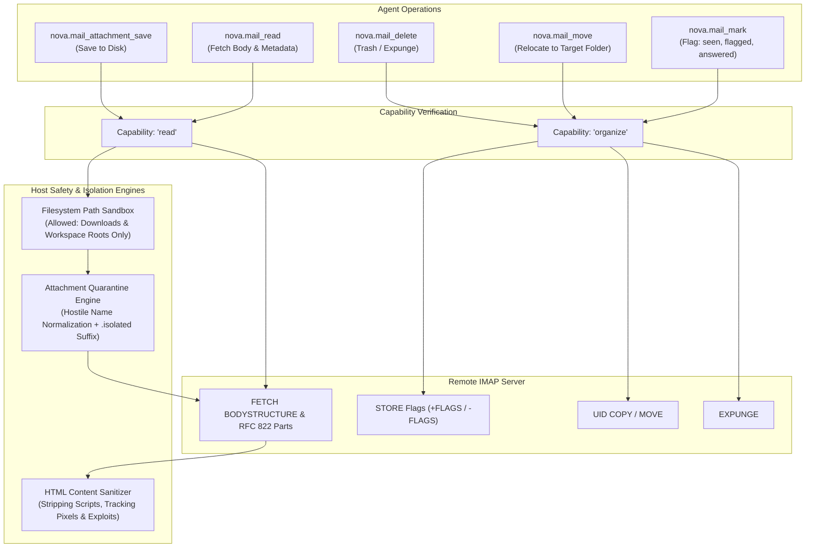

# Reading, Mailbox Organization & Attachment Safety

The message consumption and mailbox triage subsystem governs how autonomous agents inspect message bodies, organize mailboxes, and safely extract attachments. To prevent malicious email payloads from compromising the host system, Nova enforces strict HTML sanitization, filesystem sandboxing, and automated quarantine isolation for dangerous attachments.



---

## 1. Full Message Inspection (`nova.mail_read`)

`nova.mail_read` retrieves the complete RFC 822 / MIME payload of a specific message identified by its folder and UID.

### Content Processing & HTML Sanitization
* **Plain Text Projection:** If a plain-text alternative (`text/plain`) exists, Nova presents it directly.
* **HTML Sanitization:** For HTML-only messages (`text/html`), Nova strips executable scripts (`<script>`, `onload`, `javascript:` URIs) and dangerous styling before returning the payload to the agent.
* **Attachment Inventory:** Attachment descriptors list `attachmentIndex`, `fileName`, `contentType`, and `sizeBytes` without downloading binary payloads, allowing agents to inspect file metadata before saving.

### Request & Response Schema
```json
// nova.mail_read
{
  "profileId": "conn_mail_work",
  "folder": "INBOX",
  "uid": 14205
}
```

```json
{
  "content": [
    {
      "type": "text",
      "text": "Message 14205 retrieved successfully."
    }
  ],
  "structuredContent": {
    "profileId": "conn_mail_work",
    "folder": "INBOX",
    "uid": 14205,
    "messageId": "<stmt-2026-10-05@partner.com>",
    "from": "Billing Dept <invoices@partner.com>",
    "to": ["accounting@company.com"],
    "cc": [],
    "subject": "Monthly Statement - October 2026",
    "date": "2026-10-05T08:14:00Z",
    "flags": ["seen"],
    "bodyText": "Dear Customer,\n\nPlease find attached your monthly statement for October 2026.\n\nBest regards,\nBilling Department",
    "bodyHtml": "<p>Dear Customer,<br><br>Please find attached your monthly statement for October 2026.<br><br>Best regards,<br>Billing Department</p>",
    "attachments": [
      {
        "attachmentIndex": 0,
        "fileName": "Statement_October_2026.pdf",
        "contentType": "application/pdf",
        "sizeBytes": 42100
      }
    ]
  }
}
```

---

## 2. Mailbox Organization & Flag Triage (`nova.mail_mark`)

Agents categorize and triage processed messages using `nova.mail_mark` to modify standard IMAP system flags:

| Flag Argument | IMAP System Flag | Operational Significance |
| :--- | :--- | :--- |
| `seen` | `\Seen` | Marks whether a message has been read. Passing `seen: true` clears the unread indicator; `seen: false` marks it unread. |
| `flagged` | `\Flagged` | Highlights or stars a message for human escalation or high-priority follow-up. |
| `answered` | `\Answered` | Indicates an automated or manual reply has been dispatched for this message. |

```json
// nova.mail_mark
{
  "profileId": "conn_mail_work",
  "folder": "INBOX",
  "uid": 14205,
  "seen": true,
  "flagged": true
}
```

---

## 3. Folder Relocation (`nova.mail_move`)

Once an email has been processed (e.g. an invoice filed or a ticket logged), agents can relocate it out of `INBOX` into an archive folder:

```json
// nova.mail_move
{
  "profileId": "conn_mail_work",
  "folder": "INBOX",
  "uid": 14205,
  "targetFolder": "Archive/2026"
}
```

* **Atomic IMAP Move:** On modern servers supporting RFC 6851 (`MOVE`), Nova executes an atomic transfer. On legacy servers, Nova falls back to `UID COPY` followed by `STORE +FLAGS \Deleted` and `EXPUNGE`.
* **Cross-Folder Integrity:** The operation fails if the destination folder does not exist or if the target account lacks write access.

---

## 4. Deletion & Trash Semantics (`nova.mail_delete`)

Removing unwanted or processed emails is governed by `nova.mail_delete`:

```json
// nova.mail_delete
{
  "profileId": "conn_mail_work",
  "folder": "INBOX",
  "uid": 14205,
  "permanent": false
}
```

* **Standard Soft Deletion (`permanent: false`):** Automatically locates the server's designated trash folder (annotated with attribute `\Trash` or named `"Trash"` / `"Deleted Items"`) and relocates the message there.
* **Permanent Purge (`permanent: true`):** Flags the message with `\Deleted` and executes RFC 3501 `EXPUNGE` on the folder, permanently removing the message from the IMAP store.

---

## 5. Attachment Extraction & Security Quarantine (`nova.mail_attachment_save`)

Autonomous file downloads from untrusted email senders present severe security risks (malware, phishing attachments, Trojan scripts). Nova implements a **multi-stage defense-in-depth isolation pipeline** inside `nova.mail_attachment_save`:

```mermaid
flowchart TD
    Request["nova.mail_attachment_save\n(folder, uid, attachmentIndex, localPath)"] --> SandboxCheck{"Filesystem Sandbox Check\nIs localPath within Downloads or Workspace?"}
    
    SandboxCheck -- "No (Path Escapes Sandbox)" --> RejectSandbox["Abort: Error -32602\n(local_path_outside_sandbox)"]
    SandboxCheck -- "Yes (Sandboxed)" --> NameSanitizer["MIME Filename Sanitization\n- Strip ../ traversal & null bytes\n- Normalize Windows reserved chars (: * ? \" < > |)\n- Max 255 chars, preserve surrogate pairs"]
    
    NameSanitizer --> ThreatCheck{"Threat Evaluation\nIs extension executable/script-like?\n(.exe, .dll, .bat, .cmd, .ps1, .vbs, .js, .hta, .msi, etc.)"}
    
    ThreatCheck -- "Dangerous File Type" --> Quarantine["Apply Quarantine Isolation\nAppend '.isolated' suffix\n(e.g. invoice.pdf.exe.isolated)"]
    ThreatCheck -- "Safe Document / Data" --> CollisionCheck["Check Destination Collision"]
    
    Quarantine --> CollisionCheck
    CollisionCheck --> WriteFile["Stream Attachment to Disk\nCommit Verified File"]
```

### 1. Filesystem Path Sandboxing
The destination `localPath` is strictly validated. Agents can only write attachments into:
1. The user's operating system **Downloads folder** (`StoragePaths.DownloadsDir`).
2. The active **Workspace directory** associated with the current session.
Any attempt to target system directories (`C:\Windows`, `C:\Program Files`, `%APPDATA%`, or root drives) is blocked immediately.

### 2. Hostile Filename Sanitization
MIME attachment headers frequently contain malicious path traversal attacks (e.g. `../../../../Windows/system32/cmd.exe`) or Windows reserved character bugs. Nova sanitizes names via `MailAttachmentFilePolicy`:
* Strips all directory separators and path traversal components.
* Normalizes Unicode characters and preserves multi-byte UTF-16 surrogate pairs.
* Replaces invalid Windows filesystem characters (`:`, `*`, `?`, `"`, `<`, `>`, `|`) with safe underscores.
* Enforces a 255-character maximum filename ceiling (`MaxWindowsFileNameChars`).
* Resolves duplicate destination collisions by generating indexed candidates (`file (2).pdf`, `file (3).pdf`).

### 3. Automated Quarantine Suffix (`.isolated`)
If an attachment carries an executable or script extension—including `.exe`, `.dll`, `.bat`, `.cmd`, `.ps1`, `.vbs`, `.js`, `.hta`, `.msi`, `.scr`, `.com`, or double-extension spoofing (e.g. `invoice.pdf.exe`)—Nova automatically appends the **`.isolated`** extension.
* **Neutralizing Windows File Associations:** In Windows, double-clicking `invoice.pdf.exe` executes the malicious binary. Renaming it to `invoice.pdf.exe.isolated` breaks the Windows shell executable association, rendering the file completely harmless to accidental clicks.
* **Agent Transparency:** The tool result returns `sanitizedFileName` and `isolated: true`, explicitly alerting the agent that the file was quarantined.

### Extraction Example
```json
// nova.mail_attachment_save
{
  "profileId": "conn_mail_work",
  "folder": "INBOX",
  "uid": 14205,
  "attachmentIndex": 0,
  "localPath": "C:\\Users\\Operator\\Downloads\\Statement_October_2026.pdf"
}
```

```json
{
  "content": [
    {
      "type": "text",
      "text": "Attachment saved to C:\\Users\\Operator\\Downloads\\Statement_October_2026.pdf"
    }
  ],
  "structuredContent": {
    "profileId": "conn_mail_work",
    "folder": "INBOX",
    "uid": 14205,
    "attachmentIndex": 0,
    "originalFileName": "Statement_October_2026.pdf",
    "savedPath": "C:\\Users\\Operator\\Downloads\\Statement_October_2026.pdf",
    "sizeBytes": 42100,
    "isolated": false
  }
}
```

---

## 6. Practical Agent Recipes

### Recipe 1: Safe Attachment Processing Pipeline
```json
// Step 1: Read message and inspect attachments
// nova.mail_read
{
  "profileId": "conn_mail_work",
  "folder": "INBOX",
  "uid": 14205
}

// Step 2: Download attachment to Downloads folder
// nova.mail_attachment_save
{
  "profileId": "conn_mail_work",
  "folder": "INBOX",
  "uid": 14205,
  "attachmentIndex": 0,
  "localPath": "C:\\Users\\Operator\\Downloads"
}

// Step 3: Mark as read and move to Archive folder
// nova.mail_mark
{
  "profileId": "conn_mail_work",
  "folder": "INBOX",
  "uid": 14205,
  "seen": true
}

// Step 4: Relocate message
// nova.mail_move
{
  "profileId": "conn_mail_work",
  "folder": "INBOX",
  "uid": 14205,
  "targetFolder": "Archive"
}
```

---

## 7. Related Tools & Documentation

* [`nova.mail_read` Tool Reference](../../../../mcp-reference/tools/connectors-and-mail/nova-mail-read.md)
* [`nova.mail_attachment_save` Tool Reference](../../../../mcp-reference/tools/connectors-and-mail/nova-mail-attachment-save.md)
* [`nova.mail_mark` Tool Reference](../../../../mcp-reference/tools/connectors-and-mail/nova-mail-mark.md)
* [`nova.mail_move` Tool Reference](../../../../mcp-reference/tools/connectors-and-mail/nova-mail-move.md)
* [`nova.mail_delete` Tool Reference](../../../../mcp-reference/tools/connectors-and-mail/nova-mail-delete.md)
* [Mailbox Navigation, Pagination & Search](../mailbox-navigation-and-search/README.md)
* [Composition, Outbound Delivery & Rate Limits](../composition-sending-and-rate-limits/README.md)
* [Mail Architecture Overview](../README.md)
