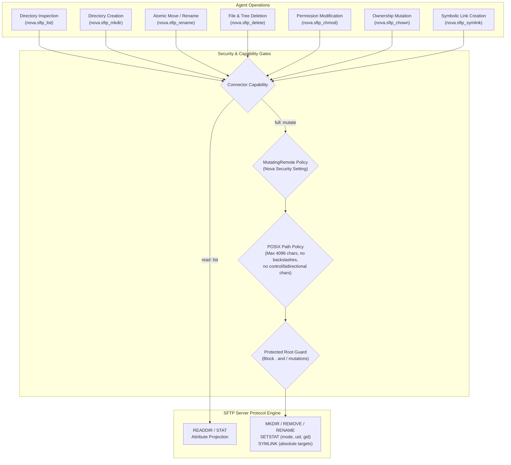
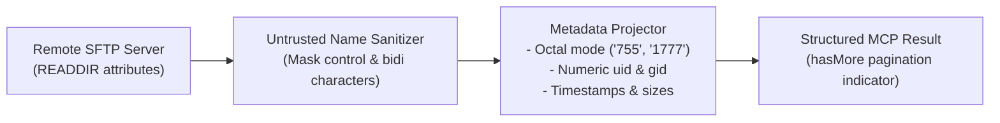
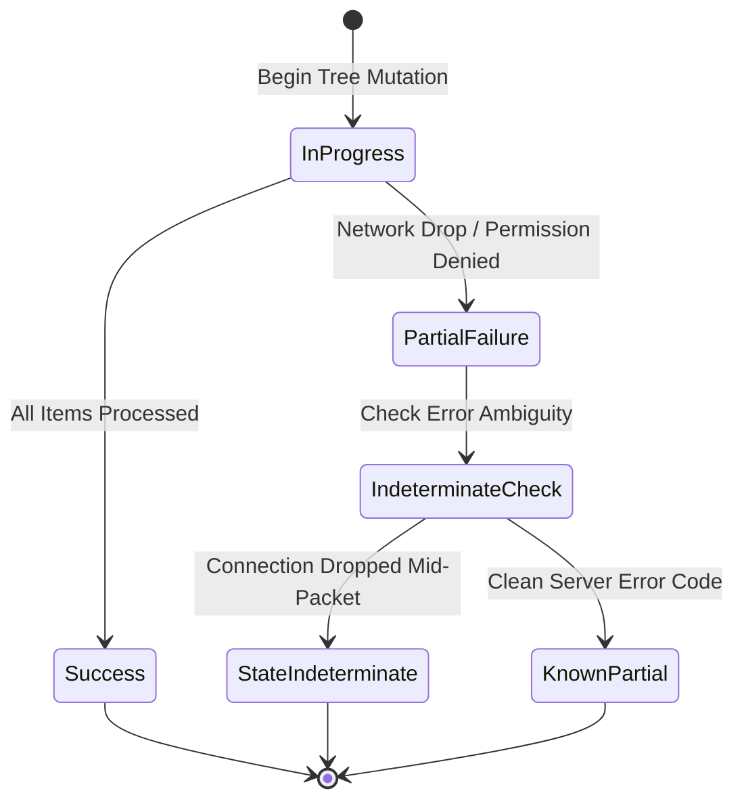

# SFTP Directory Inspection & Filesystem Mutations

Nova AI Workspace equips AI agents with comprehensive remote filesystem manipulation capabilities over SFTP. These include structured directory inspection, atomic file renaming, recursive directory management, symbolic link creation, and POSIX permission/ownership modification. Every operation is strictly governed by capability levels, execution policies, path validation rules, and symlink escape guards.



---

## 1. Capability Boundaries & Execution Policy

Remote filesystem operations are divided between two capability levels and protected by Nova's independent execution policy:

| Capability | Scope | Operations |
| :--- | :--- | :--- |
| **`read`** | Inspection only | Directory querying and metadata inspection (`nova.sftp_list`). |
| **`full`** | Filesystem mutation | Creating directories (`nova.sftp_mkdir`), renaming (`nova.sftp_rename`), deleting (`nova.sftp_delete`), changing permissions (`nova.sftp_chmod`), changing ownership (`nova.sftp_chown`), and creating symlinks (`nova.sftp_symlink`). |

> [!CRITICAL]
> **MutatingRemote Policy Invariant:** All mutating operations require the connector's capability level to be set to `full` **and** satisfy Nova's `MutatingRemote` execution policy. If the user has disabled remote mutations in Nova Settings, mutation requests fail closed with error code `-32005` (`connector_access_disabled`).

---

## 2. Directory Inspection & Metadata Projection (`nova.sftp_list`)

The `nova.sftp_list` tool queries remote directories or individual files, returning rich POSIX metadata:



### Key Inspection Behaviors

1. **POSIX Permissions Projection:** Permissions are projected as octal strings (e.g. `"644"`, `"755"`, or `"1777"` when setuid, setgid, or sticky bits are present). This enables agents to follow the **see-then-set** operational pattern: read the current mode via `nova.sftp_list` before modifying permissions via `nova.sftp_chmod`.
2. **Numeric Ownership:** Because the SFTP protocol carries numeric identifiers rather than usernames, `uid` and `gid` are represented as integers.
3. **Untrusted Filename Masking:** Remote filenames are treated as untrusted metadata. Names containing ASCII control characters or Unicode bidirectional overrides (which could disguise extensions or deceive terminal emulators) are returned with `unsafeName: true` and their raw names omitted.
4. **Result Bounds & Pagination:** Listings are bounded by `maxEntries` (1 to 1000, default 200). When a directory contains more entries than requested, `hasMore: true` indicates truncation.
5. **Symlink Traversal Prohibition:** Listing directly through a symbolic link root is rejected with `remote_symlink_rejected` to prevent directory traversal escapes.

---

## 3. Remote Filesystem Mutations

### Directory Creation (`nova.sftp_mkdir`)
* **Recursive Parent Creation:** When `recursive: true` is set, Nova automatically creates any missing parent directories (analogous to `mkdir -p`).
* **Idempotent No-Op:** If the target directory already exists, the call returns `status: "exists"` and `changed: false` without failing.
* **Permission Application:** The optional `mode` parameter (e.g. `"755"`) is applied **only** to newly created directories. It is never applied retroactively to pre-existing directories (which requires an explicit `nova.sftp_chmod`).

### Atomic Move & Rename (`nova.sftp_rename`)
* **Atomic Replacement Guard:** If the destination path already exists, Nova rejects the operation with `destination_exists` unless `overwrite: true` is explicitly specified.
* **Directory Replacement Prohibition:** Renaming a file over an existing directory is strictly rejected, regardless of the `overwrite` setting.
* **No-Op Detection:** If `remotePath` and `destinationRemotePath` are identical, the tool completes immediately with `status: "noop"` and `changed: false`.

### Deletion & Blast-Radius Ceilings (`nova.sftp_delete`)
* **Single Items vs. Trees:** A single file or empty directory can be deleted directly. Deleting a non-empty directory requires `recursive: true`.
* **Blast-Radius Ceilings:** To prevent accidental destruction of massive file hierarchies, recursive deletions enforce caller limits:
  * `maxFiles`: Maximum count of files allowed to be deleted in a single call.
  * `maxBytes`: Maximum aggregate size of files permitted to be deleted.
* **Symlink and Device Rejection:** If a tree contains symbolic links, sockets, named pipes, or device nodes, the entire deletion operation aborts before deleting files to avoid unintended external destruction.

### Symbolic Links (`nova.sftp_symlink`)
* **Absolute Target Requirement:** The `targetPath` parameter **must** be an absolute path starting with `/`. Under SSH.NET, relative link targets are resolved against the user's connection home directory rather than the directory containing the link, causing silent misplacement. Nova rejects relative targets with `invalid_symlink_target`.
* **Dangling Links Permitted:** The remote target path does not need to exist at creation time; dangling symbolic links are permitted.
* **No Overwrite:** If a file or directory already exists at `remotePath`, the operation aborts with `destination_exists`.

### Permissions & Ownership (`nova.sftp_chmod`, `nova.sftp_chown`)
* **Octal Chmod Mode:** `nova.sftp_chmod` accepts standard octal strings (e.g. `"644"`, `"755"`).
* **Symlink Protection:** In standard SFTP `SETSTAT`, commands follow symlinks on the remote server. To prevent accidental modification of target files outside the intended scope, Nova rejects `chmod` and `chown` on symbolic link nodes.
* **Partial Chown Updates:** In `nova.sftp_chown`, passing only `uid` or only `gid` modifies the specified identity while preserving the current value of the unspecified identity.

---

## 4. Protected Root & Working Directories

To prevent destructive accidents or lockouts, Nova enforces a strict protected root invariant:

> [!WARNING]
> **Protected Roots:** Modifying, renaming, changing permissions, or deleting the remote working/root directory (`.` or `/`) is rejected outright with reason code `protected_remote_root`.

---

## 5. Partial Mutations & Indeterminate State Tracking

When executing recursive operations across network connections, network drops or permission errors can occur after some files have been mutated:



* **`affectedRemotePaths`:** In the event of a partial failure, Nova returns an array of every path that was successfully altered prior to the error.
* **`stateIndeterminate`:** If a connection drops while a mutating request packet is in flight, Nova flags `stateIndeterminate: true`, notifying the agent that the server may or may not have committed the final mutation.

---

## 6. MCP Protocol Examples

### Querying Directory Attributes (`nova.sftp_list`)

```json
{
  "name": "nova.sftp_list",
  "arguments": {
    "profileId": "conn-sftp-prod",
    "remotePath": "/var/www/app",
    "maxEntries": 50
  }
}
```

#### Structured Response

```json
{
  "ok": true,
  "status": "listed",
  "entries": [
    {
      "name": "config.json",
      "remotePath": "/var/www/app/config.json",
      "isDirectory": false,
      "isRegularFile": true,
      "isSymbolicLink": false,
      "size": 2048,
      "lastWriteUtc": "2026-10-15T14:30:00Z",
      "unsafeName": false,
      "mode": "640",
      "uid": 1001,
      "gid": 1001
    },
    {
      "name": "public",
      "remotePath": "/var/www/app/public",
      "isDirectory": true,
      "isRegularFile": false,
      "isSymbolicLink": false,
      "size": 4096,
      "lastWriteUtc": "2026-10-16T09:12:00Z",
      "unsafeName": false,
      "mode": "755",
      "uid": 1001,
      "gid": 1001
    }
  ],
  "hasMore": false
}
```

---

### Creating Directories with Permissions (`nova.sftp_mkdir`)

```json
{
  "name": "nova.sftp_mkdir",
  "arguments": {
    "profileId": "conn-sftp-prod",
    "remotePath": "/var/www/app/storage/logs",
    "recursive": true,
    "mode": "750"
  }
}
```

#### Structured Response

```json
{
  "ok": true,
  "status": "created",
  "changed": true,
  "affectedRemotePaths": [
    "/var/www/app/storage",
    "/var/www/app/storage/logs"
  ]
}
```

---

### Modifying File Permissions (`nova.sftp_chmod`)

```json
{
  "name": "nova.sftp_chmod",
  "arguments": {
    "profileId": "conn-sftp-prod",
    "remotePath": "/var/www/app/config.json",
    "mode": "600"
  }
}
```

#### Structured Response

```json
{
  "ok": true,
  "status": "permissions_changed",
  "changed": true,
  "affectedRemotePaths": [
    "/var/www/app/config.json"
  ]
}
```

---

### Creating an Absolute Symbolic Link (`nova.sftp_symlink`)

```json
{
  "name": "nova.sftp_symlink",
  "arguments": {
    "profileId": "conn-sftp-prod",
    "remotePath": "/var/www/app/current_logs",
    "targetPath": "/var/log/application/active.log"
  }
}
```

#### Structured Response

```json
{
  "ok": true,
  "status": "created",
  "changed": true,
  "affectedRemotePaths": [
    "/var/www/app/current_logs"
  ]
}
```

---

## 7. Operational Best Practices

> [!TIP]
> **Use See-Then-Set for Permissions:** Before modifying file modes with `nova.sftp_chmod` or ownership with `nova.sftp_chown`, call `nova.sftp_list` to inspect current attributes.

> [!IMPORTANT]
> **Absolute Paths for Symlinks:** Always pass fully qualified paths starting with `/` in `targetPath`. Relative paths are rejected to prevent target redirection.

> [!CAUTION]
> **Recursive Tree Deletions:** Always specify reasonable `maxFiles` and `maxBytes` limits when executing `nova.sftp_delete` with `recursive: true` to prevent accidental deletion of large hierarchies.

---

## Related Documentation

* [SFTP Resumable Engine & Acceleration](../resumable-engine-and-acceleration/README.md)
* [SFTP Connector Architecture Hub](../README.md)
* [SSH Remote Execution & Terminals](../../ssh/README.md)
* [Tool: `nova.sftp_list`](../../../../mcp-reference/tools/connectors-and-mail/nova-sftp-list.md)
* [Tool: `nova.sftp_mkdir`](../../../../mcp-reference/tools/connectors-and-mail/nova-sftp-mkdir.md)
* [Tool: `nova.sftp_rename`](../../../../mcp-reference/tools/connectors-and-mail/nova-sftp-rename.md)
* [Tool: `nova.sftp_delete`](../../../../mcp-reference/tools/connectors-and-mail/nova-sftp-delete.md)
* [Tool: `nova.sftp_symlink`](../../../../mcp-reference/tools/connectors-and-mail/nova-sftp-symlink.md)
* [Tool: `nova.sftp_chmod`](../../../../mcp-reference/tools/connectors-and-mail/nova-sftp-chmod.md)
* [Tool: `nova.sftp_chown`](../../../../mcp-reference/tools/connectors-and-mail/nova-sftp-chown.md)
