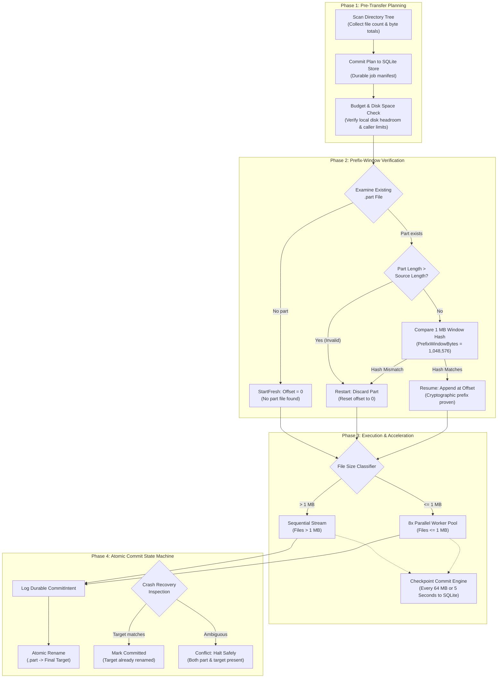
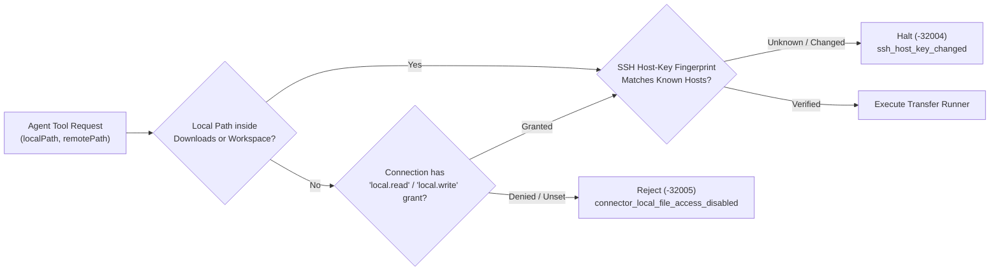

# SFTP Resumable Engine & Parallel Acceleration

Nova AI Workspace provides an industrial-grade, protocol-neutral transfer runner for SFTP file transfers. Designed to transfer individual multi-gigabyte archives or complex directory trees containing tens of thousands of files across unstable WAN links, the engine operates as a durable four-phase state machine. It prevents partial-file corruption, accelerates small-file workloads through 8x parallel pipelining, and guarantees byte integrity through cryptographic prefix verification.



---

## 1. The 4-Phase Resumable State Machine

Traditional file transfer implementations suffer from three major vulnerabilities:
1. **Blind Byte Appending:** If a network connection drops and reconnects, appending data based solely on partial file length causes silent corruption if the remote file was replaced or modified during the outage.
2. **High-Latency Round Trips:** Moving directories with thousands of small files sequentially stalls on SSH round-trip handshakes (stat, open, read, close, setstat).
3. **Partial File Ambiguity:** When an application crashes during a transfer, partially written files left in the target directory are easily mistaken for complete files by downstream tasks.

Nova eliminates these failure modes using an isolated four-phase pipeline managed by `ConnectorTransferRunner`:

### Phase 1: Pre-Transfer Planning (`ScanIfNeeded`)
Before reading or writing any file payload:
* **Recursive Manifest:** The runner scans the source directory (`recursive=true`) and records an immutable manifest of all entries, file sizes, and destination paths into Nova's local SQLite transfer store (`ConnectorTransferStore`).
* **Disk Space & Budget Verification:** The runner validates available destination storage (`CheckBudgetAndSpace`). If the target disk lacks sufficient space, or if the manifest exceeds caller-specified limits (`maxFiles` or `maxBytes`), the transfer fails immediately without writing partial files to disk.

### Phase 2: Prefix-Window Cryptographic Verification (`VerifyPrefix`)
When resuming an interrupted transfer with an existing `.part` file:
* **The Prefix Invariant:** Nova **never** appends bytes to an existing partial file until it has cryptographically proven that the existing partial data is a bit-exact prefix of the source file.
* **Length Validation:** If the local `.part` file is longer than the source file, it cannot be a prefix. The runner triggers `Restart`, purging the invalid `.part` file and resetting the offset to 0.
* **1 MB Window Hash Comparison:** For partial files with lengths less than or equal to the source, the runner reads a 1 MB verification window (`PrefixWindowBytes = 1,048,576`) immediately preceding the recorded offset.
* **Match vs. Mismatch:** It computes the cryptographic hash of this window from both the `.part` file and the remote source file:
  * **Hash Match:** The outcome is `Resume`. Transfer resumes appending at the exact recorded offset.
  * **Hash Mismatch:** The outcome is `Restart`. The corrupted partial file is discarded, and streaming restarts from offset 0.

### Phase 3: Small-File Parallel Acceleration
Transferring source trees, configuration repositories, or documentation directories containing thousands of small files is bottlenecked by round-trip latency rather than bandwidth.
* **Sequential Large Files:** Files larger than 1 MB stream sequentially to maximize single-stream throughput.
* **Parallel Small-File Pool:** Files $\le 1\text{ MB}$ execute concurrently across an internal pool of up to **8 parallel workers** on the shared SSH connection (`ParallelFiles = 8`).
* **Automatic Concurrency Fallback:** If a remote server (such as an embedded device or constrained NAS) rejects concurrent handles, Nova transparently falls back to serial execution (`_serialOnly`, `_serverLimited`) while preserving all progress.

### Phase 4: Atomic Commit State Machine
To guarantee that incomplete downloads or uploads are never consumed as valid files:
* Data streams into a dedicated staging file (`<filename>.part`).
* **Optional Remote SHA-256 Verification (`verifySha256`):** When `verifySha256=true` is requested on `nova.sftp_get` or `nova.sftp_put`, Nova verifies the completed file against `sha256sum` executed on the remote server over a second SSH channel on the same connection before initiating the rename. If hashes disagree, the partial file is purged and the transfer reports `checksum_mismatch`.
* Once payload transfer and size verification succeed, Nova writes a durable `CommitIntent` to SQLite before initiating the filesystem rename.
* **Post-Crash Recovery Rules:**
  * **`RenameAgain`:** The `.part` file is intact and the destination path is free. The engine performs the atomic rename.
  * **`MarkCommitted`:** The rename succeeded immediately before a crash. The target file exists with matching size; the entry is marked `Committed`.
  * **`Conflict`:** Both the `.part` file and the target file exist simultaneously following an ambiguous crash. The runner halts execution and reports an explicit conflict rather than overwriting data blindly.
  * **`ExternalMutation`:** The file was previously marked committed, but the target was modified or removed by an external process.

---

## 2. Checkpoint Cadence & Crash Recovery

Transfer state is continuously committed to a SQLite database residing in Nova's protected profile storage:

| Metric | Threshold | Invariant |
| :--- | :--- | :--- |
| **Volume Cadence** | Every **64 MB** (`CheckpointBytes`) | Byte offsets and SHA-256 running states are flushed to disk. |
| **Time Cadence** | Every **5 seconds** (`CheckpointInterval`) | Guarantees progress persistence even on low-bandwidth connections. |
| **Network Retry** | Up to **5 automatic retries** | Exponential backoff with jitter on dropped sockets or transient disconnects. |
| **Host-Key Re-Verification** | Every reconnect | Every new socket connection re-evaluates the human-approved host-key fingerprint. |
| **Startup Continuity** | ~30 seconds after start | Interrupted transfers resume automatically under original workspace and sandbox scope when connection permissions allow unattended execution. |

If Nova is closed, the host machine restarts, or the remote server disconnects during a multi-gigabyte transfer, re-invoking the original command attaches to the existing job and resumes immediately from the latest validated checkpoint. Unattended transfers continue automatically after browser startup.

---

## 3. Filesystem Sandboxing & Security Gates

Local file paths for SFTP downloads and uploads are rigorously bounded by Nova's path security policies:



1. **Default Sandbox:** By default, `localPath` must reside inside the user's `Downloads` folder or the active workspace root (`LocalRoots`).
2. **Local Grant Escalation:** Paths outside these folders require an explicit `local.read` (for uploads) or `local.write` (for downloads) grant configured on the connector profile. If local file access is disabled in Nova Settings, the request fails closed with error code `-32005` (`connector_local_file_access_disabled`).
3. **Host-Key Verification:** Nova checks the remote server's SSH public host key before authentication. Untrusted host keys require interactive user confirmation in Nova Settings; altered keys abort with `ssh_host_key_changed`. Agents cannot approve or bypass host keys.

---

## 4. MCP Protocol & Workflow Examples

### Starting a Resumable Download (`nova.sftp_get`)

Initiating a download creates a background transfer job. If the transfer does not complete within the `wait` window (default: 60 seconds), Nova returns the `jobId` and current progress while the transfer continues in the background:

```json
{
  "name": "nova.sftp_get",
  "arguments": {
    "profileId": "conn-sftp-prod",
    "remotePath": "/data/exports/analytics_2026.parquet",
    "localPath": "C:\\Users\\Operator\\Downloads\\analytics_2026.parquet",
    "wait": 10
  }
}
```

#### Structured Response (Running Background Job)

```json
{
  "ok": true,
  "jobId": "tr_8a7d6e5c4b3a2f1098765432",
  "attempt": 1,
  "operation": "sftp_get",
  "profileId": "conn-sftp-prod",
  "state": "transferring",
  "terminal": false,
  "running": true,
  "resumed": false,
  "resumable": true,
  "progress": {
    "phase": "transferring",
    "bytesCompleted": 4294967296,
    "bytesTotal": 10737418240,
    "filesCompleted": 0,
    "filesTotal": 1,
    "currentFile": "analytics_2026.parquet",
    "currentFileBytes": 4294967296,
    "currentFileTotal": 10737418240,
    "rateBytesPerSecond": 52428800,
    "etaSeconds": 122,
    "parallelTransfers": "off"
  },
  "verification": {
    "requested": "size",
    "performed": "size",
    "result": null
  },
  "remotePath": "/data/exports/analytics_2026.parquet",
  "localPath": "C:\\Users\\Operator\\Downloads\\analytics_2026.parquet",
  "suggestedPollMs": 5000,
  "nextAction": "poll_sftp_transfer_status"
}
```

---

### Polling Progress (`nova.sftp_transfer_status`)

Agents track active or finished transfers by querying `nova.sftp_transfer_status` using either the specific `jobId` or the `profileId` (which lists the 20 most recent jobs):

```json
{
  "name": "nova.sftp_transfer_status",
  "arguments": {
    "jobId": "tr_8a7d6e5c4b3a2f1098765432"
  }
}
```

#### Structured Response (Completed Job)

```json
{
  "ok": true,
  "jobId": "tr_8a7d6e5c4b3a2f1098765432",
  "state": "completed",
  "terminal": true,
  "running": false,
  "resumed": false,
  "progress": {
    "phase": "completed",
    "bytesCompleted": 10737418240,
    "bytesTotal": 10737418240,
    "filesCompleted": 1,
    "filesTotal": 1,
    "rateBytesPerSecond": 49807360,
    "etaSeconds": 0
  },
  "verification": {
    "requested": "size",
    "performed": "size",
    "result": "passed"
  },
  "error": null
}
```

---

### Stopping and Resuming a Transfer

To cleanly pause a running job without losing transferred data:

```json
{
  "name": "nova.sftp_transfer_stop",
  "arguments": {
    "jobId": "tr_8a7d6e5c4b3a2f1098765432"
  }
}
```

* **Soft Stop Behavior:** The runner flushes the current checkpoint, preserves the `.part` file, records `Stopped` state, and disconnects cleanly.
* **Resuming:** To resume, repeat the **identical** `nova.sftp_get` or `nova.sftp_put` call. Changing any transfer argument (e.g. `localPath` or `remotePath`) creates a new transfer spec rather than resuming.

---

## 5. Operational Best Practices

> [!TIP]
> **Directory Trees:** Always specify `recursive: true` when transferring directories. For directory trees with many small files, the engine automatically activates 8x parallel pipelining.

> [!IMPORTANT]
> **Overwrite Guard:** By default, `overwrite: false` protects existing files. If a local destination already exists, the transfer aborts immediately with `destination_changed` before any network bytes are streamed.

> [!NOTE]
> **Accurate Throughput Measurement:** Transfer rates reported in `progress.rateBytesPerSecond` measure actual bytes transferred over the active wire, never jumped offsets from resumed checkpoints.

---

## Related Documentation

* [SFTP Directory Inspection & Filesystem Mutations](../directory-inspection-and-filesystem-mutations/README.md)
* [SFTP Connector Architecture Hub](../README.md)
* [SSH Remote Execution & Terminals](../../ssh/README.md)
* [Tool: `nova.sftp_get`](../../../../mcp-reference/tools/connectors-and-mail/nova-sftp-get.md)
* [Tool: `nova.sftp_put`](../../../../mcp-reference/tools/connectors-and-mail/nova-sftp-put.md)
* [Tool: `nova.sftp_transfer_status`](../../../../mcp-reference/tools/connectors-and-mail/nova-sftp-transfer-status.md)
* [Tool: `nova.sftp_transfer_stop`](../../../../mcp-reference/tools/connectors-and-mail/nova-sftp-transfer-stop.md)
