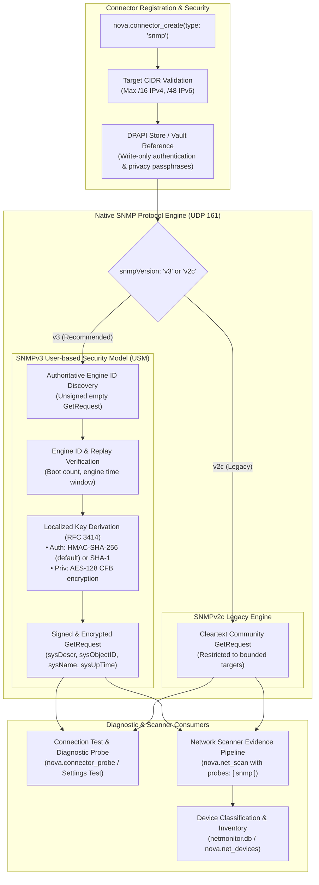

# SNMP Connectors: Hardware Telemetry & Management

Enterprise networks, campus backbones, and branch offices rely on Simple Network Management Protocol (SNMP) to query and monitor managed hardware: managed switches, core routers, network-attached storage (NAS), uninterruptible power supplies (UPS), hypervisors, and enterprise printers.

Nova AI Workspace provides native, security-bounded SNMP connectors ([`nova.connector_create`](../../../mcp-reference/tools/connectors-and-mail/nova-connector-create.md) with `type: "snmp"`). Unlike raw command-line tools that send unencrypted community strings across arbitrary subnets or execute broad recursive MIB walks, Nova's SNMP subsystem is engineered around **cryptographic zero-leakage, strict target CIDR bounding, and non-destructive single-OID inspection**.

---

## 1. High-Level Architecture & Protocol Engine

Nova supports both modern SNMPv3 and legacy SNMPv2c protocols, implemented natively in pure C# over UDP port 161:



---

## 2. SNMPv3: User-based Security Model (USM)

SNMPv3 (RFC 3414) provides robust cryptographic guarantees: message integrity, data origin authentication, and privacy (encryption). Nova implements SNMPv3 USM as the default and recommended configuration:

### 1. Cryptographic Security Levels (`snmpSecurityLevel`)
* **`authPriv` (Default & Recommended):** Requests and replies are authenticated (digitally signed) and encrypted using AES-128 CFB. Passwords, system names, and hardware descriptions are protected from eavesdropping on the network.
* **`authNoPriv`:** Requests and replies are signed for origin authentication, but payload data travels unencrypted.
* *Note:* Unauthenticated access (`noAuthNoPriv`) is explicitly disallowed in Nova to prevent unauthorized spoofing.

### 2. Supported Authentication & Privacy Algorithms
* **Authentication (`snmpAuthProtocol`):**
  * `sha256` (HMAC-SHA-256, default according to RFC 7860): Secure 256-bit hash.
  * `sha1` (HMAC-SHA-1): Maintained for compatibility with older network hardware. Deprecated MD5 is not offered.
* **Privacy / Encryption (`snmpPrivProtocol`):**
  * `aes128` (AES-128 CFB, default according to RFC 3826): Strong symmetric encryption. Insecure 56-bit DES is not offered.

### 3. Replay Protection & Engine ID Pinning
SNMPv3 protects against replay attacks by tracking each SNMP agent's `snmpEngineID`, `snmpEngineBoots`, and `snmpEngineTime`:
1. **Engine Discovery:** Nova first issues an unauthenticated empty probe to learn the remote device's `snmpEngineID`.
2. **Key Localization:** Passphrases are converted into localized cryptographic keys tied uniquely to that remote `snmpEngineID`. The user's raw passphrase never traverses the wire.
3. **Engine ID Pinning & Change Detection:** Once a signed answer is received from an IP address, Nova records and pins that device's `snmpEngineID`. If a device is replaced, reset, or hijacked such that another device answers at that IP address with a different engine ID, Nova **halts communication immediately** (`snmp_engine_id_changed`) rather than leaking signed requests to an untrusted agent.

---

## 3. SNMPv2c Community Support

For legacy enterprise printers, industrial environmental sensors, or basic switches that lack SNMPv3 capabilities, Nova supports SNMPv2c (`snmpVersion: "v2c"`):
* **Cleartext Protocol:** SNMPv2c relies on a shared "community string" (typically configured by network operators) sent in cleartext across the network.
* **Restricted Target Scope:** Because community strings can be sniffed on shared LAN segments, Nova strictly enforces target CIDR bounding. A community string configured for an office printer subnet is never transmitted to other subnets or external servers.

---

## 4. Strict Target CIDR Bounding (`NetSnmpTargets`)

Traditional network tools treat credentials as globally applicable. In contrast, Nova enforces **Target CIDR Bounding**:

```
+-----------------------------------------------------------------------------------+
| TARGET REQUIREMENT         | ENFORCEMENT RULES & SYSTEM INVARIANTS                |
+-----------------------------------------------------------------------------------+
| Mandatory Parameter        | targets is required on all SNMP connector profiles.  |
|                            | Must contain 1 to 64 explicit IP addresses or CIDRs. |
+----------------------------+------------------------------------------------------+
| Subnet Ceiling             | IPv4 subnets must be at least /16 (e.g. 10.0.0.0/16, |
|                            | 192.168.1.0/24). IPv6 subnets must be at least /48.  |
|                            | Broader prefixes (/8, /0) are rejected at creation.  |
+----------------------------+------------------------------------------------------+
| Hostnames Disallowed       | Hostnames are forbidden in targets. Because DNS      |
|                            | records can be altered, bounding must be pinned to   |
|                            | canonical IP address ranges.                         |
+----------------------------+------------------------------------------------------+
| Secret Detachment          | Changing a connector's targets automatically         |
|                            | detaches all stored credentials, requiring the       |
|                            | operator to re-authenticate the expanded target set. |
+-----------------------------------------------------------------------------------+
```

---

## 5. Non-Destructive Inspection & Scanner Integration

Nova's SNMP subsystem is intentionally read-only and non-destructive:
* **Single-OID GetRequest:** Nova executes only targeted `GetRequest` queries for standard MIB-II administrative OIDs:
  * `sysDescr` (`1.3.6.1.2.1.1.1.0`): Manufacturer, model, OS, and firmware version.
  * `sysObjectID` (`1.3.6.1.2.1.1.2.0`): Vendor enterprise SMI OID identifier.
  * `sysUpTime` (`1.3.6.1.2.1.1.3.0`): System uptime in hundredths of a second.
  * `sysName` (`1.3.6.1.2.1.1.5.0`): Fully qualified administrative node name.
* **No Recursive Walks or Set Operations:** Nova **never** executes SNMP `SetRequest` operations or broad recursive `GetBulk`/`GetNext` tree walks. It never modifies device configuration or floods embedded management controllers.
* **Network Scanner (`nova.net_scan`) Integration:**
  When `nova.net_scan` executes with `probes: ["snmp"]`, it checks whether discovered hosts fall within any configured SNMP connector's `targets`.
  * If a single connector matches, its credentials are used to query the device.
  * If multiple connectors overlap, the most specific subnet match wins.
  * Extracted facts (system name, model, hardware vendor) enrich the device profile in `netmonitor.db` with high diagnostic confidence ($\ge 0.95$).

---

## 6. Diagnostic Probe Failure Taxonomy

When testing SNMP connectors via Nova Settings or via `nova.connector_probe(profileId="...")`, Nova diagnoses specific failure reason codes:

| Failure Code | Underlying Root Cause & Guidance |
| :--- | :--- |
| **`snmp_unknown_user`** | The SNMPv3 agent responded, but does not recognize the specified `username`. |
| **`snmp_wrong_digest`** | The SNMPv3 agent rejected the packet signature: the authentication passphrase or `snmpAuthProtocol` (`sha256` vs. `sha1`) does not match the device. |
| **`snmp_decryption_error`** | The agent failed to decrypt the payload: the privacy passphrase does not match the device. |
| **`snmp_unsupported_security_level`** | The agent refused the user at `authPriv` or requires a different security level. |
| **`snmp_engine_id_changed`** | Another device answered at this address than during the previous scan. Signed requests are halted to prevent credential leakage. |
| **`snmp_not_in_time_window`** | The device's internal SNMP clock skew exceeds the acceptable replay window (typically $\pm 150$ seconds). |
| **`snmp_no_signed_answer`** | The device responded to engine discovery, but stayed silent on signed requests (many firewalls/printers drop invalid credentials silently). |
| **`snmp_targets_only_networks`** | The connector profile contains only subnets (e.g. `192.168.1.0/24`) without a single host IP to test against. |

---

## 7. MCP Protocol Examples

### Example 1: Creating an SNMPv3 USM Connector
```json
{
  "name": "nova.connector_create",
  "arguments": {
    "displayName": "Core Network Switches",
    "type": "snmp",
    "snmpVersion": "v3",
    "username": "netadmin",
    "password": "ask",
    "snmpSecurityLevel": "authPriv",
    "snmpAuthProtocol": "sha256",
    "snmpPrivProtocol": "aes128",
    "targets": [
      "10.0.1.0/24",
      "10.0.2.10"
    ],
    "note": "Cisco Catalyst and Aruba CX switches in MDF data center."
  }
}
```
*Passing `password: "ask"` instructs Nova to open an encrypted host dialog where the human operator types the authentication and privacy passphrases. Secrets are stored directly into Windows DPAPI without appearing in conversation logs.*

### Example 2: Creating an SNMPv2c Legacy Connector
```json
{
  "name": "nova.connector_create",
  "arguments": {
    "displayName": "Office Printers",
    "type": "snmp",
    "snmpVersion": "v2c",
    "password": "ask",
    "targets": [
      "192.168.10.0/24"
    ],
    "note": "Floor 2 and Floor 3 multifunction network printers."
  }
}
```

### Example 3: Running a Diagnostic Connection Probe
```json
{
  "name": "nova.connector_probe",
  "arguments": {
    "profileId": "conn_snmp_491a",
    "depth": "session"
  }
}
```

---

## 8. Related Documentation

* [Master Connectors Hub](../README.md): Overview of Mail, SSH, SFTP, FTP, External MCP, and SNMP connectors.
* [Network Discovery & Inventory Architecture](../../network/network-discovery-and-inventory/README.md): Automated subnet scanning using SNMP evidence.
* [Settings User Guide: Connectors](../../../user-guide/settings/connectors.md): Managing SNMP profiles, setting bounded targets, and testing hardware connectivity in the UI.
* [MCP Tool Reference: `nova.connector_create`](../../../mcp-reference/tools/connectors-and-mail/nova-connector-create.md): Detailed parameter schema.
* [MCP Tool Reference: `nova.connector_probe`](../../../mcp-reference/tools/connectors-and-mail/nova-connector-probe.md): Running diagnostic connection probes.
