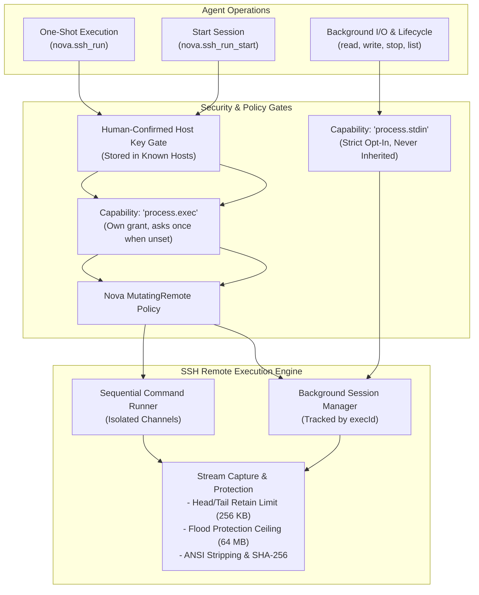
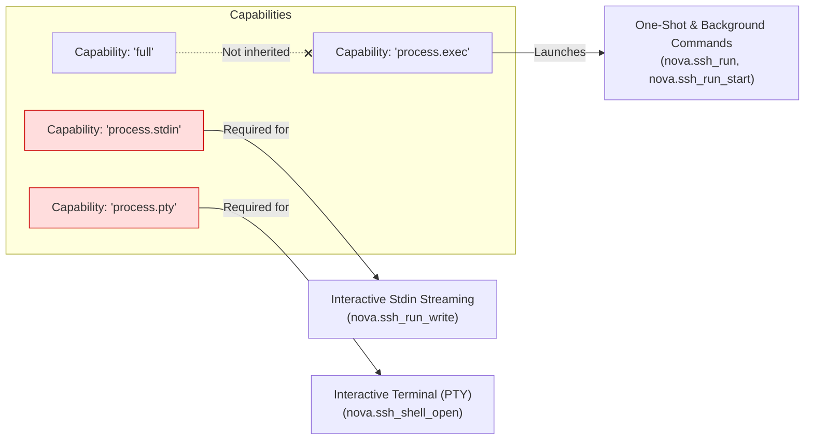
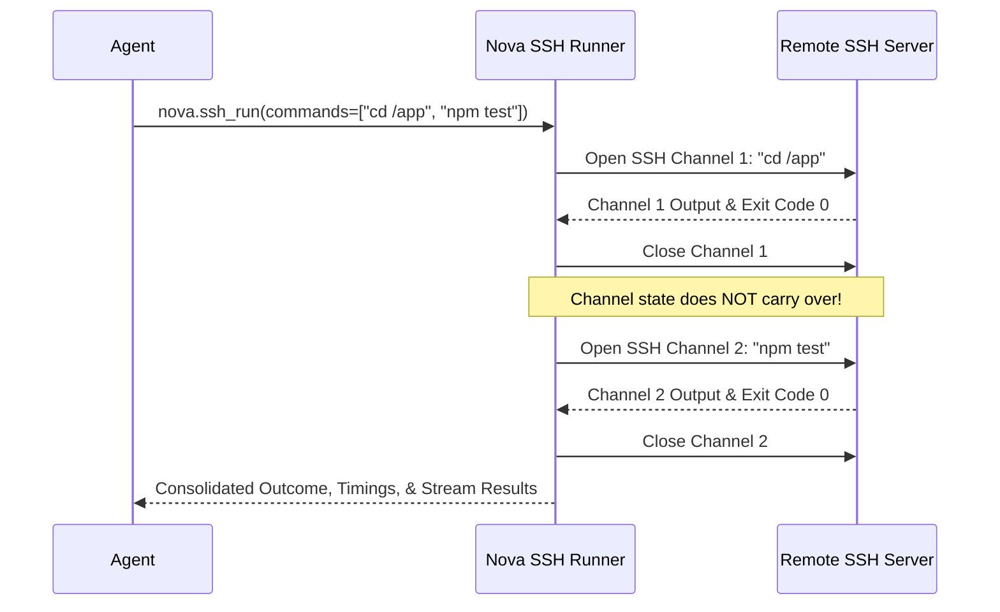
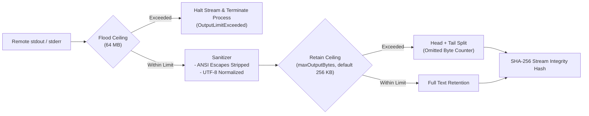
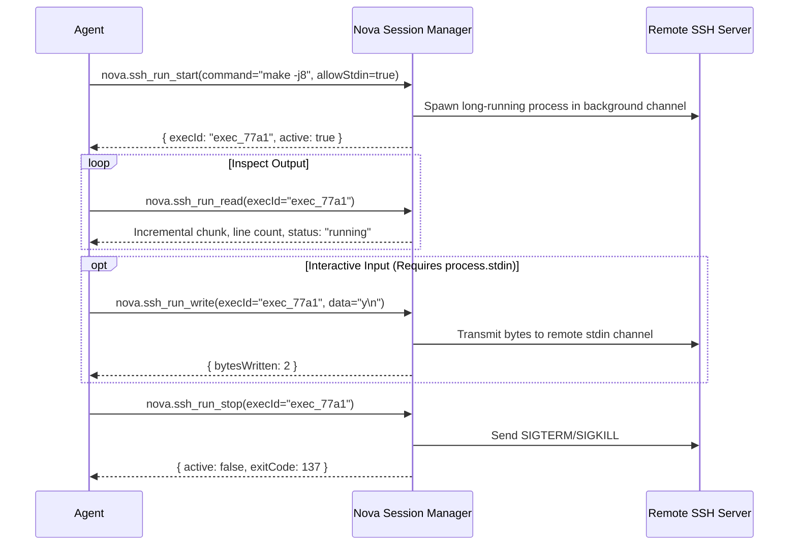
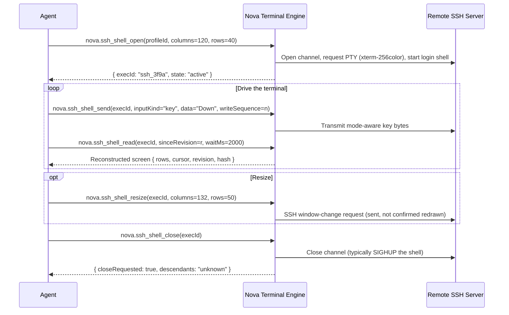

# Secure Shell (SSH) Execution Architecture

Nova provides a robust remote command execution engine over SSH-2 (RFC 4251–4254). It allows autonomous agents to run diagnostics, execute build and deployment pipelines, manage background processes, and stream interactive input into remote processes while maintaining strict process isolation, host-key verification, output flood protection, and empirical termination accounting.

---

## Dedicated Subsystem Architecture Guides

For in-depth protocol mechanics, capability verification, buffering constraints, error codes, and step-by-step agent recipes, explore the specialized SSH architecture guides:

| Architecture Guide | Scope & Focus | Primary Tools |
| :--- | :--- | :--- |
| **[SSH Command Execution & Channel Isolation](command-execution-and-channels/README.md)** | One-shot execution, sequential command batches, channel state independence, exit code accounting, flood protection (64 MB ceiling), and idempotency keys (`operationId`). | [`nova.ssh_run`](../../../mcp-reference/tools/connectors-and-mail/nova-ssh-run.md) |
| **[Background SSH Sessions & Streaming I/O](background-sessions-and-streaming/README.md)** | Long-running process lifecycle, offset-based stdout/stderr streaming cursors, `waitForEndSeconds` zero-polling, interactive stdin injection, and the strict `process.stdin` capability gate. | [`nova.ssh_run_start`](../../../mcp-reference/tools/connectors-and-mail/nova-ssh-run-start.md), [`nova.ssh_run_read`](../../../mcp-reference/tools/connectors-and-mail/nova-ssh-run-read.md), [`nova.ssh_run_write`](../../../mcp-reference/tools/connectors-and-mail/nova-ssh-run-write.md), [`nova.ssh_run_stop`](../../../mcp-reference/tools/connectors-and-mail/nova-ssh-run-stop.md), [`nova.ssh_run_list`](../../../mcp-reference/tools/connectors-and-mail/nova-ssh-run-list.md) |
| **[Interactive PTY Terminals & Screen Reconstruction](interactive-pty-terminals/README.md)** | True pseudo-terminal (PTY) emulation for TUI applications (`htop`, `vim`), 2D virtual screen reconstruction, cursor coordinate tracking, mode-aware key dispatch, dynamic window resizing (SIGWINCH), and live visual operator viewing. | [`nova.ssh_shell_open`](../../../mcp-reference/tools/connectors-and-mail/nova-ssh-shell-open.md), [`nova.ssh_shell_read`](../../../mcp-reference/tools/connectors-and-mail/nova-ssh-shell-read.md), [`nova.ssh_shell_send`](../../../mcp-reference/tools/connectors-and-mail/nova-ssh-shell-send.md), [`nova.ssh_shell_resize`](../../../mcp-reference/tools/connectors-and-mail/nova-ssh-shell-resize.md), [`nova.ssh_shell_watch`](../../../mcp-reference/tools/connectors-and-mail/nova-ssh-shell-watch.md), [`nova.ssh_shell_close`](../../../mcp-reference/tools/connectors-and-mail/nova-ssh-shell-close.md), [`nova.ssh_shell_list`](../../../mcp-reference/tools/connectors-and-mail/nova-ssh-shell-list.md) |

---

## Connection Profiles & Host-Key Verification Gate

SSH execution uses the connection profile of an `sftp` connector (standard port **22**). While file operations and command execution share network endpoints and authentication credentials, command execution is decoupled into distinct capability stages.

### The Host-Key Verification Gate

To prevent Man-in-the-Middle (MitM) attacks and credential interception, Nova enforces an unbypassable host-key verification gate:
1. **Zero Blind Trust:** When connecting to a remote host for the first time, Nova captures the server's public host key and fingerprint.
2. **Human-Only Authorization:** Host keys must be reviewed and confirmed by a human operator in Nova Settings. **Agents cannot confirm or replace host keys via MCP tools.**
3. **Key Change Detection:** If a remote server presents a changed host key, Nova immediately freezes the connection attempt before transmitting any credentials, reporting an explicit `ssh_host_key_changed` error.

---

## Capability Stages: Execution, Interactive Stdin, and Terminals

Command execution is partitioned into specialized capability stages:

1. **`process.exec` Capability:**
   - Authorizes spawning remote commands and background sessions.
   - `process.exec` is its own grant and is **not** covered by the `full` file-transfer grant: being allowed to write files never silently allows a remote shell. When it is unset, the first command asks once ("Always" stores the grant); an unattended run such as a scheduled task fails closed until the grant is set. *(Up to 1.0.0-alpha.18, commands ran on the `full` grant; since alpha.19 they need this stage.)*
2. **`process.stdin` Capability (Strict Opt-In):**
   - Authorizes feeding live, interactive standard input into a running background process (`allowStdin=true` and `nova.ssh_run_write`).
   - Because open stdin channels allow arbitrary command chaining and interactive shell escape, `process.stdin` is **strictly opt-in and never inherits weaker grants**.
3. **`process.pty` Capability (Strict Opt-In):**
   - Authorizes opening a full interactive terminal — a real pseudo-terminal (PTY) — on the server (`nova.ssh_shell_open`).
   - A terminal is the most powerful process stage: it runs full-screen programs, can execute any command, and reads typed passwords. It is **strictly opt-in and never inherits weaker grants**. Opening a terminal authorizes `process.exec` + `process.stdin` + `process.pty` together in a single prompt.
4. **`db.read`, `db.write`, and `db.export` Capabilities (Database Queries and Dumps over SSH):**
   - Authorize querying MySQL or MariaDB databases via [`nova.db_query`](../../../mcp-reference/tools/connectors-and-mail/nova-db-query.md) and creating server-side SQL dumps via [`nova.db_export`](../../../mcp-reference/tools/connectors-and-mail/nova-db-export.md) without interactive shell access (`process.exec`).
   - Queries execute through the remote client inside a secure, credential-isolated wrapper. `db.read` enforces read-only transaction envelopes and timeouts; `db.write` is strictly opt-in for data modifications (`INSERT`, `UPDATE`, `DELETE`).
   - `db.export` is evaluated independently of `db.read` and `db.write`: it produces a full export of database data.

In addition to connector-level capabilities, executing mutating remote commands requires approval under Nova's system-wide `MutatingRemote` execution policy.

---

## One-Shot Execution (`nova.ssh_run`)

`nova.ssh_run` executes a single command or a sequential batch of commands within dedicated SSH exec channels.

### Channel Isolation Invariant

In an SSH exec batch, **each command executes inside a fresh, independent remote channel**. Environment variables and working directory modifications do **not** carry over between commands:
* An initial command like `cd /var/www` only alters the directory for that specific channel.
* Subsequent commands execute in the user's default login directory unless explicitly chained (e.g., `cd /var/www && npm test`).

### Execution Controls & Timeouts

* **`commandTimeoutSeconds` (Default: 60s):** Per-command deadline. If expired, Nova requests immediate process termination (SIGKILL) and reports `TimedOut`.
* **`overallTimeoutSeconds` (Default: 300s):** Global deadline for the entire batch.
* **`stopOnError` (Default: `true`):** Halts the batch immediately if any command returns an exit code outside `expectedExitCodes`. Subsequent commands are marked with outcome `Skipped`.
* **`expectedExitCodes` (Default: `[0]`):** Defines which return codes indicate success.

### Reading the result: call status vs. command success

*Since 1.0.0-alpha.19.* The result answers two separate questions:

* **`ok`** — did Nova reach the server and run the batch? `ok: false` means a connection error; `connectionError` says in which phase.
* **`allCommandsSucceeded`** — did every command end with an exit code from `expectedExitCodes`? This is the field to base decisions on. A command that exits with an unexpected code still returns `ok: true` together with `allCommandsSucceeded: false`, `status: "failed"` or `"partial"`, and `results[].success: false`. An exit code listed in `expectedExitCodes` (for example `1` for `grep`) counts as success.

---

## Stream Capture & Flood Protection

Nova protects agent memory and context windows against runaway processes through multi-tier stream filtering:

1. **Flood Protection Ceiling (`ReceiveLimitBytes = 64 MB`):**
   - If a misconfigured remote process produces a continuous output flood, Nova halts reading once 64 MB is received and terminates the remote process. The command outcome is flagged as `OutputLimitExceeded`.
2. **Head/Tail Retain Buffer (`maxOutputBytes = 256 KB`):**
   - To provide actionable context without exhausting token budgets, results capture the start (head) and end (tail) of the output stream, reporting exact counts for omitted bytes.
3. **Cumulative Whole-Answer Ceiling (`maxTotalOutputBytes = 48 KB`, up to 4 MB):**
   - In `nova.ssh_run`, Nova bounds the total volume of text returned across all executed commands and streams. When exceeded, Nova retains head and tail while curling the loudest streams in the middle (`leftOutOfAnswerBytes`), preserving quiet streams intact.
4. **ANSI & Control Character Stripping:**
   - Terminal color sequences and raw cursor manipulation codes are stripped from text output, leaving clean, machine-readable log lines.
5. **Stream Integrity Hash:**
   - Every completed stream includes a SHA-256 cryptographic hash of all received bytes, providing verifiable proof of stream content.
6. **Masking of recognised credentials** *(since 1.0.0-alpha.19)*:
   - In `nova.ssh_run` and `nova.ssh_run_read`, password hashes in crypt format (`$1$`, `$2y$`, `$5$`, `$6$`, `$y$`, argon2 and related), PEM private keys and `mysql_native_password` hashes are replaced with `[REDACTED:<kind>]` before the agent reads the text. Each stream reports `redactions` and `redactedKinds`; the SHA-256 hash, byte counters and offsets still describe the raw stream.
   - Only these formats are recognised. Other secrets pass through unchanged, so remote scripts should print error classes rather than full exception text that may quote credentials.
   - `redactSecrets: false` turns masking off for a task that needs the value itself, such as moving a hash between systems.
   - Interactive terminals: `nova.ssh_shell_read` overwrites the same values with `*` in the rows and scrollback it returns to the agent, keeping every row's length so columns and highlights stay valid; a value wrapped across full-width rows is masked on every row. Your own terminal view and the watch window are not masked.

---

## Empirical Termination Accounting

SSH protocols report process termination through exit status packets or exit signal messages, but remote servers can drop connections or close channels without sending an exit packet. Nova separates what was **observed** from what was **assumed**:

| Outcome | Meaning | Remote Certainty |
| :--- | :--- | :--- |
| **`Exited`** | Server transmitted an explicit RFC 4254 `exit-status` packet with return code. | Confirmed terminated. |
| **`Signaled`** | Server reported process was killed by a remote signal (e.g. `SIGKILL`, `SIGSEGV`). | Confirmed terminated. |
| **`TimedOut`** | Nova's deadline fired. A termination signal was sent, but exit confirmation was not received. | **Uncertain**: Process may still be running remotely. |
| **`Cancelled`** | Caller cancelled operation. Signal requested. | **Uncertain**. |
| **`OutputLimitExceeded`** | Flood cap exceeded; connection closed. | **Uncertain**. |
| **`ConnectionLost`** | TCP or SSH connection dropped mid-execution. | **Uncertain**: Server may still be executing process. |
| **`Unknown`** | Channel closed normally, but server omitted exit-status and exit-signal messages. | **Uncertain**. |

---

## Background SSH Sessions (`nova.ssh_run_start`)

For long-running tasks, compilation jobs, or services that require periodic inspection, Nova manages asynchronous background sessions:

### Background Session Lifecycle

* **`nova.ssh_run_start`:** Launches the command and returns an `execId`. If interactive input will be needed later, `allowStdin=true` must be set at creation.
* **`nova.ssh_run_read`:** Reads new output accumulated since the previous read call using an internal ring buffer.
* **`nova.ssh_run_write`:** Sends text or raw bytes to standard input. Gated behind the `process.stdin` capability.
* **`nova.ssh_run_stop`:** Terminates the session, transmitting termination signals to the remote channel.
* **`nova.ssh_run_list`:** Discovers all active and recently completed background execution sessions.

---

## Two Execution Models: Line-Oriented vs. Interactive Terminal

Nova offers two distinct remote-execution models, chosen by the task:

1. **Line-oriented (no PTY) — `nova.ssh_run` / `nova.ssh_run_start`.** Commands run via standard SSH exec channels **without a pseudo-terminal**. This is the default for automation: programs fall into non-interactive line-buffering, producing clean, deterministic logs an agent can parse, without pagers, redraws, or terminal escape noise. Full-screen programs do not work here (`htop` reports "Error opening terminal").
2. **Interactive terminal (real PTY) — `nova.ssh_shell_open`.** When a task genuinely needs a terminal — a full-screen TUI (`htop`, `top`, `vim`, `nano`, `watch`) or an interactive prompt (`sudo`, `passwd`) — Nova opens a real PTY and exposes it as keystrokes in / reconstructed screen out. This path is opt-in behind the `process.pty` capability.

Use the line-oriented path whenever it suffices; reach for a terminal only when a program insists on one.

---

## Interactive Terminal Sessions (`nova.ssh_shell_*`)

### The screen is a reconstruction, not remote truth

Nova feeds the raw PTY byte stream through a headless VT (xterm) emulator and returns the resulting screen grid. This is **Nova's reconstruction of the bytes it has received and processed** — it is never proof of the remote application's current state. A monotone `revision` (with a content `hash`) advances only when the canonical screen actually changes, so an agent can distinguish "no change" from "changed back", and `sinceRevision` + `waitMs` turn polling into a short wait for the next repaint. There is an honest **causal gap**: a read immediately after a send can still show the pre-send revision — the screen simply has not repainted yet, which is not a failed send.

### Mode-aware input & Prompt Synchronization

`nova.ssh_shell_send` encodes input by `inputKind`: a named **key** (`Enter`, `Up`, `Ctrl-C`, `F5`, …) is encoded for the terminal's *current* modes, so arrow keys produce the right bytes whether or not the application enabled DECCKM application-cursor mode; **text** types literal UTF-8; **paste** is bracketed when the app enabled bracketed-paste mode; **raw** sends bytes verbatim. `Ctrl-D` is an ordinary key byte (there is no stdin half-close for a terminal). A send result means the bytes were **handed to the channel**, never that the remote application processed them.

* **Prompt Synchronization (`waitFor='prompt'` or Regex):**
  - Instead of sending input and polling the screen, `nova.ssh_shell_send` can wait for the remote shell prompt (`waitFor='prompt'`) or a specific regular expression (such as `[y/N]`) up to `waitMs` (default 30 s, max 120 s).
  - When matched, the command's output text is captured directly in `output.text` within the send response, avoiding separate screen reads.
* **Output Slicing (`output='since_last_send'` in `nova.ssh_shell_read`):**
  - When following up on commands, passing `output='since_last_send'` causes `nova.ssh_shell_read` to return the new output emitted by the remote host since the last send (`output.text`, `fromOffset`, `endOffset`), facilitating command line automation without fullscreen screen-scraping.

### Honest lifecycle

* **`nova.ssh_shell_open`:** opens the PTY and returns an `execId`; `state:"active"` means the channel is open and the shell started, not that a prompt is visible.
* **`nova.ssh_shell_send` / `read` / `resize`:** drive and observe the terminal; resize is a window-change *request*, not a confirmed redraw.
* **`nova.ssh_shell_close`:** requests termination (channel close → typically `SIGHUP`); it never claims the remote shell or its children died (`descendants:"unknown"`).
* **`nova.ssh_shell_list`:** recovers terminals you own before their idle timeout.

Terminal sessions share the same connection setup, human-verified host-key gate, concurrency ceilings, idle/lifetime caps, and flood protection as the command sessions above.

---

## Database Queries over SSH (`nova.db_query`)

Nova provides isolated SQL execution against MySQL and MariaDB databases accessible on or through the SSH server via [`nova.db_query`](../../../mcp-reference/tools/connectors-and-mail/nova-db-query.md), completely decoupled from raw shell execution (`process.exec`).

* **Zero Password Exposure:** Database credentials are fed directly to the remote client via standard input (`--defaults-file=/dev/stdin` or a transient file with `umask 077`). Passwords never touch the command line, process lists (`/proc/*/cmdline`), or agent conversation context.
* **Pre-Execution AST Validation:** Queries undergo strict static AST validation before transmission. Multiple statements, comments, SQL injection bypasses, schema modifications (`CREATE`, `ALTER`, `DROP`), administrative operations (`GRANT`, `KILL`), and file functions (`LOAD_FILE`, `INTO OUTFILE`) are rejected before contacting the server.
* **Read-Only Transaction Isolation:** `mode='read'` (governed by the `db.read` capability) wraps queries in an engine-enforced `START TRANSACTION READ ONLY` envelope with statement execution timeouts (`timeoutMs`). Data mutations require `mode='write'` (strictly opt-in under `db.write`).
* **Privilege Audit (`SHOW GRANTS`):** Every query execution audits user permissions on the database server, returning structured privilege flags (`readOnlyUser`, `writeGrants`, `riskyGrants`).
* **Profile Management:** Databases are configured per SFTP connector via [`nova.connector_database_set`](../../../mcp-reference/tools/connectors-and-mail/nova-connector-database-set.md) or Nova Settings, and deleted via [`nova.connector_database_delete`](../../../mcp-reference/tools/connectors-and-mail/nova-connector-database-delete.md).

---

## Database Backups and Exports (`nova.db_export`)

Nova allows autonomous agents to dump MySQL and MariaDB databases directly on the remote server via [`nova.db_export`](../../../mcp-reference/tools/connectors-and-mail/nova-db-export.md) without revealing passwords or requiring root access.

* **Server-Side Client:** Uses `mysqldump` or `mariadb-dump` already installed on the remote machine. Credentials are supplied on standard input (`--defaults-file=/dev/stdin`), completely shielded from command-line sniffing (`/proc/*/cmdline`).
* **phpMyAdmin & Shared-Hosting Compatibility:** Dumps omit `CREATE DATABASE` and `USE` statements so they import directly into the target database selected in phpMyAdmin. With `portable=true` (default), Nova strips `DEFINER` clauses and MariaDB sandbox headers, allowing unprivileged accounts on shared hosting to import without `SUPER` privileges.
* **Integrity Gate & Gzip Verification:** Output is staged in `~/.nova-db-exports/<exportId>/` and published only after verifying that the dump client exited cleanly, gzip decompression checks pass, and the `-- Dump completed` marker is present.
* **Honest Omissions & Status Polling:** Polling with `exportId` tracks job states (`running`, `finalizing`, `done`, `failed`, `lost`). Omitted objects (routines, events, or triggers when the user lacks the `TRIGGER` privilege) are explicitly listed in `objectsOmitted`.

---

## SSH Tool Reference

| Tool | Capability Required | Description |
| :--- | :--- | :--- |
| [`nova.ssh_run`](../../../mcp-reference/tools/connectors-and-mail/nova-ssh-run.md) | `process.exec` | Executes a single command or batch of commands synchronously |
| [`nova.ssh_run_start`](../../../mcp-reference/tools/connectors-and-mail/nova-ssh-run-start.md) | `process.exec` | Spawns a background command session and returns an `execId` |
| [`nova.ssh_run_read`](../../../mcp-reference/tools/connectors-and-mail/nova-ssh-run-read.md) | `read` / `process.exec` | Reads buffered output from an active background session |
| [`nova.ssh_run_write`](../../../mcp-reference/tools/connectors-and-mail/nova-ssh-run-write.md) | `process.stdin` | Sends interactive input to a background session with `allowStdin=true` |
| [`nova.ssh_run_stop`](../../../mcp-reference/tools/connectors-and-mail/nova-ssh-run-stop.md) | `process.exec` | Stops an active background session and signals the remote process |
| [`nova.ssh_run_list`](../../../mcp-reference/tools/connectors-and-mail/nova-ssh-run-list.md) | `read` / `process.exec` | Lists all active and recent background SSH command sessions |
| [`nova.ssh_shell_open`](../../../mcp-reference/tools/connectors-and-mail/nova-ssh-shell-open.md) | `process.pty` | Opens an interactive terminal (PTY) and returns an `execId` |
| [`nova.ssh_shell_send`](../../../mcp-reference/tools/connectors-and-mail/nova-ssh-shell-send.md) | `process.pty` | Sends keystrokes, text, a paste, or raw bytes to a terminal (mode-aware) |
| [`nova.ssh_shell_read`](../../../mcp-reference/tools/connectors-and-mail/nova-ssh-shell-read.md) | `read` / `process.pty` | Reads the reconstructed terminal screen (rows, cursor, revision) |
| [`nova.ssh_shell_resize`](../../../mcp-reference/tools/connectors-and-mail/nova-ssh-shell-resize.md) | `process.pty` | Requests a new terminal window size |
| [`nova.ssh_shell_close`](../../../mcp-reference/tools/connectors-and-mail/nova-ssh-shell-close.md) | `process.pty` | Closes a terminal (requests termination; never a death proof) |
| [`nova.ssh_shell_list`](../../../mcp-reference/tools/connectors-and-mail/nova-ssh-shell-list.md) | `read` / `process.pty` | Lists the interactive terminals you own |
| [`nova.db_query`](../../../mcp-reference/tools/connectors-and-mail/nova-db-query.md) | `db.read` / `db.write` | Runs an isolated SQL statement on a MySQL/MariaDB database over SSH |
| [`nova.db_export`](../../../mcp-reference/tools/connectors-and-mail/nova-db-export.md) | `db.export` | Exports a MySQL/MariaDB database to a verified SQL dump on the server |
| [`nova.connector_database_set`](../../../mcp-reference/tools/connectors-and-mail/nova-connector-database-set.md) | `read` | Adds or updates a database entry linked to an SSH/SFTP connection |
| [`nova.connector_database_delete`](../../../mcp-reference/tools/connectors-and-mail/nova-connector-database-delete.md) | `read` | Removes a database entry from an SSH/SFTP connection |

---

[Connectors overview](../README.md) · [SFTP File Transfer](../sftp/README.md) · [All core features](../../README.md)
