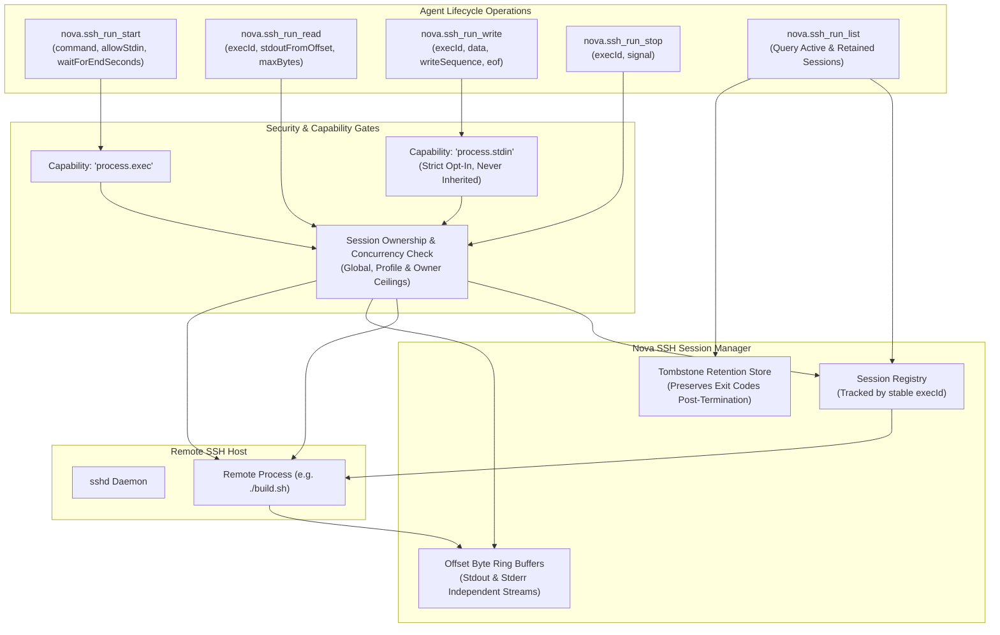
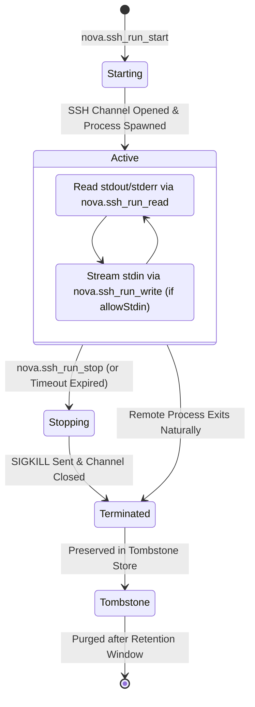
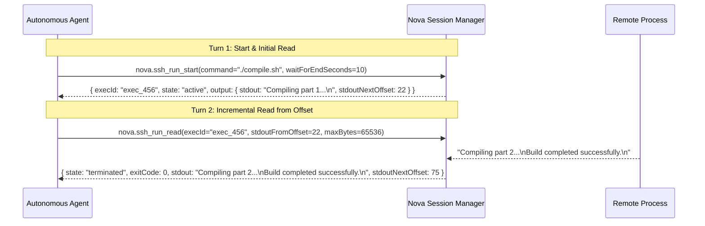

# Background SSH Sessions & Streaming I/O

For long-running tasks—such as software compilation, container builds, database migrations, or streaming logs—one-shot synchronous execution can cause tool call timeouts and block agent interaction. Nova's background SSH session subsystem decouples remote process lifecycle management from individual tool invocations, providing offset-based incremental stream consumption, interactive standard input injection, and reliable process termination.



---

## 1. Background Session Lifecycle

Managing a background execution proceeds through distinct lifecycle phases identified by an opaque, stable `execId`:



### Phase Summary
* **`starting`:** TCP connect, SSH handshake, and initial channel allocation.
* **`active`:** Process is running on the remote host; output streams accumulate in memory ring buffers.
* **`stopping`:** Termination initiated by agent (`nova.ssh_run_stop`) or timeout; Nova issues remote termination signals.
* **`terminated`:** Remote process has ended; final exit code and stream termination markers are committed.
* **`tombstone`:** Metadata preserved in `SshSessionTombstoneStore` so subsequent status checks or final log drains receive the exit report instead of `not_found`.

---

## 2. The Strict `process.stdin` Capability Gate

By default, background sessions run with standard input closed (`allowStdin: false`), preventing processes from blocking on unexpected prompts. 

When an agent explicitly requests interactive input capability via `allowStdin: true`:
1. **Strict Opt-In:** Nova enforces the **`process.stdin`** capability stage.
2. **Never Inherited:** `process.stdin` is intentionally separated from `process.exec` and `full`. Because an open stdin channel permits arbitrary command execution and interactive shell escape, it is never implicitly granted by general execution permissions.
3. **Immutability:** `allowStdin` is fixed at session launch and cannot be enabled retroactively.

---

## 3. Offset-Based Streaming Protocol (`nova.ssh_run_read`)

Rather than re-transmitting entire logs on every turn, `nova.ssh_run_read` operates an offset-based cursor model:



### Parameter Reference
* **`stdoutFromOffset` / `stderrFromOffset`:** Absolute byte offset in the respective stream. Passing the `stdoutNextOffset` from the previous response guarantees that every byte is received exactly once without duplication or gaps.
* **`maxBytes`:** Maximum bytes to return per stream this turn (default: 65,536 bytes; range 1 to 262,144 bytes).
* **`waitForEndSeconds` (Zero-Polling Optimization):** Allows an agent to wait up to 300 seconds for a process to terminate. If the command finishes within the deadline, the result returns immediately with the exit code. If it is still running, the call returns at the deadline with all accumulated output and `state: "active"`, avoiding busy-waiting polling loops.

---

## 4. Interactive Stdin Streaming (`nova.ssh_run_write`)

When a background session is created with `allowStdin: true`, agents stream input using `nova.ssh_run_write`:

```json
// nova.ssh_run_write
{
  "execId": "exec_456",
  "data": "yes\n",
  "writeSequence": 1,
  "eof": false
}
```

* **Monotonic Sequence (`writeSequence`):** A strictly increasing integer sequence number (`writeSequence: 1`, `2`, `3`). Nova verifies sequence continuity to prevent out-of-order writes or duplicate execution caused by network re-transmissions.
* **Half-Close EOF (`eof: true`):** When the agent finishes sending input, passing `eof: true` transmits an SSH EOF signal on the stdin channel, notifying the remote application that no further input is forthcoming.

---

## 5. Process Termination & Tombstone Retention

### Graceful & Forced Termination (`nova.ssh_run_stop`)
Agents can abort active sessions via `nova.ssh_run_stop`:
* **Signal Recording:** Passing `signal: "TERM"` or `"KILL"` records the intended signal. Nova transmits termination packets to ensure the remote process releases system resources.
* **Idempotency:** Repeating a stop request with the same `operationId` confirms termination without raising an error.

### Concurrency Ceilings & Tombstone Store
To prevent runaway background agents from exhausting server process limits, Nova enforces three concurrency tiers:
1. **Global Limit:** Maximum concurrent SSH sessions across the entire Nova instance.
2. **Profile Limit:** Maximum concurrent sessions per connector profile.
3. **Owner Limit:** Maximum concurrent sessions per workspace or task identity.
Terminated sessions are retained in `SshSessionTombstoneStore` for a post-termination grace period, ensuring agents can safely retrieve final exit codes and logs even after the remote process has exited.

---

## 6. Practical Agent Recipes

### Recipe 1: Long-Running Build with Smart Wait
```json
// Step 1: Launch build process with a 30-second initial wait window
// nova.ssh_run_start
{
  "profileId": "conn_prod_server",
  "command": "make release",
  "waitForEndSeconds": 30
}

// Step 2: If state is still 'active', wait for completion
// nova.ssh_run_read
{
  "execId": "exec_456",
  "stdoutFromOffset": 1024,
  "waitForEndSeconds": 60
}
```

### Recipe 2: Interactive Prompt Confirmation
```json
// Step 1: Start interactive installation
// nova.ssh_run_start
{
  "profileId": "conn_prod_server",
  "command": "./setup.sh",
  "allowStdin": true
}

// Step 2: Send confirmation and close stdin
// nova.ssh_run_write
{
  "execId": "exec_456",
  "data": "yes\n",
  "writeSequence": 1,
  "eof": true
}
```

---

## 7. Related Tools & Documentation

* [`nova.ssh_run_start` Tool Reference](../../../../mcp-reference/tools/connectors-and-mail/nova-ssh-run-start.md)
* [`nova.ssh_run_read` Tool Reference](../../../../mcp-reference/tools/connectors-and-mail/nova-ssh-run-read.md)
* [`nova.ssh_run_write` Tool Reference](../../../../mcp-reference/tools/connectors-and-mail/nova-ssh-run-write.md)
* [`nova.ssh_run_stop` Tool Reference](../../../../mcp-reference/tools/connectors-and-mail/nova-ssh-run-stop.md)
* [`nova.ssh_run_list` Tool Reference](../../../../mcp-reference/tools/connectors-and-mail/nova-ssh-run-list.md)
* [SSH Command Execution & Channels](../command-execution-and-channels/README.md)
* [Interactive PTY Terminals](../interactive-pty-terminals/README.md)
* [SSH Architecture Overview](../README.md)
