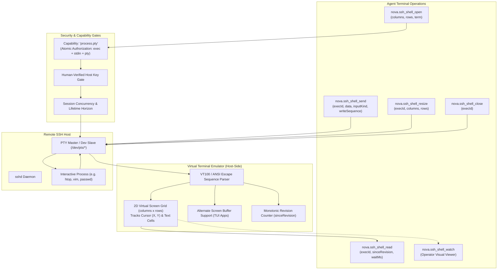

# Interactive PTY Terminals & Screen Reconstruction

Certain administrative and maintenance tasks—such as full-screen system monitors (`htop`), configuration editors (`nano`, `vim`), interactive database consoles, package installation menus, and `sudo` password prompts—require a real Unix pseudo-terminal (PTY) device. Nova's interactive shell subsystem allocates an RFC 4254 PTY on the remote server, maintains an in-memory virtual terminal screen emulator, and provides structured input and screen snapshots to autonomous agents.



---

## 1. Why a PTY Matters: PTY vs. Raw Exec Streams

Standard command execution (`nova.ssh_run`) pipes data over raw stdin/stdout streams:
* Programs like `top`, `vim`, or interactive prompts detect that stdout is not a TTY (via `isatty(1) == false`) and either abort, fail to render, or fall back to non-interactive modes.
* Shell escape codes, line editing (Ctrl-A, Backspace), and terminal window geometry are unavailable.

Nova's PTY subsystem allocates a dedicated **pseudo-terminal device** (`/dev/pts/*`) on the remote server:
1. **Full-Screen Terminal Applications (TUIs):** Supports curses-based applications, text editors, and terminal dashboards.
2. **Interactive Password & Confirmation Prompts:** Allows agents to interact with prompts that mandate a real TTY (such as `passwd` or interactive package managers).
3. **In-Memory Screen Reconstruction:** Instead of requiring agents to parse raw ANSI escape sequences and cursor movement sequences, Nova renders the terminal stream into a clean **2D text grid** representing the exact visible screen.

---

## 2. The `process.pty` Capability Gate

The pseudo-terminal is the most capable execution mode in Nova's SSH subsystem:
* **Atomic Grant:** Because a PTY session can spawn interactive shells, feed keystrokes, and navigate file systems, opening a terminal requires the **`process.pty`** capability. Granting `process.pty` atomically authorizes `process.exec` + `process.stdin` + `process.pty` in a single prompt.
* **Strict Opt-In:** `process.pty` is never implicitly inherited from weaker file-transfer (`read`, `full`) or one-shot execution (`process.exec`) permissions.
* **Unattended Restriction:** In unattended runs (e.g. background scheduled tasks), calling `nova.ssh_shell_open` without a prior persistent `always` grant fails closed immediately with error code `-32033` (`connector_approval_required`).

---

## 3. Terminal Screen Reconstruction (`nova.ssh_shell_read`)

When an agent invokes `nova.ssh_shell_read`, Nova returns the current state of the virtual screen grid:

```json
// nova.ssh_shell_read
{
  "execId": "ssh_pty_1024",
  "sinceRevision": 4,
  "waitMs": 1000
}
```

### Snapshot Structure
* **`rows`:** An array of plain text strings representing each row of the terminal from row 0 to `height - 1`. Trailing whitespace is trimmed for token efficiency.
* **`cursor`:** Active cursor coordinates `{ "x": 14, "y": 2 }` (0-indexed).
* **`alternateScreen`:** Boolean indicating whether the terminal is currently rendering in the alternate screen buffer (used by full-screen apps like `vim` or `less`).
* **`revision`:** A monotonic integer incremented whenever remote output modifies the virtual screen.
* **Differential Wait (`sinceRevision` & `waitMs`):** If an agent passes `sinceRevision: 4` and the screen has not updated, Nova waits up to `waitMs` (default: 1000 ms) for the remote process to repaint before returning `{ "unchanged": true }`.

---

## 4. Key & Input Dispatch (`nova.ssh_shell_send`)

Agents interact with the PTY using `nova.ssh_shell_send`, which supports four input encoding modes:

| `inputKind` | Purpose | Example Payload (`data`) | Description |
| :--- | :--- | :--- | :--- |
| **`key`** | Named Special Keys | `"Enter"`, `"Up"`, `"Down"`, `"Escape"`, `"Tab"`, `"Ctrl-C"`, `"Ctrl-D"` | Translates named keys into standard ANSI/VT100 byte sequences. |
| **`text`** | Normal Keystroke Typing | `"ls -la\n"` or `"config.yml"` | Sends standard UTF-8 characters as if typed by a human operator. |
| **`paste`** | Bracketed Paste Mode | `"multiline\nscript\ncontent"` | Wraps content in bracketed paste escapes (`\e[200~` and `\e[201~`) to prevent auto-indent mangling or accidental command execution in shells. |
| **`raw`** | Direct Escape Sequences | `"\u001b[A"` | Sends unencoded raw bytes directly to the PTY. |

### Sequential Ordering (`writeSequence`)
Every send call mandates a strictly increasing `writeSequence` integer (`1`, `2`, `3`). Nova verifies sequence order to guarantee that keystrokes and commands are dispatched in the exact intended sequence.

---

## 5. Dynamic Window Resizing (`nova.ssh_shell_resize`)

Terminal applications format their layout according to terminal width and height:

```json
// nova.ssh_shell_resize
{
  "execId": "ssh_pty_1024",
  "columns": 120,
  "rows": 40
}
```

* **RFC 4254 `window-change`:** Nova sends an SSH window change message to the server, which immediately fires a `SIGWINCH` signal to the remote process.
* **Dynamic Reflow:** Applications like `htop` or text editors instantly reflow their UI to fit the new dimensions.

---

## 6. Visual Operator Viewer (`nova.ssh_shell_watch`)

For collaborative human-agent debugging, an operator can view the agent's interactive terminal session live on the host desktop:
* Invoking `nova.ssh_shell_watch(execId="...", action="open")` opens a dedicated, read-only WinUI 3 desktop window showing the virtual terminal.
* The operator sees the agent's keystrokes, remote responses, and full-screen updates rendered in real time.
* Closing the viewer window does not terminate the underlying remote SSH session.

---

## 7. Session Lifetime & Concurrency Horizons

To prevent abandoned PTY sessions from leaking server resources:
1. **Idle Expiry:** Each session tracks an `idleExpiresAtUtc` timestamp. Every agent read or send resets the idle timer. If an agent stops interacting, the session is cleanly closed.
2. **Absolute Lifetime:** Sessions enforce an absolute hard ceiling from start, ensuring long-forgotten sessions are swept automatically.
3. **Concurrency Ceilings:** Global, profile, and owner limits prevent an agent from exhausting remote `pty` allocations.

---

## 8. Practical Agent Recipes

### Recipe 1: Launch an Interactive Shell & Run Commands
```json
// Step 1: Open interactive terminal session
// nova.ssh_shell_open
{
  "profileId": "conn_prod_server",
  "columns": 80,
  "rows": 24
}

// Step 2: Send command with Enter key
// nova.ssh_shell_send
{
  "execId": "ssh_pty_1024",
  "inputKind": "text",
  "data": "uptime\n",
  "writeSequence": 1
}

// Step 3: Read screen snapshot
// nova.ssh_shell_read
{
  "execId": "ssh_pty_1024",
  "waitMs": 1000
}

// Step 4: Close session
// nova.ssh_shell_close
{
  "execId": "ssh_pty_1024"
}
```

### Recipe 2: Handling Interactive Sudo or Password Prompts
```json
// Step 1: Trigger command requiring password
// nova.ssh_shell_send
{
  "execId": "ssh_pty_1024",
  "inputKind": "text",
  "data": "sudo apt update\n",
  "writeSequence": 1
}

// Step 2: Verify prompt appears on screen
// nova.ssh_shell_read
{
  "execId": "ssh_pty_1024",
  "waitMs": 1000
}

// Step 3: Inject password followed by Enter
// nova.ssh_shell_send
{
  "execId": "ssh_pty_1024",
  "inputKind": "text",
  "data": "secret_password\n",
  "writeSequence": 2
}
```

---

## 9. Related Tools & Documentation

* [`nova.ssh_shell_open` Tool Reference](../../../../mcp-reference/tools/connectors-and-mail/nova-ssh-shell-open.md)
* [`nova.ssh_shell_read` Tool Reference](../../../../mcp-reference/tools/connectors-and-mail/nova-ssh-shell-read.md)
* [`nova.ssh_shell_send` Tool Reference](../../../../mcp-reference/tools/connectors-and-mail/nova-ssh-shell-send.md)
* [`nova.ssh_shell_resize` Tool Reference](../../../../mcp-reference/tools/connectors-and-mail/nova-ssh-shell-resize.md)
* [`nova.ssh_shell_watch` Tool Reference](../../../../mcp-reference/tools/connectors-and-mail/nova-ssh-shell-watch.md)
* [`nova.ssh_shell_close` Tool Reference](../../../../mcp-reference/tools/connectors-and-mail/nova-ssh-shell-close.md)
* [`nova.ssh_shell_list` Tool Reference](../../../../mcp-reference/tools/connectors-and-mail/nova-ssh-shell-list.md)
* [SSH Command Execution & Channels](../command-execution-and-channels/README.md)
* [Background Sessions & Streaming I/O](../background-sessions-and-streaming/README.md)
* [SSH Architecture Overview](../README.md)
