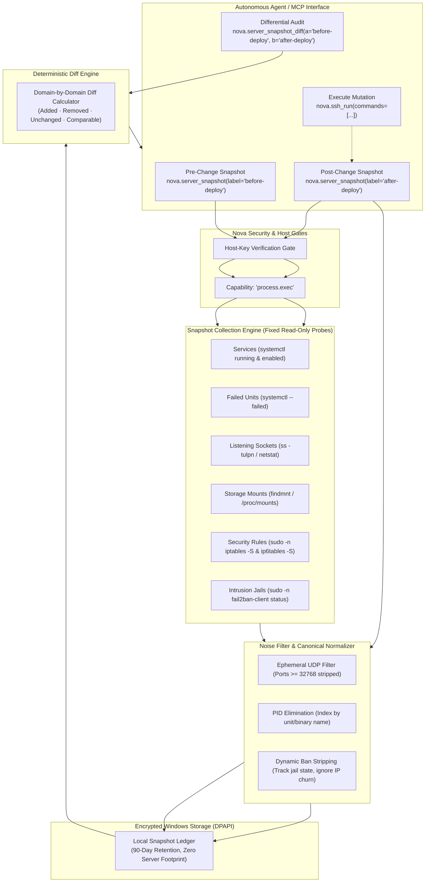
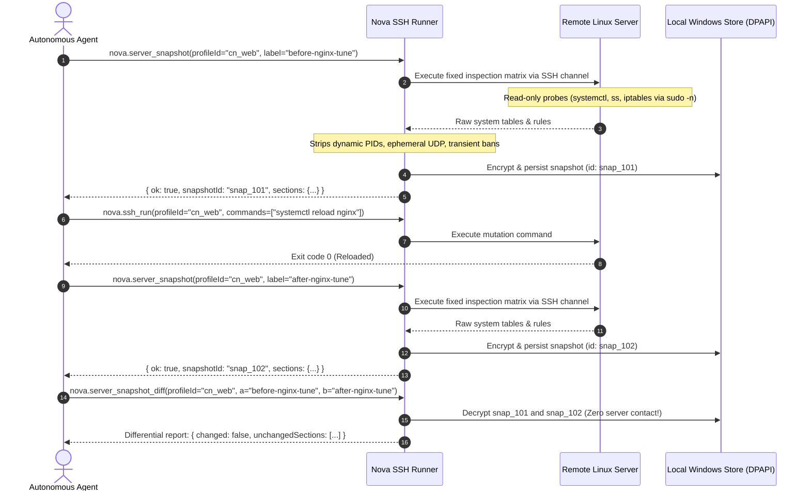
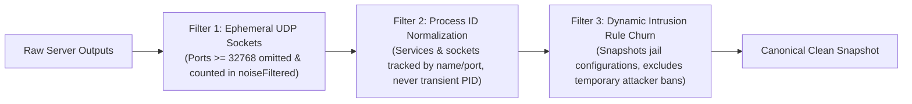
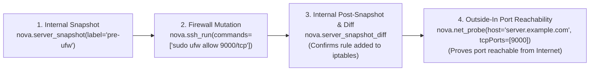

# Remote Server State Snapshots & Differential Auditing

> **Atomic pre- and post-change system inventory, running services, listening sockets, firewall rules, fail2ban jails, noise filtering, and differential verification over SSH.**

---

## 1. Overview & Architectural Vision

System administration, software deployments, and infrastructure modifications on remote Linux servers carry significant operational risk. Modifying firewall rules (`iptables`/`ufw`), upgrading packages, adjusting web server configurations, or restarting systemd services can inadvertently shut down listening ports, open unauthenticated services, break file mounts, or cause silent unit degradation.

Traditionally, autonomous agents verify remote changes either by running ad-hoc shell commands (`netstat`, `ps`, `systemctl`) or by assuming success if an exit code was zero. Both approaches are flawed:
* **Ad-hoc shell commands are noisy and brittle:** Command output formats change across distributions, and running multiple commands manually increases prompt overhead and introduces parsing hallucinations.
* **Exit codes mask side effects:** A deployment script might exit with code `0` while silently crashing an adjacent daemon or failing to bring up a background worker.
* **Manual diffing struggles with dynamic churn:** Ephemeral client sockets (such as dynamic DNS or NTP lookups) and transient process IDs produce false-positive diff alerts that confuse autonomous decision-making.

Nova AI Workspace provides a **Server State Snapshot & Differential Auditing Subsystem**. Built directly atop Nova's secure SSH execution pipeline, it allows agents to capture an atomic, read-only system snapshot before a change and compare it against a post-change snapshot to verify intended mutations and prove the absence of regressions.



---

## 2. The Verification Workflow: Before, Mutate, After, Diff

The standard operational cycle follows an atomic four-step verification pattern:



---

## 3. The Eight Inspected System Domains

Nova queries an immutable, fixed inspection matrix across eight operational domains. The agent **cannot supply custom commands** to `nova.server_snapshot`, guaranteeing that snapshots remain non-destructive and side-effect free:

| Domain Key | Inspection Scope | Underlying Linux Commands | Fail-Safe & Fallback Behavior |
| :--- | :--- | :--- | :--- |
| `services_running` | Active systemd system services | `systemctl list-units --type=service --state=running` | If systemd is absent (e.g., lightweight container or SysVinit), marked `state: "unavailable"`. |
| `services_enabled` | Services configured to start at boot | `systemctl list-unit-files --type=service --state=enabled` | Reports static boot targets. Marked `state: "unavailable"` if unit files cannot be queried. |
| `units_failed` | Systemd units in a degraded or failed state | `systemctl list-units --state=failed` | Critical regression canary: any new failed unit indicates an abnormal side effect. |
| `listening_tcp` | Active TCP server sockets and ports | `ss -tlpn` (fallback to `netstat -tlpn`) | Normalizes bound IP (`0.0.0.0`, `127.0.0.1`, `::`) and port numbers. |
| `listening_udp` | Bound UDP listening services | `ss -ulpn` (fallback to `netstat -ulpn`) | Ephemeral outbound client sockets are filtered out via the noise elimination engine. |
| `mounts` | Active filesystem mount points and flags | `findmnt -rno TARGET,SOURCE,FSTYPE,OPTIONS` | Detects unexpected read-only remounts (`ro`), missing storage partitions, or unmounted network shares. |
| `fail2ban_jails` | Active intrusion prevention jails | `sudo -n fail2ban-client status` | Uses `sudo -n` (non-interactive). If passwordless sudo is unavailable, marked `state: "unavailable"`. |
| `iptables` / `ip6tables` | Packet filtering chains and active rules | `sudo -n iptables -S` / `sudo -n ip6tables -S` | Captures rule chains verbatim. Requires passwordless sudo; marked `unavailable` on unprivileged accounts. |

---

## 4. Noise Elimination & Comparability Invariants

Raw textual diffing on Linux operating systems produces excessive false positives. Nova applies three deterministic normalizations before persisting any snapshot:



### 1. Ephemeral UDP Port Filtering

Linux allocates ephemeral UDP ports (typically in the range $32768$–$60999$) for outgoing DNS queries, NTP time synchronizations, and syslog transmissions. Because these port numbers rotate continuously without administrator intervention, including them would cause every diff to report false-positive additions and removals.
* Nova strips all listening UDP sockets in the ephemeral range ($\ge 32768$).
* The number of filtered ephemeral entries is reported in `sections.listening_udp.noiseFiltered`.

### 2. PID Decoupling

Processes frequently restart with new Process IDs (PIDs) during routine maintenance. Nova indexes listening sockets and active units by binary path, service unit name, and binding port, strictly excluding transient PIDs from the comparison hash.

### 3. Fail2ban Dynamic Ban Churn

In production, Fail2ban continuously adds and removes temporary IP bans. Nova inspects the list of active monitored jails (`jail_list`) rather than transient per-IP ban chains, preventing external internet scanning activity from polluting deployment diffs.

### 4. The Comparability Invariant (`comparable: false`)

> [!IMPORTANT]
> **Unavailable is NOT Empty:**
> If a server inspection command fails (for example, if `fail2ban` is not installed or `sudo -n` is rejected due to missing privileges), Nova records `state: "unavailable"` with the command's exit code and error string.
>
> When diffing, if either snapshot marks a domain as `unavailable`, Nova sets `comparable: false`. This invariant prevents a dangerous false positive where losing sudo access would otherwise make it appear that all firewall rules had been deleted.

---

## 5. Differential Auditing Mechanics (`nova.server_snapshot_diff`)

The differential engine evaluates two stored snapshots entirely on the local Windows machine without opening remote network connections or contacting the server:

```json
{
  "name": "nova_server_snapshot_diff",
  "arguments": {
    "profileId": "cn_c0ffee1234",
    "a": "before-deploy",
    "b": "after-deploy"
  }
}
```

### Structured Diff Schema

The response delivers a structured assessment of changes across all domains:

```json
{
  "structuredContent": {
    "ok": true,
    "a": {
      "id": "snap_3f9a1c07be",
      "label": "before-deploy",
      "takenAt": "2026-10-31T12:00:00+00:00"
    },
    "b": {
      "id": "snap_81d2e0aa45",
      "label": "after-deploy",
      "takenAt": "2026-10-31T12:06:10+00:00"
    },
    "changed": true,
    "sections": {
      "listening_tcp": {
        "stateA": "ok",
        "stateB": "ok",
        "comparable": true,
        "added": ["0.0.0.0:8443 (nginx)"],
        "removed": ["0.0.0.0:8080 (nginx)"],
        "addedCount": 1,
        "removedCount": 1,
        "truncated": false
      },
      "units_failed": {
        "stateA": "ok",
        "stateB": "ok",
        "comparable": true,
        "added": [],
        "removed": [],
        "addedCount": 0,
        "removedCount": 0,
        "truncated": false
      }
    },
    "unchangedSections": [
      "services_running",
      "services_enabled",
      "listening_udp",
      "mounts",
      "fail2ban_jails",
      "iptables",
      "ip6tables"
    ],
    "remoteOutputTrust": "untrusted_remote_output"
  }
}
```

* **`changed`:** Boolean flag indicating whether any comparable section experienced additions or removals.
* **`unchangedSections`:** Array of domain names that remained byte-for-byte identical, allowing agents to confirm zero regression across unaffected services at a glance.
* **`remoteOutputTrust: "untrusted_remote_output"`:** Reminds agents that remote system strings must be treated as untrusted data rather than prompt instructions.

---

## 6. Operational Recipes for Autonomous Agents

### Recipe 1: Pre/Post Package Upgrade Verification

```python
# 1. Establish pre-change baseline
pre = nova.server_snapshot(profileId="cn_prod", label="pre-apt-upgrade")

# 2. Execute maintenance
nova.ssh_run(
    profileId="cn_prod",
    commands=["sudo apt-get update", "sudo apt-get --only-upgrade install nginx -y"],
    stopOnError=True
)

# 3. Capture post-change baseline
post = nova.server_snapshot(profileId="cn_prod", label="post-apt-upgrade")

# 4. Evaluate diff
diff = nova.server_snapshot_diff(profileId="cn_prod", a="pre-apt-upgrade", b="post-apt-upgrade")

# Verify: No newly failed units
assert len(diff["sections"].get("units_failed", {}).get("added", [])) == 0, "Regressions detected in systemd units!"
```

### Recipe 2: Firewall Modification & Port Exposure Verification

When altering firewall rules (`ufw` / `iptables`), verify both the internal rule state and the external network perspective:



1. Capture internal baseline: `nova.server_snapshot(profileId=conn, label="pre-ufw")`.
2. Apply firewall adjustment: `nova.ssh_run(profileId=conn, commands=["sudo ufw allow 9000/tcp"])`.
3. Compute internal diff: `nova.server_snapshot_diff(profileId=conn, a="pre-ufw", b="post-ufw")`.
4. Perform outside-in reachability check: [`nova.net_probe`](../../../network/path-diagnostics-and-probing/README.md) verifies whether port $9000$ is accessible across public network boundaries (`host="server.example.com", tcpPorts=[9000]`).

---

## 7. Storage, Retention & Security Policies

* **Zero Server Footprint:** Snapshots are strictly stored on the client workstation in Nova's local application data directory. No state files, temporary logs, or inspection artifacts are written to the remote server.
* **Cryptographic Protection (DPAPI):** Stored snapshots are encrypted using the Windows Data Protection API (DPAPI) keyed to the active Windows user account.
* **Automatic Retention Window:** Snapshots carry a default retention window of **90 days**, after which expired snapshots are automatically purged during startup reconciliation.
* **Semantic Label Resolution:** When diffing by label (`label="before-change"`), Nova automatically selects the most recent snapshot matching that label, enabling standardized scripts to execute repeatedly without maintaining hardcoded snapshot IDs.

---

## 8. Tool Reference Matrix

| Tool Name | Capability Required | Risk Category | Primary Purpose | Key Parameters |
| :--- | :--- | :---: | :--- | :--- |
| [`nova.server_snapshot`](../../../../mcp-reference/tools/connectors-and-mail/nova-server-snapshot.md) | `process.exec` | `normal` | Captures read-only system inventory (services, sockets, mounts, firewall). | `profileId` (required)<br>`label` (optional, $\le 64$ chars) |
| [`nova.server_snapshot_diff`](../../../../mcp-reference/tools/connectors-and-mail/nova-server-snapshot-diff.md) | None (Local execution) | `safe` | Computes structured diff between two snapshots on the client machine. | `profileId` (required)<br>`a` (required ID/label)<br>`b` (required ID/label)<br>`maxItems` (optional, default: 100) |

---

## 9. Related Documentation

* [Secure Shell (SSH) Execution Architecture](../README.md) — Channel isolation, background processes, and interactive PTY terminals.
* [Database Management (MySQL & MariaDB over SSH)](../../database/README.md) — Isolated SQL execution and verified server-side dumps.
* [Network Probing & Path Diagnostics](../../../network/path-diagnostics-and-probing/README.md) — Outside-in TCP/UDP port accessibility auditing via `nova.net_probe`.
* [Connectors Subsystem Architecture](../../README.md) — Unified connector capability model and DPAPI credential isolation.
* [User Guide: Remote Connectors & SSH](../../../../user-guide/tools/connectors.md) — Desktop UI instructions for managing remote connections.

[Connectors overview](../../README.md) · [SSH overview](../README.md) · [All core features](../../../README.md)
