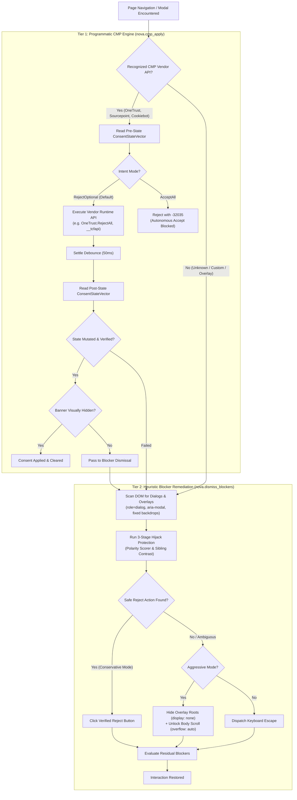

# Consent Management & Blocker Clearance

> [!IMPORTANT]
> Autonomous agents navigating the modern web face a constant obstacle: cookie consent banners, Consent Management Platform (CMP) dialogs, newsletter popups, and translucent click-intercepting backdrops. Naive UI-clicking frequently falls victim to dark patterns, cross-origin iframe boundaries, and hijacked buttons. Nova AI Workspace solves this with a **two-tier architecture**: programmatic vendor API dispatch via `nova.cmp_apply` backed by ground-truth state verification, and intelligent heuristic remediation via `nova.dismiss_blockers`.

---

## 1. Overview & Architectural Philosophy

When an autonomous agent interacts with a web page, modal banners and cookie walls introduce three critical failure modes:

1. **Click Hijacking & Dark Patterns:** Websites deliberately disguise acceptance buttons, use deceptive phrasing (such as *"Reject only essential cookies and continue"*), or style the *"Accept All"* button with high visual contrast while hiding *"Reject All"* inside nested accordions.
2. **Cross-Origin Iframe Boundaries:** Enterprise CMPs frequently render their UI inside third-party iframes (such as Sourcepoint TCF v2). Standard DOM queries executed in the top frame fail to reach these elements, while unconstrained cross-frame clicking introduces security and injection risks.
3. **State Mutation vs. Visual Dismissal:** Closing a modal visually (via DOM deletion or CSS hiding) does not register a legal consent choice. Many websites halt script loading or withhold core page functionality until a valid consent signal is emitted through the vendor's JavaScript runtime API.

Nova's architecture decouples **privacy policy application** from **visual DOM remediation**:



---

## 2. The Two-Tier Clearance Model

Nova divides consent and overlay handling into two distinct MCP tools, each designed for a specific layer of the browser stack:

| Dimension | Tier 1: Programmatic CMP Engine | Tier 2: Heuristic Blocker Remediation |
| :--- | :--- | :--- |
| **Primary MCP Tool** | [`nova.cmp_apply`](../../mcp-reference/tools/guarded-actions/nova-cmp-apply.md) | [`nova.dismiss_blockers`](../../mcp-reference/tools/guarded-actions/nova-dismiss-blockers.md) |
| **Execution Layer** | Vendor JavaScript runtime APIs (`window.OneTrust`, `__tcfapi`, `window.Cookiebot`) | DOM tree traversal, CSS styling overrides, synthetic click/key dispatch |
| **Vendor Scope** | Standardized Enterprise CMPs (OneTrust, Sourcepoint / TCF v2, Cookiebot) | Universal: custom cookie walls, newsletter modals, age gates, backdrops |
| **Ground-Truth Verification** | Yes: captures cryptographic TC strings, vendor group states, and purpose flags | Visual & structural: checks whether elements still intercept pointer events |
| **Dark Pattern Resilience** | Complete: bypasses DOM UI entirely via direct runtime method calls | Algorithmic: 3-stage polarity scoring and sibling contrast classification |
| **DOM Side Effects** | Zero DOM mutation: vendor scripts manage their own banner teardown | Controlled DOM mutation: element removal, `display: none`, scroll restoration |

---

## 3. Subsystem Architecture

The consent and blocker subsystem comprises three specialized architectural areas:

| Subsystem Guide | Scope & Key Concepts | Primary Components |
| :--- | :--- | :--- |
| **[Programmatic CMP Engine](cmp-engine/README.md)** | Ordered adapter detection pipeline, vendor runtime protocols (Sourcepoint TCF v2, Cookiebot, OneTrust), typed `ConsentIntent`, `ConsentStateVector` pre/post verification, and autonomous `AcceptAll` safety gates. | `CmpAdapterRegistry`<br>`ConsentIntent`<br>`ConsentStateVector`<br>`SourcepointAdapter`<br>`OneTrustAdapter`<br>`CookiebotAdapter` |
| **[Hijack & Dark Pattern Defense](hijack-protection/README.md)** | 3-stage defense-in-depth: pre-click polarity scoring (5 European languages), sibling contrast classification, outcome vector verification, and privileged cross-origin iframe security boundaries. | `CmpPolarityScorer`<br>`CmpSiblingContrastClassifier`<br>`CmpIndicatorTokens`<br>`PrivilegedCrossOriginCmpInteractionEnabled` |
| **[Blocker & Overlay Remediation](blocker-dismissal/README.md)** | Active heuristic remediation, conservative vs. aggressive modes, synthetic Escape key injection, automated `overflow: hidden` body scroll restoration, and guarded click integration. | `nova.dismiss_blockers`<br>`BlockerKindClassifier`<br>`CmpDismissBlockersHijackAssessment`<br>`autoDismissBlockers` |

---

## 4. Operational Decision Matrix for Agents

When designing autonomous browser navigation workflows, agents should follow this deterministic sequence:

1. **Step 1: Check for Known CMP via `nova.cmp_apply`**
   ```json
   {
     "targetId": "tab-101",
     "mode": "auto",
     "intent": { "mode": "RejectOptional" }
   }
   ```
   * If `status: "ok"` and `verified: true`: The consent policy is legally registered in the vendor's engine. If `bannerVisuallyHidden: true`, proceed immediately to browsing.
   * If `status: "ok"` but `bannerVisuallyHidden: false`: The consent state was updated, but the banner DOM remains rendered. Call `nova.dismiss_blockers` to clean up the residual UI.
2. **Step 2: Fall Back on `failureCode: "no_adapter"`**
   If `nova.cmp_apply` returns `failureCode: "no_adapter"`, the website uses a custom or unsupported consent mechanism. Immediately escalate to:
   ```json
   {
     "targetId": "tab-101",
     "mode": "conservative"
   }
   ```
3. **Step 3: Escalate to Aggressive Mode if Pointer Events Remain Intercepted**
   If `blocked: true` persists after conservative dismissal (often caused by stubborn backdrops or newsletter overlays):
   ```json
   {
     "targetId": "tab-101",
     "mode": "aggressive",
     "maxPasses": 3
   }
   ```
4. **Step 4: Leverage Guarded Click Automation**
   For standard interactions, manual blocker clearance is rarely necessary. Passing `autoDismissBlockers: true` to [`nova.click_selector`](../../mcp-reference/tools/browser-automation/nova-click-selector.md) enables automatic on-demand blocker dismissal whenever a backdrop intercepts a click.

---

## Related Documentation

* [Programmatic CMP Engine Architecture](cmp-engine/README.md)
* [3-Stage Hijack & Dark Pattern Defense](hijack-protection/README.md)
* [Blocker & Overlay Remediation](blocker-dismissal/README.md)
* [Agent Awareness Gates (AAG)](../agent-awareness-gates-aag/README.md)
* [Closed-Loop System (CLS)](../closed-loop-system-cls/README.md)
* [Tool Catalog: Guarded Actions & Blocker Clearance](../../mcp-reference/tools/guarded-actions/README.md)
